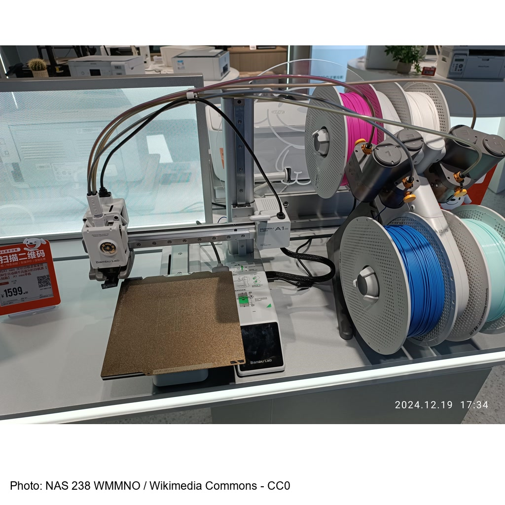

<!-- oomp-documentation:start -->
# OOMP 3D printer catalogue

## Summary

[Browse the taxonomy](navigation/README.md) · [Original Ender-3 parts by category](navigation/part/creality_ender_3/README.md)

Find a printer by model, a spool by material and shade, or a part by its name, location or manufacturer code.

Bambu Lab A1 mini on the left and AMS lite with four spools on the right. [JD Mall Electronics Showroom, 3D printers, December 2024 (R12S 06)](https://commons.wikimedia.org/wiki/File:DG_%E6%9D%B1%E8%8E%9E_DongGuan_%E5%8D%97%E5%9F%8E%E5%8D%80_Nancheng_%E9%B4%BB%E7%A6%8F%E8%B7%AF_HongFu_Road_%E6%9D%B1%E8%8E%9E%E4%BA%AC%E6%9D%B1%E5%95%86%E5%A0%B4_JD_Mall_Electronics_Showroom_3D_printers_December_2024_R12S_06.jpg) by NAS 238 WMMNO. [CC0 1.0](https://creativecommons.org/publicdomain/zero/1.0/). Resized within a square white canvas and credited on the image.

## Details

[OOMP v5 directory](https://github.com/oomlout/oomlout_oomp_version_5) · [Generator and taxonomy slots](README_GENERATOR.md) · [Printer parts taxonomy](PARTS_TAXONOMY.md) · [Research queue and handoff prompt](HANDOFF.md)

## Parts

### Printers

| Record | Coverage |
| --- | --- |
| [Anycubic Chiron](parts/three_d_printer_printer_anycubic_chiron/) | Starter record |
| [Anycubic Vyper](parts/three_d_printer_printer_anycubic_vyper/) | Starter record |
| [Bambu Lab A1](parts/three_d_printer_printer_bambu_lab_a1/) | Starter record |
| [Bambu Lab A1 mini](parts/three_d_printer_printer_bambu_lab_a1_mini/) | Worked example |
| [Bambu Lab P1P](parts/three_d_printer_printer_bambu_lab_p1p/) | Starter record |
| [Bambu Lab P1S](parts/three_d_printer_printer_bambu_lab_p1s/) | Worked example |
| [Creality Ender-3](parts/three_d_printer_printer_creality_ender_3/) | Starter record |
| [Creality Ender-3 E](parts/three_d_printer_printer_creality_ender_3_e/) | Starter record |
| [Creality Ender-3 Max](parts/three_d_printer_printer_creality_ender_3_max/) | Starter record |
| [Creality Ender-3 Max Neo](parts/three_d_printer_printer_creality_ender_3_max_neo/) | Starter record |
| [Creality Ender-3 Neo](parts/three_d_printer_printer_creality_ender_3_neo/) | Starter record |
| [Creality Ender-3 Pro](parts/three_d_printer_printer_creality_ender_3_pro/) | Starter record |
| [Creality Ender-3 S1](parts/three_d_printer_printer_creality_ender_3_s1/) | Starter record |
| [Creality Ender-3 S1 Plus](parts/three_d_printer_printer_creality_ender_3_s1_plus/) | Starter record |
| [Creality Ender-3 S1 Pro](parts/three_d_printer_printer_creality_ender_3_s1_pro/) | Starter record |
| [Creality Ender-3 V2](parts/three_d_printer_printer_creality_ender_3_v2/) | Starter record |
| [Creality Ender-3 V2 Neo](parts/three_d_printer_printer_creality_ender_3_v2_neo/) | Starter record |
| [Creality Ender-3 V3](parts/three_d_printer_printer_creality_ender_3_v3/) | Starter record |
| [Creality Ender-3 V3 KE](parts/three_d_printer_printer_creality_ender_3_v3_ke/) | Starter record |
| [Creality Ender-3 V3 Mega](parts/three_d_printer_printer_creality_ender_3_v3_mega/) | Starter record |
| [Creality Ender-3 V3 Neo](parts/three_d_printer_printer_creality_ender_3_v3_neo/) | Starter record |
| [Creality Ender-3 V3 Plus](parts/three_d_printer_printer_creality_ender_3_v3_plus/) | Starter record |
| [Creality Ender-3 V3 SE](parts/three_d_printer_printer_creality_ender_3_v3_se/) | Starter record |
| [Creality Ender-3 V4](parts/three_d_printer_printer_creality_ender_3_v4/) | Starter record |

### Filament

| Record | Coverage |
| --- | --- |
| [SUNLU PETG Beige(Skin), 1 kg with spool](parts/three_d_printer_filament_petg_1_75_mm_beige_beige_skin_sunlu_dlz_us_sl_petg_sk_1kg/) | Starter record |
| [Bambu Lab PETG Basic Dark Beige, 1 kg with spool](parts/three_d_printer_filament_petg_1_75_mm_beige_dark_beige_bambu_lab_g00_y01_1_75_1000_spl/) | Starter record |
| [Bambu Lab PETG Basic Dark Beige, 1 kg refill](parts/three_d_printer_filament_petg_1_75_mm_beige_dark_beige_bambu_lab_g00_y01_1_75_1000_splfree/) | Starter record |
| [Bambu Lab PETG Basic Black, 1 kg with spool](parts/three_d_printer_filament_petg_1_75_mm_black_black_bambu_lab_g00_k00_1_75_1000_spl/) | Starter record |
| [Bambu Lab PETG Basic Black, 1 kg refill](parts/three_d_printer_filament_petg_1_75_mm_black_black_bambu_lab_g00_k00_1_75_1000_splfree/) | Starter record |
| [SUNLU PETG Black, 1 kg with spool](parts/three_d_printer_filament_petg_1_75_mm_black_black_sunlu_dlz_us_sl_petg_bk_1kg/) | Starter record |
| [SUNLU PETG Blue(Klein Blue), 1 kg with spool](parts/three_d_printer_filament_petg_1_75_mm_blue_blue_klein_blue_sunlu_dlz_us_sl_petg_bl_1kg/) | Starter record |
| [SUNLU PETG Cyan, 1 kg with spool](parts/three_d_printer_filament_petg_1_75_mm_blue_cyan_sunlu_dlz_us_sl_petg_cy_1kg/) | Starter record |
| [Bambu Lab PETG Basic Misty Blue, 1 kg with spool](parts/three_d_printer_filament_petg_1_75_mm_blue_misty_blue_bambu_lab_g00_d01_1_75_1000_spl/) | Starter record |
| [Bambu Lab PETG Basic Misty Blue, 1 kg refill](parts/three_d_printer_filament_petg_1_75_mm_blue_misty_blue_bambu_lab_g00_d01_1_75_1000_splfree/) | Starter record |
| [Bambu Lab PETG Basic Navy Blue, 1 kg with spool](parts/three_d_printer_filament_petg_1_75_mm_blue_navy_blue_bambu_lab_g00_b01_1_75_1000_spl/) | Starter record |
| [Bambu Lab PETG Basic Navy Blue, 1 kg refill](parts/three_d_printer_filament_petg_1_75_mm_blue_navy_blue_bambu_lab_g00_b01_1_75_1000_splfree/) | Starter record |
| [Bambu Lab PETG Basic Reflex Blue, 1 kg with spool](parts/three_d_printer_filament_petg_1_75_mm_blue_reflex_blue_bambu_lab_g00_b00_1_75_1000_spl/) | Starter record |
| [Bambu Lab PETG Basic Reflex Blue, 1 kg refill](parts/three_d_printer_filament_petg_1_75_mm_blue_reflex_blue_bambu_lab_g00_b00_1_75_1000_splfree/) | Starter record |
| [SUNLU PETG Sky Blue, 1 kg with spool](parts/three_d_printer_filament_petg_1_75_mm_blue_sky_blue_sunlu_dlz_us_sl_petg_sb_1kg/) | Starter record |
| [Polymaker PolyLite PETG Translucent Blue](parts/three_d_printer_filament_petg_1_75_mm_blue_translucent_blue_polymaker_pb01032/) | Worked example |
| [SUNLU PETG Transparent Blue, 1 kg with spool](parts/three_d_printer_filament_petg_1_75_mm_blue_transparent_blue_sunlu_dlz_us_sl_petg_tpbl_1kg/) | Starter record |
| [SUNLU PETG Chocolate, 1 kg with spool](parts/three_d_printer_filament_petg_1_75_mm_brown_chocolate_sunlu_dlz_us_sl_petg_cc_1kg/) | Starter record |
| [SUNLU PETG Coffee Brown, 1 kg with spool](parts/three_d_printer_filament_petg_1_75_mm_brown_coffee_brown_sunlu_dlz_us_sl_petg_cbn_1kg/) | Starter record |
| [Bambu Lab PETG Basic Dark Brown, 1 kg with spool](parts/three_d_printer_filament_petg_1_75_mm_brown_dark_brown_bambu_lab_g00_n00_1_75_1000_spl/) | Starter record |
| [Bambu Lab PETG Basic Dark Brown, 1 kg refill](parts/three_d_printer_filament_petg_1_75_mm_brown_dark_brown_bambu_lab_g00_n00_1_75_1000_splfree/) | Starter record |
| [SUNLU PETG Oak(Wood), 1 kg with spool](parts/three_d_printer_filament_petg_1_75_mm_brown_oak_wood_sunlu_dlz_us_sl_petg_ok_1kg/) | Starter record |
| [SUNLU PETG Roasted Chestnut, 1 kg with spool](parts/three_d_printer_filament_petg_1_75_mm_brown_roasted_chestnut_sunlu_dlz_us_sl_petg_rcn_1kg/) | Starter record |
| [SUNLU PETG Clear(Transparent), 1 kg with spool](parts/three_d_printer_filament_petg_1_75_mm_clear_clear_transparent_sunlu_dlz_us_sl_petg_tp_1kg/) | Starter record |
| [Bambu Lab PETG Basic Green, 1 kg with spool](parts/three_d_printer_filament_petg_1_75_mm_green_green_bambu_lab_g00_g00_1_75_1000_spl/) | Starter record |
| [Bambu Lab PETG Basic Green, 1 kg refill](parts/three_d_printer_filament_petg_1_75_mm_green_green_bambu_lab_g00_g00_1_75_1000_splfree/) | Starter record |
| [SUNLU PETG Green, 1 kg with spool](parts/three_d_printer_filament_petg_1_75_mm_green_green_sunlu_dlz_us_sl_petg_gn_1kg/) | Starter record |
| [SUNLU PETG Mint Green, 1 kg with spool](parts/three_d_printer_filament_petg_1_75_mm_green_mint_green_sunlu_dlz_us_sl_petg_mg_1kg/) | Starter record |
| [SUNLU PETG Oliver Green, 1 kg with spool](parts/three_d_printer_filament_petg_1_75_mm_green_oliver_green_sunlu_dlz_us_sl_petg_og_1kg/) | Starter record |
| [Bambu Lab PETG Basic Pine Green, 1 kg with spool](parts/three_d_printer_filament_petg_1_75_mm_green_pine_green_bambu_lab_g00_g01_1_75_1000_spl/) | Starter record |
| [Bambu Lab PETG Basic Pine Green, 1 kg refill](parts/three_d_printer_filament_petg_1_75_mm_green_pine_green_bambu_lab_g00_g01_1_75_1000_splfree/) | Starter record |
| [SUNLU PETG Transparent Green, 1 kg with spool](parts/three_d_printer_filament_petg_1_75_mm_green_transparent_green_sunlu_dlz_us_sl_petg_tpgn_1kg/) | Starter record |
| [Bambu Lab PETG Basic Gray, 1 kg with spool](parts/three_d_printer_filament_petg_1_75_mm_grey_gray_bambu_lab_g00_d00_1_75_1000_spl/) | Starter record |
| [Bambu Lab PETG Basic Gray, 1 kg refill](parts/three_d_printer_filament_petg_1_75_mm_grey_gray_bambu_lab_g00_d00_1_75_1000_splfree/) | Starter record |
| [SUNLU PETG Grey, 1 kg with spool](parts/three_d_printer_filament_petg_1_75_mm_grey_grey_sunlu_dlz_us_sl_petg_gy_1kg/) | Starter record |
| [Bambu Lab PETG Basic Orange, 1 kg with spool](parts/three_d_printer_filament_petg_1_75_mm_orange_orange_bambu_lab_g00_a00_1_75_1000_spl/) | Starter record |
| [Bambu Lab PETG Basic Orange, 1 kg refill](parts/three_d_printer_filament_petg_1_75_mm_orange_orange_bambu_lab_g00_a00_1_75_1000_splfree/) | Starter record |
| [SUNLU PETG Orange, 1 kg with spool](parts/three_d_printer_filament_petg_1_75_mm_orange_orange_sunlu_dlz_us_sl_petg_or_1kg/) | Starter record |
| [SUNLU PETG Sunny Orange, 1 kg with spool](parts/three_d_printer_filament_petg_1_75_mm_orange_sunny_orange_sunlu_dlz_us_sl_petg_so_1kg/) | Starter record |
| [SUNLU PETG Transparent Orange, 1 kg with spool](parts/three_d_printer_filament_petg_1_75_mm_orange_transparent_orange_sunlu_dlz_us_sl_petg_tpor_1kg/) | Starter record |
| [SUNLU PETG Magenta, 1 kg with spool](parts/three_d_printer_filament_petg_1_75_mm_pink_magenta_sunlu_dlz_us_sl_petg_mag_1kg/) | Starter record |
| [SUNLU PETG Sakura Pink, 1 kg with spool](parts/three_d_printer_filament_petg_1_75_mm_pink_sakura_pink_sunlu_dlz_us_sl_petg_sp_1kg/) | Starter record |
| [SUNLU PETG Cherry Red, 1 kg with spool](parts/three_d_printer_filament_petg_1_75_mm_red_cherry_red_sunlu_dlz_us_sl_petg_cr_1kg/) | Starter record |
| [Bambu Lab PETG Basic Red, 1 kg with spool](parts/three_d_printer_filament_petg_1_75_mm_red_red_bambu_lab_g00_r00_1_75_1000_spl/) | Starter record |
| [Bambu Lab PETG Basic Red, 1 kg refill](parts/three_d_printer_filament_petg_1_75_mm_red_red_bambu_lab_g00_r00_1_75_1000_splfree/) | Starter record |
| [SUNLU PETG Red, 1 kg with spool](parts/three_d_printer_filament_petg_1_75_mm_red_red_sunlu_dlz_us_sl_petg_rd_1kg/) | Starter record |
| [SUNLU PETG Transparent Red, 1 kg with spool](parts/three_d_printer_filament_petg_1_75_mm_red_transparent_red_sunlu_dlz_us_sl_petg_tprd_1kg/) | Starter record |
| [SUNLU PETG Lavender Purple(Purple), 1 kg with spool](parts/three_d_printer_filament_petg_1_75_mm_violet_lavender_purple_purple_sunlu_dlz_us_sl_petg_lp_1kg/) | Starter record |
| [SUNLU PETG Transparent Purple, 1 kg with spool](parts/three_d_printer_filament_petg_1_75_mm_violet_transparent_purple_sunlu_dlz_us_sl_petg_tppp_1kg/) | Starter record |
| [SUNLU PETG Bone White, 1 kg with spool](parts/three_d_printer_filament_petg_1_75_mm_white_bone_white_sunlu_dlz_us_sl_petg_bwt_1kg/) | Starter record |
| [SUNLU PETG Ceramic White, 1 kg with spool](parts/three_d_printer_filament_petg_1_75_mm_white_ceramic_white_sunlu_dlz_us_sl_petg_cw_1kg/) | Starter record |
| [Bambu Lab PETG Basic White, 1 kg with spool](parts/three_d_printer_filament_petg_1_75_mm_white_white_bambu_lab_g00_w00_1_75_1000_spl/) | Starter record |
| [Bambu Lab PETG Basic White, 1 kg refill](parts/three_d_printer_filament_petg_1_75_mm_white_white_bambu_lab_g00_w00_1_75_1000_splfree/) | Starter record |
| [SUNLU PETG White, 1 kg with spool](parts/three_d_printer_filament_petg_1_75_mm_white_white_sunlu_dlz_us_sl_petg_wt_1kg/) | Starter record |
| [SUNLU PETG Lemon Yellow, 1 kg with spool](parts/three_d_printer_filament_petg_1_75_mm_yellow_lemon_yellow_sunlu_dlz_us_sl_petg_ly_1kg/) | Starter record |
| [SUNLU PETG Transparent Yellow, 1 kg with spool](parts/three_d_printer_filament_petg_1_75_mm_yellow_transparent_yellow_sunlu_dlz_us_sl_petg_tpyl_1kg/) | Starter record |
| [SUNLU PETG Vivid yellow, 1 kg with spool](parts/three_d_printer_filament_petg_1_75_mm_yellow_vivid_yellow_sunlu_dlz_us_sl_petg_vy_1kg/) | Starter record |
| [Bambu Lab PETG Basic Yellow, 1 kg with spool](parts/three_d_printer_filament_petg_1_75_mm_yellow_yellow_bambu_lab_g00_y00_1_75_1000_spl/) | Starter record |
| [Bambu Lab PETG Basic Yellow, 1 kg refill](parts/three_d_printer_filament_petg_1_75_mm_yellow_yellow_bambu_lab_g00_y00_1_75_1000_splfree/) | Starter record |
| [SUNLU PETG Yellow, 1 kg with spool](parts/three_d_printer_filament_petg_1_75_mm_yellow_yellow_sunlu_dlz_us_sl_petg_yl_1kg/) | Starter record |
| [PLA Basic Beige, 1 kg refill](parts/three_d_printer_filament_pla_1_75_mm_beige_beige_bambu_lab_a00_p0_1_75_1000_splfree/) | Starter record |
| [SUNLU PLA Skin(Beige), 1 kg with spool](parts/three_d_printer_filament_pla_1_75_mm_beige_skin_beige_sunlu_dlz_us_sl_pla_sk_1kg/) | Starter record |
| [PLA Basic Black, 1 kg with spool](parts/three_d_printer_filament_pla_1_75_mm_black_black_bambu_lab_a00_k0_1_75_1000_spl/) | Starter record |
| [PLA Basic Black, 1 kg refill](parts/three_d_printer_filament_pla_1_75_mm_black_black_bambu_lab_a00_k0_1_75_1000_splfree/) | Starter record |
| [Polymaker PolyLite PLA Black](parts/three_d_printer_filament_pla_1_75_mm_black_black_polymaker_pa02001/) | Worked example |
| [SUNLU PLA Black, 1 kg with spool](parts/three_d_printer_filament_pla_1_75_mm_black_black_sunlu_dlz_us_sl_pla_bk_1kg/) | Starter record |
| [PLA Basic Blue, 1 kg with spool](parts/three_d_printer_filament_pla_1_75_mm_blue_blue_bambu_lab_a00_b9_1_75_1000_spl/) | Starter record |
| [PLA Basic Blue, 1 kg refill](parts/three_d_printer_filament_pla_1_75_mm_blue_blue_bambu_lab_a00_b9_1_75_1000_splfree/) | Starter record |
| [PLA Basic Blue Grey, 1 kg refill](parts/three_d_printer_filament_pla_1_75_mm_blue_blue_grey_bambu_lab_a00_b1_1_75_1000_splfree/) | Starter record |
| [SUNLU PLA Blue Grey, 1 kg with spool](parts/three_d_printer_filament_pla_1_75_mm_blue_blue_grey_sunlu_dlz_us_sl_pla_bg_1kg/) | Starter record |
| [SUNLU PLA Blue(Klein Blue), 1 kg with spool](parts/three_d_printer_filament_pla_1_75_mm_blue_blue_klein_blue_sunlu_dlz_us_sl_pla_bl_1kg/) | Starter record |
| [PLA Basic Cobalt Blue, 1 kg refill](parts/three_d_printer_filament_pla_1_75_mm_blue_cobalt_blue_bambu_lab_a00_b3_1_75_1000_splfree/) | Starter record |
| [PLA Basic Cyan, 1 kg with spool](parts/three_d_printer_filament_pla_1_75_mm_blue_cyan_bambu_lab_a00_b8_1_75_1000_spl/) | Starter record |
| [PLA Basic Cyan, 1 kg refill](parts/three_d_printer_filament_pla_1_75_mm_blue_cyan_bambu_lab_a00_b8_1_75_1000_splfree/) | Starter record |
| [SUNLU PLA Cyan, 1 kg with spool](parts/three_d_printer_filament_pla_1_75_mm_blue_cyan_sunlu_dlz_us_sl_pla_cy_1kg/) | Starter record |
| [SUNLU PLA Sky Blue, 1 kg with spool](parts/three_d_printer_filament_pla_1_75_mm_blue_sky_blue_sunlu_dlz_us_sl_pla_sb_1kg/) | Starter record |
| [SUNLU PLA Transparent Blue, 1 kg with spool](parts/three_d_printer_filament_pla_1_75_mm_blue_transparent_blue_sunlu_dlz_us_sl_pla_tpbl_1kg/) | Starter record |
| [PLA Basic Turquoise, 1 kg refill](parts/three_d_printer_filament_pla_1_75_mm_blue_turquoise_bambu_lab_a00_b5_1_75_1000_splfree/) | Starter record |
| [PLA Basic Brown, 1 kg refill](parts/three_d_printer_filament_pla_1_75_mm_brown_brown_bambu_lab_a00_n0_1_75_1000_splfree/) | Starter record |
| [PLA Basic Cocoa Brown, 1 kg with spool](parts/three_d_printer_filament_pla_1_75_mm_brown_cocoa_brown_bambu_lab_a00_n1_1_75_1000_spl/) | Starter record |
| [PLA Basic Cocoa Brown, 1 kg refill](parts/three_d_printer_filament_pla_1_75_mm_brown_cocoa_brown_bambu_lab_a00_n1_1_75_1000_splfree/) | Starter record |
| [SUNLU PLA Coffee-Brown(Coffee), 1 kg with spool](parts/three_d_printer_filament_pla_1_75_mm_brown_coffee_brown_coffee_sunlu_dlz_us_sl_pla_cbn_1kg/) | Starter record |
| [SUNLU PLA Oak(Wood), 1 kg with spool](parts/three_d_printer_filament_pla_1_75_mm_brown_oak_wood_sunlu_dlz_us_sl_pla_ok_1kg/) | Starter record |
| [SUNLU PLA Roasted Chestnut Black, 1 kg with spool](parts/three_d_printer_filament_pla_1_75_mm_brown_roasted_chestnut_black_sunlu_dlz_us_sl_pla_rcn_1kg/) | Starter record |
| [SUNLU PLA Transparent, 1 kg with spool](parts/three_d_printer_filament_pla_1_75_mm_clear_transparent_sunlu_dlz_us_sl_pla_tp_1kg/) | Starter record |
| [PLA Basic Bambu Green, 1 kg with spool](parts/three_d_printer_filament_pla_1_75_mm_green_bambu_green_bambu_lab_a00_g6_1_75_1000_spl/) | Starter record |
| [PLA Basic Bambu Green, 1 kg refill](parts/three_d_printer_filament_pla_1_75_mm_green_bambu_green_bambu_lab_a00_g6_1_75_1000_splfree/) | Starter record |
| [PLA Basic Bright Green, 1 kg refill](parts/three_d_printer_filament_pla_1_75_mm_green_bright_green_bambu_lab_a00_g3_1_75_1000_splfree/) | Starter record |
| [SUNLU PLA Grass Green, 1 kg with spool](parts/three_d_printer_filament_pla_1_75_mm_green_grass_green_sunlu_dlz_us_sl_pla_gg_1kg/) | Starter record |
| [Polymaker PolyLite PLA Green, 1.75 mm, 1 kg](parts/three_d_printer_filament_pla_1_75_mm_green_green_polymaker_pa02006/) | Starter record |
| [SUNLU PLA Green, 1 kg with spool](parts/three_d_printer_filament_pla_1_75_mm_green_green_sunlu_dlz_us_sl_pla_gn_1kg/) | Starter record |
| [SUNLU PLA Mint Green, 1 kg with spool](parts/three_d_printer_filament_pla_1_75_mm_green_mint_green_sunlu_dlz_us_sl_pla_mg_1kg/) | Starter record |
| [PLA Basic Mistletoe Green, 1 kg with spool](parts/three_d_printer_filament_pla_1_75_mm_green_mistletoe_green_bambu_lab_a00_g2_1_75_1000_spl/) | Starter record |
| [PLA Basic Mistletoe Green, 1 kg refill](parts/three_d_printer_filament_pla_1_75_mm_green_mistletoe_green_bambu_lab_a00_g2_1_75_1000_splfree/) | Starter record |
| [SUNLU PLA Oliver Green, 1 kg with spool](parts/three_d_printer_filament_pla_1_75_mm_green_oliver_green_sunlu_dlz_us_sl_pla_og_1kg/) | Starter record |
| [SUNLU PLA Transparent Green, 1 kg with spool](parts/three_d_printer_filament_pla_1_75_mm_green_transparent_green_sunlu_dlz_us_sl_pla_tpgn_1kg/) | Starter record |
| [PLA Basic Dark Gray, 1 kg refill](parts/three_d_printer_filament_pla_1_75_mm_grey_dark_gray_bambu_lab_a00_d3_1_75_1000_splfree/) | Starter record |
| [PLA Basic Gray, 1 kg with spool](parts/three_d_printer_filament_pla_1_75_mm_grey_gray_bambu_lab_a00_d0_1_75_1000_spl/) | Starter record |
| [PLA Basic Gray, 1 kg refill](parts/three_d_printer_filament_pla_1_75_mm_grey_gray_bambu_lab_a00_d0_1_75_1000_splfree/) | Starter record |
| [Polymaker PolyLite PLA Grey, 1.75 mm, 1 kg](parts/three_d_printer_filament_pla_1_75_mm_grey_grey_polymaker_pa02003/) | Starter record |
| [SUNLU PLA Grey, 1 kg with spool](parts/three_d_printer_filament_pla_1_75_mm_grey_grey_sunlu_dlz_us_sl_pla_gy_1kg/) | Starter record |
| [PLA Basic Light Gray, 1 kg refill](parts/three_d_printer_filament_pla_1_75_mm_grey_light_gray_bambu_lab_a00_d2_1_75_1000_splfree/) | Starter record |
| [PLA Basic Indigo Purple, 1 kg with spool](parts/three_d_printer_filament_pla_1_75_mm_indigo_indigo_purple_bambu_lab_a00_p2_1_75_1000_spl/) | Starter record |
| [PLA Basic Indigo Purple, 1 kg refill](parts/three_d_printer_filament_pla_1_75_mm_indigo_indigo_purple_bambu_lab_a00_p2_1_75_1000_splfree/) | Starter record |
| [PLA Basic Bronze, 1 kg refill](parts/three_d_printer_filament_pla_1_75_mm_metallic_bronze_bambu_lab_a00_y3_1_75_1000_splfree/) | Starter record |
| [PLA Basic Gold, 1 kg refill](parts/three_d_printer_filament_pla_1_75_mm_metallic_gold_bambu_lab_a00_y4_1_75_1000_splfree/) | Starter record |
| [SUNLU PLA Gold, 1 kg with spool](parts/three_d_printer_filament_pla_1_75_mm_metallic_gold_sunlu_dlz_us_sl_pla_gd_1kg/) | Starter record |
| [PLA Basic Silver, 1 kg refill](parts/three_d_printer_filament_pla_1_75_mm_metallic_silver_bambu_lab_a00_d1_1_75_1000_splfree/) | Starter record |
| [SUNLU PLA Silver, 1 kg with spool](parts/three_d_printer_filament_pla_1_75_mm_metallic_silver_sunlu_dlz_us_sl_pla_sv_1kg/) | Starter record |
| [PLA Basic Orange, 1 kg refill](parts/three_d_printer_filament_pla_1_75_mm_orange_orange_bambu_lab_a00_a0_1_75_1000_splfree/) | Starter record |
| [Polymaker PolyLite PLA Orange, 1.75 mm, 1 kg](parts/three_d_printer_filament_pla_1_75_mm_orange_orange_polymaker_pa02008/) | Starter record |
| [SUNLU PLA Orange, 1 kg with spool](parts/three_d_printer_filament_pla_1_75_mm_orange_orange_sunlu_dlz_us_sl_pla_or_1kg/) | Starter record |
| [PLA Basic Pumpkin Orange, 1 kg with spool](parts/three_d_printer_filament_pla_1_75_mm_orange_pumpkin_orange_bambu_lab_a00_a1_1_75_1000_spl/) | Starter record |
| [PLA Basic Pumpkin Orange, 1 kg refill](parts/three_d_printer_filament_pla_1_75_mm_orange_pumpkin_orange_bambu_lab_a00_a1_1_75_1000_splfree/) | Starter record |
| [SUNLU PLA Sunny Orange, 1 kg with spool](parts/three_d_printer_filament_pla_1_75_mm_orange_sunny_orange_sunlu_dlz_us_sl_pla_so_1kg/) | Starter record |
| [SUNLU PLA Transparent Orange, 1 kg with spool](parts/three_d_printer_filament_pla_1_75_mm_orange_transparent_orange_sunlu_dlz_us_sl_pla_to2_1kg/) | Starter record |
| [PLA Basic Hot Pink, 1 kg with spool](parts/three_d_printer_filament_pla_1_75_mm_pink_hot_pink_bambu_lab_a00_r3_1_75_1000_spl/) | Starter record |
| [PLA Basic Hot Pink, 1 kg refill](parts/three_d_printer_filament_pla_1_75_mm_pink_hot_pink_bambu_lab_a00_r3_1_75_1000_splfree/) | Starter record |
| [PLA Basic Magenta, 1 kg refill](parts/three_d_printer_filament_pla_1_75_mm_pink_magenta_bambu_lab_a00_p6_1_75_1000_splfree/) | Starter record |
| [SUNLU PLA Magenta(Fuchsia), 1 kg with spool](parts/three_d_printer_filament_pla_1_75_mm_pink_magenta_fuchsia_sunlu_dlz_us_sl_pla_mag_1kg/) | Starter record |
| [PLA Basic Pink, 1 kg refill](parts/three_d_printer_filament_pla_1_75_mm_pink_pink_bambu_lab_a00_p1_1_75_1000_splfree/) | Starter record |
| [SUNLU PLA Pink(Sakura Pink), 1 kg with spool](parts/three_d_printer_filament_pla_1_75_mm_pink_pink_sakura_pink_sunlu_dlz_us_sl_pla_sp_1kg/) | Starter record |
| [SUNLU PLA Rainbow 01, 1 kg spool](parts/three_d_printer_filament_pla_1_75_mm_rainbow_rainbow_01_sunlu_dlz_eu_sl_pla_rb01_8m_1kg/) | Starter record |
| [SUNLU PLA Cherry Red, 1 kg with spool](parts/three_d_printer_filament_pla_1_75_mm_red_cherry_red_sunlu_dlz_us_sl_pla_cr_1kg/) | Starter record |
| [PLA Basic Maroon Red, 1 kg refill](parts/three_d_printer_filament_pla_1_75_mm_red_maroon_red_bambu_lab_a00_r2_1_75_1000_splfree/) | Starter record |
| [PLA Basic Red, 1 kg with spool](parts/three_d_printer_filament_pla_1_75_mm_red_red_bambu_lab_a00_r0_1_75_1000_spl/) | Starter record |
| [PLA Basic Red, 1 kg refill](parts/three_d_printer_filament_pla_1_75_mm_red_red_bambu_lab_a00_r0_1_75_1000_splfree/) | Starter record |
| [Polymaker PolyLite PLA Red, 1.75 mm, 1 kg](parts/three_d_printer_filament_pla_1_75_mm_red_red_polymaker_pa02004/) | Starter record |
| [SUNLU PLA Red, 1 kg with spool](parts/three_d_printer_filament_pla_1_75_mm_red_red_sunlu_dlz_us_sl_pla_rd_1kg/) | Starter record |
| [SUNLU PLA Transparent Red, 1 kg with spool](parts/three_d_printer_filament_pla_1_75_mm_red_transparent_red_sunlu_dlz_us_sl_pla_tprd_1kg/) | Starter record |
| [PLA Basic Purple, 1 kg refill](parts/three_d_printer_filament_pla_1_75_mm_violet_purple_bambu_lab_a00_p5_1_75_1000_splfree/) | Starter record |
| [SUNLU PLA Purple(Lavender Purple), 1 kg with spool](parts/three_d_printer_filament_pla_1_75_mm_violet_purple_lavender_purple_sunlu_dlz_us_sl_pla_pp_1kg/) | Starter record |
| [Polymaker PolyLite PLA Purple, 1.75 mm, 1 kg](parts/three_d_printer_filament_pla_1_75_mm_violet_purple_polymaker_pa02009/) | Starter record |
| [SUNLU PLA Transparent Purple, 1 kg with spool](parts/three_d_printer_filament_pla_1_75_mm_violet_transparent_purple_sunlu_dlz_us_sl_pla_tpp2_1kg/) | Starter record |
| [SUNLU PLA Bone White, 1 kg with spool](parts/three_d_printer_filament_pla_1_75_mm_white_bone_white_sunlu_dlz_us_sl_pla_bwt_1kg/) | Starter record |
| [SUNLU PLA Ceramic White, 1 kg with spool](parts/three_d_printer_filament_pla_1_75_mm_white_ceramic_white_sunlu_dlz_us_sl_pla_cm_1kg/) | Starter record |
| [Bambu Lab PLA Basic Jade White 1 kg with spool](parts/three_d_printer_filament_pla_1_75_mm_white_jade_white_bambu_lab_a00_w1_1_75_1000_spl/) | Starter record |
| [Bambu Lab PLA Basic Jade White 1 kg refill](parts/three_d_printer_filament_pla_1_75_mm_white_jade_white_bambu_lab_a00_w1_1_75_1000_splfree/) | Starter record |
| [Polymaker PolyLite PLA White, 1.75 mm, 1 kg](parts/three_d_printer_filament_pla_1_75_mm_white_white_polymaker_pa02002/) | Starter record |
| [SUNLU PLA White, 1 kg with spool](parts/three_d_printer_filament_pla_1_75_mm_white_white_sunlu_dlz_us_sl_pla_wt_1kg/) | Starter record |
| [SUNLU PLA Lemon Yellow, 1 kg with spool](parts/three_d_printer_filament_pla_1_75_mm_yellow_lemon_yellow_sunlu_dlz_us_sl_pla_ly_1kg/) | Starter record |
| [PLA Basic Sunflower Yellow, 1 kg with spool](parts/three_d_printer_filament_pla_1_75_mm_yellow_sunflower_yellow_bambu_lab_a00_y2_1_75_1000_spl/) | Starter record |
| [PLA Basic Sunflower Yellow, 1 kg refill](parts/three_d_printer_filament_pla_1_75_mm_yellow_sunflower_yellow_bambu_lab_a00_y2_1_75_1000_splfree/) | Starter record |
| [SUNLU PLA Transparent Yellow, 1 kg with spool](parts/three_d_printer_filament_pla_1_75_mm_yellow_transparent_yellow_sunlu_dlz_us_sl_pla_ty2_1kg/) | Starter record |
| [SUNLU PLA Vivid Yellow, 1 kg with spool](parts/three_d_printer_filament_pla_1_75_mm_yellow_vivid_yellow_sunlu_dlz_us_sl_pla_vy_1kg/) | Starter record |
| [PLA Basic Yellow, 1 kg refill](parts/three_d_printer_filament_pla_1_75_mm_yellow_yellow_bambu_lab_a00_y0_1_75_1000_splfree/) | Starter record |
| [Polymaker PolyLite PLA Yellow, 1.75 mm, 1 kg](parts/three_d_printer_filament_pla_1_75_mm_yellow_yellow_polymaker_pa02007/) | Starter record |
| [SUNLU PLA Yellow, 1 kg with spool](parts/three_d_printer_filament_pla_1_75_mm_yellow_yellow_sunlu_dlz_us_sl_pla_yl_1kg/) | Starter record |

### Spare parts

| Record | Coverage |
| --- | --- |
| [Bambu Lab A1 series hotend with 0.2 mm stainless steel nozzle](parts/three_d_printer_part_bambu_lab_a1_mini_hotend_hotend_with_nozzle_0_2_mm_stainless_steel_bambu_lab_fah018/) | Starter record |
| [Bambu Lab A1 series hotend with 0.4 mm hardened steel nozzle](parts/three_d_printer_part_bambu_lab_a1_mini_hotend_hotend_with_nozzle_0_4_mm_hardened_steel_bambu_lab_fah019/) | Starter record |
| [Bambu Lab A1 series hotend with nozzle, 0.4 mm](parts/three_d_printer_part_bambu_lab_a1_mini_hotend_hotend_with_nozzle_0_4_mm_stainless_steel_bambu_lab_fah007/) | Worked example |
| [Bambu Lab A1 series hotend with 0.6 mm hardened steel nozzle](parts/three_d_printer_part_bambu_lab_a1_mini_hotend_hotend_with_nozzle_0_6_mm_hardened_steel_bambu_lab_fah020/) | Starter record |
| [Bambu Lab A1 series hotend with 0.8 mm hardened steel nozzle](parts/three_d_printer_part_bambu_lab_a1_mini_hotend_hotend_with_nozzle_0_8_mm_hardened_steel_bambu_lab_fah021/) | Starter record |
| [Bambu Lab P1 series complete hotend, 0.2 mm stainless steel](parts/three_d_printer_part_bambu_lab_p1s_hotend_complete_0_2_mm_stainless_steel_bambu_lab_fah004_p/) | Starter record |
| [Bambu Lab P1 series complete hotend, 0.4 mm](parts/three_d_printer_part_bambu_lab_p1s_hotend_complete_0_4_mm_hardened_steel_bambu_lab_fah001_p/) | Worked example |
| [Bambu Lab P1 series complete hotend, 0.6 mm hardened steel](parts/three_d_printer_part_bambu_lab_p1s_hotend_complete_0_6_mm_hardened_steel_bambu_lab_fah005_p/) | Starter record |
| [Bambu Lab P1 series complete hotend, 0.8 mm hardened steel](parts/three_d_printer_part_bambu_lab_p1s_hotend_complete_0_8_mm_hardened_steel_bambu_lab_fah003_p/) | Starter record |
| [Bambu Lab P1 series hotend with nozzle, 0.2 mm stainless steel](parts/three_d_printer_part_bambu_lab_p1s_hotend_hotend_with_nozzle_0_2_mm_stainless_steel_bambu_lab_fah004_n_1/) | Starter record |
| [Bambu Lab P1 series hotend with nozzle, 0.4 mm hardened steel](parts/three_d_printer_part_bambu_lab_p1s_hotend_hotend_with_nozzle_0_4_mm_hardened_steel_bambu_lab_fah001_n_1/) | Starter record |
| [Bambu Lab P1 series hotend with nozzle, 0.6 mm hardened steel](parts/three_d_printer_part_bambu_lab_p1s_hotend_hotend_with_nozzle_0_6_mm_hardened_steel_bambu_lab_fah005_n_1/) | Starter record |
| [Bambu Lab P1 series hotend with nozzle, 0.8 mm hardened steel](parts/three_d_printer_part_bambu_lab_p1s_hotend_hotend_with_nozzle_0_8_mm_hardened_steel_bambu_lab_fah003_n_1/) | Starter record |
| [Ender-3 X-Axis assembly](parts/three_d_printer_part_creality_ender_3_axis_assembly_x_axis_assembly/) | Design reference |
| [Ender-3 Y-Axis assembly](parts/three_d_printer_part_creality_ender_3_axis_assembly_y_axis_assembly/) | Design reference |
| [Ender-3 Z-Axis assembly](parts/three_d_printer_part_creality_ender_3_axis_assembly_z_axis_assembly/) | Design reference |
| [Ender-3 Bed clip (15 mm)](parts/three_d_printer_part_creality_ender_3_bed_mount_bed_clip_15_mm_creality_400506044/) | Design reference |
| [Ender-3 Bed levelling spring](parts/three_d_printer_part_creality_ender_3_bed_mount_bed_levelling_spring/) | Design reference |
| [Ender-3 Bed levelling wheel](parts/three_d_printer_part_creality_ender_3_bed_mount_bed_levelling_wheel_creality_400404040/) | Design reference |
| [Ender-3 X belt adjustment block](parts/three_d_printer_part_creality_ender_3_belt_tensioner_x_belt_adjustment_block_creality_400101006/) | Design reference |
| [Ender-3 X-Belt Tensioner assembly](parts/three_d_printer_part_creality_ender_3_belt_tensioner_x_belt_tensioner_assembly/) | Design reference |
| [Ender-3 Y belt adjustment block](parts/three_d_printer_part_creality_ender_3_belt_tensioner_y_belt_adjustment_block_creality_400101007/) | Design reference |
| [Ender-3 Y-Belt Tensioner assembly](parts/three_d_printer_part_creality_ender_3_belt_tensioner_y_belt_tensioner_assembly/) | Design reference |
| [Ender-3 Fibre build surface](parts/three_d_printer_part_creality_ender_3_build_plate_fibre_build_surface_creality_400505021/) | Design reference |
| [Ender-3 Cable tie](parts/three_d_printer_part_creality_ender_3_cable_management_cable_tie_creality_400506029/) | Design reference |
| [Ender-3 Extruder carriage plate](parts/three_d_printer_part_creality_ender_3_carriage_extruder_carriage_plate_creality_400101002/) | Design reference |
| [Ender-3 Y bed carriage plate](parts/three_d_printer_part_creality_ender_3_carriage_y_bed_carriage_plate_creality_400101129/) | Design reference |
| [Ender-3 Adhesive paper (30 x 60)](parts/three_d_printer_part_creality_ender_3_consumable_adhesive_paper_30_x_60_creality_700301051/) | Design reference |
| [Ender-3 Adhesive paper (60 x 60 mm)](parts/three_d_printer_part_creality_ender_3_consumable_adhesive_paper_60_x_60_mm_creality_700301054/) | Design reference |
| [Ender-3 High-temperature insulation (20 x 50 mm)](parts/three_d_printer_part_creality_ender_3_consumable_high_temperature_insulation_20_x_50_mm_creality_700301044/) | Design reference |
| [Ender-3 High-temperature insulation (50 x 60 mm)](parts/three_d_printer_part_creality_ender_3_consumable_high_temperature_insulation_50_x_60_mm_creality_700301056/) | Design reference |
| [Ender-3 Test filament sample](parts/three_d_printer_part_creality_ender_3_consumable_test_filament_sample_creality_700206003/) | Design reference |
| [Ender-3 Feedback card](parts/three_d_printer_part_creality_ender_3_documentation_feedback_card_creality_500601001/) | Design reference |
| [Ender-3 Instruction sheet](parts/three_d_printer_part_creality_ender_3_documentation_instruction_sheet_creality_600101011/) | Design reference |
| [Ender-3 Product qualification certificate](parts/three_d_printer_part_creality_ender_3_documentation_product_qualification_certificate_creality_400504008/) | Design reference |
| [Ender-3 Warranty card](parts/three_d_printer_part_creality_ender_3_documentation_warranty_card_creality_600601016/) | Design reference |
| [Ender-3 X-axis timing belt](parts/three_d_printer_part_creality_ender_3_drive_belt_x_axis_timing_belt_creality_400212037/) | Design reference |
| [Ender-3 Y-axis timing belt](parts/three_d_printer_part_creality_ender_3_drive_belt_y_axis_timing_belt_creality_400212038/) | Design reference |
| [Ender-3 Electronics enclosure assembly](parts/three_d_printer_part_creality_ender_3_enclosure_electronics_enclosure_assembly/) | Design reference |
| [Ender-3 Electronics enclosure bottom](parts/three_d_printer_part_creality_ender_3_enclosure_electronics_enclosure_bottom_creality_400101130/) | Design reference |
| [Ender-3 Electronics enclosure top](parts/three_d_printer_part_creality_ender_3_enclosure_electronics_enclosure_top_creality_400101131/) | Design reference |
| [Ender-3 Three-pin endstop switch](parts/three_d_printer_part_creality_ender_3_endstop_three_pin_endstop_switch_creality_400304001/) | Design reference |
| [Ender-3 X endstop switch](parts/three_d_printer_part_creality_ender_3_endstop_x_endstop_switch/) | Design reference |
| [Ender-3 Y-Axis Limit Switch assembly](parts/three_d_printer_part_creality_ender_3_endstop_y_axis_limit_switch_assembly/) | Design reference |
| [Ender-3 Y endstop switch](parts/three_d_printer_part_creality_ender_3_endstop_y_endstop_switch/) | Design reference |
| [Ender-3 Z-Axis Limit Switch assembly](parts/three_d_printer_part_creality_ender_3_endstop_z_axis_limit_switch_assembly/) | Design reference |
| [Ender-3 Z endstop switch](parts/three_d_printer_part_creality_ender_3_endstop_z_endstop_switch/) | Design reference |
| [Ender-3 Extruder assembly](parts/three_d_printer_part_creality_ender_3_extruder_extruder_assembly/) | Design reference |
| [Ender-3 Extruder drive gear](parts/three_d_printer_part_creality_ender_3_extruder_extruder_drive_gear_creality_400103001/) | Design reference |
| [Ender-3 Extruder housing 2](parts/three_d_printer_part_creality_ender_3_extruder_extruder_housing_2/) | Design reference |
| [Ender-3 Extruder housing](parts/three_d_printer_part_creality_ender_3_extruder_extruder_housing_creality_400404033/) | Design reference |
| [Ender-3 Extruder idler lever](parts/three_d_printer_part_creality_ender_3_extruder_extruder_idler_lever_creality_400404032/) | Design reference |
| [Ender-3 Extruder spring](parts/three_d_printer_part_creality_ender_3_extruder_extruder_spring_creality_400204002/) | Design reference |
| [Ender-3 Part cooling fan duct](parts/three_d_printer_part_creality_ender_3_fan_duct_part_cooling_fan_duct_creality_400402023/) | Design reference |
| [Ender-3 Toolhead fan cover](parts/three_d_printer_part_creality_ender_3_fan_duct_toolhead_fan_cover_creality_400101029/) | Design reference |
| [Ender-3 Electronics case fan](parts/three_d_printer_part_creality_ender_3_fan_electronics_case_fan_creality_400309045/) | Design reference |
| [Ender-3 Fan assembly](parts/three_d_printer_part_creality_ender_3_fan_fan_assembly/) | Design reference |
| [Ender-3 Hotend heatsink fan](parts/three_d_printer_part_creality_ender_3_fan_hotend_heatsink_fan_creality_400309032/) | Design reference |
| [Ender-3 Nozzle cooling fan](parts/three_d_printer_part_creality_ender_3_fan_nozzle_cooling_fan_creality_400309044/) | Design reference |
| [Ender-3 M2 x 10 Socket Head Screw](parts/three_d_printer_part_creality_ender_3_fastener_m2_x_10_socket_head_screw_creality_400205003/) | Design reference |
| [Ender-3 M2 x 8 Socket Head Screw](parts/three_d_printer_part_creality_ender_3_fastener_m2_x_8_socket_head_screw_creality_400205002/) | Design reference |
| [Ender-3 M30 Plastic nut](parts/three_d_printer_part_creality_ender_3_fastener_m30_plastic_nut_creality_400403005/) | Design reference |
| [Ender-3 M3 Split Washer](parts/three_d_printer_part_creality_ender_3_fastener_m3_split_washer_creality_400205105/) | Design reference |
| [Ender-3 M3 x 10 Flush Head Screw](parts/three_d_printer_part_creality_ender_3_fastener_m3_x_10_flush_head_screw/) | Design reference |
| [Ender-3 M3 x 10 Pan Head Screw](parts/three_d_printer_part_creality_ender_3_fastener_m3_x_10_pan_head_screw_creality_400205031/) | Design reference |
| [Ender-3 M3 x 10 pan head screw (P)](parts/three_d_printer_part_creality_ender_3_fastener_m3_x_10_pan_head_screw_p_creality_400205060/) | Design reference |
| [Ender-3 M3 x 16 Pan Head Screw](parts/three_d_printer_part_creality_ender_3_fastener_m3_x_16_pan_head_screw_creality_400205032/) | Design reference |
| [Ender-3 M3 x 18 Flush Head Screw](parts/three_d_printer_part_creality_ender_3_fastener_m3_x_18_flush_head_screw/) | Design reference |
| [Ender-3 M3 x 18 Pan Head Screw](parts/three_d_printer_part_creality_ender_3_fastener_m3_x_18_pan_head_screw_creality_400205144/) | Design reference |
| [Ender-3 M3 x 18 Socket Head Screw](parts/three_d_printer_part_creality_ender_3_fastener_m3_x_18_socket_head_screw_creality_400205007/) | Design reference |
| [Ender-3 M3 x 3 screw](parts/three_d_printer_part_creality_ender_3_fastener_m3_x_3_screw_creality_400205018/) | Design reference |
| [Ender-3 M3 x 40 Flush Head Screw](parts/three_d_printer_part_creality_ender_3_fastener_m3_x_40_flush_head_screw/) | Design reference |
| [Ender-3 M3 x 40 Pan Head Screw](parts/three_d_printer_part_creality_ender_3_fastener_m3_x_40_pan_head_screw_creality_400205141/) | Design reference |
| [Ender-3 M3 x 4 Pan Head Screw](parts/three_d_printer_part_creality_ender_3_fastener_m3_x_4_pan_head_screw_creality_400205021/) | Design reference |
| [Ender-3 M3 x 6 Pan Head Screw](parts/three_d_printer_part_creality_ender_3_fastener_m3_x_6_pan_head_screw_creality_400205029/) | Design reference |
| [Ender-3 M3 x 6 Screw](parts/three_d_printer_part_creality_ender_3_fastener_m3_x_6_screw_creality_400205153/) | Design reference |
| [Ender-3 M3 x 8 Pan Head Screw](parts/three_d_printer_part_creality_ender_3_fastener_m3_x_8_pan_head_screw/) | Design reference |
| [Ender-3 M4 screw](parts/three_d_printer_part_creality_ender_3_fastener_m4_screw_creality_400205019/) | Design reference |
| [Ender-3 M4 Split Washer](parts/three_d_printer_part_creality_ender_3_fastener_m4_split_washer_creality_400205106/) | Design reference |
| [Ender-3 M4 T-Slot Nut](parts/three_d_printer_part_creality_ender_3_fastener_m4_t_slot_nut_creality_400205101/) | Design reference |
| [Ender-3 M4 x 10 Socket Head Screw](parts/three_d_printer_part_creality_ender_3_fastener_m4_x_10_socket_head_screw_creality_400205014/) | Design reference |
| [Ender-3 M4 x 14 Pan Head Screw](parts/three_d_printer_part_creality_ender_3_fastener_m4_x_14_pan_head_screw_creality_400205068/) | Design reference |
| [Ender-3 M4 x 16 Pan Head Screw](parts/three_d_printer_part_creality_ender_3_fastener_m4_x_16_pan_head_screw/) | Design reference |
| [Ender-3 M4 x 16 Screw](parts/three_d_printer_part_creality_ender_3_fastener_m4_x_16_screw_creality_400205148/) | Design reference |
| [Ender-3 M4 x 16 Socket Head Screw](parts/three_d_printer_part_creality_ender_3_fastener_m4_x_16_socket_head_screw_creality_400205015/) | Design reference |
| [Ender-3 M4 x 18 Flush Head Screw](parts/three_d_printer_part_creality_ender_3_fastener_m4_x_18_flush_head_screw/) | Design reference |
| [Ender-3 M4 x 18 Pan Head Screw](parts/three_d_printer_part_creality_ender_3_fastener_m4_x_18_pan_head_screw_creality_400205140/) | Design reference |
| [Ender-3 M4 x 20 Socket Head Screw](parts/three_d_printer_part_creality_ender_3_fastener_m4_x_20_socket_head_screw_creality_400205122/) | Design reference |
| [Ender-3 M4 x 30 Flush Head Screw](parts/three_d_printer_part_creality_ender_3_fastener_m4_x_30_flush_head_screw/) | Design reference |
| [Ender-3 M4 x 35 Flush Head Screw](parts/three_d_printer_part_creality_ender_3_fastener_m4_x_35_flush_head_screw_creality_400205074/) | Design reference |
| [Ender-3 M4 x 8 Socket Head Screw](parts/three_d_printer_part_creality_ender_3_fastener_m4_x_8_socket_head_screw_creality_400205013/) | Design reference |
| [Ender-3 M5 Self-locking nut](parts/three_d_printer_part_creality_ender_3_fastener_m5_self_locking_nut_creality_400205097/) | Design reference |
| [Ender-3 M5 Split Washer](parts/three_d_printer_part_creality_ender_3_fastener_m5_split_washer_creality_400205107/) | Design reference |
| [Ender-3 M5 T-Slot Nut](parts/three_d_printer_part_creality_ender_3_fastener_m5_t_slot_nut_creality_400205102/) | Design reference |
| [Ender-3 M5 washer (5 x 8 x 1)](parts/three_d_printer_part_creality_ender_3_fastener_m5_washer_5_x_8_x_1_creality_400205110/) | Design reference |
| [Ender-3 M5 washer](parts/three_d_printer_part_creality_ender_3_fastener_m5_washer_creality_400205109/) | Design reference |
| [Ender-3 M5 x 25 Socket Head Screw](parts/three_d_printer_part_creality_ender_3_fastener_m5_x_25_socket_head_screw_creality_400205163/) | Design reference |
| [Ender-3 M5 x 30 Pan Head Screw](parts/three_d_printer_part_creality_ender_3_fastener_m5_x_30_pan_head_screw_creality_400205053/) | Design reference |
| [Ender-3 M5 x 40 Pan Head Screw](parts/three_d_printer_part_creality_ender_3_fastener_m5_x_40_pan_head_screw_creality_400205055/) | Design reference |
| [Ender-3 M5 x 40 Socket Head Screw](parts/three_d_printer_part_creality_ender_3_fastener_m5_x_40_socket_head_screw_creality_400205165/) | Design reference |
| [Ender-3 M5 x 45 Socket Head Screw](parts/three_d_printer_part_creality_ender_3_fastener_m5_x_45_socket_head_screw_creality_400205166/) | Design reference |
| [Ender-3 M5 x 8 Pan Head Screw](parts/three_d_printer_part_creality_ender_3_fastener_m5_x_8_pan_head_screw_creality_400205044/) | Design reference |
| [Ender-3 M8 nut](parts/three_d_printer_part_creality_ender_3_fastener_m8_nut/) | Design reference |
| [Ender-3 M8 Self-locking nut](parts/three_d_printer_part_creality_ender_3_fastener_m8_self_locking_nut_creality_400205098/) | Design reference |
| [Ender-3 M8 x 25 Pan Head Screw](parts/three_d_printer_part_creality_ender_3_fastener_m8_x_25_pan_head_screw/) | Design reference |
| [Ender-3 M8 x 35 Pan Head Screw](parts/three_d_printer_part_creality_ender_3_fastener_m8_x_35_pan_head_screw_creality_400205176/) | Design reference |
| [Ender-3 Roller Bolt assembly](parts/three_d_printer_part_creality_ender_3_fastener_roller_bolt_assembly/) | Design reference |
| [Ender-3 Bowden PTFE tube](parts/three_d_printer_part_creality_ender_3_filament_guide_bowden_ptfe_tube_creality_400407013/) | Design reference |
| [Ender-3 D4 M8 pneumatic fitting](parts/three_d_printer_part_creality_ender_3_filament_guide_d4_m8_pneumatic_fitting_creality_400210001/) | Design reference |
| [Ender-3 M6 pneumatic fitting](parts/three_d_printer_part_creality_ender_3_filament_guide_m6_pneumatic_fitting_creality_400210002/) | Design reference |
| [Ender-3 2020 Endcap](parts/three_d_printer_part_creality_ender_3_frame_2020_endcap_creality_400402020/) | Design reference |
| [Ender-3 2020 Top Profile](parts/three_d_printer_part_creality_ender_3_frame_2020_top_profile_creality_400102065/) | Design reference |
| [Ender-3 2020 X Profile](parts/three_d_printer_part_creality_ender_3_frame_2020_x_profile_creality_400102066/) | Design reference |
| [Ender-3 2040 Y Profile](parts/three_d_printer_part_creality_ender_3_frame_2040_y_profile_creality_400102067/) | Design reference |
| [Ender-3 4040 Central Profile](parts/three_d_printer_part_creality_ender_3_frame_4040_central_profile_creality_400102070/) | Design reference |
| [Ender-3 4040 Endcap](parts/three_d_printer_part_creality_ender_3_frame_4040_endcap_creality_400404041/) | Design reference |
| [Ender-3 4040 Left Profile](parts/three_d_printer_part_creality_ender_3_frame_4040_left_profile_creality_400102071/) | Design reference |
| [Ender-3 4040 Right Profile](parts/three_d_printer_part_creality_ender_3_frame_4040_right_profile_creality_400102072/) | Design reference |
| [Ender-3 Frame assembly](parts/three_d_printer_part_creality_ender_3_frame_frame_assembly/) | Design reference |
| [Ender-3 Left Z upright (2040)](parts/three_d_printer_part_creality_ender_3_frame_left_z_upright_2040_creality_400102069/) | Design reference |
| [Ender-3 Right Z upright (2040)](parts/three_d_printer_part_creality_ender_3_frame_right_z_upright_2040_creality_400102068/) | Design reference |
| [Ender-3 Support frame](parts/three_d_printer_part_creality_ender_3_frame_support_frame_creality_400101081/) | Design reference |
| [Ender-3 Copper cover](parts/three_d_printer_part_creality_ender_3_hardware_copper_cover_creality_400214001/) | Design reference |
| [Ender-3 W8 tube (450 mm)](parts/three_d_printer_part_creality_ender_3_hardware_w8_tube_450_mm_creality_400501034/) | Design reference |
| [Ender-3 W8 tube (950 mm)](parts/three_d_printer_part_creality_ender_3_hardware_w8_tube_950_mm_creality_400501035/) | Design reference |
| [Ender-3 Hotend throat tube (D7-M6)](parts/three_d_printer_part_creality_ender_3_heatbreak_hotend_throat_tube_d7_m6_creality_400107006/) | Design reference |
| [Ender-3 235 mm heated bed](parts/three_d_printer_part_creality_ender_3_heated_bed_235_mm_heated_bed_creality_400302026/) | Design reference |
| [Ender-3 Bed assembly](parts/three_d_printer_part_creality_ender_3_heated_bed_bed_assembly/) | Design reference |
| [Ender-3 24 V 40 W heater cartridge](parts/three_d_printer_part_creality_ender_3_heater_24_v_40_w_heater_cartridge_creality_400308002/) | Design reference |
| [Ender-3 Heater block](parts/three_d_printer_part_creality_ender_3_heater_block_heater_block_creality_400104004/) | Design reference |
| [Ender-3 Hotend heatsink](parts/three_d_printer_part_creality_ender_3_heatsink_hotend_heatsink_creality_400105008/) | Design reference |
| [Ender-3 Heating Unit assembly](parts/three_d_printer_part_creality_ender_3_hotend_heating_unit_assembly/) | Design reference |
| [Ender-3 Facebook code sticker](parts/three_d_printer_part_creality_ender_3_identification_facebook_code_sticker_creality_600601058/) | Design reference |
| [Ender-3 Fan cover sticker](parts/three_d_printer_part_creality_ender_3_identification_fan_cover_sticker_creality_400504007/) | Design reference |
| [Ender-3 Serial number sticker](parts/three_d_printer_part_creality_ender_3_identification_serial_number_sticker_creality_600601023/) | Design reference |
| [Ender-3 Specification sticker](parts/three_d_printer_part_creality_ender_3_identification_specification_sticker_creality_600601026/) | Design reference |
| [Ender-3 Z lead screw cover](parts/three_d_printer_part_creality_ender_3_lead_screw_z_lead_screw_cover_creality_400409003/) | Design reference |
| [Ender-3 Z lead screw](parts/three_d_printer_part_creality_ender_3_lead_screw_z_lead_screw_creality_400206017/) | Design reference |
| [Ender-3 Z lead screw nut](parts/three_d_printer_part_creality_ender_3_lead_screw_z_lead_screw_nut_creality_400205111/) | Design reference |
| [Ender-3 Mainboard (1284P)](parts/three_d_printer_part_creality_ender_3_motherboard_mainboard_1284p_creality_200101027/) | Design reference |
| [Ender-3 Bed cable strain-relief bracket](parts/three_d_printer_part_creality_ender_3_mount_bed_cable_strain_relief_bracket_creality_400404030/) | Design reference |
| [Ender-3 Bed cable support cover](parts/three_d_printer_part_creality_ender_3_mount_bed_cable_support_cover_creality_400404031/) | Design reference |
| [Ender-3 E motor bracket](parts/three_d_printer_part_creality_ender_3_mount_e_motor_bracket_creality_400101103/) | Design reference |
| [Ender-3 Frame foot pad](parts/three_d_printer_part_creality_ender_3_mount_frame_foot_pad_creality_400406006/) | Design reference |
| [Ender-3 LCD mounting bracket](parts/three_d_printer_part_creality_ender_3_mount_lcd_mounting_bracket_creality_400101133/) | Design reference |
| [Ender-3 Power supply bracket](parts/three_d_printer_part_creality_ender_3_mount_power_supply_bracket_creality_400402028/) | Design reference |
| [Ender-3 Pulley mount assembly](parts/three_d_printer_part_creality_ender_3_mount_pulley_mount_assembly/) | Design reference |
| [Ender-3 X limit switch bracket](parts/three_d_printer_part_creality_ender_3_mount_x_limit_switch_bracket_creality_400404038/) | Design reference |
| [Ender-3 X motor bracket](parts/three_d_printer_part_creality_ender_3_mount_x_motor_bracket_creality_400101104/) | Design reference |
| [Ender-3 Y limit switch bracket](parts/three_d_printer_part_creality_ender_3_mount_y_limit_switch_bracket_creality_400402032/) | Design reference |
| [Ender-3 Y motor bracket](parts/three_d_printer_part_creality_ender_3_mount_y_motor_bracket_creality_400101005/) | Design reference |
| [Ender-3 Z limit switch bracket](parts/three_d_printer_part_creality_ender_3_mount_z_limit_switch_bracket_creality_400402033/) | Design reference |
| [Ender-3 Z motor bracket](parts/three_d_printer_part_creality_ender_3_mount_z_motor_bracket_creality_400402010/) | Design reference |
| [Ender-3 Z support bracket](parts/three_d_printer_part_creality_ender_3_mount_z_support_bracket_creality_400101027/) | Design reference |
| [Ender-3 0.4 mm nozzle](parts/three_d_printer_part_creality_ender_3_nozzle_0_4_mm_nozzle_creality_400106003/) | Design reference |
| [Ender-3 Antistatic bag](parts/three_d_printer_part_creality_ender_3_packaging_antistatic_bag_creality_500201008/) | Design reference |
| [Ender-3 Packing foam](parts/three_d_printer_part_creality_ender_3_packaging_packing_foam_creality_500101065/) | Design reference |
| [Ender-3 Resealable bag (15 x 20 cm)](parts/three_d_printer_part_creality_ender_3_packaging_resealable_bag_15_x_20_cm_creality_500201004/) | Design reference |
| [Ender-3 Resealable bag (18 x 26 cm)](parts/three_d_printer_part_creality_ender_3_packaging_resealable_bag_18_x_26_cm_creality_500201006/) | Design reference |
| [Ender-3 Resealable bag (6 x 9 cm)](parts/three_d_printer_part_creality_ender_3_packaging_resealable_bag_6_x_9_cm_creality_500201001/) | Design reference |
| [Ender-3 Resealable bag (9 x 13 cm)](parts/three_d_printer_part_creality_ender_3_packaging_resealable_bag_9_x_13_cm_creality_500201002/) | Design reference |
| [Ender-3 Shipping carton](parts/three_d_printer_part_creality_ender_3_packaging_shipping_carton_creality_500301056/) | Design reference |
| [Ender-3 0603 LED](parts/three_d_printer_part_creality_ender_3_pcb_component_0603_led/) | Design reference |
| [Ender-3 1812 1.5A](parts/three_d_printer_part_creality_ender_3_pcb_component_1812_1_5a/) | Design reference |
| [Ender-3 adjustable resistance 10K 3*3](parts/three_d_printer_part_creality_ender_3_pcb_component_adjustable_resistance_10k_3_3/) | Design reference |
| [Ender-3 Buzzer-5V 7.6mm*12mm*9mm](parts/three_d_printer_part_creality_ender_3_pcb_component_buzzer_5v_7_6mm_12mm_9mm/) | Design reference |
| [Ender-3 Capacitor-0603 100nF/50V/10%](parts/three_d_printer_part_creality_ender_3_pcb_component_capacitor_0603_100nf_50v_10/) | Design reference |
| [Ender-3 Capacitor-0603 150pF/50V/10%](parts/three_d_printer_part_creality_ender_3_pcb_component_capacitor_0603_150pf_50v_10/) | Design reference |
| [Ender-3 Capacitor-0603 22pF/50V/5%](parts/three_d_printer_part_creality_ender_3_pcb_component_capacitor_0603_22pf_50v_5/) | Design reference |
| [Ender-3 Capacitor-0805 10uF/25V/10%](parts/three_d_printer_part_creality_ender_3_pcb_component_capacitor_0805_10uf_25v_10/) | Design reference |
| [Ender-3 Capacitor-SMD 100UF/35V 6*7mm](parts/three_d_printer_part_creality_ender_3_pcb_component_capacitor_smd_100uf_35v_6_7mm/) | Design reference |
| [Ender-3 Code Switch 20mm](parts/three_d_printer_part_creality_ender_3_pcb_component_code_switch_20mm/) | Design reference |
| [Ender-3 Connector 2.54MM](parts/three_d_printer_part_creality_ender_3_pcb_component_connector_2_54mm/) | Design reference |
| [Ender-3 Connector 2 X 2.54mm 10pin](parts/three_d_printer_part_creality_ender_3_pcb_component_connector_2_x_2_54mm_10pin/) | Design reference |
| [Ender-3 Connector 2 X 2.54mm 6pin](parts/three_d_printer_part_creality_ender_3_pcb_component_connector_2_x_2_54mm_6pin/) | Design reference |
| [Ender-3 Connector HP128-5.0-2P](parts/three_d_printer_part_creality_ender_3_pcb_component_connector_hp128_5_0_2p/) | Design reference |
| [Ender-3 Connector HP129-5.0-2P](parts/three_d_printer_part_creality_ender_3_pcb_component_connector_hp129_5_0_2p/) | Design reference |
| [Ender-3 Connector XH2.54-2A](parts/three_d_printer_part_creality_ender_3_pcb_component_connector_xh2_54_2a/) | Design reference |
| [Ender-3 Connector XH2.54-4A](parts/three_d_printer_part_creality_ender_3_pcb_component_connector_xh2_54_4a/) | Design reference |
| [Ender-3 Crystal Oscillator 16MHZ 49S DIP](parts/three_d_printer_part_creality_ender_3_pcb_component_crystal_oscillator_16mhz_49s_dip/) | Design reference |
| [Ender-3 Electrolytic Capacitor 22uF/35V 5*5mm](parts/three_d_printer_part_creality_ender_3_pcb_component_electrolytic_capacitor_22uf_35v_5_5mm/) | Design reference |
| [Ender-3 Electrolytic Capacitor-DIP 100uF/16V 6*5mm](parts/three_d_printer_part_creality_ender_3_pcb_component_electrolytic_capacitor_dip_100uf_16v_6_5mm/) | Design reference |
| [Ender-3 Inductor-SMD 150UH/1A, 3316](parts/three_d_printer_part_creality_ender_3_pcb_component_inductor_smd_150uh_1a_3316/) | Design reference |
| [Ender-3 QFN-28 A4988](parts/three_d_printer_part_creality_ender_3_pcb_component_qfn_28_a4988/) | Design reference |
| [Ender-3 QFP-44 ATMEGA1284P](parts/three_d_printer_part_creality_ender_3_pcb_component_qfp_44_atmega1284p/) | Design reference |
| [Ender-3 Resistor-0603 0R](parts/three_d_printer_part_creality_ender_3_pcb_component_resistor_0603_0r/) | Design reference |
| [Ender-3 Resistor-0603 100K](parts/three_d_printer_part_creality_ender_3_pcb_component_resistor_0603_100k/) | Design reference |
| [Ender-3 Resistor-0603 10K](parts/three_d_printer_part_creality_ender_3_pcb_component_resistor_0603_10k/) | Design reference |
| [Ender-3 Resistor-0603 1K](parts/three_d_printer_part_creality_ender_3_pcb_component_resistor_0603_1k/) | Design reference |
| [Ender-3 Resistor-0603 210K/1%](parts/three_d_printer_part_creality_ender_3_pcb_component_resistor_0603_210k_1/) | Design reference |
| [Ender-3 Resistor-0603 23.7K/1%](parts/three_d_printer_part_creality_ender_3_pcb_component_resistor_0603_23_7k_1/) | Design reference |
| [Ender-3 Resistor-0603 24.9K/1%](parts/three_d_printer_part_creality_ender_3_pcb_component_resistor_0603_24_9k_1/) | Design reference |
| [Ender-3 Resistor-0603 33K/1%](parts/three_d_printer_part_creality_ender_3_pcb_component_resistor_0603_33k_1/) | Design reference |
| [Ender-3 Resistor-0603 40.2K/1%](parts/three_d_printer_part_creality_ender_3_pcb_component_resistor_0603_40_2k_1/) | Design reference |
| [Ender-3 Resistor-0603 4.7K](parts/three_d_printer_part_creality_ender_3_pcb_component_resistor_0603_4_7k/) | Design reference |
| [Ender-3 Resistor-0805 0.1R](parts/three_d_printer_part_creality_ender_3_pcb_component_resistor_0805_0_1r/) | Design reference |
| [Ender-3 SMA B340A-13-F 3A](parts/three_d_printer_part_creality_ender_3_pcb_component_sma_b340a_13_f_3a/) | Design reference |
| [Ender-3 SMA SS12](parts/three_d_printer_part_creality_ender_3_pcb_component_sma_ss12/) | Design reference |
| [Ender-3 SMD TF](parts/three_d_printer_part_creality_ender_3_pcb_component_smd_tf/) | Design reference |
| [Ender-3 SOP-8 MP1584EN](parts/three_d_printer_part_creality_ender_3_pcb_component_sop_8_mp1584en/) | Design reference |
| [Ender-3 SOT-23 S8050/J3Y](parts/three_d_printer_part_creality_ender_3_pcb_component_sot_23_s8050_j3y/) | Design reference |
| [Ender-3 SOT-252 D522](parts/three_d_printer_part_creality_ender_3_pcb_component_sot_252_d522/) | Design reference |
| [Ender-3 SSOP-20 74HC541](parts/three_d_printer_part_creality_ender_3_pcb_component_ssop_20_74hc541/) | Design reference |
| [Ender-3 SSOP-28 FT232RL](parts/three_d_printer_part_creality_ender_3_pcb_component_ssop_28_ft232rl/) | Design reference |
| [Ender-3 USB mini 5pin](parts/three_d_printer_part_creality_ender_3_pcb_component_usb_mini_5pin/) | Design reference |
| [Ender-3 24 V 15 A power supply](parts/three_d_printer_part_creality_ender_3_power_supply_24_v_15_a_power_supply_creality_400301008/) | Design reference |
| [Ender-3 Power Supply assembly](parts/three_d_printer_part_creality_ender_3_power_supply_power_supply_assembly/) | Design reference |
| [Ender-3 Power switch](parts/three_d_printer_part_creality_ender_3_power_switch_power_switch_creality_400305007/) | Design reference |
| [Ender-3 2GT-pulley](parts/three_d_printer_part_creality_ender_3_pulley_2gt_pulley_creality_400211009/) | Design reference |
| [Ender-3 Eccentric roller spacer](parts/three_d_printer_part_creality_ender_3_roller_wheel_eccentric_roller_spacer_creality_400108002/) | Design reference |
| [Ender-3 Eccentric Roller X-Axis assembly](parts/three_d_printer_part_creality_ender_3_roller_wheel_eccentric_roller_x_axis_assembly/) | Design reference |
| [Ender-3 Eccentric Roller Y-Axis assembly](parts/three_d_printer_part_creality_ender_3_roller_wheel_eccentric_roller_y_axis_assembly/) | Design reference |
| [Ender-3 Eccentric Roller Z-Axis Left assembly](parts/three_d_printer_part_creality_ender_3_roller_wheel_eccentric_roller_z_axis_left_assembly/) | Design reference |
| [Ender-3 Eccentric Roller Z-Axis Right assembly](parts/three_d_printer_part_creality_ender_3_roller_wheel_eccentric_roller_z_axis_right_assembly/) | Design reference |
| [Ender-3 Fixed roller spacer](parts/three_d_printer_part_creality_ender_3_roller_wheel_fixed_roller_spacer_creality_400108001/) | Design reference |
| [Ender-3 Roller X-Axis assembly](parts/three_d_printer_part_creality_ender_3_roller_wheel_roller_x_axis_assembly/) | Design reference |
| [Ender-3 Roller Y-Axis assembly](parts/three_d_printer_part_creality_ender_3_roller_wheel_roller_y_axis_assembly/) | Design reference |
| [Ender-3 Roller Z-Axis Left assembly](parts/three_d_printer_part_creality_ender_3_roller_wheel_roller_z_axis_left_assembly/) | Design reference |
| [Ender-3 Roller Z-Axis Right assembly](parts/three_d_printer_part_creality_ender_3_roller_wheel_roller_z_axis_right_assembly/) | Design reference |
| [Ender-3 V-slot roller wheel](parts/three_d_printer_part_creality_ender_3_roller_wheel_v_slot_roller_wheel_creality_400403003/) | Design reference |
| [Ender-3 V-wheel assembly](parts/three_d_printer_part_creality_ender_3_roller_wheel_v_wheel_assembly/) | Design reference |
| [Ender-3 624U bearing](parts/three_d_printer_part_creality_ender_3_rotary_bearing_624u_bearing_creality_400202002/) | Design reference |
| [Ender-3 625ZZ bearing](parts/three_d_printer_part_creality_ender_3_rotary_bearing_625zz_bearing_creality_400202004/) | Design reference |
| [Ender-3 F688ZZ bearing](parts/three_d_printer_part_creality_ender_3_rotary_bearing_f688zz_bearing_creality_400202003/) | Design reference |
| [Ender-3 Display assembly](parts/three_d_printer_part_creality_ender_3_screen_display_assembly/) | Design reference |
| [Ender-3 LCD control knob](parts/three_d_printer_part_creality_ender_3_screen_lcd_control_knob_creality_400307001/) | Design reference |
| [Ender-3 LCD screen](parts/three_d_printer_part_creality_ender_3_screen_lcd_screen_creality_200102010/) | Design reference |
| [Ender-3 1.5 mm hex key](parts/three_d_printer_part_creality_ender_3_service_tool_1_5_mm_hex_key_creality_400506005/) | Design reference |
| [Ender-3 2.5 mm hex key](parts/three_d_printer_part_creality_ender_3_service_tool_2_5_mm_hex_key_creality_400506007/) | Design reference |
| [Ender-3 2 mm hex key](parts/three_d_printer_part_creality_ender_3_service_tool_2_mm_hex_key_creality_400506006/) | Design reference |
| [Ender-3 3 mm hex key](parts/three_d_printer_part_creality_ender_3_service_tool_3_mm_hex_key_creality_400506008/) | Design reference |
| [Ender-3 4 mm hex key](parts/three_d_printer_part_creality_ender_3_service_tool_4_mm_hex_key_creality_400506009/) | Design reference |
| [Ender-3 Bed scraper](parts/three_d_printer_part_creality_ender_3_service_tool_bed_scraper_creality_400506002/) | Design reference |
| [Ender-3 Cleaning needle](parts/three_d_printer_part_creality_ender_3_service_tool_cleaning_needle_creality_400506020/) | Design reference |
| [Ender-3 Cutting tool (scissors)](parts/three_d_printer_part_creality_ender_3_service_tool_cutting_tool_scissors_creality_400506001/) | Design reference |
| [Ender-3 Screwdriver](parts/three_d_printer_part_creality_ender_3_service_tool_screwdriver_creality_400506011/) | Design reference |
| [Ender-3 Size 6 open spanner](parts/three_d_printer_part_creality_ender_3_service_tool_size_6_open_spanner_creality_400506035/) | Design reference |
| [Ender-3 Size 8–10 open spanner](parts/three_d_printer_part_creality_ender_3_service_tool_size_8_10_open_spanner_creality_400506036/) | Design reference |
| [Ender-3 Z shaft coupler](parts/three_d_printer_part_creality_ender_3_shaft_coupler_z_shaft_coupler_creality_400208004/) | Design reference |
| [Ender-3 Spool Holder assembly](parts/three_d_printer_part_creality_ender_3_spool_holder_spool_holder_assembly/) | Design reference |
| [Ender-3 Spool holder tube](parts/three_d_printer_part_creality_ender_3_spool_holder_spool_holder_tube_creality_400403004/) | Design reference |
| [Ender-3 42-34 stepper motor](parts/three_d_printer_part_creality_ender_3_stepper_motor_42_34_stepper_motor_creality_400201001/) | Design reference |
| [Ender-3 42-40 stepper motor](parts/three_d_printer_part_creality_ender_3_stepper_motor_42_40_stepper_motor_creality_400201004/) | Design reference |
| [Ender-3 Extruder stepper motor](parts/three_d_printer_part_creality_ender_3_stepper_motor_extruder_stepper_motor/) | Design reference |
| [Ender-3 X stepper motor](parts/three_d_printer_part_creality_ender_3_stepper_motor_x_stepper_motor/) | Design reference |
| [Ender-3 Y stepper motor](parts/three_d_printer_part_creality_ender_3_stepper_motor_y_stepper_motor/) | Design reference |
| [Ender-3 Z stepper motor](parts/three_d_printer_part_creality_ender_3_stepper_motor_z_stepper_motor/) | Design reference |
| [Ender-3 8 GB memory card](parts/three_d_printer_part_creality_ender_3_storage_media_8_gb_memory_card_creality_600401004/) | Design reference |
| [Ender-3 Card Reader](parts/three_d_printer_part_creality_ender_3_storage_media_card_reader_creality_600501001/) | Design reference |
| [Ender-3 Bed thermistor](parts/three_d_printer_part_creality_ender_3_temperature_sensor_bed_thermistor_creality_400303022/) | Design reference |
| [Ender-3 Hotend thermistor](parts/three_d_printer_part_creality_ender_3_temperature_sensor_hotend_thermistor_creality_400303006/) | Design reference |
| [Ender-3 Printing Head assembly](parts/three_d_printer_part_creality_ender_3_toolhead_printing_head_assembly/) | Design reference |
| [Ender-3 Sprinkler assembly (CAD name)](parts/three_d_printer_part_creality_ender_3_toolhead_sprinkler_assembly_cad_name/) | Design reference |
| [Ender-3 Black silicone wire](parts/three_d_printer_part_creality_ender_3_wiring_harness_black_silicone_wire_creality_400306145/) | Design reference |
| [Ender-3 Heated bed cable](parts/three_d_printer_part_creality_ender_3_wiring_harness_heated_bed_cable_creality_400306217/) | Design reference |
| [Ender-3 LCD ribbon cable](parts/three_d_printer_part_creality_ender_3_wiring_harness_lcd_ribbon_cable_creality_400306228/) | Design reference |
| [Ender-3 Mainboard XT60 lead](parts/three_d_printer_part_creality_ender_3_wiring_harness_mainboard_xt60_lead_creality_400306222/) | Design reference |
| [Ender-3 Power cord](parts/three_d_printer_part_creality_ender_3_wiring_harness_power_cord_creality_400506016/) | Design reference |
| [Ender-3 Power supply XT60 lead](parts/three_d_printer_part_creality_ender_3_wiring_harness_power_supply_xt60_lead_creality_400306223/) | Design reference |
| [Ender-3 Red silicone wire (170 mm)](parts/three_d_printer_part_creality_ender_3_wiring_harness_red_silicone_wire_170_mm_creality_400306127/) | Design reference |
| [Ender-3 Red silicone wire (90 mm)](parts/three_d_printer_part_creality_ender_3_wiring_harness_red_silicone_wire_90_mm_creality_400306221/) | Design reference |
| [Ender-3 X and extruder motor loom](parts/three_d_printer_part_creality_ender_3_wiring_harness_x_and_extruder_motor_loom_creality_400306224/) | Design reference |
| [Ender-3 Y motor lead](parts/three_d_printer_part_creality_ender_3_wiring_harness_y_motor_lead_creality_400306225/) | Design reference |
| [Ender-3 Yellow silicone wire](parts/three_d_printer_part_creality_ender_3_wiring_harness_yellow_silicone_wire_creality_400306128/) | Design reference |
| [Ender-3 Z motor and endstop loom](parts/three_d_printer_part_creality_ender_3_wiring_harness_z_motor_and_endstop_loom_creality_400306226/) | Design reference |

### Automatic material systems

| Record | Coverage |
| --- | --- |
| [Bambu Lab AMS](parts/three_d_printer_ams_bambu_lab_ams/) | Worked example |
| [Bambu Lab AMS lite](parts/three_d_printer_ams_bambu_lab_ams_lite/) | Worked example |

## Assembly

For a spare, match the printer, manufacturer code and assembly contents. Each part page links its specifications and the evidence for its fit.
<!-- oomp-documentation:end -->
