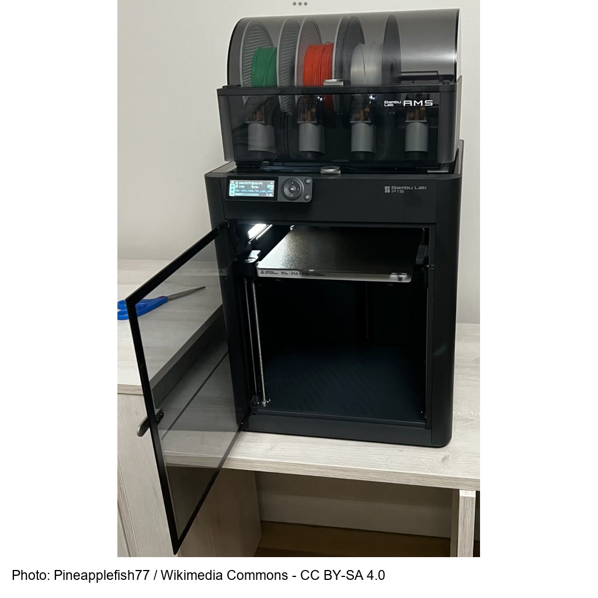

<!-- oomp-documentation:start -->
# Bambu Lab AMS

[Open catalogue record](http://localhost:5703/parts/three_d_printer_ams_bambu_lab_ams) · [AMS specifications and price](https://bambu-lab-global.myshopify.com/products/ams-multicolor-printing)

## Summary

Bambu Lab AMS automatic material system with 4 spool positions.



Bambu Lab P1S with the original AMS on top. [P1s with ams.jpg](https://commons.wikimedia.org/wiki/File:P1s_with_ams.jpg) by Pineapplefish77. [CC BY-SA 4.0](https://creativecommons.org/licenses/by-sa/4.0/). Resized within a square white canvas and credited on the image.

## Details

OOMP ID `three_d_printer_ams_bambu_lab_ams`

| Specification | Value |
| --- | --- |
| A1 series compatibility | Requires the AMS Hub for A1 Series and firmware supporting AMS. Bambu Lab announced support in A1-series public beta 01.06.10.33 on 2025-10-13. |
| Filament diameter (mm) | 1.75 |
| Housing | Enclosed, with desiccant |
| Product dimensions (manufacturer order, mm) | 368 × 283 × 224 |
| Net mass (kg) | 2.5 |
| Reference price | USD 349, Bambu Lab Global, standalone unit before tax. |
| Spool outer diameter (mm) | 197–202 |
| Spool positions | 4 |
| Spool width (mm) | 50–68 |
| Standalone store availability | 2022-11-07 |

Also indexed as AMS 1, original AMS.

Sources checked 2026-11-18.

- [Bambu Lab A1 series AMS support announcement](https://forum.bambulab.com/t/a1-series-firmware-v01-06-10-33-now-in-public-beta/201055)
- [P1 series compatibility](https://bambu-lab-global.myshopify.com/collections/p1-series)
- [Standalone retail announcement](https://forum.bambulab.com/t/bambu-lab-ams-and-ams-hub-are-now-in-stock/846)

| Taxonomy slot | Value |
| --- | --- |
| 1 | `three_d_printer` |
| 2 | `ams` |
| 14 | `bambu_lab` |
| 15 | `ams` |

## Labels

| Layout | Stock (mm) | Files |
| --- | --- | --- |
| OOMP inventory | 76.2 × 50.8 | [SVG](label_oomp.svg) · [Print PDF](label_oomp.pdf) |
| Stock | 76.2 × 50.8 | [SVG](label_stock_3x2.svg) · [Print PDF](label_stock_3x2.pdf) |
| Stock | 38.1 × 25.4 | [SVG](label_stock_1_5x1.svg) · [Print PDF](label_stock_1_5x1.pdf) |
| Drawer | 38.1 × 25.4 | [SVG](label_drawer.svg) · [Print PDF](label_drawer.pdf) |
| Compact barcode | 30 × 15 | [SVG](label_30x15.svg) · [Print PDF](label_30x15.pdf) |

## Parts

[Browse this category](../../navigation/ams/bambu_lab/README.md) · [Canonical metadata](working.yaml) · [Catalogue](../../README.md)

Confirmed printer models in this catalogue

- [Bambu Lab P1S](../three_d_printer_printer_bambu_lab_p1s/)
- [Bambu Lab P1P](../three_d_printer_printer_bambu_lab_p1p/)
- [Bambu Lab A1](../three_d_printer_printer_bambu_lab_a1/)
- [Bambu Lab A1 mini](../three_d_printer_printer_bambu_lab_a1_mini/)

## Assembly

Use the model-specific manufacturer documentation linked above for setup or service.

<details>
<summary>Full OOMP metadata</summary>

```yaml
aliases:
- AMS 1
- original AMS
compatible_printers:
- three_d_printer_printer_bambu_lab_p1s
- three_d_printer_printer_bambu_lab_p1p
- three_d_printer_printer_bambu_lab_a1
- three_d_printer_printer_bambu_lab_a1_mini
link_main: https://github.com/oomlout/oomp_three_d_printer_version_5/tree/main/parts/three_d_printer_ams_bambu_lab_ams
link_source: https://bambu-lab-global.myshopify.com/products/ams-multicolor-printing
link_web: http://localhost:5703/parts/three_d_printer_ams_bambu_lab_ams
name_proper: Bambu Lab AMS
oomp_id: three_d_printer_ams_bambu_lab_ams
photo:
  caption: Bambu Lab P1S with the original AMS on top.
  changes: Resized within a square white canvas and credited on the image.
  creator: Pineapplefish77
  credit_line: 'Photo: Pineapplefish77 / Wikimedia Commons - CC BY-SA 4.0'
  file: source_file/images/p1s_with_ams_square.jpg
  license: CC BY-SA 4.0
  license_url: https://creativecommons.org/licenses/by-sa/4.0/
  original_file: source_file/p1s_with_ams.jpg
  source: https://commons.wikimedia.org/wiki/File:P1s_with_ams.jpg
  title: P1s with ams.jpg
source_checked: '2026-11-18'
sources:
  AMS specifications and price: https://bambu-lab-global.myshopify.com/products/ams-multicolor-printing
  Bambu Lab A1 series AMS support announcement: https://forum.bambulab.com/t/a1-series-firmware-v01-06-10-33-now-in-public-beta/201055
  P1 series compatibility: https://bambu-lab-global.myshopify.com/collections/p1-series
  Standalone retail announcement: https://forum.bambulab.com/t/bambu-lab-ams-and-ams-hub-are-now-in-stock/846
specifications:
  a1_series_compatibility: Requires the AMS Hub for A1 Series and firmware supporting
    AMS. Bambu Lab announced support in A1-series public beta 01.06.10.33 on 2025-10-13.
  filament_diameter_mm: 1.75
  housing: Enclosed, with desiccant
  machine_dimensions_mm:
  - 368
  - 283
  - 224
  net_mass_kg: 2.5
  reference_price: USD 349, Bambu Lab Global, standalone unit before tax.
  spool_outer_diameter_mm:
  - 197
  - 202
  spool_positions: 4
  spool_width_mm:
  - 50
  - 68
  standalone_store_availability: '2022-11-07'
taxonomy_1: three_d_printer
taxonomy_10: ''
taxonomy_11: ''
taxonomy_12: ''
taxonomy_13: ''
taxonomy_14: bambu_lab
taxonomy_15: ams
taxonomy_2: ams
taxonomy_3: ''
taxonomy_4: ''
taxonomy_5: ''
taxonomy_6: ''
taxonomy_7: ''
taxonomy_8: ''
taxonomy_9: ''
worked_example: true
taxonomy_1_upper: THREE_D_PRINTER
taxonomy_1_upper_length_1: T
taxonomy_1_upper_length_2: TH
taxonomy_1_upper_length_3: THR
taxonomy_1_upper_length_4: THRE
taxonomy_1_upper_length_5: THREE
taxonomy_1_length_1: t
taxonomy_1_length_2: th
taxonomy_1_length_3: thr
taxonomy_1_length_4: thre
taxonomy_1_length_5: three
taxonomy_1_capital: Three D Printer
taxonomy_1_first_letter: t
taxonomy_1_first_letter_upper: T
taxonomy_2_upper: AMS
taxonomy_2_upper_length_1: A
taxonomy_2_upper_length_2: AM
taxonomy_2_upper_length_3: AMS
taxonomy_2_upper_length_4: AMS
taxonomy_2_upper_length_5: AMS
taxonomy_2_length_1: a
taxonomy_2_length_2: am
taxonomy_2_length_3: ams
taxonomy_2_length_4: ams
taxonomy_2_length_5: ams
taxonomy_2_capital: Ams
taxonomy_2_first_letter: a
taxonomy_2_first_letter_upper: A
taxonomy_14_upper: BAMBU_LAB
taxonomy_14_upper_length_1: B
taxonomy_14_upper_length_2: BA
taxonomy_14_upper_length_3: BAM
taxonomy_14_upper_length_4: BAMB
taxonomy_14_upper_length_5: BAMBU
taxonomy_14_length_1: b
taxonomy_14_length_2: ba
taxonomy_14_length_3: bam
taxonomy_14_length_4: bamb
taxonomy_14_length_5: bambu
taxonomy_14_capital: Bambu Lab
taxonomy_14_first_letter: b
taxonomy_14_first_letter_upper: B
taxonomy_15_upper: AMS
taxonomy_15_upper_length_1: A
taxonomy_15_upper_length_2: AM
taxonomy_15_upper_length_3: AMS
taxonomy_15_upper_length_4: AMS
taxonomy_15_upper_length_5: AMS
taxonomy_15_length_1: a
taxonomy_15_length_2: am
taxonomy_15_length_3: ams
taxonomy_15_length_4: ams
taxonomy_15_length_5: ams
taxonomy_15_capital: Ams
taxonomy_15_first_letter: a
taxonomy_15_first_letter_upper: A
id: three_d_printer_ams_bambu_lab_ams
id_no_class: three_d_printer_ams_bambu_lab_ams
id_no_type: three_d_printer_ams_bambu_lab_ams
id_no_size: three_d_printer_ams_bambu_lab_ams
oomp_key: oomp_three_d_printer_ams_bambu_lab_ams
link_github: https://github.com/oomlout/oomp_three_d_printer_version_5/tree/main/parts/three_d_printer_ams_bambu_lab_ams
link_redirect: https://github.com/oomlout/oomp_three_d_printer_version_5/tree/main/parts/three_d_printer_ams_bambu_lab_ams
directory: parts/three_d_printer_ams_bambu_lab_ams
name: Three D Printer Ams Bambu Lab Ams
name_no_class: Three D Printer Ams Bambu Lab Ams
name_no_type: Three D Printer Ams Bambu Lab Ams
name_no_size: Three D Printer Ams Bambu Lab Ams
md5: 52575b9abd4c1db1a8ccc44555da8d5a
md5_5: '52575'
md5_5_upper: '52575'
md5_6: 52575b
md5_6_upper: 52575B
md5_6_alpha: 37ntn
md5_6_alpha_upper: 37NTN
md5_10: 52575b9abd
md5_10_upper: 52575B9ABD
bip_39_full_array:
- 'false'
- river
- trade
- kind
- scrub
- sugar
- permit
- obtain
- earn
- put
- person
- release
bip_39_full_space: false river trade kind scrub sugar permit obtain earn put person
  release
bip_39_full_no_space: falserivertradekindscrubsugarpermitobtainearnputpersonrelease
bip_39_full_underscore: false_river_trade_kind_scrub_sugar_permit_obtain_earn_put_person_release
bip_39_2_word_array:
- 'false'
- river
bip_39_2_word_space: false river
bip_39_2_word_no_space: falseriver
bip_39_2_word_underscore: false_river
bip_39_3_word_array:
- 'false'
- river
- trade
bip_39_3_word_space: false river trade
bip_39_3_word_no_space: falserivertrade
bip_39_3_word_underscore: false_river_trade
label_title: AMS
label_barcode: M0,0h34v760h-34z M136,0h34v760h-34z M204,0h102v760h-102z M340,0h102v760h-102z
  M476,0h34v760h-34z M544,0h102v760h-102z M680,0h102v760h-102z M884,0h34v760h-34z
  M952,0h34v760h-34z M1020,0h34v760h-34z M1088,0h34v760h-34z M1156,0h34v760h-34z M1292,0h34v760h-34z
  M1360,0h102v760h-102z M1496,0h102v760h-102z M1632,0h34v760h-34z M1700,0h34v760h-34z
  M1768,0h102v760h-102z M1904,0h34v760h-34z M2040,0h102v760h-102z M2176,0h34v760h-34z
  M2244,0h34v760h-34z M2312,0h102v760h-102z M2448,0h102v760h-102z M2652,0h34v760h-34z
  M2720,0h34v760h-34z M2788,0h34v760h-34z M2856,0h102v760h-102z M2992,0h34v760h-34z
  M3128,0h102v760h-102z M3264,0h34v760h-34z M3400,0h34v760h-34z M3468,0h102v760h-102z
  M3604,0h102v760h-102z M3740,0h34v760h-34z
label_barcode_width: 3774
label_maker: Bambu Lab
label_family: Material feeder
label_detail: 4 spools
label_variant: 1.75 mm filament
label_context: Bambu Lab
inventory_title_size: 14
stock_title_size: 5.3
drawer_title_size: 3.3
compact_title_size: 2.8
oomlout_ai_roboclick_1:
  actions:
  - command: text_jinja_template
    file_template: source_file/template_jinja/template_jinja_label_oomlout_76_2_mm_50_8_mm/working.svg.j2
    file_output: label_oomp.svg
    convert_to_pdf: true
    convert_to_png: false
  - command: text_jinja_template
    file_template: source_file/template_jinja/label_stock/3x2.svg.j2
    file_output: label_stock_3x2.svg
    convert_to_pdf: true
    convert_to_png: false
  - command: text_jinja_template
    file_template: source_file/template_jinja/label_stock/1_5x1.svg.j2
    file_output: label_stock_1_5x1.svg
    convert_to_pdf: true
    convert_to_png: false
  - command: text_jinja_template
    file_template: source_file/template_jinja/label_drawer/working.svg.j2
    file_output: label_drawer.svg
    convert_to_pdf: true
    convert_to_png: false
  - command: text_jinja_template
    file_template: source_file/template_jinja/label_printer_30x15/working.svg.j2
    file_output: label_30x15.svg
    convert_to_pdf: true
    convert_to_png: false
  file_test: ''
  retries_until_complete: 0
  action_name: step_0_jinja_template_label_oomp.svg
```

</details>
<!-- oomp-documentation:end -->
