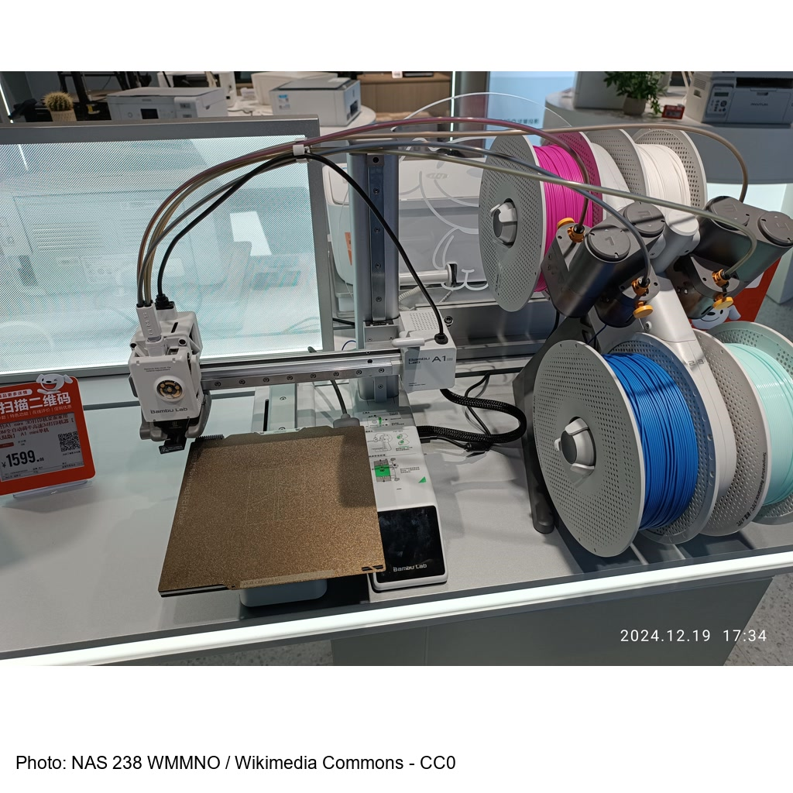

<!-- oomp-documentation:start -->
# Bambu Lab AMS lite

## Summary

Bambu Lab AMS lite automatic material system with 4 spool positions.



Bambu Lab A1 mini on the left and AMS lite with four spools on the right. [JD Mall Electronics Showroom, 3D printers, December 2024 (R12S 06)](https://commons.wikimedia.org/wiki/File:DG_%E6%9D%B1%E8%8E%9E_DongGuan_%E5%8D%97%E5%9F%8E%E5%8D%80_Nancheng_%E9%B4%BB%E7%A6%8F%E8%B7%AF_HongFu_Road_%E6%9D%B1%E8%8E%9E%E4%BA%AC%E6%9D%B1%E5%95%86%E5%A0%B4_JD_Mall_Electronics_Showroom_3D_printers_December_2024_R12S_06.jpg) by NAS 238 WMMNO. [CC0 1.0](https://creativecommons.org/publicdomain/zero/1.0/). Resized within a square white canvas and credited on the image.

## Details

OOMP ID `three_d_printer_ams_bambu_lab_ams_lite`

| Specification | Value |
| --- | --- |
| Filament diameter (mm) | 1.75 |
| Housing | Open stand with four centre-mounted spools |
| Product dimensions (manufacturer order, mm) | 397 × 208 × 342 |
| Net mass (kg) | 1.6 |
| Reference price | USD 249, Bambu Lab Global, standalone unit before tax. |
| Regulatory model | SA005 |
| Spool inner diameter (mm) | 53–58 |
| Spool positions | 4 |
| Spool width (mm) | 40–68 |

Also indexed as AMS mini (informal search term).

Sources checked 2026-11-18.

- [A-series compatibility and price](https://bambu-lab-global.myshopify.com/products/ams-lite)
- [AMS lite specifications](https://csm.bblcdn.com/hub/0f7d57180a9b462d9c2bf4fa8aeb5958.pdf)
- [EU declaration with model code](https://public-cdn.bambulab.com/portal/euro-compliance/EU_Declaration_of_Conformity_AMS_lite.pdf)

| Taxonomy slot | Value |
| --- | --- |
| 1 | `three_d_printer` |
| 2 | `ams` |
| 14 | `bambu_lab` |
| 15 | `ams_lite` |

## Labels

| Layout | Stock (mm) | Files |
| --- | --- | --- |
| OOMP inventory | 76.2 × 50.8 | [SVG](label_oomp.svg) · [Print PDF](label_oomp.pdf) |
| Stock | 76.2 × 50.8 | [SVG](label_stock_3x2.svg) · [Print PDF](label_stock_3x2.pdf) |
| Stock | 38.1 × 25.4 | [SVG](label_stock_1_5x1.svg) · [Print PDF](label_stock_1_5x1.pdf) |
| Drawer | 38.1 × 25.4 | [SVG](label_drawer.svg) · [Print PDF](label_drawer.pdf) |
| Compact barcode | 30 × 15 | [SVG](label_30x15.svg) · [Print PDF](label_30x15.pdf) |

## Parts

[Browse this category](../../navigation/ams/bambu_lab/README.md) · [Canonical metadata](working.yaml) · [Catalogue](../../README.md)

Confirmed printer models in this catalogue

- [Bambu Lab A1](../three_d_printer_printer_bambu_lab_a1/)
- [Bambu Lab A1 mini](../three_d_printer_printer_bambu_lab_a1_mini/)

## Assembly

Use the model-specific manufacturer documentation linked above for setup or service.

<details>
<summary>Full OOMP metadata</summary>

```yaml
aliases:
- AMS mini (informal search term)
compatible_printers:
- three_d_printer_printer_bambu_lab_a1
- three_d_printer_printer_bambu_lab_a1_mini
name_proper: Bambu Lab AMS lite
oomp_id: three_d_printer_ams_bambu_lab_ams_lite
photo:
  caption: Bambu Lab A1 mini on the left and AMS lite with four spools on the right.
  changes: Resized within a square white canvas and credited on the image.
  creator: NAS 238 WMMNO
  credit_line: 'Photo: NAS 238 WMMNO / Wikimedia Commons - CC0'
  file: source_file/images/a1_mini_showroom_square.jpg
  license: CC0 1.0
  license_url: https://creativecommons.org/publicdomain/zero/1.0/
  original_file: source_file/a1_mini_showroom.jpg
  source: https://commons.wikimedia.org/wiki/File:DG_%E6%9D%B1%E8%8E%9E_DongGuan_%E5%8D%97%E5%9F%8E%E5%8D%80_Nancheng_%E9%B4%BB%E7%A6%8F%E8%B7%AF_HongFu_Road_%E6%9D%B1%E8%8E%9E%E4%BA%AC%E6%9D%B1%E5%95%86%E5%A0%B4_JD_Mall_Electronics_Showroom_3D_printers_December_2024_R12S_06.jpg
  title: JD Mall Electronics Showroom, 3D printers, December 2024 (R12S 06)
source_checked: '2026-11-18'
sources:
  A-series compatibility and price: https://bambu-lab-global.myshopify.com/products/ams-lite
  AMS lite specifications: https://csm.bblcdn.com/hub/0f7d57180a9b462d9c2bf4fa8aeb5958.pdf
  EU declaration with model code: https://public-cdn.bambulab.com/portal/euro-compliance/EU_Declaration_of_Conformity_AMS_lite.pdf
specifications:
  filament_diameter_mm: 1.75
  housing: Open stand with four centre-mounted spools
  machine_dimensions_mm:
  - 397
  - 208
  - 342
  net_mass_kg: 1.6
  reference_price: USD 249, Bambu Lab Global, standalone unit before tax.
  regulatory_model: SA005
  spool_inner_diameter_mm:
  - 53
  - 58
  spool_positions: 4
  spool_width_mm:
  - 40
  - 68
taxonomy_1: three_d_printer
taxonomy_10: ''
taxonomy_11: ''
taxonomy_12: ''
taxonomy_13: ''
taxonomy_14: bambu_lab
taxonomy_15: ams_lite
taxonomy_2: ams
taxonomy_3: ''
taxonomy_4: ''
taxonomy_5: ''
taxonomy_6: ''
taxonomy_7: ''
taxonomy_8: ''
taxonomy_9: ''
worked_example: true
taxonomy_1_upper: THREE_D_PRINTER
taxonomy_1_upper_length_1: T
taxonomy_1_upper_length_2: TH
taxonomy_1_upper_length_3: THR
taxonomy_1_upper_length_4: THRE
taxonomy_1_upper_length_5: THREE
taxonomy_1_length_1: t
taxonomy_1_length_2: th
taxonomy_1_length_3: thr
taxonomy_1_length_4: thre
taxonomy_1_length_5: three
taxonomy_1_capital: Three D Printer
taxonomy_1_first_letter: t
taxonomy_1_first_letter_upper: T
taxonomy_2_upper: AMS
taxonomy_2_upper_length_1: A
taxonomy_2_upper_length_2: AM
taxonomy_2_upper_length_3: AMS
taxonomy_2_upper_length_4: AMS
taxonomy_2_upper_length_5: AMS
taxonomy_2_length_1: a
taxonomy_2_length_2: am
taxonomy_2_length_3: ams
taxonomy_2_length_4: ams
taxonomy_2_length_5: ams
taxonomy_2_capital: Ams
taxonomy_2_first_letter: a
taxonomy_2_first_letter_upper: A
taxonomy_14_upper: BAMBU_LAB
taxonomy_14_upper_length_1: B
taxonomy_14_upper_length_2: BA
taxonomy_14_upper_length_3: BAM
taxonomy_14_upper_length_4: BAMB
taxonomy_14_upper_length_5: BAMBU
taxonomy_14_length_1: b
taxonomy_14_length_2: ba
taxonomy_14_length_3: bam
taxonomy_14_length_4: bamb
taxonomy_14_length_5: bambu
taxonomy_14_capital: Bambu Lab
taxonomy_14_first_letter: b
taxonomy_14_first_letter_upper: B
taxonomy_15_upper: AMS_LITE
taxonomy_15_upper_length_1: A
taxonomy_15_upper_length_2: AM
taxonomy_15_upper_length_3: AMS
taxonomy_15_upper_length_4: AMS_
taxonomy_15_upper_length_5: AMS_L
taxonomy_15_length_1: a
taxonomy_15_length_2: am
taxonomy_15_length_3: ams
taxonomy_15_length_4: ams_
taxonomy_15_length_5: ams_l
taxonomy_15_capital: Ams Lite
taxonomy_15_first_letter: a
taxonomy_15_first_letter_upper: A
id: three_d_printer_ams_bambu_lab_ams_lite
id_no_class: three_d_printer_ams_bambu_lab_ams_lite
id_no_type: three_d_printer_ams_bambu_lab_ams_lite
id_no_size: three_d_printer_ams_bambu_lab_ams_lite
oomp_key: oomp_three_d_printer_ams_bambu_lab_ams_lite
link_github: https://github.com/oomlout/oomp_three_d_printer_version_5/tree/main/parts/three_d_printer_ams_bambu_lab_ams_lite
link_main: https://github.com/oomlout/oomp_three_d_printer_version_5/tree/main/parts/three_d_printer_ams_bambu_lab_ams_lite
link_redirect: https://github.com/oomlout/oomp_three_d_printer_version_5/tree/main/parts/three_d_printer_ams_bambu_lab_ams_lite
directory: parts/three_d_printer_ams_bambu_lab_ams_lite
name: Three D Printer Ams Bambu Lab Ams Lite
name_no_class: Three D Printer Ams Bambu Lab Ams Lite
name_no_type: Three D Printer Ams Bambu Lab Ams Lite
name_no_size: Three D Printer Ams Bambu Lab Ams Lite
md5: c305cc210b1a4e80b2b991649dabf319
md5_5: c305c
md5_5_upper: C305C
md5_6: c305cc
md5_6_upper: C305CC
md5_6_alpha: 7lxvw
md5_6_alpha_upper: 7LXVW
md5_10: c305cc210b
md5_10_upper: C305CC210B
bip_39_full_array:
- seek
- common
- analyst
- bike
- pilot
- doctor
- slab
- cram
- goose
- unhappy
- wolf
- credit
bip_39_full_space: seek common analyst bike pilot doctor slab cram goose unhappy wolf
  credit
bip_39_full_no_space: seekcommonanalystbikepilotdoctorslabcramgooseunhappywolfcredit
bip_39_full_underscore: seek_common_analyst_bike_pilot_doctor_slab_cram_goose_unhappy_wolf_credit
bip_39_2_word_array:
- seek
- common
bip_39_2_word_space: seek common
bip_39_2_word_no_space: seekcommon
bip_39_2_word_underscore: seek_common
bip_39_3_word_array:
- seek
- common
- analyst
bip_39_3_word_space: seek common analyst
bip_39_3_word_no_space: seekcommonanalyst
bip_39_3_word_underscore: seek_common_analyst
label_title: AMS LITE
label_barcode: M0,0h34v760h-34z M136,0h34v760h-34z M204,0h102v760h-102z M340,0h102v760h-102z
  M476,0h34v760h-34z M544,0h34v760h-34z M612,0h34v760h-34z M748,0h34v760h-34z M816,0h102v760h-102z
  M952,0h102v760h-102z M1088,0h34v760h-34z M1156,0h102v760h-102z M1292,0h34v760h-34z
  M1360,0h34v760h-34z M1496,0h102v760h-102z M1632,0h34v760h-34z M1768,0h34v760h-34z
  M1836,0h102v760h-102z M1972,0h34v760h-34z M2040,0h102v760h-102z M2176,0h34v760h-34z
  M2312,0h102v760h-102z M2448,0h34v760h-34z M2516,0h34v760h-34z M2584,0h102v760h-102z
  M2720,0h102v760h-102z M2924,0h102v760h-102z M3060,0h34v760h-34z M3128,0h34v760h-34z
  M3196,0h34v760h-34z M3264,0h34v760h-34z M3400,0h34v760h-34z M3468,0h102v760h-102z
  M3604,0h102v760h-102z M3740,0h34v760h-34z
label_barcode_width: 3774
label_maker: Bambu Lab
label_family: Material feeder
label_detail: 4 spools
label_variant: 1.75 mm filament
label_context: Bambu Lab
inventory_title_size: 14
stock_title_size: 5.3
drawer_title_size: 3.3
compact_title_size: 2.8
oomlout_ai_roboclick_1:
  actions:
  - command: text_jinja_template
    file_template: source_file/template_jinja/template_jinja_label_oomlout_76_2_mm_50_8_mm/working.svg.j2
    file_output: label_oomp.svg
    convert_to_pdf: true
    convert_to_png: false
  - command: text_jinja_template
    file_template: source_file/template_jinja/label_stock/3x2.svg.j2
    file_output: label_stock_3x2.svg
    convert_to_pdf: true
    convert_to_png: false
  - command: text_jinja_template
    file_template: source_file/template_jinja/label_stock/1_5x1.svg.j2
    file_output: label_stock_1_5x1.svg
    convert_to_pdf: true
    convert_to_png: false
  - command: text_jinja_template
    file_template: source_file/template_jinja/label_drawer/working.svg.j2
    file_output: label_drawer.svg
    convert_to_pdf: true
    convert_to_png: false
  - command: text_jinja_template
    file_template: source_file/template_jinja/label_printer_30x15/working.svg.j2
    file_output: label_30x15.svg
    convert_to_pdf: true
    convert_to_png: false
  file_test: ''
  retries_until_complete: 0
  action_name: step_0_jinja_template_label_oomp.svg
```

</details>
<!-- oomp-documentation:end -->
