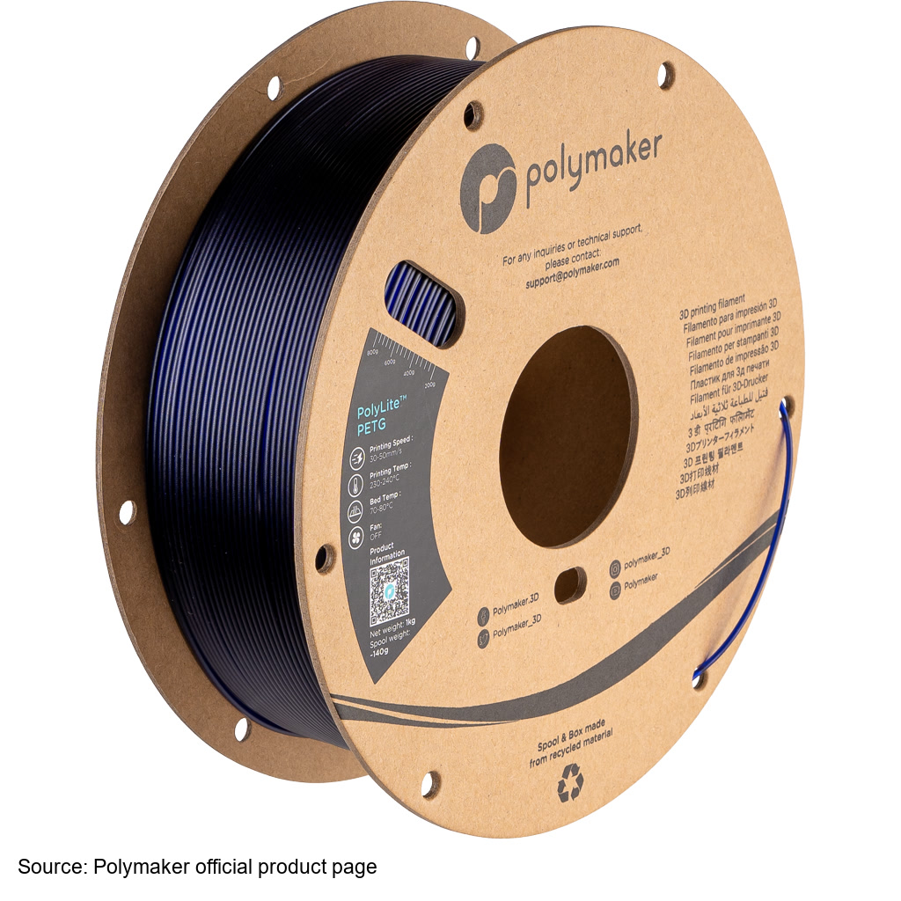

<!-- oomp-documentation:start -->
# Polymaker PolyLite PETG Translucent Blue

[Open catalogue record](http://localhost:5703/parts/three_d_printer_filament_petg_1_75_mm_blue_translucent_blue_polymaker_pb01032) · [Manufacturer SKU table](https://polymaker.com/wp-content/uploads/SKU-PDF-Version-EN-2024-01.pdf)

## Summary

PolyLite Translucent PETG in Translucent Blue.



Polymaker PolyLite Translucent PETG in Translucent Blue, 1 kg spool. [Polymaker product image](https://shop.polymaker.com/products/polylite-translucent-petg) by Polymaker. [Manufacturer product image; reuse permission not established](https://shop.polymaker.com/products/polylite-translucent-petg). Resized within a square white canvas and credited on the image.

## Details

OOMP ID `three_d_printer_filament_petg_1_75_mm_blue_translucent_blue_polymaker_pb01032`

| Specification | Value |
| --- | --- |
| Bed temperature (°C) | 70–80 |
| Colour name | Translucent Blue |
| Filament diameter (mm) | 1.75 |
| Manufacturer part number | PB01032 |
| Net filament mass (g) | 1000 |
| Nozzle temperature (°C) | 230–260 |
| Product line | PolyLite Translucent PETG |
| Reference price | About USD 20 per 1 kg spool, Polymaker US listed price. |
| Temperature note | PolyLite PETG datasheet range for a 0.4 mm nozzle. The retail page also shows a narrower 230–240 °C quick reference. |

Sources checked 2026-11-18.

- [PolyLite PETG technical data sheet](https://wiki.polymaker.com/polymaker-products/more-about-our-products/documents/technical-data-sheets/petg-pet/polylite-tm-petg)
- [Polymaker product, printing settings and price](https://shop.polymaker.com/products/polylite-translucent-petg/)

| Taxonomy slot | Value |
| --- | --- |
| 1 | `three_d_printer` |
| 2 | `filament` |
| 3 | `petg` |
| 4 | `1_75_mm` |
| 5 | `blue` |
| 6 | `translucent_blue` |
| 14 | `polymaker` |
| 15 | `pb01032` |

## Labels

| Layout | Stock (mm) | Files |
| --- | --- | --- |
| OOMP inventory | 76.2 × 50.8 | [SVG](label_oomp.svg) · [Print PDF](label_oomp.pdf) |
| Stock | 76.2 × 50.8 | [SVG](label_stock_3x2.svg) · [Print PDF](label_stock_3x2.pdf) |
| Stock | 38.1 × 25.4 | [SVG](label_stock_1_5x1.svg) · [Print PDF](label_stock_1_5x1.pdf) |
| Drawer | 38.1 × 25.4 | [SVG](label_drawer.svg) · [Print PDF](label_drawer.pdf) |
| Compact barcode | 30 × 15 | [SVG](label_30x15.svg) · [Print PDF](label_30x15.pdf) |

## Parts

[Browse this category](../../navigation/filament/petg/1_75_mm/blue/README.md) · [Canonical metadata](working.yaml) · [Catalogue](../../README.md)


## Assembly

Use the model-specific manufacturer documentation linked above for setup or service.

<details>
<summary>Full OOMP metadata</summary>

```yaml
link_main: https://github.com/oomlout/oomp_three_d_printer_version_5/tree/main/parts/three_d_printer_filament_petg_1_75_mm_blue_translucent_blue_polymaker_pb01032
link_source: https://polymaker.com/wp-content/uploads/SKU-PDF-Version-EN-2024-01.pdf
link_web: http://localhost:5703/parts/three_d_printer_filament_petg_1_75_mm_blue_translucent_blue_polymaker_pb01032
name_proper: Polymaker PolyLite PETG Translucent Blue
oomp_id: three_d_printer_filament_petg_1_75_mm_blue_translucent_blue_polymaker_pb01032
photo:
  caption: Polymaker PolyLite Translucent PETG in Translucent Blue, 1 kg spool.
  changes: Resized within a square white canvas and credited on the image.
  creator: Polymaker
  credit_line: 'Source: Polymaker official product page'
  file: source_file/images/polymaker_petg_square.jpg
  license: Manufacturer product image; reuse permission not established
  license_url: https://shop.polymaker.com/products/polylite-translucent-petg
  original_file: source_file/images/original/polymaker_petg.png
  original_image_url: https://cdn.shopify.com/s/files/1/0548/7299/7945/files/PolyLite-Translucent-PETG_1.75mm_1kg_Translucent-Blue.png?v=1685250113
  source: https://shop.polymaker.com/products/polylite-translucent-petg
  source_checked: '2026-11-19'
  title: Polymaker product image
source_checked: '2026-11-18'
sources:
  Manufacturer SKU table: https://polymaker.com/wp-content/uploads/SKU-PDF-Version-EN-2024-01.pdf
  PolyLite PETG technical data sheet: https://wiki.polymaker.com/polymaker-products/more-about-our-products/documents/technical-data-sheets/petg-pet/polylite-tm-petg
  Polymaker product, printing settings and price: https://shop.polymaker.com/products/polylite-translucent-petg/
specifications:
  bed_temperature_c:
  - 70
  - 80
  colour_name: Translucent Blue
  filament_diameter_mm: 1.75
  manufacturer_part_number: PB01032
  net_filament_mass_g: 1000
  nozzle_temperature_c:
  - 230
  - 260
  product_line: PolyLite Translucent PETG
  reference_price: About USD 20 per 1 kg spool, Polymaker US listed price.
  temperature_note: PolyLite PETG datasheet range for a 0.4 mm nozzle. The retail
    page also shows a narrower 230–240 °C quick reference.
taxonomy_1: three_d_printer
taxonomy_10: ''
taxonomy_11: ''
taxonomy_12: ''
taxonomy_13: ''
taxonomy_14: polymaker
taxonomy_15: pb01032
taxonomy_2: filament
taxonomy_3: petg
taxonomy_4: 1_75_mm
taxonomy_5: blue
taxonomy_6: translucent_blue
taxonomy_7: ''
taxonomy_8: ''
taxonomy_9: ''
worked_example: true
taxonomy_1_upper: THREE_D_PRINTER
taxonomy_1_upper_length_1: T
taxonomy_1_upper_length_2: TH
taxonomy_1_upper_length_3: THR
taxonomy_1_upper_length_4: THRE
taxonomy_1_upper_length_5: THREE
taxonomy_1_length_1: t
taxonomy_1_length_2: th
taxonomy_1_length_3: thr
taxonomy_1_length_4: thre
taxonomy_1_length_5: three
taxonomy_1_capital: Three D Printer
taxonomy_1_first_letter: t
taxonomy_1_first_letter_upper: T
taxonomy_2_upper: FILAMENT
taxonomy_2_upper_length_1: F
taxonomy_2_upper_length_2: FI
taxonomy_2_upper_length_3: FIL
taxonomy_2_upper_length_4: FILA
taxonomy_2_upper_length_5: FILAM
taxonomy_2_length_1: f
taxonomy_2_length_2: fi
taxonomy_2_length_3: fil
taxonomy_2_length_4: fila
taxonomy_2_length_5: filam
taxonomy_2_capital: Filament
taxonomy_2_first_letter: f
taxonomy_2_first_letter_upper: F
taxonomy_3_upper: PETG
taxonomy_3_upper_length_1: P
taxonomy_3_upper_length_2: PE
taxonomy_3_upper_length_3: PET
taxonomy_3_upper_length_4: PETG
taxonomy_3_upper_length_5: PETG
taxonomy_3_length_1: p
taxonomy_3_length_2: pe
taxonomy_3_length_3: pet
taxonomy_3_length_4: petg
taxonomy_3_length_5: petg
taxonomy_3_capital: Petg
taxonomy_3_first_letter: p
taxonomy_3_first_letter_upper: P
taxonomy_4_upper: 1_75_MM
taxonomy_4_upper_length_1: '1'
taxonomy_4_upper_length_2: '1_'
taxonomy_4_upper_length_3: '1_7'
taxonomy_4_upper_length_4: '1_75'
taxonomy_4_upper_length_5: '1_75_'
taxonomy_4_length_1: '1'
taxonomy_4_length_2: '1_'
taxonomy_4_length_3: '1_7'
taxonomy_4_length_4: '1_75'
taxonomy_4_length_5: '1_75_'
taxonomy_4_capital: 1.75 mm
taxonomy_4_first_letter: '1'
taxonomy_4_first_letter_upper: '1'
taxonomy_5_upper: BLUE
taxonomy_5_upper_length_1: B
taxonomy_5_upper_length_2: BL
taxonomy_5_upper_length_3: BLU
taxonomy_5_upper_length_4: BLUE
taxonomy_5_upper_length_5: BLUE
taxonomy_5_length_1: b
taxonomy_5_length_2: bl
taxonomy_5_length_3: blu
taxonomy_5_length_4: blue
taxonomy_5_length_5: blue
taxonomy_5_capital: Blue
taxonomy_5_first_letter: b
taxonomy_5_first_letter_upper: B
taxonomy_6_upper: TRANSLUCENT_BLUE
taxonomy_6_upper_length_1: T
taxonomy_6_upper_length_2: TR
taxonomy_6_upper_length_3: TRA
taxonomy_6_upper_length_4: TRAN
taxonomy_6_upper_length_5: TRANS
taxonomy_6_length_1: t
taxonomy_6_length_2: tr
taxonomy_6_length_3: tra
taxonomy_6_length_4: tran
taxonomy_6_length_5: trans
taxonomy_6_capital: Translucent Blue
taxonomy_6_first_letter: t
taxonomy_6_first_letter_upper: T
taxonomy_14_upper: POLYMAKER
taxonomy_14_upper_length_1: P
taxonomy_14_upper_length_2: PO
taxonomy_14_upper_length_3: POL
taxonomy_14_upper_length_4: POLY
taxonomy_14_upper_length_5: POLYM
taxonomy_14_length_1: p
taxonomy_14_length_2: po
taxonomy_14_length_3: pol
taxonomy_14_length_4: poly
taxonomy_14_length_5: polym
taxonomy_14_capital: Polymaker
taxonomy_14_first_letter: p
taxonomy_14_first_letter_upper: P
taxonomy_15_upper: PB01032
taxonomy_15_upper_length_1: P
taxonomy_15_upper_length_2: PB
taxonomy_15_upper_length_3: PB0
taxonomy_15_upper_length_4: PB01
taxonomy_15_upper_length_5: PB010
taxonomy_15_length_1: p
taxonomy_15_length_2: pb
taxonomy_15_length_3: pb0
taxonomy_15_length_4: pb01
taxonomy_15_length_5: pb010
taxonomy_15_capital: Pb01032
taxonomy_15_first_letter: p
taxonomy_15_first_letter_upper: P
id: three_d_printer_filament_petg_1_75_mm_blue_translucent_blue_polymaker_pb01032
id_no_class: three_d_printer_filament_petg_1_75_mm_blue_translucent_blue_polymaker_pb01032
id_no_type: three_d_printer_filament_petg_1_75_mm_blue_translucent_blue_polymaker_pb01032
id_no_size: three_d_printer_filament_petg_1_75_mm_blue_translucent_blue_polymaker_pb01032
oomp_key: oomp_three_d_printer_filament_petg_1_75_mm_blue_translucent_blue_polymaker_pb01032
link_github: https://github.com/oomlout/oomp_three_d_printer_version_5/tree/main/parts/three_d_printer_filament_petg_1_75_mm_blue_translucent_blue_polymaker_pb01032
link_redirect: https://github.com/oomlout/oomp_three_d_printer_version_5/tree/main/parts/three_d_printer_filament_petg_1_75_mm_blue_translucent_blue_polymaker_pb01032
directory: parts/three_d_printer_filament_petg_1_75_mm_blue_translucent_blue_polymaker_pb01032
name: Three D Printer Filament Petg 1 75 Mm Blue Translucent Blue Polymaker Pb01032
name_no_class: Three D Printer Filament Petg 1 75 Mm Blue Translucent Blue Polymaker
  Pb01032
name_no_type: Three D Printer Filament Petg 1 75 Mm Blue Translucent Blue Polymaker
  Pb01032
name_no_size: Three D Printer Filament Petg 1 75 Mm Blue Translucent Blue Polymaker
  Pb01032
md5: eb0d8dc2ec2b3a29af4b2fb8cba71308
md5_5: eb0d8
md5_5_upper: EB0D8
md5_6: eb0d8d
md5_6_upper: EB0D8D
md5_6_alpha: 9664t
md5_6_alpha_upper: 9664T
md5_10: eb0d8dc2ec
md5_10_upper: EB0D8DC2EC
bip_39_full_array:
- twelve
- hockey
- idle
- success
- recipe
- below
- rule
- grass
- rhythm
- frog
- shadow
- axis
bip_39_full_space: twelve hockey idle success recipe below rule grass rhythm frog
  shadow axis
bip_39_full_no_space: twelvehockeyidlesuccessrecipebelowrulegrassrhythmfrogshadowaxis
bip_39_full_underscore: twelve_hockey_idle_success_recipe_below_rule_grass_rhythm_frog_shadow_axis
bip_39_2_word_array:
- twelve
- hockey
bip_39_2_word_space: twelve hockey
bip_39_2_word_no_space: twelvehockey
bip_39_2_word_underscore: twelve_hockey
bip_39_3_word_array:
- twelve
- hockey
- idle
bip_39_3_word_space: twelve hockey idle
bip_39_3_word_no_space: twelvehockeyidle
bip_39_3_word_underscore: twelve_hockey_idle
label_title: PB01032
label_barcode: M0,0h34v760h-34z M136,0h34v760h-34z M204,0h102v760h-102z M340,0h102v760h-102z
  M476,0h34v760h-34z M544,0h34v760h-34z M612,0h102v760h-102z M816,0h34v760h-34z M884,0h102v760h-102z
  M1020,0h34v760h-34z M1088,0h34v760h-34z M1156,0h102v760h-102z M1360,0h102v760h-102z
  M1496,0h34v760h-34z M1564,0h34v760h-34z M1632,0h34v760h-34z M1700,0h102v760h-102z
  M1904,0h102v760h-102z M2040,0h34v760h-34z M2108,0h34v760h-34z M2176,0h34v760h-34z
  M2244,0h34v760h-34z M2380,0h102v760h-102z M2516,0h34v760h-34z M2584,0h102v760h-102z
  M2720,0h34v760h-34z M2788,0h34v760h-34z M2856,0h102v760h-102z M2992,0h102v760h-102z
  M3196,0h34v760h-34z M3264,0h34v760h-34z M3400,0h34v760h-34z M3468,0h102v760h-102z
  M3604,0h102v760h-102z M3740,0h34v760h-34z
label_barcode_width: 3774
label_maker: Polymaker
label_family: Filament
label_detail: PETG / 1.75 mm
label_variant: Translucent Blue
label_context: Polymaker
inventory_title_size: 14
stock_title_size: 5.3
drawer_title_size: 3.3
compact_title_size: 2.8
oomlout_ai_roboclick_1:
  actions:
  - command: text_jinja_template
    file_template: source_file/template_jinja/template_jinja_label_oomlout_76_2_mm_50_8_mm/working.svg.j2
    file_output: label_oomp.svg
    convert_to_pdf: true
    convert_to_png: false
  - command: text_jinja_template
    file_template: source_file/template_jinja/label_stock/3x2.svg.j2
    file_output: label_stock_3x2.svg
    convert_to_pdf: true
    convert_to_png: false
  - command: text_jinja_template
    file_template: source_file/template_jinja/label_stock/1_5x1.svg.j2
    file_output: label_stock_1_5x1.svg
    convert_to_pdf: true
    convert_to_png: false
  - command: text_jinja_template
    file_template: source_file/template_jinja/label_drawer/working.svg.j2
    file_output: label_drawer.svg
    convert_to_pdf: true
    convert_to_png: false
  - command: text_jinja_template
    file_template: source_file/template_jinja/label_printer_30x15/working.svg.j2
    file_output: label_30x15.svg
    convert_to_pdf: true
    convert_to_png: false
  file_test: ''
  retries_until_complete: 0
  action_name: step_0_jinja_template_label_oomp.svg
```

</details>
<!-- oomp-documentation:end -->
