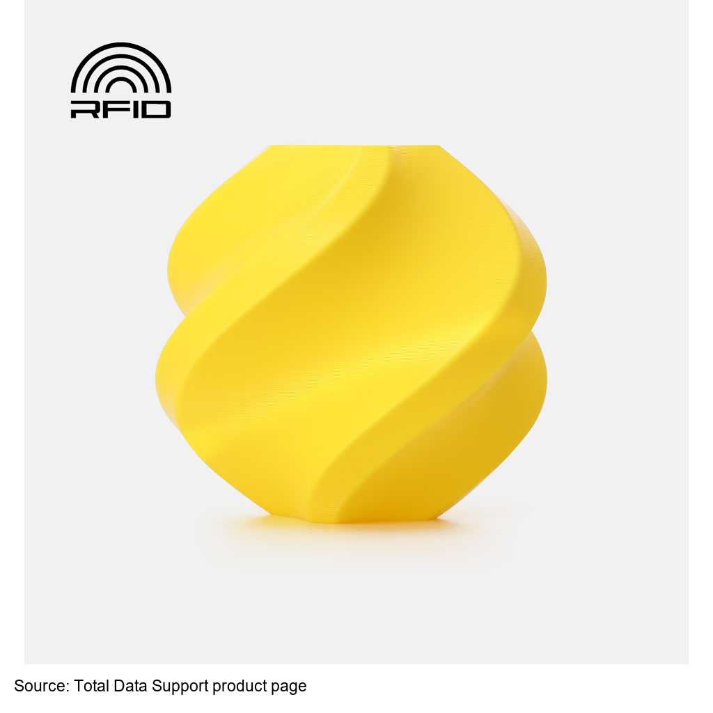

<!-- oomp-documentation:start -->
# Bambu Lab PETG Basic Yellow, 1 kg with spool

[Open catalogue record](http://localhost:5703/parts/three_d_printer_filament_petg_1_75_mm_yellow_yellow_bambu_lab_g00_y00_1_75_1000_spl) · [Bambu Lab upgraded PETG Basic technical data sheet](https://store.bblcdn.com/s1/default/cb94589bf7994fdcbfa833badefae9cd/Bambu_PETG_Basic_Technical_Data_Sheet.pdf)

## Summary

PETG Basic, upgraded formulation in Yellow.



Total Data Support product-page colour sample for Yellow; the colour sample is shown rather than the spool or refill. [Total Data Support filament colour sample](https://totaldatasupport.com/products/petg-basic) by Creator not identified; product image supplied by Total Data Support. [Product image; reuse permission not established](https://totaldatasupport.com/products/petg-basic). Resized within a square white canvas and credited on the image.

## Details

OOMP ID `three_d_printer_filament_petg_1_75_mm_yellow_yellow_bambu_lab_g00_y00_1_75_1000_spl`

| Specification | Value |
| --- | --- |
| Colour code | 30402 |
| Colour name | Yellow |
| Filament diameter (mm) | 1.75 |
| Manufacturer part number | G00-Y00-1.75-1000-SPL |
| Net mass (kg) | 1 |
| Package type | with spool |
| Product line | PETG Basic, upgraded formulation |

Sources checked 2026-11-18.

- [Retailer exact variant SKU table](https://www.eshop.formwerk.ro/en/cumpara/filament-bambu-lab-petg-basic-3292)

| Taxonomy slot | Value |
| --- | --- |
| 1 | `three_d_printer` |
| 2 | `filament` |
| 3 | `petg` |
| 4 | `1_75_mm` |
| 5 | `yellow` |
| 6 | `yellow` |
| 14 | `bambu_lab` |
| 15 | `g00_y00_1_75_1000_spl` |

## Labels

| Layout | Stock (mm) | Files |
| --- | --- | --- |
| OOMP inventory | 76.2 × 50.8 | [SVG](label_oomp.svg) · [Print PDF](label_oomp.pdf) |
| Stock | 76.2 × 50.8 | [SVG](label_stock_3x2.svg) · [Print PDF](label_stock_3x2.pdf) |
| Stock | 38.1 × 25.4 | [SVG](label_stock_1_5x1.svg) · [Print PDF](label_stock_1_5x1.pdf) |
| Drawer | 38.1 × 25.4 | [SVG](label_drawer.svg) · [Print PDF](label_drawer.pdf) |
| Compact barcode | 30 × 15 | [SVG](label_30x15.svg) · [Print PDF](label_30x15.pdf) |

## Parts

[Browse this category](../../navigation/filament/petg/1_75_mm/yellow/README.md) · [Canonical metadata](working.yaml) · [Catalogue](../../README.md)


## Assembly

Use the model-specific manufacturer documentation linked above for setup or service.

<details>
<summary>Full OOMP metadata</summary>

```yaml
link_main: https://github.com/oomlout/oomp_three_d_printer_version_5/tree/main/parts/three_d_printer_filament_petg_1_75_mm_yellow_yellow_bambu_lab_g00_y00_1_75_1000_spl
link_source: https://store.bblcdn.com/s1/default/cb94589bf7994fdcbfa833badefae9cd/Bambu_PETG_Basic_Technical_Data_Sheet.pdf
link_web: http://localhost:5703/parts/three_d_printer_filament_petg_1_75_mm_yellow_yellow_bambu_lab_g00_y00_1_75_1000_spl
name_proper: Bambu Lab PETG Basic Yellow, 1 kg with spool
oomp_id: three_d_printer_filament_petg_1_75_mm_yellow_yellow_bambu_lab_g00_y00_1_75_1000_spl
photo:
  caption: Total Data Support product-page colour sample for Yellow; the colour sample
    is shown rather than the spool or refill.
  changes: Resized within a square white canvas and credited on the image.
  creator: Creator not identified; product image supplied by Total Data Support
  credit_line: 'Source: Total Data Support product page'
  file: source_file/images/filament_sample_5e79400e0d6eba77_square.jpg
  license: Product image; reuse permission not established
  license_url: https://totaldatasupport.com/products/petg-basic
  original_file: source_file/images/original/filament_sample_5e79400e0d6eba77.png
  original_image_url: https://cdn.shopify.com/s/files/1/0777/1514/4995/files/YELLOW.png?v=1791098789
  source: https://totaldatasupport.com/products/petg-basic
  source_checked: '2026-11-19'
  title: Total Data Support filament colour sample
source_checked: '2026-11-18'
sources:
  Bambu Lab upgraded PETG Basic technical data sheet: https://store.bblcdn.com/s1/default/cb94589bf7994fdcbfa833badefae9cd/Bambu_PETG_Basic_Technical_Data_Sheet.pdf
  Retailer exact variant SKU table: https://www.eshop.formwerk.ro/en/cumpara/filament-bambu-lab-petg-basic-3292
specifications:
  colour_code: '30402'
  colour_name: Yellow
  filament_diameter_mm: 1.75
  manufacturer_part_number: G00-Y00-1.75-1000-SPL
  net_mass_kg: 1
  package_type: with spool
  product_line: PETG Basic, upgraded formulation
taxonomy_1: three_d_printer
taxonomy_10: ''
taxonomy_11: ''
taxonomy_12: ''
taxonomy_13: ''
taxonomy_14: bambu_lab
taxonomy_15: g00_y00_1_75_1000_spl
taxonomy_2: filament
taxonomy_3: petg
taxonomy_4: 1_75_mm
taxonomy_5: yellow
taxonomy_6: yellow
taxonomy_7: ''
taxonomy_8: ''
taxonomy_9: ''
taxonomy_1_upper: THREE_D_PRINTER
taxonomy_1_upper_length_1: T
taxonomy_1_upper_length_2: TH
taxonomy_1_upper_length_3: THR
taxonomy_1_upper_length_4: THRE
taxonomy_1_upper_length_5: THREE
taxonomy_1_length_1: t
taxonomy_1_length_2: th
taxonomy_1_length_3: thr
taxonomy_1_length_4: thre
taxonomy_1_length_5: three
taxonomy_1_capital: Three D Printer
taxonomy_1_first_letter: t
taxonomy_1_first_letter_upper: T
taxonomy_2_upper: FILAMENT
taxonomy_2_upper_length_1: F
taxonomy_2_upper_length_2: FI
taxonomy_2_upper_length_3: FIL
taxonomy_2_upper_length_4: FILA
taxonomy_2_upper_length_5: FILAM
taxonomy_2_length_1: f
taxonomy_2_length_2: fi
taxonomy_2_length_3: fil
taxonomy_2_length_4: fila
taxonomy_2_length_5: filam
taxonomy_2_capital: Filament
taxonomy_2_first_letter: f
taxonomy_2_first_letter_upper: F
taxonomy_3_upper: PETG
taxonomy_3_upper_length_1: P
taxonomy_3_upper_length_2: PE
taxonomy_3_upper_length_3: PET
taxonomy_3_upper_length_4: PETG
taxonomy_3_upper_length_5: PETG
taxonomy_3_length_1: p
taxonomy_3_length_2: pe
taxonomy_3_length_3: pet
taxonomy_3_length_4: petg
taxonomy_3_length_5: petg
taxonomy_3_capital: Petg
taxonomy_3_first_letter: p
taxonomy_3_first_letter_upper: P
taxonomy_4_upper: 1_75_MM
taxonomy_4_upper_length_1: '1'
taxonomy_4_upper_length_2: '1_'
taxonomy_4_upper_length_3: '1_7'
taxonomy_4_upper_length_4: '1_75'
taxonomy_4_upper_length_5: '1_75_'
taxonomy_4_length_1: '1'
taxonomy_4_length_2: '1_'
taxonomy_4_length_3: '1_7'
taxonomy_4_length_4: '1_75'
taxonomy_4_length_5: '1_75_'
taxonomy_4_capital: 1.75 mm
taxonomy_4_first_letter: '1'
taxonomy_4_first_letter_upper: '1'
taxonomy_5_upper: YELLOW
taxonomy_5_upper_length_1: Y
taxonomy_5_upper_length_2: YE
taxonomy_5_upper_length_3: YEL
taxonomy_5_upper_length_4: YELL
taxonomy_5_upper_length_5: YELLO
taxonomy_5_length_1: y
taxonomy_5_length_2: ye
taxonomy_5_length_3: yel
taxonomy_5_length_4: yell
taxonomy_5_length_5: yello
taxonomy_5_capital: Yellow
taxonomy_5_first_letter: y
taxonomy_5_first_letter_upper: Y
taxonomy_6_upper: YELLOW
taxonomy_6_upper_length_1: Y
taxonomy_6_upper_length_2: YE
taxonomy_6_upper_length_3: YEL
taxonomy_6_upper_length_4: YELL
taxonomy_6_upper_length_5: YELLO
taxonomy_6_length_1: y
taxonomy_6_length_2: ye
taxonomy_6_length_3: yel
taxonomy_6_length_4: yell
taxonomy_6_length_5: yello
taxonomy_6_capital: Yellow
taxonomy_6_first_letter: y
taxonomy_6_first_letter_upper: Y
taxonomy_14_upper: BAMBU_LAB
taxonomy_14_upper_length_1: B
taxonomy_14_upper_length_2: BA
taxonomy_14_upper_length_3: BAM
taxonomy_14_upper_length_4: BAMB
taxonomy_14_upper_length_5: BAMBU
taxonomy_14_length_1: b
taxonomy_14_length_2: ba
taxonomy_14_length_3: bam
taxonomy_14_length_4: bamb
taxonomy_14_length_5: bambu
taxonomy_14_capital: Bambu Lab
taxonomy_14_first_letter: b
taxonomy_14_first_letter_upper: B
taxonomy_15_upper: G00_Y00_1_75_1000_SPL
taxonomy_15_upper_length_1: G
taxonomy_15_upper_length_2: G0
taxonomy_15_upper_length_3: G00
taxonomy_15_upper_length_4: G00_
taxonomy_15_upper_length_5: G00_Y
taxonomy_15_length_1: g
taxonomy_15_length_2: g0
taxonomy_15_length_3: g00
taxonomy_15_length_4: g00_
taxonomy_15_length_5: g00_y
taxonomy_15_capital: G00 Y00 1.75.1000 Spl
taxonomy_15_first_letter: g
taxonomy_15_first_letter_upper: G
id: three_d_printer_filament_petg_1_75_mm_yellow_yellow_bambu_lab_g00_y00_1_75_1000_spl
id_no_class: three_d_printer_filament_petg_1_75_mm_yellow_yellow_bambu_lab_g00_y00_1_75_1000_spl
id_no_type: three_d_printer_filament_petg_1_75_mm_yellow_yellow_bambu_lab_g00_y00_1_75_1000_spl
id_no_size: three_d_printer_filament_petg_1_75_mm_yellow_yellow_bambu_lab_g00_y00_1_75_1000_spl
oomp_key: oomp_three_d_printer_filament_petg_1_75_mm_yellow_yellow_bambu_lab_g00_y00_1_75_1000_spl
link_github: https://github.com/oomlout/oomp_three_d_printer_version_5/tree/main/parts/three_d_printer_filament_petg_1_75_mm_yellow_yellow_bambu_lab_g00_y00_1_75_1000_spl
link_redirect: https://github.com/oomlout/oomp_three_d_printer_version_5/tree/main/parts/three_d_printer_filament_petg_1_75_mm_yellow_yellow_bambu_lab_g00_y00_1_75_1000_spl
directory: parts/three_d_printer_filament_petg_1_75_mm_yellow_yellow_bambu_lab_g00_y00_1_75_1000_spl
name: Three D Printer Filament Petg 1 75 Mm Yellow Yellow Bambu Lab G00 Y00 1 75 1000
  Spl
name_no_class: Three D Printer Filament Petg 1 75 Mm Yellow Yellow Bambu Lab G00 Y00
  1 75 1000 Spl
name_no_type: Three D Printer Filament Petg 1 75 Mm Yellow Yellow Bambu Lab G00 Y00
  1 75 1000 Spl
name_no_size: Three D Printer Filament Petg 1 75 Mm Yellow Yellow Bambu Lab G00 Y00
  1 75 1000 Spl
md5: 704e658ac20c4369c85b775946b63df3
md5_5: 704e6
md5_5_upper: 704E6
md5_6: 704e65
md5_6_upper: 704E65
md5_6_alpha: 4dr39
md5_6_alpha_upper: 4DR39
md5_10: 704e658ac2
md5_10_upper: 704E658AC2
bip_39_full_array:
- icon
- industry
- glance
- lottery
- service
- reject
- cannon
- humble
- flock
- cup
- month
- train
bip_39_full_space: icon industry glance lottery service reject cannon humble flock
  cup month train
bip_39_full_no_space: iconindustryglancelotteryservicerejectcannonhumbleflockcupmonthtrain
bip_39_full_underscore: icon_industry_glance_lottery_service_reject_cannon_humble_flock_cup_month_train
bip_39_2_word_array:
- icon
- industry
bip_39_2_word_space: icon industry
bip_39_2_word_no_space: iconindustry
bip_39_2_word_underscore: icon_industry
bip_39_3_word_array:
- icon
- industry
- glance
bip_39_3_word_space: icon industry glance
bip_39_3_word_no_space: iconindustryglance
bip_39_3_word_underscore: icon_industry_glance
label_title: G00-Y00-1.75-1000-SPL
label_barcode: M0,0h34v760h-34z M136,0h34v760h-34z M204,0h102v760h-102z M340,0h102v760h-102z
  M476,0h34v760h-34z M544,0h34v760h-34z M612,0h34v760h-34z M748,0h102v760h-102z M884,0h34v760h-34z
  M952,0h102v760h-102z M1088,0h34v760h-34z M1156,0h34v760h-34z M1224,0h102v760h-102z
  M1428,0h34v760h-34z M1496,0h102v760h-102z M1632,0h102v760h-102z M1768,0h34v760h-34z
  M1836,0h34v760h-34z M1904,0h102v760h-102z M2108,0h34v760h-34z M2176,0h102v760h-102z
  M2312,0h102v760h-102z M2516,0h34v760h-34z M2584,0h34v760h-34z M2652,0h34v760h-34z
  M2720,0h34v760h-34z M2788,0h102v760h-102z M2992,0h34v760h-34z M3060,0h102v760h-102z
  M3196,0h34v760h-34z M3264,0h34v760h-34z M3400,0h34v760h-34z M3468,0h102v760h-102z
  M3604,0h102v760h-102z M3740,0h34v760h-34z
label_barcode_width: 3774
label_maker: Bambu Lab
label_family: Filament
label_detail: PETG / 1.75 mm
label_variant: Yellow
label_context: Bambu Lab
inventory_title_size: 10.075566750629724
stock_title_size: 3.0586541921554518
drawer_title_size: 1.97912918315941
compact_title_size: 2.428931270241094
oomlout_ai_roboclick_1:
  actions:
  - command: text_jinja_template
    file_template: source_file/template_jinja/template_jinja_label_oomlout_76_2_mm_50_8_mm/working.svg.j2
    file_output: label_oomp.svg
    convert_to_pdf: true
    convert_to_png: false
  - command: text_jinja_template
    file_template: source_file/template_jinja/label_stock/3x2.svg.j2
    file_output: label_stock_3x2.svg
    convert_to_pdf: true
    convert_to_png: false
  - command: text_jinja_template
    file_template: source_file/template_jinja/label_stock/1_5x1.svg.j2
    file_output: label_stock_1_5x1.svg
    convert_to_pdf: true
    convert_to_png: false
  - command: text_jinja_template
    file_template: source_file/template_jinja/label_drawer/working.svg.j2
    file_output: label_drawer.svg
    convert_to_pdf: true
    convert_to_png: false
  - command: text_jinja_template
    file_template: source_file/template_jinja/label_printer_30x15/working.svg.j2
    file_output: label_30x15.svg
    convert_to_pdf: true
    convert_to_png: false
  file_test: ''
  retries_until_complete: 0
  action_name: step_0_jinja_template_label_oomp.svg
```

</details>
<!-- oomp-documentation:end -->
