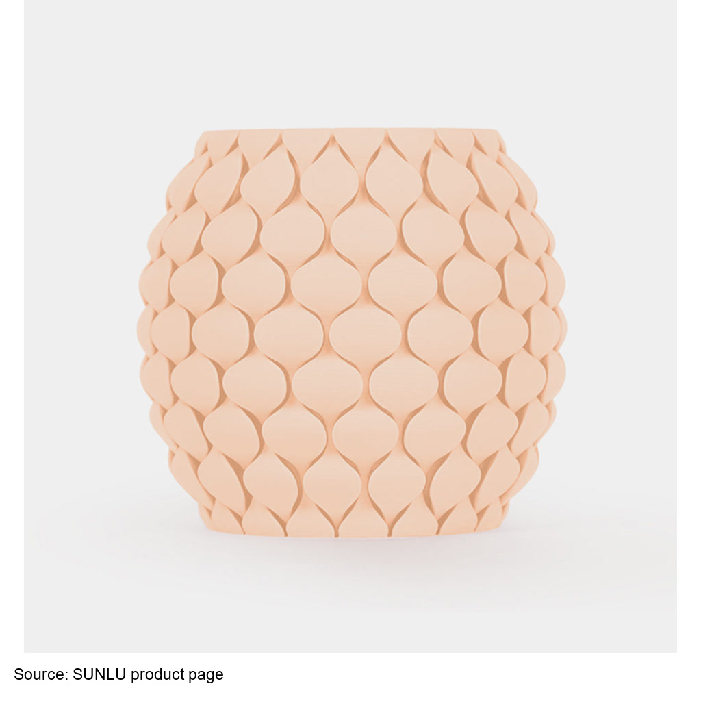

<!-- oomp-documentation:start -->
# SUNLU PLA Skin(Beige), 1 kg with spool

[Open catalogue record](http://localhost:5703/parts/three_d_printer_filament_pla_1_75_mm_beige_skin_beige_sunlu_dlz_us_sl_pla_sk_1kg) · [Manufacturer product page and variant SKU](https://store.sunlu.com/products/over-6kg-of-pla-pla-meta-3d-filaments-1kg-2-2lbs-fit-most-of-fdm-printer)

## Summary

SUNLU PLA in Skin(Beige).



SUNLU product-page colour sample for Skin(Beige); the colour sample is shown rather than the spool or refill. [SUNLU filament colour sample](https://store.sunlu.com/products/over-6kg-of-pla-pla-meta-3d-filaments-1kg-2-2lbs-fit-most-of-fdm-printer) by SUNLU. [Product image; reuse permission not established](https://store.sunlu.com/products/over-6kg-of-pla-pla-meta-3d-filaments-1kg-2-2lbs-fit-most-of-fdm-printer). Resized within a square white canvas and credited on the image.

## Details

OOMP ID `three_d_printer_filament_pla_1_75_mm_beige_skin_beige_sunlu_dlz_us_sl_pla_sk_1kg`

| Specification | Value |
| --- | --- |
| Colour name | Skin(Beige) |
| Filament diameter (mm) | 1.75 |
| Manufacturer part number | DLZ-US-SL-PLA-SK-1KG |
| Net mass (kg) | 1 |
| Package type | with spool |
| Product line | SUNLU PLA |
| Sku market | Manufacturer store, USA |

Sources checked 2026-11-18.


| Taxonomy slot | Value |
| --- | --- |
| 1 | `three_d_printer` |
| 2 | `filament` |
| 3 | `pla` |
| 4 | `1_75_mm` |
| 5 | `beige` |
| 6 | `skin_beige` |
| 14 | `sunlu` |
| 15 | `dlz_us_sl_pla_sk_1kg` |

## Labels

| Layout | Stock (mm) | Files |
| --- | --- | --- |
| OOMP inventory | 76.2 × 50.8 | [SVG](label_oomp.svg) · [Print PDF](label_oomp.pdf) |
| Stock | 76.2 × 50.8 | [SVG](label_stock_3x2.svg) · [Print PDF](label_stock_3x2.pdf) |
| Stock | 38.1 × 25.4 | [SVG](label_stock_1_5x1.svg) · [Print PDF](label_stock_1_5x1.pdf) |
| Drawer | 38.1 × 25.4 | [SVG](label_drawer.svg) · [Print PDF](label_drawer.pdf) |
| Compact barcode | 30 × 15 | [SVG](label_30x15.svg) · [Print PDF](label_30x15.pdf) |

## Parts

[Browse this category](../../navigation/filament/pla/1_75_mm/beige/README.md) · [Canonical metadata](working.yaml) · [Catalogue](../../README.md)


## Assembly

Use the model-specific manufacturer documentation linked above for setup or service.

<details>
<summary>Full OOMP metadata</summary>

```yaml
link_main: https://github.com/oomlout/oomp_three_d_printer_version_5/tree/main/parts/three_d_printer_filament_pla_1_75_mm_beige_skin_beige_sunlu_dlz_us_sl_pla_sk_1kg
link_source: https://store.sunlu.com/products/over-6kg-of-pla-pla-meta-3d-filaments-1kg-2-2lbs-fit-most-of-fdm-printer
link_web: http://localhost:5703/parts/three_d_printer_filament_pla_1_75_mm_beige_skin_beige_sunlu_dlz_us_sl_pla_sk_1kg
name_proper: SUNLU PLA Skin(Beige), 1 kg with spool
oomp_id: three_d_printer_filament_pla_1_75_mm_beige_skin_beige_sunlu_dlz_us_sl_pla_sk_1kg
photo:
  caption: SUNLU product-page colour sample for Skin(Beige); the colour sample is
    shown rather than the spool or refill.
  changes: Resized within a square white canvas and credited on the image.
  creator: SUNLU
  credit_line: 'Source: SUNLU product page'
  file: source_file/images/filament_sample_b5d6095dad3a0f5e_square.jpg
  license: Product image; reuse permission not established
  license_url: https://store.sunlu.com/products/over-6kg-of-pla-pla-meta-3d-filaments-1kg-2-2lbs-fit-most-of-fdm-printer
  original_file: source_file/images/original/filament_sample_b5d6095dad3a0f5e.jpg
  original_image_url: https://cdn.shopify.com/s/files/1/0152/6507/1190/files/PLA_beige.jpg?v=1776410951
  source: https://store.sunlu.com/products/over-6kg-of-pla-pla-meta-3d-filaments-1kg-2-2lbs-fit-most-of-fdm-printer
  source_checked: '2026-11-19'
  title: SUNLU filament colour sample
source_checked: '2026-11-18'
sources:
  Manufacturer product page and variant SKU: https://store.sunlu.com/products/over-6kg-of-pla-pla-meta-3d-filaments-1kg-2-2lbs-fit-most-of-fdm-printer
specifications:
  colour_name: Skin(Beige)
  filament_diameter_mm: 1.75
  manufacturer_part_number: DLZ-US-SL-PLA-SK-1KG
  net_mass_kg: 1
  package_type: with spool
  product_line: SUNLU PLA
  sku_market: Manufacturer store, USA
taxonomy_1: three_d_printer
taxonomy_10: ''
taxonomy_11: ''
taxonomy_12: ''
taxonomy_13: ''
taxonomy_14: sunlu
taxonomy_15: dlz_us_sl_pla_sk_1kg
taxonomy_2: filament
taxonomy_3: pla
taxonomy_4: 1_75_mm
taxonomy_5: beige
taxonomy_6: skin_beige
taxonomy_7: ''
taxonomy_8: ''
taxonomy_9: ''
taxonomy_1_upper: THREE_D_PRINTER
taxonomy_1_upper_length_1: T
taxonomy_1_upper_length_2: TH
taxonomy_1_upper_length_3: THR
taxonomy_1_upper_length_4: THRE
taxonomy_1_upper_length_5: THREE
taxonomy_1_length_1: t
taxonomy_1_length_2: th
taxonomy_1_length_3: thr
taxonomy_1_length_4: thre
taxonomy_1_length_5: three
taxonomy_1_capital: Three D Printer
taxonomy_1_first_letter: t
taxonomy_1_first_letter_upper: T
taxonomy_2_upper: FILAMENT
taxonomy_2_upper_length_1: F
taxonomy_2_upper_length_2: FI
taxonomy_2_upper_length_3: FIL
taxonomy_2_upper_length_4: FILA
taxonomy_2_upper_length_5: FILAM
taxonomy_2_length_1: f
taxonomy_2_length_2: fi
taxonomy_2_length_3: fil
taxonomy_2_length_4: fila
taxonomy_2_length_5: filam
taxonomy_2_capital: Filament
taxonomy_2_first_letter: f
taxonomy_2_first_letter_upper: F
taxonomy_3_upper: PLA
taxonomy_3_upper_length_1: P
taxonomy_3_upper_length_2: PL
taxonomy_3_upper_length_3: PLA
taxonomy_3_upper_length_4: PLA
taxonomy_3_upper_length_5: PLA
taxonomy_3_length_1: p
taxonomy_3_length_2: pl
taxonomy_3_length_3: pla
taxonomy_3_length_4: pla
taxonomy_3_length_5: pla
taxonomy_3_capital: Pla
taxonomy_3_first_letter: p
taxonomy_3_first_letter_upper: P
taxonomy_4_upper: 1_75_MM
taxonomy_4_upper_length_1: '1'
taxonomy_4_upper_length_2: '1_'
taxonomy_4_upper_length_3: '1_7'
taxonomy_4_upper_length_4: '1_75'
taxonomy_4_upper_length_5: '1_75_'
taxonomy_4_length_1: '1'
taxonomy_4_length_2: '1_'
taxonomy_4_length_3: '1_7'
taxonomy_4_length_4: '1_75'
taxonomy_4_length_5: '1_75_'
taxonomy_4_capital: 1.75 mm
taxonomy_4_first_letter: '1'
taxonomy_4_first_letter_upper: '1'
taxonomy_5_upper: BEIGE
taxonomy_5_upper_length_1: B
taxonomy_5_upper_length_2: BE
taxonomy_5_upper_length_3: BEI
taxonomy_5_upper_length_4: BEIG
taxonomy_5_upper_length_5: BEIGE
taxonomy_5_length_1: b
taxonomy_5_length_2: be
taxonomy_5_length_3: bei
taxonomy_5_length_4: beig
taxonomy_5_length_5: beige
taxonomy_5_capital: Beige
taxonomy_5_first_letter: b
taxonomy_5_first_letter_upper: B
taxonomy_6_upper: SKIN_BEIGE
taxonomy_6_upper_length_1: S
taxonomy_6_upper_length_2: SK
taxonomy_6_upper_length_3: SKI
taxonomy_6_upper_length_4: SKIN
taxonomy_6_upper_length_5: SKIN_
taxonomy_6_length_1: s
taxonomy_6_length_2: sk
taxonomy_6_length_3: ski
taxonomy_6_length_4: skin
taxonomy_6_length_5: skin_
taxonomy_6_capital: Skin Beige
taxonomy_6_first_letter: s
taxonomy_6_first_letter_upper: S
taxonomy_14_upper: SUNLU
taxonomy_14_upper_length_1: S
taxonomy_14_upper_length_2: SU
taxonomy_14_upper_length_3: SUN
taxonomy_14_upper_length_4: SUNL
taxonomy_14_upper_length_5: SUNLU
taxonomy_14_length_1: s
taxonomy_14_length_2: su
taxonomy_14_length_3: sun
taxonomy_14_length_4: sunl
taxonomy_14_length_5: sunlu
taxonomy_14_capital: Sunlu
taxonomy_14_first_letter: s
taxonomy_14_first_letter_upper: S
taxonomy_15_upper: DLZ_US_SL_PLA_SK_1KG
taxonomy_15_upper_length_1: D
taxonomy_15_upper_length_2: DL
taxonomy_15_upper_length_3: DLZ
taxonomy_15_upper_length_4: DLZ_
taxonomy_15_upper_length_5: DLZ_U
taxonomy_15_length_1: d
taxonomy_15_length_2: dl
taxonomy_15_length_3: dlz
taxonomy_15_length_4: dlz_
taxonomy_15_length_5: dlz_u
taxonomy_15_capital: Dlz Us Sl Pla Sk 1Kg
taxonomy_15_first_letter: d
taxonomy_15_first_letter_upper: D
id: three_d_printer_filament_pla_1_75_mm_beige_skin_beige_sunlu_dlz_us_sl_pla_sk_1kg
id_no_class: three_d_printer_filament_pla_1_75_mm_beige_skin_beige_sunlu_dlz_us_sl_pla_sk_1kg
id_no_type: three_d_printer_filament_pla_1_75_mm_beige_skin_beige_sunlu_dlz_us_sl_pla_sk_1kg
id_no_size: three_d_printer_filament_pla_1_75_mm_beige_skin_beige_sunlu_dlz_us_sl_pla_sk_1kg
oomp_key: oomp_three_d_printer_filament_pla_1_75_mm_beige_skin_beige_sunlu_dlz_us_sl_pla_sk_1kg
link_github: https://github.com/oomlout/oomp_three_d_printer_version_5/tree/main/parts/three_d_printer_filament_pla_1_75_mm_beige_skin_beige_sunlu_dlz_us_sl_pla_sk_1kg
link_redirect: https://github.com/oomlout/oomp_three_d_printer_version_5/tree/main/parts/three_d_printer_filament_pla_1_75_mm_beige_skin_beige_sunlu_dlz_us_sl_pla_sk_1kg
directory: parts/three_d_printer_filament_pla_1_75_mm_beige_skin_beige_sunlu_dlz_us_sl_pla_sk_1kg
name: Three D Printer Filament Pla 1 75 Mm Beige Skin Beige Sunlu Dlz Us Sl Pla Sk
  1Kg
name_no_class: Three D Printer Filament Pla 1 75 Mm Beige Skin Beige Sunlu Dlz Us
  Sl Pla Sk 1Kg
name_no_type: Three D Printer Filament Pla 1 75 Mm Beige Skin Beige Sunlu Dlz Us Sl
  Pla Sk 1Kg
name_no_size: Three D Printer Filament Pla 1 75 Mm Beige Skin Beige Sunlu Dlz Us Sl
  Pla Sk 1Kg
md5: ff3bcec4c5093daaba85a7a853649e99
md5_5: ff3bc
md5_5_upper: FF3BC
md5_6: ff3bce
md5_6_upper: FF3BCE
md5_6_alpha: 9yimm
md5_6_alpha_upper: 9YIMM
md5_10: ff3bcec4c5
md5_10_upper: FF3BCEC4C5
bip_39_full_array:
- you
- taxi
- raise
- meat
- need
- stem
- tube
- reject
- portion
- open
- chicken
- crater
bip_39_full_space: you taxi raise meat need stem tube reject portion open chicken
  crater
bip_39_full_no_space: youtaxiraisemeatneedstemtuberejectportionopenchickencrater
bip_39_full_underscore: you_taxi_raise_meat_need_stem_tube_reject_portion_open_chicken_crater
bip_39_2_word_array:
- you
- taxi
bip_39_2_word_space: you taxi
bip_39_2_word_no_space: youtaxi
bip_39_2_word_underscore: you_taxi
bip_39_3_word_array:
- you
- taxi
- raise
bip_39_3_word_space: you taxi raise
bip_39_3_word_no_space: youtaxiraise
bip_39_3_word_underscore: you_taxi_raise
label_title: DLZ-US-SL-PLA-SK-1KG
label_barcode: M0,0h34v760h-34z M136,0h34v760h-34z M204,0h102v760h-102z M340,0h102v760h-102z
  M476,0h34v760h-34z M544,0h34v760h-34z M612,0h102v760h-102z M816,0h34v760h-34z M884,0h102v760h-102z
  M1020,0h34v760h-34z M1088,0h102v760h-102z M1292,0h34v760h-34z M1360,0h102v760h-102z
  M1496,0h34v760h-34z M1564,0h34v760h-34z M1632,0h34v760h-34z M1700,0h102v760h-102z
  M1836,0h34v760h-34z M1972,0h102v760h-102z M2108,0h34v760h-34z M2176,0h102v760h-102z
  M2312,0h102v760h-102z M2448,0h34v760h-34z M2516,0h34v760h-34z M2652,0h34v760h-34z
  M2720,0h102v760h-102z M2856,0h102v760h-102z M2992,0h34v760h-34z M3060,0h34v760h-34z
  M3196,0h34v760h-34z M3264,0h34v760h-34z M3400,0h34v760h-34z M3468,0h102v760h-102z
  M3604,0h102v760h-102z M3740,0h34v760h-34z
label_barcode_width: 3774
label_maker: Sunlu
label_family: Filament
label_detail: PLA / 1.75 mm
label_variant: Skin(Beige)
label_context: Sunlu
inventory_title_size: 9.555498677587236
stock_title_size: 2.900776384267554
drawer_title_size: 1.8769729545260643
compact_title_size: 2.303557716918352
oomlout_ai_roboclick_1:
  actions:
  - command: text_jinja_template
    file_template: source_file/template_jinja/template_jinja_label_oomlout_76_2_mm_50_8_mm/working.svg.j2
    file_output: label_oomp.svg
    convert_to_pdf: true
    convert_to_png: false
  - command: text_jinja_template
    file_template: source_file/template_jinja/label_stock/3x2.svg.j2
    file_output: label_stock_3x2.svg
    convert_to_pdf: true
    convert_to_png: false
  - command: text_jinja_template
    file_template: source_file/template_jinja/label_stock/1_5x1.svg.j2
    file_output: label_stock_1_5x1.svg
    convert_to_pdf: true
    convert_to_png: false
  - command: text_jinja_template
    file_template: source_file/template_jinja/label_drawer/working.svg.j2
    file_output: label_drawer.svg
    convert_to_pdf: true
    convert_to_png: false
  - command: text_jinja_template
    file_template: source_file/template_jinja/label_printer_30x15/working.svg.j2
    file_output: label_30x15.svg
    convert_to_pdf: true
    convert_to_png: false
  file_test: ''
  retries_until_complete: 0
  action_name: step_0_jinja_template_label_oomp.svg
```

</details>
<!-- oomp-documentation:end -->
