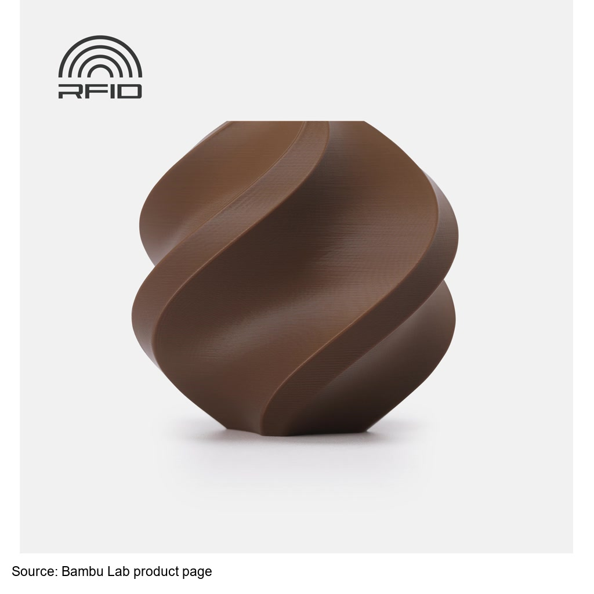

<!-- oomp-documentation:start -->
# PLA Basic Cocoa Brown, 1 kg refill

## Summary

PLA Basic in Cocoa Brown.



Bambu Lab product-page colour sample for Cocoa Brown; the colour sample is shown rather than the spool or refill. [Bambu Lab filament colour sample](https://bambulab-eu.myshopify.com/products/pla-basic-filament) by Bambu Lab. [Product image; reuse permission not established](https://bambulab-eu.myshopify.com/products/pla-basic-filament). Resized within a square white canvas and credited on the image.

## Details

OOMP ID `three_d_printer_filament_pla_1_75_mm_brown_cocoa_brown_bambu_lab_a00_n1_1_75_1000_splfree`

| Specification | Value |
| --- | --- |
| Colour code | 10802 |
| Colour name | Cocoa Brown |
| Filament diameter (mm) | 1.75 |
| Manufacturer part number | A00-N1-1.75-1000-SPLFREE |
| Net mass (kg) | 1 |
| Package type | refill |
| Product line | PLA Basic |

Sources checked 2026-11-18.

- [Manufacturer product page and variant SKU](https://bambulab-eu.myshopify.com/products/pla-basic-filament)

| Taxonomy slot | Value |
| --- | --- |
| 1 | `three_d_printer` |
| 2 | `filament` |
| 3 | `pla` |
| 4 | `1_75_mm` |
| 5 | `brown` |
| 6 | `cocoa_brown` |
| 14 | `bambu_lab` |
| 15 | `a00_n1_1_75_1000_splfree` |

## Labels

| Layout | Stock (mm) | Files |
| --- | --- | --- |
| OOMP inventory | 76.2 × 50.8 | [SVG](label_oomp.svg) · [Print PDF](label_oomp.pdf) |
| Stock | 76.2 × 50.8 | [SVG](label_stock_3x2.svg) · [Print PDF](label_stock_3x2.pdf) |
| Stock | 38.1 × 25.4 | [SVG](label_stock_1_5x1.svg) · [Print PDF](label_stock_1_5x1.pdf) |
| Drawer | 38.1 × 25.4 | [SVG](label_drawer.svg) · [Print PDF](label_drawer.pdf) |
| Compact barcode | 30 × 15 | [SVG](label_30x15.svg) · [Print PDF](label_30x15.pdf) |

## Parts

[Browse this category](../../navigation/filament/pla/1_75_mm/brown/README.md) · [Canonical metadata](working.yaml) · [Catalogue](../../README.md)


## Assembly

Use the model-specific manufacturer documentation linked above for setup or service.

<details>
<summary>Full OOMP metadata</summary>

```yaml
name_proper: PLA Basic Cocoa Brown, 1 kg refill
oomp_id: three_d_printer_filament_pla_1_75_mm_brown_cocoa_brown_bambu_lab_a00_n1_1_75_1000_splfree
photo:
  caption: Bambu Lab product-page colour sample for Cocoa Brown; the colour sample
    is shown rather than the spool or refill.
  changes: Resized within a square white canvas and credited on the image.
  creator: Bambu Lab
  credit_line: 'Source: Bambu Lab product page'
  file: source_file/images/filament_sample_a9a357063d33c976_square.jpg
  license: Product image; reuse permission not established
  license_url: https://bambulab-eu.myshopify.com/products/pla-basic-filament
  original_file: source_file/images/original/filament_sample_a9a357063d33c976.jpg
  original_image_url: https://cdn.shopify.com/s/files/1/0645/5876/0155/files/CocoaBrown.jpg?v=1737095626
  source: https://bambulab-eu.myshopify.com/products/pla-basic-filament
  source_checked: '2026-11-19'
  title: Bambu Lab filament colour sample
source_checked: '2026-11-18'
sources:
  Manufacturer product page and variant SKU: https://bambulab-eu.myshopify.com/products/pla-basic-filament
specifications:
  colour_code: '10802'
  colour_name: Cocoa Brown
  filament_diameter_mm: 1.75
  manufacturer_part_number: A00-N1-1.75-1000-SPLFREE
  net_mass_kg: 1
  package_type: refill
  product_line: PLA Basic
taxonomy_1: three_d_printer
taxonomy_10: ''
taxonomy_11: ''
taxonomy_12: ''
taxonomy_13: ''
taxonomy_14: bambu_lab
taxonomy_15: a00_n1_1_75_1000_splfree
taxonomy_2: filament
taxonomy_3: pla
taxonomy_4: 1_75_mm
taxonomy_5: brown
taxonomy_6: cocoa_brown
taxonomy_7: ''
taxonomy_8: ''
taxonomy_9: ''
taxonomy_1_upper: THREE_D_PRINTER
taxonomy_1_upper_length_1: T
taxonomy_1_upper_length_2: TH
taxonomy_1_upper_length_3: THR
taxonomy_1_upper_length_4: THRE
taxonomy_1_upper_length_5: THREE
taxonomy_1_length_1: t
taxonomy_1_length_2: th
taxonomy_1_length_3: thr
taxonomy_1_length_4: thre
taxonomy_1_length_5: three
taxonomy_1_capital: Three D Printer
taxonomy_1_first_letter: t
taxonomy_1_first_letter_upper: T
taxonomy_2_upper: FILAMENT
taxonomy_2_upper_length_1: F
taxonomy_2_upper_length_2: FI
taxonomy_2_upper_length_3: FIL
taxonomy_2_upper_length_4: FILA
taxonomy_2_upper_length_5: FILAM
taxonomy_2_length_1: f
taxonomy_2_length_2: fi
taxonomy_2_length_3: fil
taxonomy_2_length_4: fila
taxonomy_2_length_5: filam
taxonomy_2_capital: Filament
taxonomy_2_first_letter: f
taxonomy_2_first_letter_upper: F
taxonomy_3_upper: PLA
taxonomy_3_upper_length_1: P
taxonomy_3_upper_length_2: PL
taxonomy_3_upper_length_3: PLA
taxonomy_3_upper_length_4: PLA
taxonomy_3_upper_length_5: PLA
taxonomy_3_length_1: p
taxonomy_3_length_2: pl
taxonomy_3_length_3: pla
taxonomy_3_length_4: pla
taxonomy_3_length_5: pla
taxonomy_3_capital: Pla
taxonomy_3_first_letter: p
taxonomy_3_first_letter_upper: P
taxonomy_4_upper: 1_75_MM
taxonomy_4_upper_length_1: '1'
taxonomy_4_upper_length_2: '1_'
taxonomy_4_upper_length_3: '1_7'
taxonomy_4_upper_length_4: '1_75'
taxonomy_4_upper_length_5: '1_75_'
taxonomy_4_length_1: '1'
taxonomy_4_length_2: '1_'
taxonomy_4_length_3: '1_7'
taxonomy_4_length_4: '1_75'
taxonomy_4_length_5: '1_75_'
taxonomy_4_capital: 1.75 mm
taxonomy_4_first_letter: '1'
taxonomy_4_first_letter_upper: '1'
taxonomy_5_upper: BROWN
taxonomy_5_upper_length_1: B
taxonomy_5_upper_length_2: BR
taxonomy_5_upper_length_3: BRO
taxonomy_5_upper_length_4: BROW
taxonomy_5_upper_length_5: BROWN
taxonomy_5_length_1: b
taxonomy_5_length_2: br
taxonomy_5_length_3: bro
taxonomy_5_length_4: brow
taxonomy_5_length_5: brown
taxonomy_5_capital: Brown
taxonomy_5_first_letter: b
taxonomy_5_first_letter_upper: B
taxonomy_6_upper: COCOA_BROWN
taxonomy_6_upper_length_1: C
taxonomy_6_upper_length_2: CO
taxonomy_6_upper_length_3: COC
taxonomy_6_upper_length_4: COCO
taxonomy_6_upper_length_5: COCOA
taxonomy_6_length_1: c
taxonomy_6_length_2: co
taxonomy_6_length_3: coc
taxonomy_6_length_4: coco
taxonomy_6_length_5: cocoa
taxonomy_6_capital: Cocoa Brown
taxonomy_6_first_letter: c
taxonomy_6_first_letter_upper: C
taxonomy_14_upper: BAMBU_LAB
taxonomy_14_upper_length_1: B
taxonomy_14_upper_length_2: BA
taxonomy_14_upper_length_3: BAM
taxonomy_14_upper_length_4: BAMB
taxonomy_14_upper_length_5: BAMBU
taxonomy_14_length_1: b
taxonomy_14_length_2: ba
taxonomy_14_length_3: bam
taxonomy_14_length_4: bamb
taxonomy_14_length_5: bambu
taxonomy_14_capital: Bambu Lab
taxonomy_14_first_letter: b
taxonomy_14_first_letter_upper: B
taxonomy_15_upper: A00_N1_1_75_1000_SPLFREE
taxonomy_15_upper_length_1: A
taxonomy_15_upper_length_2: A0
taxonomy_15_upper_length_3: A00
taxonomy_15_upper_length_4: A00_
taxonomy_15_upper_length_5: A00_N
taxonomy_15_length_1: a
taxonomy_15_length_2: a0
taxonomy_15_length_3: a00
taxonomy_15_length_4: a00_
taxonomy_15_length_5: a00_n
taxonomy_15_capital: A00 N1.1.75.1000 Splfree
taxonomy_15_first_letter: a
taxonomy_15_first_letter_upper: A
id: three_d_printer_filament_pla_1_75_mm_brown_cocoa_brown_bambu_lab_a00_n1_1_75_1000_splfree
id_no_class: three_d_printer_filament_pla_1_75_mm_brown_cocoa_brown_bambu_lab_a00_n1_1_75_1000_splfree
id_no_type: three_d_printer_filament_pla_1_75_mm_brown_cocoa_brown_bambu_lab_a00_n1_1_75_1000_splfree
id_no_size: three_d_printer_filament_pla_1_75_mm_brown_cocoa_brown_bambu_lab_a00_n1_1_75_1000_splfree
oomp_key: oomp_three_d_printer_filament_pla_1_75_mm_brown_cocoa_brown_bambu_lab_a00_n1_1_75_1000_splfree
link_github: https://github.com/oomlout/oomp_three_d_printer_version_5/tree/main/parts/three_d_printer_filament_pla_1_75_mm_brown_cocoa_brown_bambu_lab_a00_n1_1_75_1000_splfree
link_main: https://github.com/oomlout/oomp_three_d_printer_version_5/tree/main/parts/three_d_printer_filament_pla_1_75_mm_brown_cocoa_brown_bambu_lab_a00_n1_1_75_1000_splfree
link_redirect: https://github.com/oomlout/oomp_three_d_printer_version_5/tree/main/parts/three_d_printer_filament_pla_1_75_mm_brown_cocoa_brown_bambu_lab_a00_n1_1_75_1000_splfree
directory: parts/three_d_printer_filament_pla_1_75_mm_brown_cocoa_brown_bambu_lab_a00_n1_1_75_1000_splfree
name: Three D Printer Filament Pla 1 75 Mm Brown Cocoa Brown Bambu Lab A00 N1 1 75
  1000 Splfree
name_no_class: Three D Printer Filament Pla 1 75 Mm Brown Cocoa Brown Bambu Lab A00
  N1 1 75 1000 Splfree
name_no_type: Three D Printer Filament Pla 1 75 Mm Brown Cocoa Brown Bambu Lab A00
  N1 1 75 1000 Splfree
name_no_size: Three D Printer Filament Pla 1 75 Mm Brown Cocoa Brown Bambu Lab A00
  N1 1 75 1000 Splfree
md5: 4614c5117c941224c775b9f8d3b97cb4
md5_5: 4614c
md5_5_upper: 4614C
md5_6: 4614c5
md5_6_upper: 4614C5
md5_6_alpha: 2qfut
md5_6_alpha_upper: 2QFUT
md5_10: 4614c5117c
md5_10_upper: 4614C5117C
bip_39_full_array:
- ecology
- plate
- dust
- weird
- donkey
- bar
- build
- rescue
- web
- oven
- game
- habit
bip_39_full_space: ecology plate dust weird donkey bar build rescue web oven game
  habit
bip_39_full_no_space: ecologyplatedustweirddonkeybarbuildrescuewebovengamehabit
bip_39_full_underscore: ecology_plate_dust_weird_donkey_bar_build_rescue_web_oven_game_habit
bip_39_2_word_array:
- ecology
- plate
bip_39_2_word_space: ecology plate
bip_39_2_word_no_space: ecologyplate
bip_39_2_word_underscore: ecology_plate
bip_39_3_word_array:
- ecology
- plate
- dust
bip_39_3_word_space: ecology plate dust
bip_39_3_word_no_space: ecologyplatedust
bip_39_3_word_underscore: ecology_plate_dust
label_title: A00-N1-1.75-1000-SPLFREE
label_barcode: M0,0h34v760h-34z M136,0h34v760h-34z M204,0h102v760h-102z M340,0h102v760h-102z
  M476,0h34v760h-34z M544,0h34v760h-34z M612,0h102v760h-102z M816,0h34v760h-34z M884,0h34v760h-34z
  M952,0h102v760h-102z M1088,0h34v760h-34z M1156,0h34v760h-34z M1224,0h34v760h-34z
  M1292,0h102v760h-102z M1496,0h102v760h-102z M1632,0h34v760h-34z M1700,0h102v760h-102z
  M1836,0h102v760h-102z M2040,0h34v760h-34z M2108,0h34v760h-34z M2176,0h102v760h-102z
  M2380,0h34v760h-34z M2448,0h34v760h-34z M2516,0h34v760h-34z M2584,0h102v760h-102z
  M2720,0h34v760h-34z M2788,0h34v760h-34z M2856,0h102v760h-102z M2992,0h102v760h-102z
  M3196,0h34v760h-34z M3264,0h34v760h-34z M3400,0h34v760h-34z M3468,0h102v760h-102z
  M3604,0h102v760h-102z M3740,0h34v760h-34z
label_barcode_width: 3774
label_maker: Bambu Lab
label_family: Filament
label_detail: PLA / 1.75 mm
label_variant: Cocoa Brown
label_context: Bambu Lab
inventory_title_size: 8.468168758505973
stock_title_size: 2.5706940874035986
drawer_title_size: 1.6633902918493875
compact_title_size: 2.0414335399969756
oomlout_ai_roboclick_1:
  actions:
  - command: text_jinja_template
    file_template: source_file/template_jinja/template_jinja_label_oomlout_76_2_mm_50_8_mm/working.svg.j2
    file_output: label_oomp.svg
    convert_to_pdf: true
    convert_to_png: false
  - command: text_jinja_template
    file_template: source_file/template_jinja/label_stock/3x2.svg.j2
    file_output: label_stock_3x2.svg
    convert_to_pdf: true
    convert_to_png: false
  - command: text_jinja_template
    file_template: source_file/template_jinja/label_stock/1_5x1.svg.j2
    file_output: label_stock_1_5x1.svg
    convert_to_pdf: true
    convert_to_png: false
  - command: text_jinja_template
    file_template: source_file/template_jinja/label_drawer/working.svg.j2
    file_output: label_drawer.svg
    convert_to_pdf: true
    convert_to_png: false
  - command: text_jinja_template
    file_template: source_file/template_jinja/label_printer_30x15/working.svg.j2
    file_output: label_30x15.svg
    convert_to_pdf: true
    convert_to_png: false
  file_test: ''
  retries_until_complete: 0
  action_name: step_0_jinja_template_label_oomp.svg
```

</details>
<!-- oomp-documentation:end -->
