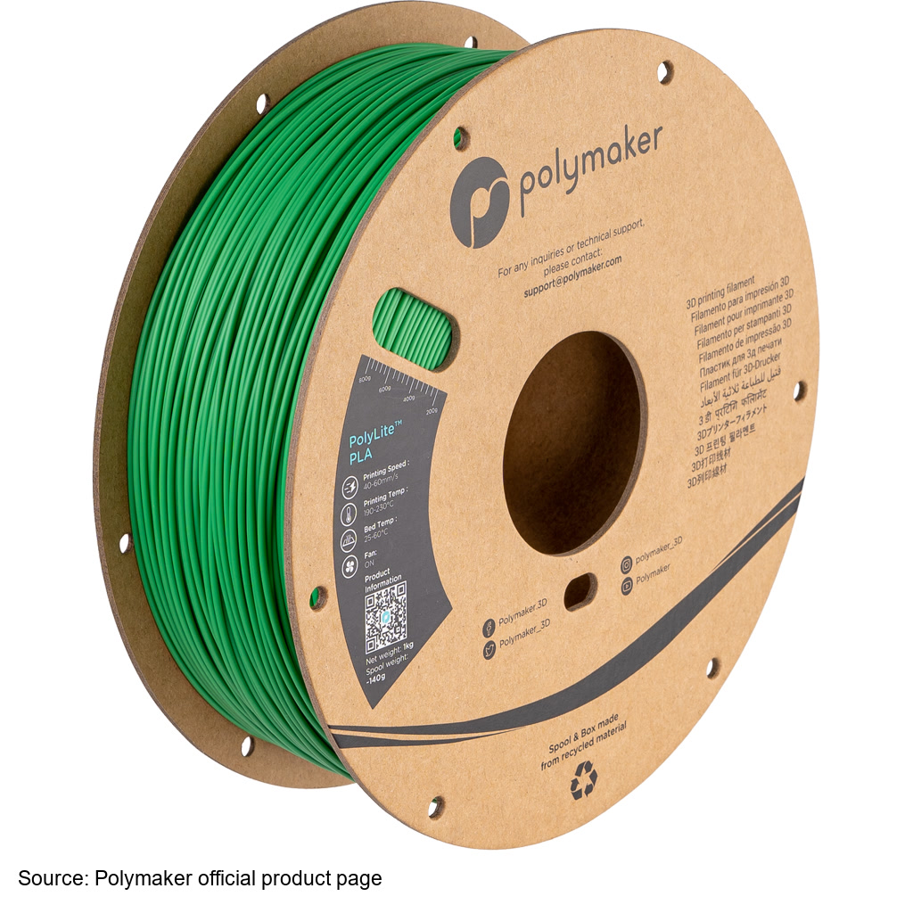

<!-- oomp-documentation:start -->
# Polymaker PolyLite PLA Green, 1.75 mm, 1 kg

## Summary

PolyLite PLA in Green.



Polymaker product image for Green / 1.75mm / 1kg. [Polymaker product image](https://shop.polymaker.com/products/polylite-pla) by Polymaker. [Manufacturer product image; reuse permission not established](https://shop.polymaker.com/products/polylite-pla). Resized within a square white canvas and credited on the image.

## Details

OOMP ID `three_d_printer_filament_pla_1_75_mm_green_green_polymaker_pa02006`

| Specification | Value |
| --- | --- |
| Colour name | Green |
| Filament diameter (mm) | 1.75 |
| Manufacturer part number | PA02006 |
| Net mass (kg) | 1.0 |
| Product line | PolyLite PLA |

Sources checked 2026-11-18.

- [Polymaker 2024 SKU table](https://polymaker.com/wp-content/uploads/SKU-PDF-Version-EN-2024-01.pdf)

| Taxonomy slot | Value |
| --- | --- |
| 1 | `three_d_printer` |
| 2 | `filament` |
| 3 | `pla` |
| 4 | `1_75_mm` |
| 5 | `green` |
| 6 | `green` |
| 14 | `polymaker` |
| 15 | `pa02006` |

## Labels

| Layout | Stock (mm) | Files |
| --- | --- | --- |
| OOMP inventory | 76.2 × 50.8 | [SVG](label_oomp.svg) · [Print PDF](label_oomp.pdf) |
| Stock | 76.2 × 50.8 | [SVG](label_stock_3x2.svg) · [Print PDF](label_stock_3x2.pdf) |
| Stock | 38.1 × 25.4 | [SVG](label_stock_1_5x1.svg) · [Print PDF](label_stock_1_5x1.pdf) |
| Drawer | 38.1 × 25.4 | [SVG](label_drawer.svg) · [Print PDF](label_drawer.pdf) |
| Compact barcode | 30 × 15 | [SVG](label_30x15.svg) · [Print PDF](label_30x15.pdf) |

## Parts

[Browse this category](../../navigation/filament/pla/1_75_mm/green/README.md) · [Canonical metadata](working.yaml) · [Catalogue](../../README.md)


## Assembly

Use the model-specific manufacturer documentation linked above for setup or service.

<details>
<summary>Full OOMP metadata</summary>

```yaml
name_proper: Polymaker PolyLite PLA Green, 1.75 mm, 1 kg
oomp_id: three_d_printer_filament_pla_1_75_mm_green_green_polymaker_pa02006
photo:
  caption: Polymaker product image for Green / 1.75mm / 1kg.
  changes: Resized within a square white canvas and credited on the image.
  creator: Polymaker
  credit_line: 'Source: Polymaker official product page'
  file: source_file/images/polymaker_pa02006_square.jpg
  license: Manufacturer product image; reuse permission not established
  license_url: https://shop.polymaker.com/products/polylite-pla
  original_file: source_file/images/original/polymaker_pa02006.png
  original_image_url: https://cdn.shopify.com/s/files/1/0548/7299/7945/products/Polymaker_Polylite_Green.png?v=1696941145
  source: https://shop.polymaker.com/products/polylite-pla
  source_checked: '2026-11-19'
  title: Polymaker product image
source_checked: '2026-11-18'
sources:
  Polymaker 2024 SKU table: https://polymaker.com/wp-content/uploads/SKU-PDF-Version-EN-2024-01.pdf
specifications:
  colour_name: Green
  filament_diameter_mm: 1.75
  manufacturer_part_number: PA02006
  net_mass_kg: 1.0
  product_line: PolyLite PLA
taxonomy_1: three_d_printer
taxonomy_10: ''
taxonomy_11: ''
taxonomy_12: ''
taxonomy_13: ''
taxonomy_14: polymaker
taxonomy_15: pa02006
taxonomy_2: filament
taxonomy_3: pla
taxonomy_4: 1_75_mm
taxonomy_5: green
taxonomy_6: green
taxonomy_7: ''
taxonomy_8: ''
taxonomy_9: ''
taxonomy_1_upper: THREE_D_PRINTER
taxonomy_1_upper_length_1: T
taxonomy_1_upper_length_2: TH
taxonomy_1_upper_length_3: THR
taxonomy_1_upper_length_4: THRE
taxonomy_1_upper_length_5: THREE
taxonomy_1_length_1: t
taxonomy_1_length_2: th
taxonomy_1_length_3: thr
taxonomy_1_length_4: thre
taxonomy_1_length_5: three
taxonomy_1_capital: Three D Printer
taxonomy_1_first_letter: t
taxonomy_1_first_letter_upper: T
taxonomy_2_upper: FILAMENT
taxonomy_2_upper_length_1: F
taxonomy_2_upper_length_2: FI
taxonomy_2_upper_length_3: FIL
taxonomy_2_upper_length_4: FILA
taxonomy_2_upper_length_5: FILAM
taxonomy_2_length_1: f
taxonomy_2_length_2: fi
taxonomy_2_length_3: fil
taxonomy_2_length_4: fila
taxonomy_2_length_5: filam
taxonomy_2_capital: Filament
taxonomy_2_first_letter: f
taxonomy_2_first_letter_upper: F
taxonomy_3_upper: PLA
taxonomy_3_upper_length_1: P
taxonomy_3_upper_length_2: PL
taxonomy_3_upper_length_3: PLA
taxonomy_3_upper_length_4: PLA
taxonomy_3_upper_length_5: PLA
taxonomy_3_length_1: p
taxonomy_3_length_2: pl
taxonomy_3_length_3: pla
taxonomy_3_length_4: pla
taxonomy_3_length_5: pla
taxonomy_3_capital: Pla
taxonomy_3_first_letter: p
taxonomy_3_first_letter_upper: P
taxonomy_4_upper: 1_75_MM
taxonomy_4_upper_length_1: '1'
taxonomy_4_upper_length_2: '1_'
taxonomy_4_upper_length_3: '1_7'
taxonomy_4_upper_length_4: '1_75'
taxonomy_4_upper_length_5: '1_75_'
taxonomy_4_length_1: '1'
taxonomy_4_length_2: '1_'
taxonomy_4_length_3: '1_7'
taxonomy_4_length_4: '1_75'
taxonomy_4_length_5: '1_75_'
taxonomy_4_capital: 1.75 mm
taxonomy_4_first_letter: '1'
taxonomy_4_first_letter_upper: '1'
taxonomy_5_upper: GREEN
taxonomy_5_upper_length_1: G
taxonomy_5_upper_length_2: GR
taxonomy_5_upper_length_3: GRE
taxonomy_5_upper_length_4: GREE
taxonomy_5_upper_length_5: GREEN
taxonomy_5_length_1: g
taxonomy_5_length_2: gr
taxonomy_5_length_3: gre
taxonomy_5_length_4: gree
taxonomy_5_length_5: green
taxonomy_5_capital: Green
taxonomy_5_first_letter: g
taxonomy_5_first_letter_upper: G
taxonomy_6_upper: GREEN
taxonomy_6_upper_length_1: G
taxonomy_6_upper_length_2: GR
taxonomy_6_upper_length_3: GRE
taxonomy_6_upper_length_4: GREE
taxonomy_6_upper_length_5: GREEN
taxonomy_6_length_1: g
taxonomy_6_length_2: gr
taxonomy_6_length_3: gre
taxonomy_6_length_4: gree
taxonomy_6_length_5: green
taxonomy_6_capital: Green
taxonomy_6_first_letter: g
taxonomy_6_first_letter_upper: G
taxonomy_14_upper: POLYMAKER
taxonomy_14_upper_length_1: P
taxonomy_14_upper_length_2: PO
taxonomy_14_upper_length_3: POL
taxonomy_14_upper_length_4: POLY
taxonomy_14_upper_length_5: POLYM
taxonomy_14_length_1: p
taxonomy_14_length_2: po
taxonomy_14_length_3: pol
taxonomy_14_length_4: poly
taxonomy_14_length_5: polym
taxonomy_14_capital: Polymaker
taxonomy_14_first_letter: p
taxonomy_14_first_letter_upper: P
taxonomy_15_upper: PA02006
taxonomy_15_upper_length_1: P
taxonomy_15_upper_length_2: PA
taxonomy_15_upper_length_3: PA0
taxonomy_15_upper_length_4: PA02
taxonomy_15_upper_length_5: PA020
taxonomy_15_length_1: p
taxonomy_15_length_2: pa
taxonomy_15_length_3: pa0
taxonomy_15_length_4: pa02
taxonomy_15_length_5: pa020
taxonomy_15_capital: Pa02006
taxonomy_15_first_letter: p
taxonomy_15_first_letter_upper: P
id: three_d_printer_filament_pla_1_75_mm_green_green_polymaker_pa02006
id_no_class: three_d_printer_filament_pla_1_75_mm_green_green_polymaker_pa02006
id_no_type: three_d_printer_filament_pla_1_75_mm_green_green_polymaker_pa02006
id_no_size: three_d_printer_filament_pla_1_75_mm_green_green_polymaker_pa02006
oomp_key: oomp_three_d_printer_filament_pla_1_75_mm_green_green_polymaker_pa02006
link_github: https://github.com/oomlout/oomp_three_d_printer_version_5/tree/main/parts/three_d_printer_filament_pla_1_75_mm_green_green_polymaker_pa02006
link_main: https://github.com/oomlout/oomp_three_d_printer_version_5/tree/main/parts/three_d_printer_filament_pla_1_75_mm_green_green_polymaker_pa02006
link_redirect: https://github.com/oomlout/oomp_three_d_printer_version_5/tree/main/parts/three_d_printer_filament_pla_1_75_mm_green_green_polymaker_pa02006
directory: parts/three_d_printer_filament_pla_1_75_mm_green_green_polymaker_pa02006
name: Three D Printer Filament Pla 1 75 Mm Green Green Polymaker Pa02006
name_no_class: Three D Printer Filament Pla 1 75 Mm Green Green Polymaker Pa02006
name_no_type: Three D Printer Filament Pla 1 75 Mm Green Green Polymaker Pa02006
name_no_size: Three D Printer Filament Pla 1 75 Mm Green Green Polymaker Pa02006
md5: 61fb676cd64909ece10107df60569c71
md5_5: 61fb6
md5_5_upper: 61FB6
md5_6: 61fb67
md5_6_upper: 61FB67
md5_6_alpha: 3tmqv
md5_6_alpha_upper: 3TMQV
md5_10: 61fb676cd6
md5_10_upper: 61FB676CD6
bip_39_full_array:
- giggle
- swamp
- swamp
- prosper
- mountain
- wait
- lottery
- can
- term
- actor
- poem
- together
bip_39_full_space: giggle swamp swamp prosper mountain wait lottery can term actor
  poem together
bip_39_full_no_space: giggleswampswampprospermountainwaitlotterycantermactorpoemtogether
bip_39_full_underscore: giggle_swamp_swamp_prosper_mountain_wait_lottery_can_term_actor_poem_together
bip_39_2_word_array:
- giggle
- swamp
bip_39_2_word_space: giggle swamp
bip_39_2_word_no_space: giggleswamp
bip_39_2_word_underscore: giggle_swamp
bip_39_3_word_array:
- giggle
- swamp
- swamp
bip_39_3_word_space: giggle swamp swamp
bip_39_3_word_no_space: giggleswampswamp
bip_39_3_word_underscore: giggle_swamp_swamp
label_title: PA02006
label_barcode: M0,0h34v760h-34z M136,0h34v760h-34z M204,0h102v760h-102z M340,0h102v760h-102z
  M476,0h34v760h-34z M544,0h102v760h-102z M680,0h102v760h-102z M884,0h34v760h-34z
  M952,0h34v760h-34z M1020,0h34v760h-34z M1088,0h34v760h-34z M1156,0h34v760h-34z M1224,0h102v760h-102z
  M1360,0h102v760h-102z M1564,0h34v760h-34z M1632,0h102v760h-102z M1768,0h102v760h-102z
  M1904,0h34v760h-34z M1972,0h34v760h-34z M2108,0h34v760h-34z M2176,0h34v760h-34z
  M2244,0h34v760h-34z M2312,0h34v760h-34z M2380,0h102v760h-102z M2584,0h102v760h-102z
  M2720,0h34v760h-34z M2856,0h102v760h-102z M2992,0h34v760h-34z M3060,0h34v760h-34z
  M3128,0h102v760h-102z M3264,0h34v760h-34z M3400,0h34v760h-34z M3468,0h102v760h-102z
  M3604,0h102v760h-102z M3740,0h34v760h-34z
label_barcode_width: 3774
label_maker: Polymaker
label_family: Filament
label_detail: PLA / 1.75 mm
label_variant: Green
label_context: Polymaker
inventory_title_size: 14
stock_title_size: 5.3
drawer_title_size: 3.3
compact_title_size: 2.8
oomlout_ai_roboclick_1:
  actions:
  - command: text_jinja_template
    file_template: source_file/template_jinja/template_jinja_label_oomlout_76_2_mm_50_8_mm/working.svg.j2
    file_output: label_oomp.svg
    convert_to_pdf: true
    convert_to_png: false
  - command: text_jinja_template
    file_template: source_file/template_jinja/label_stock/3x2.svg.j2
    file_output: label_stock_3x2.svg
    convert_to_pdf: true
    convert_to_png: false
  - command: text_jinja_template
    file_template: source_file/template_jinja/label_stock/1_5x1.svg.j2
    file_output: label_stock_1_5x1.svg
    convert_to_pdf: true
    convert_to_png: false
  - command: text_jinja_template
    file_template: source_file/template_jinja/label_drawer/working.svg.j2
    file_output: label_drawer.svg
    convert_to_pdf: true
    convert_to_png: false
  - command: text_jinja_template
    file_template: source_file/template_jinja/label_printer_30x15/working.svg.j2
    file_output: label_30x15.svg
    convert_to_pdf: true
    convert_to_png: false
  file_test: ''
  retries_until_complete: 0
  action_name: step_0_jinja_template_label_oomp.svg
```

</details>
<!-- oomp-documentation:end -->
