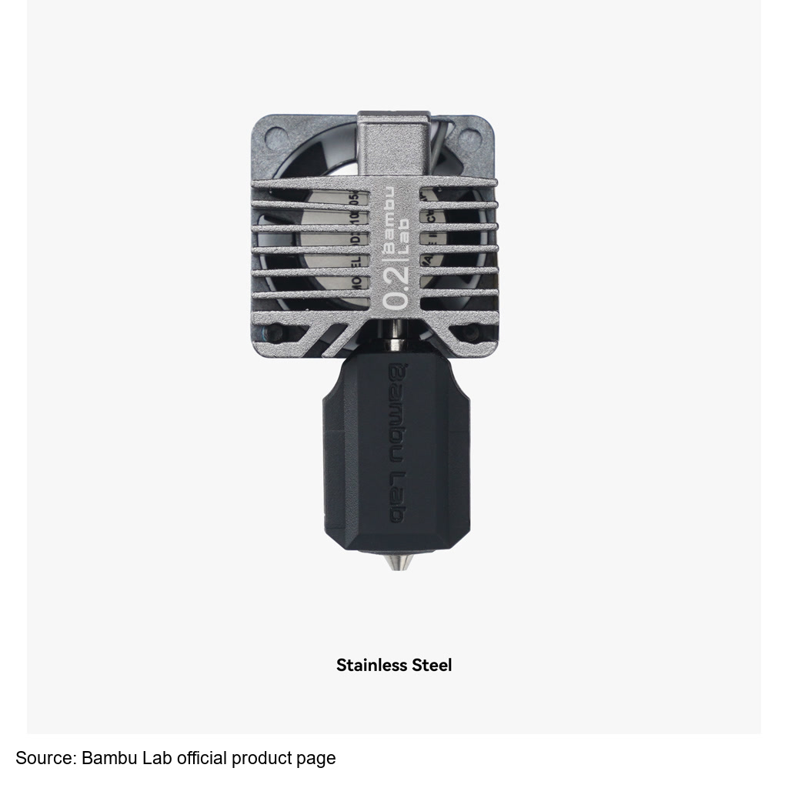

<!-- oomp-documentation:start -->
# Spare record moved

[Open the current part page](../three_d_printer_part_bambu_lab_p1s_toolhead_hotend_complete_0_2_mm_stainless_steel_bambu_lab_fah004_p/README.md). Previous label code: `IVS9`.

[Open catalogue record](http://localhost:5703/parts/three_d_printer_part_bambu_lab_p1s_toolhead_hotend_complete_0_2_mm_stainless_steel_bambu_lab_fah004_p) · [Bambu Lab P1 hotend, variants and compatibility](https://bambu-lab-global.myshopify.com/products/bambu-hotend-p1-series)

Manufacturer product image for 0.2mm Stainless Steel / Complete Hotend. [Bambu Lab product image](https://bambu-lab-global.myshopify.com/products/bambu-hotend-p1-series) by Bambu Lab. [Manufacturer product image; reuse permission not established](https://bambu-lab-global.myshopify.com/products/bambu-hotend-p1-series). Resized within a square white canvas and credited on the image.

## Current labels

- OOMP inventory 76.2 × 50.8 mm · [SVG](../three_d_printer_part_bambu_lab_p1s_toolhead_hotend_complete_0_2_mm_stainless_steel_bambu_lab_fah004_p/label_oomp.svg) · [Print PDF](../three_d_printer_part_bambu_lab_p1s_toolhead_hotend_complete_0_2_mm_stainless_steel_bambu_lab_fah004_p/label_oomp.pdf)
- Stock 76.2 × 50.8 mm · [SVG](../three_d_printer_part_bambu_lab_p1s_toolhead_hotend_complete_0_2_mm_stainless_steel_bambu_lab_fah004_p/label_stock_3x2.svg) · [Print PDF](../three_d_printer_part_bambu_lab_p1s_toolhead_hotend_complete_0_2_mm_stainless_steel_bambu_lab_fah004_p/label_stock_3x2.pdf)
- Stock 38.1 × 25.4 mm · [SVG](../three_d_printer_part_bambu_lab_p1s_toolhead_hotend_complete_0_2_mm_stainless_steel_bambu_lab_fah004_p/label_stock_1_5x1.svg) · [Print PDF](../three_d_printer_part_bambu_lab_p1s_toolhead_hotend_complete_0_2_mm_stainless_steel_bambu_lab_fah004_p/label_stock_1_5x1.pdf)
- Drawer 38.1 × 25.4 mm · [SVG](../three_d_printer_part_bambu_lab_p1s_toolhead_hotend_complete_0_2_mm_stainless_steel_bambu_lab_fah004_p/label_drawer.svg) · [Print PDF](../three_d_printer_part_bambu_lab_p1s_toolhead_hotend_complete_0_2_mm_stainless_steel_bambu_lab_fah004_p/label_drawer.pdf)
- Compact barcode 30 × 15 mm · [SVG](../three_d_printer_part_bambu_lab_p1s_toolhead_hotend_complete_0_2_mm_stainless_steel_bambu_lab_fah004_p/label_30x15.svg) · [Print PDF](../three_d_printer_part_bambu_lab_p1s_toolhead_hotend_complete_0_2_mm_stainless_steel_bambu_lab_fah004_p/label_30x15.pdf)
<!-- oomp-documentation:end -->
