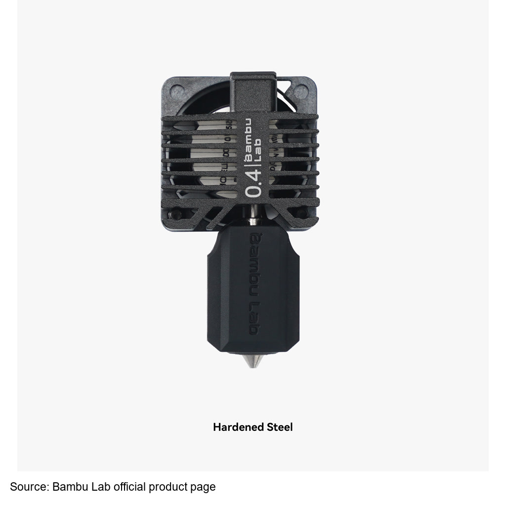

<!-- oomp-documentation:start -->
# Bambu Lab P1 series complete hotend, 0.4 mm

[Open catalogue record](http://localhost:5703/parts/three_d_printer_part_bambu_lab_p1s_toolhead_hotend_complete_0_4_mm_hardened_steel_bambu_lab_fah001_p) · [Bambu Lab assembly and compatibility](https://bambu-lab-global.myshopify.com/products/bambu-hotend-p1-series)

## Summary

Complete hotend assembly with fan, heater and thermistor



Manufacturer product image for 0.4mm Hardened Steel / Complete Hotend. [Bambu Lab product image](https://bambu-lab-global.myshopify.com/products/bambu-hotend-p1-series) by Bambu Lab. [Manufacturer product image; reuse permission not established](https://bambu-lab-global.myshopify.com/products/bambu-hotend-p1-series). Resized within a square white canvas and credited on the image.

## Details

OOMP ID `three_d_printer_part_bambu_lab_p1s_toolhead_hotend_complete_0_4_mm_hardened_steel_bambu_lab_fah001_p`

| Specification | Value |
| --- | --- |
| Assembly scope | Complete hotend assembly with fan, heater and thermistor |
| Manufacturer part number | FAH001-P |
| Nozzle diameter (mm) | 0.4 |
| Nozzle material | Hardened steel |
| Reference price | GBP 32.99, Additive-X UK retail listing, VAT included. |

Sources checked 2026-11-18.

- [Additive-X exact manufacturer SKU and UK price](https://www.additive-x.com/shop/bambu-lab-p1-series-complete-hotend-assembly-with-hardened-steel-nozzle-0-4mm.html)

| Taxonomy slot | Value |
| --- | --- |
| 1 | `three_d_printer` |
| 2 | `part` |
| 3 | `bambu_lab_p1s` |
| 4 | `toolhead` |
| 5 | `hotend` |
| 6 | `complete_0_4_mm_hardened_steel` |
| 14 | `bambu_lab` |
| 15 | `fah001_p` |

Assembly taxonomy: [toolhead / hotend](../../navigation/part/bambu_lab_p1s/toolhead/hotend/README.md)

## Labels

| Layout | Stock (mm) | Files |
| --- | --- | --- |
| OOMP inventory | 76.2 × 50.8 | [SVG](label_oomp.svg) · [Print PDF](label_oomp.pdf) |
| Stock | 76.2 × 50.8 | [SVG](label_stock_3x2.svg) · [Print PDF](label_stock_3x2.pdf) |
| Stock | 38.1 × 25.4 | [SVG](label_stock_1_5x1.svg) · [Print PDF](label_stock_1_5x1.pdf) |
| Drawer | 38.1 × 25.4 | [SVG](label_drawer.svg) · [Print PDF](label_drawer.pdf) |
| Compact barcode | 30 × 15 | [SVG](label_30x15.svg) · [Print PDF](label_30x15.pdf) |

## Parts

[Browse this category](../../navigation/part/bambu_lab_p1s/toolhead/hotend/README.md) · [Canonical metadata](working.yaml) · [Catalogue](../../README.md)

Confirmed printer models in this catalogue

- [Bambu Lab P1S](../three_d_printer_printer_bambu_lab_p1s/)
- [Bambu Lab P1P](../three_d_printer_printer_bambu_lab_p1p/)

## Assembly

Use the model-specific manufacturer documentation linked above for setup or service.

<details>
<summary>Full OOMP metadata</summary>

```yaml
assembly_path:
- toolhead
- hotend
compatible_printers:
- three_d_printer_printer_bambu_lab_p1s
- three_d_printer_printer_bambu_lab_p1p
exact_variant: complete_0_4_mm_hardened_steel
link_main: https://github.com/oomlout/oomp_three_d_printer_version_5/tree/main/parts/three_d_printer_part_bambu_lab_p1s_toolhead_hotend_complete_0_4_mm_hardened_steel_bambu_lab_fah001_p
link_source: https://bambu-lab-global.myshopify.com/products/bambu-hotend-p1-series
link_web: http://localhost:5703/parts/three_d_printer_part_bambu_lab_p1s_toolhead_hotend_complete_0_4_mm_hardened_steel_bambu_lab_fah001_p
name_proper: Bambu Lab P1 series complete hotend, 0.4 mm
oomp_id: three_d_printer_part_bambu_lab_p1s_toolhead_hotend_complete_0_4_mm_hardened_steel_bambu_lab_fah001_p
photo:
  caption: Manufacturer product image for 0.4mm Hardened Steel / Complete Hotend.
  changes: Resized within a square white canvas and credited on the image.
  creator: Bambu Lab
  credit_line: 'Source: Bambu Lab official product page'
  file: source_file/images/p1_fah001_p_square.jpg
  license: Manufacturer product image; reuse permission not established
  license_url: https://bambu-lab-global.myshopify.com/products/bambu-hotend-p1-series
  original_file: source_file/images/original/p1_fah001_p.png
  original_image_url: https://cdn.shopify.com/s/files/1/0574/3116/2995/files/0.4mm_b43f6e76-c14f-43ae-bb01-fe54ea184959.png?v=1717129118
  source: https://bambu-lab-global.myshopify.com/products/bambu-hotend-p1-series
  source_checked: '2026-11-19'
  title: Bambu Lab product image
previous_id: three_d_printer_part_bambu_lab_p1s_hotend_complete_0_4_mm_hardened_steel_bambu_lab_fah001_p
previous_label: S6XQ
source_checked: '2026-11-18'
sources:
  Additive-X exact manufacturer SKU and UK price: https://www.additive-x.com/shop/bambu-lab-p1-series-complete-hotend-assembly-with-hardened-steel-nozzle-0-4mm.html
  Bambu Lab assembly and compatibility: https://bambu-lab-global.myshopify.com/products/bambu-hotend-p1-series
spare_type: hotend
specifications:
  assembly_scope: Complete hotend assembly with fan, heater and thermistor
  manufacturer_part_number: FAH001-P
  nozzle_diameter_mm: 0.4
  nozzle_material: Hardened steel
  reference_price: GBP 32.99, Additive-X UK retail listing, VAT included.
taxonomy_1: three_d_printer
taxonomy_10: ''
taxonomy_11: ''
taxonomy_12: ''
taxonomy_13: ''
taxonomy_14: bambu_lab
taxonomy_15: fah001_p
taxonomy_2: part
taxonomy_3: bambu_lab_p1s
taxonomy_4: toolhead
taxonomy_5: hotend
taxonomy_6: complete_0_4_mm_hardened_steel
taxonomy_7: ''
taxonomy_8: ''
taxonomy_9: ''
worked_example: true
taxonomy_1_upper: THREE_D_PRINTER
taxonomy_1_upper_length_1: T
taxonomy_1_upper_length_2: TH
taxonomy_1_upper_length_3: THR
taxonomy_1_upper_length_4: THRE
taxonomy_1_upper_length_5: THREE
taxonomy_1_length_1: t
taxonomy_1_length_2: th
taxonomy_1_length_3: thr
taxonomy_1_length_4: thre
taxonomy_1_length_5: three
taxonomy_1_capital: Three D Printer
taxonomy_1_first_letter: t
taxonomy_1_first_letter_upper: T
taxonomy_2_upper: PART
taxonomy_2_upper_length_1: P
taxonomy_2_upper_length_2: PA
taxonomy_2_upper_length_3: PAR
taxonomy_2_upper_length_4: PART
taxonomy_2_upper_length_5: PART
taxonomy_2_length_1: p
taxonomy_2_length_2: pa
taxonomy_2_length_3: par
taxonomy_2_length_4: part
taxonomy_2_length_5: part
taxonomy_2_capital: Part
taxonomy_2_first_letter: p
taxonomy_2_first_letter_upper: P
taxonomy_3_upper: BAMBU_LAB_P1S
taxonomy_3_upper_length_1: B
taxonomy_3_upper_length_2: BA
taxonomy_3_upper_length_3: BAM
taxonomy_3_upper_length_4: BAMB
taxonomy_3_upper_length_5: BAMBU
taxonomy_3_length_1: b
taxonomy_3_length_2: ba
taxonomy_3_length_3: bam
taxonomy_3_length_4: bamb
taxonomy_3_length_5: bambu
taxonomy_3_capital: Bambu Lab P1S
taxonomy_3_first_letter: b
taxonomy_3_first_letter_upper: B
taxonomy_4_upper: TOOLHEAD
taxonomy_4_upper_length_1: T
taxonomy_4_upper_length_2: TO
taxonomy_4_upper_length_3: TOO
taxonomy_4_upper_length_4: TOOL
taxonomy_4_upper_length_5: TOOLH
taxonomy_4_length_1: t
taxonomy_4_length_2: to
taxonomy_4_length_3: too
taxonomy_4_length_4: tool
taxonomy_4_length_5: toolh
taxonomy_4_capital: Toolhead
taxonomy_4_first_letter: t
taxonomy_4_first_letter_upper: T
taxonomy_5_upper: HOTEND
taxonomy_5_upper_length_1: H
taxonomy_5_upper_length_2: HO
taxonomy_5_upper_length_3: HOT
taxonomy_5_upper_length_4: HOTE
taxonomy_5_upper_length_5: HOTEN
taxonomy_5_length_1: h
taxonomy_5_length_2: ho
taxonomy_5_length_3: hot
taxonomy_5_length_4: hote
taxonomy_5_length_5: hoten
taxonomy_5_capital: Hotend
taxonomy_5_first_letter: h
taxonomy_5_first_letter_upper: H
taxonomy_6_upper: COMPLETE_0_4_MM_HARDENED_STEEL
taxonomy_6_upper_length_1: C
taxonomy_6_upper_length_2: CO
taxonomy_6_upper_length_3: COM
taxonomy_6_upper_length_4: COMP
taxonomy_6_upper_length_5: COMPL
taxonomy_6_length_1: c
taxonomy_6_length_2: co
taxonomy_6_length_3: com
taxonomy_6_length_4: comp
taxonomy_6_length_5: compl
taxonomy_6_capital: Complete 0 4 mm Hardened Steel
taxonomy_6_first_letter: c
taxonomy_6_first_letter_upper: C
taxonomy_14_upper: BAMBU_LAB
taxonomy_14_upper_length_1: B
taxonomy_14_upper_length_2: BA
taxonomy_14_upper_length_3: BAM
taxonomy_14_upper_length_4: BAMB
taxonomy_14_upper_length_5: BAMBU
taxonomy_14_length_1: b
taxonomy_14_length_2: ba
taxonomy_14_length_3: bam
taxonomy_14_length_4: bamb
taxonomy_14_length_5: bambu
taxonomy_14_capital: Bambu Lab
taxonomy_14_first_letter: b
taxonomy_14_first_letter_upper: B
taxonomy_15_upper: FAH001_P
taxonomy_15_upper_length_1: F
taxonomy_15_upper_length_2: FA
taxonomy_15_upper_length_3: FAH
taxonomy_15_upper_length_4: FAH0
taxonomy_15_upper_length_5: FAH00
taxonomy_15_length_1: f
taxonomy_15_length_2: fa
taxonomy_15_length_3: fah
taxonomy_15_length_4: fah0
taxonomy_15_length_5: fah00
taxonomy_15_capital: Fah001 P
taxonomy_15_first_letter: f
taxonomy_15_first_letter_upper: F
id: three_d_printer_part_bambu_lab_p1s_toolhead_hotend_complete_0_4_mm_hardened_steel_bambu_lab_fah001_p
id_no_class: three_d_printer_part_bambu_lab_p1s_toolhead_hotend_complete_0_4_mm_hardened_steel_bambu_lab_fah001_p
id_no_type: three_d_printer_part_bambu_lab_p1s_toolhead_hotend_complete_0_4_mm_hardened_steel_bambu_lab_fah001_p
id_no_size: three_d_printer_part_bambu_lab_p1s_toolhead_hotend_complete_0_4_mm_hardened_steel_bambu_lab_fah001_p
oomp_key: oomp_three_d_printer_part_bambu_lab_p1s_toolhead_hotend_complete_0_4_mm_hardened_steel_bambu_lab_fah001_p
link_github: https://github.com/oomlout/oomp_three_d_printer_version_5/tree/main/parts/three_d_printer_part_bambu_lab_p1s_toolhead_hotend_complete_0_4_mm_hardened_steel_bambu_lab_fah001_p
link_redirect: https://github.com/oomlout/oomp_three_d_printer_version_5/tree/main/parts/three_d_printer_part_bambu_lab_p1s_toolhead_hotend_complete_0_4_mm_hardened_steel_bambu_lab_fah001_p
directory: parts/three_d_printer_part_bambu_lab_p1s_toolhead_hotend_complete_0_4_mm_hardened_steel_bambu_lab_fah001_p
name: Three D Printer Part Bambu Lab P1S Toolhead Hotend Complete 0 4 Mm Hardened
  Steel Bambu Lab Fah001 P
name_no_class: Three D Printer Part Bambu Lab P1S Toolhead Hotend Complete 0 4 Mm
  Hardened Steel Bambu Lab Fah001 P
name_no_type: Three D Printer Part Bambu Lab P1S Toolhead Hotend Complete 0 4 Mm Hardened
  Steel Bambu Lab Fah001 P
name_no_size: Three D Printer Part Bambu Lab P1S Toolhead Hotend Complete 0 4 Mm Hardened
  Steel Bambu Lab Fah001 P
md5: 96500413b2111aec7871d052544a7c89
md5_5: '96500'
md5_5_upper: '96500'
md5_6: '965004'
md5_6_upper: '965004'
md5_6_alpha: 5v4zo
md5_6_alpha_upper: 5V4ZO
md5_10: 96500413b2
md5_10_upper: 96500413B2
bip_39_full_array:
- north
- lens
- agent
- goddess
- balance
- involve
- tide
- deliver
- 'false'
- pelican
- palace
- barrel
bip_39_full_space: north lens agent goddess balance involve tide deliver false pelican
  palace barrel
bip_39_full_no_space: northlensagentgoddessbalanceinvolvetidedeliverfalsepelicanpalacebarrel
bip_39_full_underscore: north_lens_agent_goddess_balance_involve_tide_deliver_false_pelican_palace_barrel
bip_39_2_word_array:
- north
- lens
bip_39_2_word_space: north lens
bip_39_2_word_no_space: northlens
bip_39_2_word_underscore: north_lens
bip_39_3_word_array:
- north
- lens
- agent
bip_39_3_word_space: north lens agent
bip_39_3_word_no_space: northlensagent
bip_39_3_word_underscore: north_lens_agent
label_title: FAH001-P
label_barcode: M0,0h34v760h-34z M136,0h34v760h-34z M204,0h102v760h-102z M340,0h102v760h-102z
  M476,0h34v760h-34z M544,0h102v760h-102z M680,0h34v760h-34z M816,0h102v760h-102z
  M952,0h34v760h-34z M1020,0h34v760h-34z M1088,0h34v760h-34z M1224,0h102v760h-102z
  M1360,0h34v760h-34z M1428,0h34v760h-34z M1496,0h102v760h-102z M1632,0h34v760h-34z
  M1700,0h34v760h-34z M1836,0h102v760h-102z M1972,0h34v760h-34z M2040,0h102v760h-102z
  M2176,0h34v760h-34z M2312,0h102v760h-102z M2448,0h102v760h-102z M2584,0h34v760h-34z
  M2652,0h34v760h-34z M2720,0h102v760h-102z M2856,0h34v760h-34z M2924,0h102v760h-102z
  M3060,0h34v760h-34z M3196,0h34v760h-34z M3264,0h34v760h-34z M3400,0h34v760h-34z
  M3468,0h102v760h-102z M3604,0h102v760h-102z M3740,0h34v760h-34z
label_barcode_width: 3774
label_maker: Bambu Lab
label_family: Hotend
label_detail: 0.4 mm hardened
label_variant: Bambu Lab P1S
label_context: Bambu Lab
inventory_title_size: 14
stock_title_size: 5.3
drawer_title_size: 3.3
compact_title_size: 2.8
oomlout_ai_roboclick_1:
  actions:
  - command: text_jinja_template
    file_template: source_file/template_jinja/template_jinja_label_oomlout_76_2_mm_50_8_mm/working.svg.j2
    file_output: label_oomp.svg
    convert_to_pdf: true
    convert_to_png: false
  - command: text_jinja_template
    file_template: source_file/template_jinja/label_stock/3x2.svg.j2
    file_output: label_stock_3x2.svg
    convert_to_pdf: true
    convert_to_png: false
  - command: text_jinja_template
    file_template: source_file/template_jinja/label_stock/1_5x1.svg.j2
    file_output: label_stock_1_5x1.svg
    convert_to_pdf: true
    convert_to_png: false
  - command: text_jinja_template
    file_template: source_file/template_jinja/label_drawer/working.svg.j2
    file_output: label_drawer.svg
    convert_to_pdf: true
    convert_to_png: false
  - command: text_jinja_template
    file_template: source_file/template_jinja/label_printer_30x15/working.svg.j2
    file_output: label_30x15.svg
    convert_to_pdf: true
    convert_to_png: false
  file_test: ''
  retries_until_complete: 0
  action_name: step_0_jinja_template_label_oomp.svg
```

</details>
<!-- oomp-documentation:end -->
