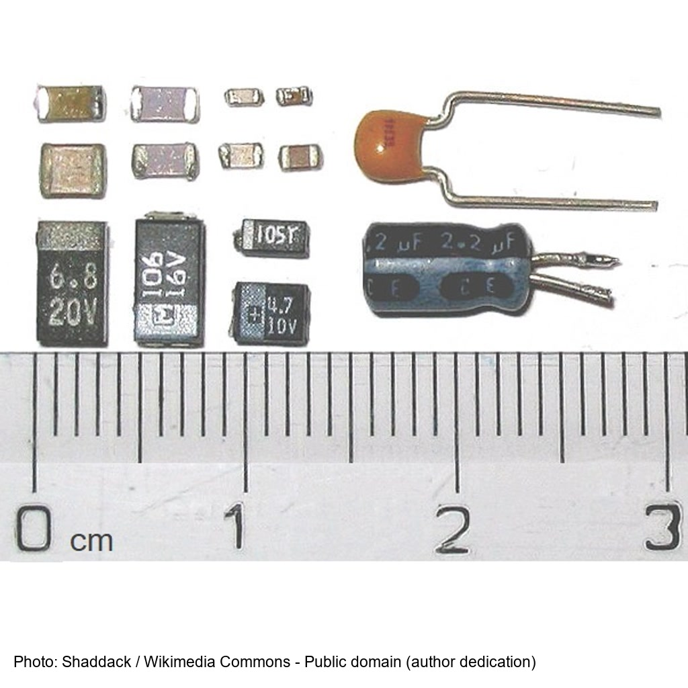
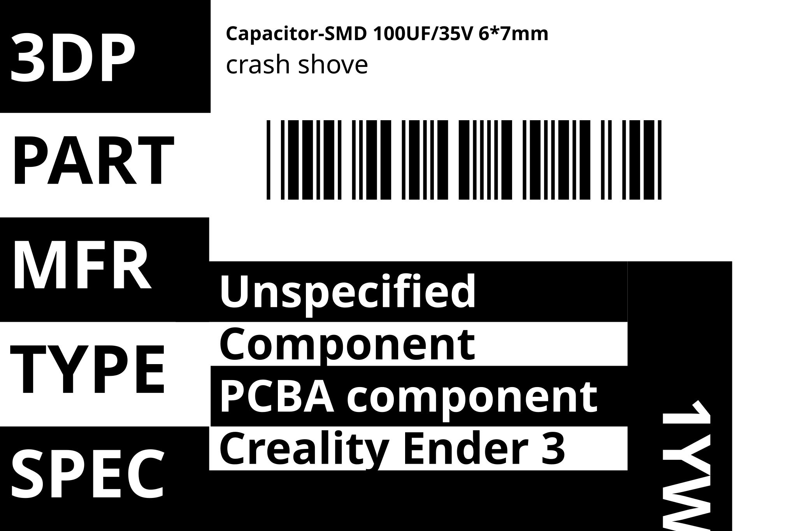

<!-- oomp-documentation:start -->
# Ender-3 Capacitor-SMD 100UF/35V 6*7mm

[Open catalogue record](http://localhost:5703/parts/three_d_printer_part_creality_ender_3_electronic_component_capacitor_smd_100uf_35v_6_7mm) · [Creality Ender-3 PCBA bill of materials](https://github.com/Creality3DPrinting/Ender-3/blob/88c7758cea9d0d00a54fdb238bedb3b33425f409/Ender-3%20PCB/Ender-3%20PCBA%20BOM.xlsx)

## Summary

Ender-3 Capacitor-SMD 100UF/35V 6*7mm



Representative selection of surface-mount and leaded capacitors; the value and package may differ from this record. [Photo-SMDcapacitors.jpg](https://commons.wikimedia.org/wiki/File:Photo-SMDcapacitors.jpg) by Shaddack. [Public domain (author dedication)](https://commons.wikimedia.org/wiki/File:Photo-SMDcapacitors.jpg). Resized within a square white canvas and credited on the image.

## Details

OOMP ID `three_d_printer_part_creality_ender_3_electronic_component_capacitor_smd_100uf_35v_6_7mm`

| Specification | Value |
| --- | --- |
| Pcba bom items | 24 |
| Pcba quantities pcs | 6 |
| Reference name | Capacitor-SMD 100UF/35V 6*7mm |
| Source name | Capacitance-SMD |
| Source specification | 100UF/35V 6*7mm |

Sources checked 2026-11-18.


| Taxonomy slot | Value |
| --- | --- |
| 1 | `three_d_printer` |
| 2 | `part` |
| 3 | `creality_ender_3` |
| 4 | `electronic` |
| 5 | `component` |
| 6 | `capacitor_smd_100uf_35v_6_7mm` |

Assembly taxonomy: [electronic / component](../../navigation/part/creality_ender_3/electronic/component/README.md)

## Labels



| Layout | Stock (mm) | Files |
| --- | --- | --- |
| OOMP inventory | 76.2 × 50.8 | [SVG](label_oomp.svg) · [Print PDF](label_oomp.pdf) |
| Stock | 76.2 × 50.8 | [SVG](label_stock_3x2.svg) · [Print PDF](label_stock_3x2.pdf) |
| Stock | 38.1 × 25.4 | [SVG](label_stock_1_5x1.svg) · [Print PDF](label_stock_1_5x1.pdf) |
| Drawer | 38.1 × 25.4 | [SVG](label_drawer.svg) · [Print PDF](label_drawer.pdf) |
| Compact barcode | 30 × 15 | [SVG](label_30x15.svg) · [Print PDF](label_30x15.pdf) |

## Parts

[Browse this category](../../navigation/part/creality_ender_3/electronic/component/README.md) · [Canonical metadata](working.yaml) · [Catalogue](../../README.md)

Confirmed printer models in this catalogue

- [Creality Ender-3](../three_d_printer_printer_creality_ender_3/)

## Assembly

Use the model-specific manufacturer documentation linked above for setup or service.

<details>
<summary>Full OOMP metadata</summary>

```yaml
assembly_path:
- electronic
- component
compatible_printers:
- three_d_printer_printer_creality_ender_3
exact_variant: capacitor_smd_100uf_35v_6_7mm
link_main: https://github.com/oomlout/oomp_three_d_printer_version_5/tree/main/parts/three_d_printer_part_creality_ender_3_electronic_component_capacitor_smd_100uf_35v_6_7mm
link_source: https://github.com/Creality3DPrinting/Ender-3/blob/88c7758cea9d0d00a54fdb238bedb3b33425f409/Ender-3%20PCB/Ender-3%20PCBA%20BOM.xlsx
link_web: http://localhost:5703/parts/three_d_printer_part_creality_ender_3_electronic_component_capacitor_smd_100uf_35v_6_7mm
name_proper: Ender-3 Capacitor-SMD 100UF/35V 6*7mm
oomp_id: three_d_printer_part_creality_ender_3_electronic_component_capacitor_smd_100uf_35v_6_7mm
photo:
  caption: Representative selection of surface-mount and leaded capacitors; the value
    and package may differ from this record.
  changes: Resized within a square white canvas and credited on the image.
  creator: Shaddack
  credit_line: 'Photo: Shaddack / Wikimedia Commons - Public domain (author dedication)'
  file: source_file/images/representative_capacitor_square.jpg
  license: Public domain (author dedication)
  license_url: https://commons.wikimedia.org/wiki/File:Photo-SMDcapacitors.jpg
  original_file: source_file/images/original/representative_capacitor.jpg
  original_image_url: https://upload.wikimedia.org/wikipedia/commons/8/86/Photo-SMDcapacitors.jpg?utm_source=commons.wikimedia.org&utm_campaign=imageinfo&utm_content=original
  source: https://commons.wikimedia.org/wiki/File:Photo-SMDcapacitors.jpg
  source_checked: '2026-11-19'
  title: Photo-SMDcapacitors.jpg
previous_id: three_d_printer_part_creality_ender_3_pcb_component_capacitor_smd_100uf_35v_6_7mm
previous_label: 9NW4F
source_checked: '2026-11-18'
sources:
  Creality Ender-3 PCBA bill of materials: https://github.com/Creality3DPrinting/Ender-3/blob/88c7758cea9d0d00a54fdb238bedb3b33425f409/Ender-3%20PCB/Ender-3%20PCBA%20BOM.xlsx
spare_type: pcb_component
specifications:
  pcba_bom_items:
  - 24
  pcba_quantities_pcs:
  - 6
  reference_name: Capacitor-SMD 100UF/35V 6*7mm
  source_name: Capacitance-SMD
  source_specification: 100UF/35V 6*7mm
taxonomy_1: three_d_printer
taxonomy_10: ''
taxonomy_11: ''
taxonomy_12: ''
taxonomy_13: ''
taxonomy_14: ''
taxonomy_15: ''
taxonomy_2: part
taxonomy_3: creality_ender_3
taxonomy_4: electronic
taxonomy_5: component
taxonomy_6: capacitor_smd_100uf_35v_6_7mm
taxonomy_7: ''
taxonomy_8: ''
taxonomy_9: ''
taxonomy_1_upper: THREE_D_PRINTER
taxonomy_1_upper_length_1: T
taxonomy_1_upper_length_2: TH
taxonomy_1_upper_length_3: THR
taxonomy_1_upper_length_4: THRE
taxonomy_1_upper_length_5: THREE
taxonomy_1_length_1: t
taxonomy_1_length_2: th
taxonomy_1_length_3: thr
taxonomy_1_length_4: thre
taxonomy_1_length_5: three
taxonomy_1_capital: Three D Printer
taxonomy_1_first_letter: t
taxonomy_1_first_letter_upper: T
taxonomy_2_upper: PART
taxonomy_2_upper_length_1: P
taxonomy_2_upper_length_2: PA
taxonomy_2_upper_length_3: PAR
taxonomy_2_upper_length_4: PART
taxonomy_2_upper_length_5: PART
taxonomy_2_length_1: p
taxonomy_2_length_2: pa
taxonomy_2_length_3: par
taxonomy_2_length_4: part
taxonomy_2_length_5: part
taxonomy_2_capital: Part
taxonomy_2_first_letter: p
taxonomy_2_first_letter_upper: P
taxonomy_3_upper: CREALITY_ENDER_3
taxonomy_3_upper_length_1: C
taxonomy_3_upper_length_2: CR
taxonomy_3_upper_length_3: CRE
taxonomy_3_upper_length_4: CREA
taxonomy_3_upper_length_5: CREAL
taxonomy_3_length_1: c
taxonomy_3_length_2: cr
taxonomy_3_length_3: cre
taxonomy_3_length_4: crea
taxonomy_3_length_5: creal
taxonomy_3_capital: Creality Ender 3
taxonomy_3_first_letter: c
taxonomy_3_first_letter_upper: C
taxonomy_4_upper: ELECTRONIC
taxonomy_4_upper_length_1: E
taxonomy_4_upper_length_2: EL
taxonomy_4_upper_length_3: ELE
taxonomy_4_upper_length_4: ELEC
taxonomy_4_upper_length_5: ELECT
taxonomy_4_length_1: e
taxonomy_4_length_2: el
taxonomy_4_length_3: ele
taxonomy_4_length_4: elec
taxonomy_4_length_5: elect
taxonomy_4_capital: Electronic
taxonomy_4_first_letter: e
taxonomy_4_first_letter_upper: E
taxonomy_5_upper: COMPONENT
taxonomy_5_upper_length_1: C
taxonomy_5_upper_length_2: CO
taxonomy_5_upper_length_3: COM
taxonomy_5_upper_length_4: COMP
taxonomy_5_upper_length_5: COMPO
taxonomy_5_length_1: c
taxonomy_5_length_2: co
taxonomy_5_length_3: com
taxonomy_5_length_4: comp
taxonomy_5_length_5: compo
taxonomy_5_capital: Component
taxonomy_5_first_letter: c
taxonomy_5_first_letter_upper: C
taxonomy_6_upper: CAPACITOR_SMD_100UF_35V_6_7MM
taxonomy_6_upper_length_1: C
taxonomy_6_upper_length_2: CA
taxonomy_6_upper_length_3: CAP
taxonomy_6_upper_length_4: CAPA
taxonomy_6_upper_length_5: CAPAC
taxonomy_6_length_1: c
taxonomy_6_length_2: ca
taxonomy_6_length_3: cap
taxonomy_6_length_4: capa
taxonomy_6_length_5: capac
taxonomy_6_capital: Capacitor Smd 100Uf 35V 6.7mm
taxonomy_6_first_letter: c
taxonomy_6_first_letter_upper: C
id: three_d_printer_part_creality_ender_3_electronic_component_capacitor_smd_100uf_35v_6_7mm
id_no_class: three_d_printer_part_creality_ender_3_electronic_component_capacitor_smd_100uf_35v_6_7mm
id_no_type: three_d_printer_part_creality_ender_3_electronic_component_capacitor_smd_100uf_35v_6_7mm
id_no_size: three_d_printer_part_creality_ender_3_electronic_component_capacitor_smd_100uf_35v_6_7mm
oomp_key: oomp_three_d_printer_part_creality_ender_3_electronic_component_capacitor_smd_100uf_35v_6_7mm
link_github: https://github.com/oomlout/oomp_three_d_printer_version_5/tree/main/parts/three_d_printer_part_creality_ender_3_electronic_component_capacitor_smd_100uf_35v_6_7mm
link_redirect: https://github.com/oomlout/oomp_three_d_printer_version_5/tree/main/parts/three_d_printer_part_creality_ender_3_electronic_component_capacitor_smd_100uf_35v_6_7mm
directory: parts/three_d_printer_part_creality_ender_3_electronic_component_capacitor_smd_100uf_35v_6_7mm
name: Three D Printer Part Creality Ender 3 Electronic Component Capacitor Smd 100Uf
  35V 6 7Mm
name_no_class: Three D Printer Part Creality Ender 3 Electronic Component Capacitor
  Smd 100Uf 35V 6 7Mm
name_no_type: Three D Printer Part Creality Ender 3 Electronic Component Capacitor
  Smd 100Uf 35V 6 7Mm
name_no_size: Three D Printer Part Creality Ender 3 Electronic Component Capacitor
  Smd 100Uf 35V 6 7Mm
md5: 3278e0c7f4046461dcef1f523ccaaaa7
md5_5: 3278e
md5_5_upper: 3278E
md5_6: 3278e0
md5_6_upper: 3278E0
md5_6_alpha: 1yw9s
md5_6_alpha_upper: 1YW9S
md5_10: 3278e0c7f4
md5_10_upper: 3278E0C7F4
bip_39_full_array:
- crash
- shove
- cradle
- trend
- edge
- couch
- inhale
- token
- fall
- town
- primary
- exercise
bip_39_full_space: crash shove cradle trend edge couch inhale token fall town primary
  exercise
bip_39_full_no_space: crashshovecradletrendedgecouchinhaletokenfalltownprimaryexercise
bip_39_full_underscore: crash_shove_cradle_trend_edge_couch_inhale_token_fall_town_primary_exercise
bip_39_2_word_array:
- crash
- shove
bip_39_2_word_space: crash shove
bip_39_2_word_no_space: crashshove
bip_39_2_word_underscore: crash_shove
bip_39_3_word_array:
- crash
- shove
- cradle
bip_39_3_word_space: crash shove cradle
bip_39_3_word_no_space: crashshovecradle
bip_39_3_word_underscore: crash_shove_cradle
label_title: Capacitor-SMD 100UF/35V 6*7mm
label_barcode: M0,0h34v760h-34z M136,0h34v760h-34z M204,0h102v760h-102z M340,0h102v760h-102z
  M476,0h34v760h-34z M544,0h102v760h-102z M680,0h34v760h-34z M816,0h34v760h-34z M884,0h34v760h-34z
  M952,0h102v760h-102z M1088,0h102v760h-102z M1292,0h34v760h-34z M1360,0h102v760h-102z
  M1496,0h34v760h-34z M1564,0h34v760h-34z M1632,0h102v760h-102z M1836,0h102v760h-102z
  M1972,0h34v760h-34z M2040,0h34v760h-34z M2108,0h34v760h-34z M2176,0h34v760h-34z
  M2244,0h102v760h-102z M2448,0h34v760h-34z M2516,0h102v760h-102z M2652,0h34v760h-34z
  M2720,0h34v760h-34z M2788,0h102v760h-102z M2924,0h34v760h-34z M2992,0h102v760h-102z
  M3196,0h34v760h-34z M3264,0h34v760h-34z M3400,0h34v760h-34z M3468,0h102v760h-102z
  M3604,0h102v760h-102z M3740,0h34v760h-34z
label_barcode_width: 3774
label_maker: Unspecified
label_family: Component
label_detail: PCBA component
label_variant: Creality Ender 3
label_context: Creality Ender-3
inventory_title_size: 6.973848069738481
stock_title_size: 2.1170610211706102
drawer_title_size: 1.3698630136986303
compact_title_size: 1.6811955168119552
oomlout_ai_roboclick_1:
  actions:
  - command: text_jinja_template
    file_template: source_file/template_jinja/template_jinja_label_oomlout_76_2_mm_50_8_mm/working.svg.j2
    file_output: label_oomp.svg
    convert_to_pdf: true
    convert_to_png: false
  - command: text_jinja_template
    file_template: source_file/template_jinja/label_stock/3x2.svg.j2
    file_output: label_stock_3x2.svg
    convert_to_pdf: true
    convert_to_png: false
  - command: text_jinja_template
    file_template: source_file/template_jinja/label_stock/1_5x1.svg.j2
    file_output: label_stock_1_5x1.svg
    convert_to_pdf: true
    convert_to_png: false
  - command: text_jinja_template
    file_template: source_file/template_jinja/label_drawer/working.svg.j2
    file_output: label_drawer.svg
    convert_to_pdf: true
    convert_to_png: false
  - command: text_jinja_template
    file_template: source_file/template_jinja/label_printer_30x15/working.svg.j2
    file_output: label_30x15.svg
    convert_to_pdf: true
    convert_to_png: false
  file_test: ''
  retries_until_complete: 0
  action_name: step_0_jinja_template_label_oomp.svg
```

</details>
<!-- oomp-documentation:end -->
