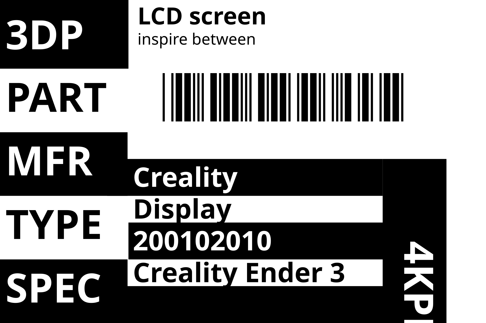

<!-- oomp-documentation:start -->
# Ender-3 LCD screen

[Open catalogue record](http://localhost:5703/parts/three_d_printer_part_creality_ender_3_electronic_display_lcd_screen_creality_200102010) · [Creality Ender-3 machine bill of materials](https://github.com/Creality3DPrinting/Ender-3/blob/88c7758cea9d0d00a54fdb238bedb3b33425f409/Ender-3%20Mechanical/Ender-3%20BOM.XLS)

## Summary

Ender-3 LCD screen

## Details

OOMP ID `three_d_printer_part_creality_ender_3_electronic_display_lcd_screen_creality_200102010`

| Specification | Value |
| --- | --- |
| Identifier basis | Creality machine BOM part code. Retail ordering code unverified. |
| Machine bom quantity pcs | 1 |
| Machine bom row | 4 |
| Manufacturer part number | 200102010 |
| Reference name | LCD screen |
| Source name | LCD |

Sources checked 2026-11-18.


| Taxonomy slot | Value |
| --- | --- |
| 1 | `three_d_printer` |
| 2 | `part` |
| 3 | `creality_ender_3` |
| 4 | `electronic` |
| 5 | `display` |
| 6 | `lcd_screen` |
| 14 | `creality` |
| 15 | `200102010` |

Assembly taxonomy: [electronic / display](../../navigation/part/creality_ender_3/electronic/display/README.md)

## Labels



| Layout | Stock (mm) | Files |
| --- | --- | --- |
| OOMP inventory | 76.2 × 50.8 | [SVG](label_oomp.svg) · [Print PDF](label_oomp.pdf) |
| Stock | 76.2 × 50.8 | [SVG](label_stock_3x2.svg) · [Print PDF](label_stock_3x2.pdf) |
| Stock | 38.1 × 25.4 | [SVG](label_stock_1_5x1.svg) · [Print PDF](label_stock_1_5x1.pdf) |
| Drawer | 38.1 × 25.4 | [SVG](label_drawer.svg) · [Print PDF](label_drawer.pdf) |
| Compact barcode | 30 × 15 | [SVG](label_30x15.svg) · [Print PDF](label_30x15.pdf) |

## Parts

[Browse this category](../../navigation/part/creality_ender_3/electronic/display/README.md) · [Canonical metadata](working.yaml) · [Catalogue](../../README.md)

Confirmed printer models in this catalogue

- [Creality Ender-3](../three_d_printer_printer_creality_ender_3/)

## Assembly

Use the model-specific manufacturer documentation linked above for setup or service.

<details>
<summary>Full OOMP metadata</summary>

```yaml
assembly_path:
- electronic
- display
compatible_printers:
- three_d_printer_printer_creality_ender_3
exact_variant: lcd_screen
link_main: https://github.com/oomlout/oomp_three_d_printer_version_5/tree/main/parts/three_d_printer_part_creality_ender_3_electronic_display_lcd_screen_creality_200102010
link_source: https://github.com/Creality3DPrinting/Ender-3/blob/88c7758cea9d0d00a54fdb238bedb3b33425f409/Ender-3%20Mechanical/Ender-3%20BOM.XLS
link_web: http://localhost:5703/parts/three_d_printer_part_creality_ender_3_electronic_display_lcd_screen_creality_200102010
name_proper: Ender-3 LCD screen
oomp_id: three_d_printer_part_creality_ender_3_electronic_display_lcd_screen_creality_200102010
previous_id: three_d_printer_part_creality_ender_3_screen_lcd_screen_creality_200102010
previous_label: 6V6B9
source_checked: '2026-11-18'
sources:
  Creality Ender-3 machine bill of materials: https://github.com/Creality3DPrinting/Ender-3/blob/88c7758cea9d0d00a54fdb238bedb3b33425f409/Ender-3%20Mechanical/Ender-3%20BOM.XLS
spare_type: screen
specifications:
  identifier_basis: Creality machine BOM part code. Retail ordering code unverified.
  machine_bom_quantity_pcs: 1
  machine_bom_row: 4
  manufacturer_part_number: '200102010'
  reference_name: LCD screen
  source_name: LCD
taxonomy_1: three_d_printer
taxonomy_10: ''
taxonomy_11: ''
taxonomy_12: ''
taxonomy_13: ''
taxonomy_14: creality
taxonomy_15: '200102010'
taxonomy_2: part
taxonomy_3: creality_ender_3
taxonomy_4: electronic
taxonomy_5: display
taxonomy_6: lcd_screen
taxonomy_7: ''
taxonomy_8: ''
taxonomy_9: ''
taxonomy_1_upper: THREE_D_PRINTER
taxonomy_1_upper_length_1: T
taxonomy_1_upper_length_2: TH
taxonomy_1_upper_length_3: THR
taxonomy_1_upper_length_4: THRE
taxonomy_1_upper_length_5: THREE
taxonomy_1_length_1: t
taxonomy_1_length_2: th
taxonomy_1_length_3: thr
taxonomy_1_length_4: thre
taxonomy_1_length_5: three
taxonomy_1_capital: Three D Printer
taxonomy_1_first_letter: t
taxonomy_1_first_letter_upper: T
taxonomy_2_upper: PART
taxonomy_2_upper_length_1: P
taxonomy_2_upper_length_2: PA
taxonomy_2_upper_length_3: PAR
taxonomy_2_upper_length_4: PART
taxonomy_2_upper_length_5: PART
taxonomy_2_length_1: p
taxonomy_2_length_2: pa
taxonomy_2_length_3: par
taxonomy_2_length_4: part
taxonomy_2_length_5: part
taxonomy_2_capital: Part
taxonomy_2_first_letter: p
taxonomy_2_first_letter_upper: P
taxonomy_3_upper: CREALITY_ENDER_3
taxonomy_3_upper_length_1: C
taxonomy_3_upper_length_2: CR
taxonomy_3_upper_length_3: CRE
taxonomy_3_upper_length_4: CREA
taxonomy_3_upper_length_5: CREAL
taxonomy_3_length_1: c
taxonomy_3_length_2: cr
taxonomy_3_length_3: cre
taxonomy_3_length_4: crea
taxonomy_3_length_5: creal
taxonomy_3_capital: Creality Ender 3
taxonomy_3_first_letter: c
taxonomy_3_first_letter_upper: C
taxonomy_4_upper: ELECTRONIC
taxonomy_4_upper_length_1: E
taxonomy_4_upper_length_2: EL
taxonomy_4_upper_length_3: ELE
taxonomy_4_upper_length_4: ELEC
taxonomy_4_upper_length_5: ELECT
taxonomy_4_length_1: e
taxonomy_4_length_2: el
taxonomy_4_length_3: ele
taxonomy_4_length_4: elec
taxonomy_4_length_5: elect
taxonomy_4_capital: Electronic
taxonomy_4_first_letter: e
taxonomy_4_first_letter_upper: E
taxonomy_5_upper: DISPLAY
taxonomy_5_upper_length_1: D
taxonomy_5_upper_length_2: DI
taxonomy_5_upper_length_3: DIS
taxonomy_5_upper_length_4: DISP
taxonomy_5_upper_length_5: DISPL
taxonomy_5_length_1: d
taxonomy_5_length_2: di
taxonomy_5_length_3: dis
taxonomy_5_length_4: disp
taxonomy_5_length_5: displ
taxonomy_5_capital: Display
taxonomy_5_first_letter: d
taxonomy_5_first_letter_upper: D
taxonomy_6_upper: LCD_SCREEN
taxonomy_6_upper_length_1: L
taxonomy_6_upper_length_2: LC
taxonomy_6_upper_length_3: LCD
taxonomy_6_upper_length_4: LCD_
taxonomy_6_upper_length_5: LCD_S
taxonomy_6_length_1: l
taxonomy_6_length_2: lc
taxonomy_6_length_3: lcd
taxonomy_6_length_4: lcd_
taxonomy_6_length_5: lcd_s
taxonomy_6_capital: Lcd Screen
taxonomy_6_first_letter: l
taxonomy_6_first_letter_upper: L
taxonomy_14_upper: CREALITY
taxonomy_14_upper_length_1: C
taxonomy_14_upper_length_2: CR
taxonomy_14_upper_length_3: CRE
taxonomy_14_upper_length_4: CREA
taxonomy_14_upper_length_5: CREAL
taxonomy_14_length_1: c
taxonomy_14_length_2: cr
taxonomy_14_length_3: cre
taxonomy_14_length_4: crea
taxonomy_14_length_5: creal
taxonomy_14_capital: Creality
taxonomy_14_first_letter: c
taxonomy_14_first_letter_upper: C
taxonomy_15_upper: '200102010'
taxonomy_15_upper_length_1: '2'
taxonomy_15_upper_length_2: '20'
taxonomy_15_upper_length_3: '200'
taxonomy_15_upper_length_4: '2001'
taxonomy_15_upper_length_5: '20010'
taxonomy_15_length_1: '2'
taxonomy_15_length_2: '20'
taxonomy_15_length_3: '200'
taxonomy_15_length_4: '2001'
taxonomy_15_length_5: '20010'
taxonomy_15_capital: '200102010'
taxonomy_15_first_letter: '2'
taxonomy_15_first_letter_upper: '2'
id: three_d_printer_part_creality_ender_3_electronic_display_lcd_screen_creality_200102010
id_no_class: three_d_printer_part_creality_ender_3_electronic_display_lcd_screen_creality_200102010
id_no_type: three_d_printer_part_creality_ender_3_electronic_display_lcd_screen_creality_200102010
id_no_size: three_d_printer_part_creality_ender_3_electronic_display_lcd_screen_creality_200102010
oomp_key: oomp_three_d_printer_part_creality_ender_3_electronic_display_lcd_screen_creality_200102010
link_github: https://github.com/oomlout/oomp_three_d_printer_version_5/tree/main/parts/three_d_printer_part_creality_ender_3_electronic_display_lcd_screen_creality_200102010
link_redirect: https://github.com/oomlout/oomp_three_d_printer_version_5/tree/main/parts/three_d_printer_part_creality_ender_3_electronic_display_lcd_screen_creality_200102010
directory: parts/three_d_printer_part_creality_ender_3_electronic_display_lcd_screen_creality_200102010
name: Three D Printer Part Creality Ender 3 Electronic Display Lcd Screen Creality
  200102010
name_no_class: Three D Printer Part Creality Ender 3 Electronic Display Lcd Screen
  Creality 200102010
name_no_type: Three D Printer Part Creality Ender 3 Electronic Display Lcd Screen
  Creality 200102010
name_no_size: Three D Printer Part Creality Ender 3 Electronic Display Lcd Screen
  Creality 200102010
md5: 7542b545ecee0c996f43459495fa7821
md5_5: 7542b
md5_5_upper: 7542B
md5_6: 7542b5
md5_6_upper: 7542B5
md5_6_alpha: 4kpmd
md5_6_alpha_upper: 4KPMD
md5_10: 7542b545ec
md5_10_upper: 7542B545EC
bip_39_full_array:
- inspire
- between
- fabric
- supply
- this
- erosion
- rug
- hamster
- nest
- quit
- own
- drastic
bip_39_full_space: inspire between fabric supply this erosion rug hamster nest quit
  own drastic
bip_39_full_no_space: inspirebetweenfabricsupplythiserosionrughamsternestquitowndrastic
bip_39_full_underscore: inspire_between_fabric_supply_this_erosion_rug_hamster_nest_quit_own_drastic
bip_39_2_word_array:
- inspire
- between
bip_39_2_word_space: inspire between
bip_39_2_word_no_space: inspirebetween
bip_39_2_word_underscore: inspire_between
bip_39_3_word_array:
- inspire
- between
- fabric
bip_39_3_word_space: inspire between fabric
bip_39_3_word_no_space: inspirebetweenfabric
bip_39_3_word_underscore: inspire_between_fabric
label_title: LCD screen
label_barcode: M0,0h34v760h-34z M136,0h34v760h-34z M204,0h102v760h-102z M340,0h102v760h-102z
  M476,0h34v760h-34z M544,0h34v760h-34z M612,0h34v760h-34z M748,0h102v760h-102z M884,0h34v760h-34z
  M952,0h102v760h-102z M1088,0h102v760h-102z M1224,0h34v760h-34z M1292,0h34v760h-34z
  M1360,0h34v760h-34z M1496,0h102v760h-102z M1632,0h34v760h-34z M1700,0h102v760h-102z
  M1836,0h102v760h-102z M1972,0h34v760h-34z M2108,0h34v760h-34z M2176,0h102v760h-102z
  M2312,0h102v760h-102z M2448,0h34v760h-34z M2516,0h34v760h-34z M2652,0h34v760h-34z
  M2720,0h34v760h-34z M2788,0h34v760h-34z M2856,0h102v760h-102z M3060,0h34v760h-34z
  M3128,0h102v760h-102z M3264,0h34v760h-34z M3400,0h34v760h-34z M3468,0h102v760h-102z
  M3604,0h102v760h-102z M3740,0h34v760h-34z
label_barcode_width: 3774
label_maker: Creality
label_family: Display
label_detail: '200102010'
label_variant: Creality Ender 3
label_context: Creality Ender-3
inventory_title_size: 14
stock_title_size: 5.3
drawer_title_size: 3.3
compact_title_size: 2.8
oomlout_ai_roboclick_1:
  actions:
  - command: text_jinja_template
    file_template: source_file/template_jinja/template_jinja_label_oomlout_76_2_mm_50_8_mm/working.svg.j2
    file_output: label_oomp.svg
    convert_to_pdf: true
    convert_to_png: false
  - command: text_jinja_template
    file_template: source_file/template_jinja/label_stock/3x2.svg.j2
    file_output: label_stock_3x2.svg
    convert_to_pdf: true
    convert_to_png: false
  - command: text_jinja_template
    file_template: source_file/template_jinja/label_stock/1_5x1.svg.j2
    file_output: label_stock_1_5x1.svg
    convert_to_pdf: true
    convert_to_png: false
  - command: text_jinja_template
    file_template: source_file/template_jinja/label_drawer/working.svg.j2
    file_output: label_drawer.svg
    convert_to_pdf: true
    convert_to_png: false
  - command: text_jinja_template
    file_template: source_file/template_jinja/label_printer_30x15/working.svg.j2
    file_output: label_30x15.svg
    convert_to_pdf: true
    convert_to_png: false
  file_test: ''
  retries_until_complete: 0
  action_name: step_0_jinja_template_label_oomp.svg
```

</details>
<!-- oomp-documentation:end -->
