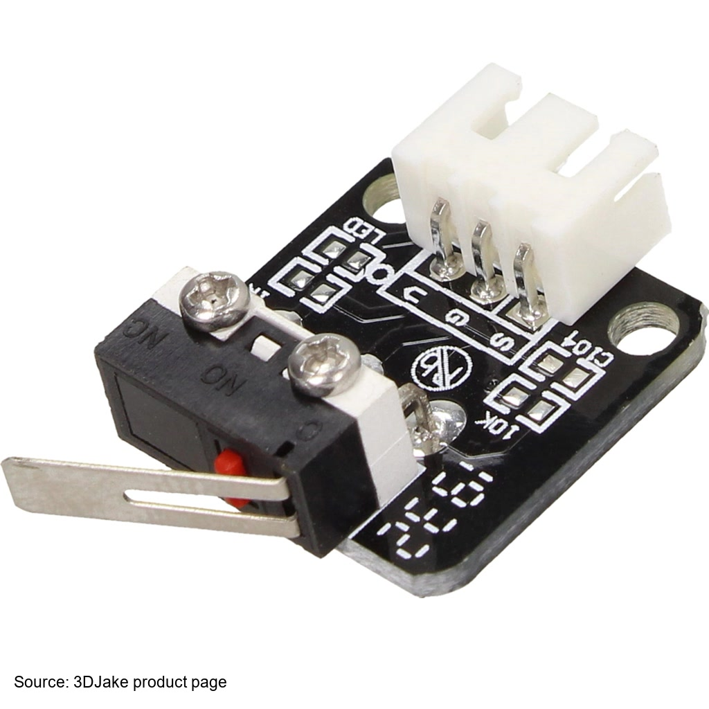
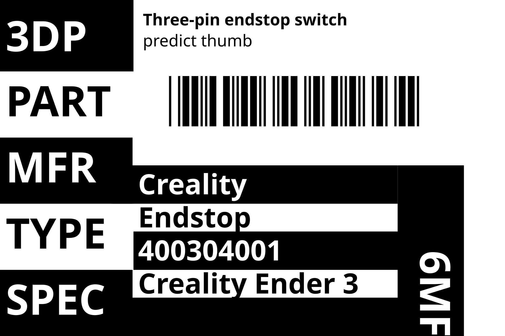

<!-- oomp-documentation:start -->
# Ender-3 Three-pin endstop switch

[Open catalogue record](http://localhost:5703/parts/three_d_printer_part_creality_ender_3_electronic_endstop_three_pin_endstop_switch_creality_400304001) · [Creality Ender-3 machine bill of materials](https://github.com/Creality3DPrinting/Ender-3/blob/88c7758cea9d0d00a54fdb238bedb3b33425f409/Ender-3%20Mechanical/Ender-3%20BOM.XLS)

## Summary

Ender-3 Three-pin endstop switch



Creality replacement limit switch assembly; the installed position and mounting hardware are not shown. [Creality replacement endstop, 3DJake product image](https://www.3djake.uk/creality-3d-printers-spare-parts/limit-switch?sai=7792) by Creator not identified; product image supplied by 3DJake. [Retail product image; reuse permission not established](https://www.3djake.uk/creality-3d-printers-spare-parts/limit-switch?sai=7792). Resized within a square white canvas and credited on the image.

## Details

OOMP ID `three_d_printer_part_creality_ender_3_electronic_endstop_three_pin_endstop_switch_creality_400304001`

| Specification | Value |
| --- | --- |
| Identifier basis | Creality machine BOM part code. Retail ordering code unverified. |
| Machine bom quantity pcs | 3 |
| Machine bom row | 89 |
| Manufacturer part number | 400304001 |
| Reference name | Three-pin endstop switch |
| Source name | limit switch |
| Source specification | 3PIN |

Sources checked 2026-11-18.


| Taxonomy slot | Value |
| --- | --- |
| 1 | `three_d_printer` |
| 2 | `part` |
| 3 | `creality_ender_3` |
| 4 | `electronic` |
| 5 | `endstop` |
| 6 | `three_pin_endstop_switch` |
| 14 | `creality` |
| 15 | `400304001` |

Assembly taxonomy: [electronic / endstop](../../navigation/part/creality_ender_3/electronic/endstop/README.md)

## Labels



| Layout | Stock (mm) | Files |
| --- | --- | --- |
| OOMP inventory | 76.2 × 50.8 | [SVG](label_oomp.svg) · [Print PDF](label_oomp.pdf) |
| Stock | 76.2 × 50.8 | [SVG](label_stock_3x2.svg) · [Print PDF](label_stock_3x2.pdf) |
| Stock | 38.1 × 25.4 | [SVG](label_stock_1_5x1.svg) · [Print PDF](label_stock_1_5x1.pdf) |
| Drawer | 38.1 × 25.4 | [SVG](label_drawer.svg) · [Print PDF](label_drawer.pdf) |
| Compact barcode | 30 × 15 | [SVG](label_30x15.svg) · [Print PDF](label_30x15.pdf) |

## Parts

[Browse this category](../../navigation/part/creality_ender_3/electronic/endstop/README.md) · [Canonical metadata](working.yaml) · [Catalogue](../../README.md)

Confirmed printer models in this catalogue

- [Creality Ender-3](../three_d_printer_printer_creality_ender_3/)

## Assembly

Use the model-specific manufacturer documentation linked above for setup or service.

<details>
<summary>Full OOMP metadata</summary>

```yaml
assembly_path:
- electronic
- endstop
compatible_printers:
- three_d_printer_printer_creality_ender_3
exact_variant: three_pin_endstop_switch
link_main: https://github.com/oomlout/oomp_three_d_printer_version_5/tree/main/parts/three_d_printer_part_creality_ender_3_electronic_endstop_three_pin_endstop_switch_creality_400304001
link_source: https://github.com/Creality3DPrinting/Ender-3/blob/88c7758cea9d0d00a54fdb238bedb3b33425f409/Ender-3%20Mechanical/Ender-3%20BOM.XLS
link_web: http://localhost:5703/parts/three_d_printer_part_creality_ender_3_electronic_endstop_three_pin_endstop_switch_creality_400304001
name_proper: Ender-3 Three-pin endstop switch
oomp_id: three_d_printer_part_creality_ender_3_electronic_endstop_three_pin_endstop_switch_creality_400304001
photo:
  caption: Creality replacement limit switch assembly; the installed position and
    mounting hardware are not shown.
  changes: Resized within a square white canvas and credited on the image.
  creator: Creator not identified; product image supplied by 3DJake
  credit_line: 'Source: 3DJake product page'
  file: source_file/images/creality_replacement_endstop_square.jpg
  license: Retail product image; reuse permission not established
  license_url: https://www.3djake.uk/creality-3d-printers-spare-parts/limit-switch?sai=7792
  original_file: source_file/images/original/creality_replacement_endstop.jpg
  original_image_url: https://3d.nice-cdn.com/upload/image/product/large/default/10829_54723815.jpg
  source: https://www.3djake.uk/creality-3d-printers-spare-parts/limit-switch?sai=7792
  source_checked: '2026-11-19'
  title: Creality replacement endstop, 3DJake product image
previous_id: three_d_printer_part_creality_ender_3_endstop_three_pin_endstop_switch_creality_400304001
previous_label: 1L2IW
source_checked: '2026-11-18'
sources:
  Creality Ender-3 machine bill of materials: https://github.com/Creality3DPrinting/Ender-3/blob/88c7758cea9d0d00a54fdb238bedb3b33425f409/Ender-3%20Mechanical/Ender-3%20BOM.XLS
spare_type: endstop
specifications:
  identifier_basis: Creality machine BOM part code. Retail ordering code unverified.
  machine_bom_quantity_pcs: 3
  machine_bom_row: 89
  manufacturer_part_number: '400304001'
  reference_name: Three-pin endstop switch
  source_name: limit switch
  source_specification: 3PIN
taxonomy_1: three_d_printer
taxonomy_10: ''
taxonomy_11: ''
taxonomy_12: ''
taxonomy_13: ''
taxonomy_14: creality
taxonomy_15: '400304001'
taxonomy_2: part
taxonomy_3: creality_ender_3
taxonomy_4: electronic
taxonomy_5: endstop
taxonomy_6: three_pin_endstop_switch
taxonomy_7: ''
taxonomy_8: ''
taxonomy_9: ''
taxonomy_1_upper: THREE_D_PRINTER
taxonomy_1_upper_length_1: T
taxonomy_1_upper_length_2: TH
taxonomy_1_upper_length_3: THR
taxonomy_1_upper_length_4: THRE
taxonomy_1_upper_length_5: THREE
taxonomy_1_length_1: t
taxonomy_1_length_2: th
taxonomy_1_length_3: thr
taxonomy_1_length_4: thre
taxonomy_1_length_5: three
taxonomy_1_capital: Three D Printer
taxonomy_1_first_letter: t
taxonomy_1_first_letter_upper: T
taxonomy_2_upper: PART
taxonomy_2_upper_length_1: P
taxonomy_2_upper_length_2: PA
taxonomy_2_upper_length_3: PAR
taxonomy_2_upper_length_4: PART
taxonomy_2_upper_length_5: PART
taxonomy_2_length_1: p
taxonomy_2_length_2: pa
taxonomy_2_length_3: par
taxonomy_2_length_4: part
taxonomy_2_length_5: part
taxonomy_2_capital: Part
taxonomy_2_first_letter: p
taxonomy_2_first_letter_upper: P
taxonomy_3_upper: CREALITY_ENDER_3
taxonomy_3_upper_length_1: C
taxonomy_3_upper_length_2: CR
taxonomy_3_upper_length_3: CRE
taxonomy_3_upper_length_4: CREA
taxonomy_3_upper_length_5: CREAL
taxonomy_3_length_1: c
taxonomy_3_length_2: cr
taxonomy_3_length_3: cre
taxonomy_3_length_4: crea
taxonomy_3_length_5: creal
taxonomy_3_capital: Creality Ender 3
taxonomy_3_first_letter: c
taxonomy_3_first_letter_upper: C
taxonomy_4_upper: ELECTRONIC
taxonomy_4_upper_length_1: E
taxonomy_4_upper_length_2: EL
taxonomy_4_upper_length_3: ELE
taxonomy_4_upper_length_4: ELEC
taxonomy_4_upper_length_5: ELECT
taxonomy_4_length_1: e
taxonomy_4_length_2: el
taxonomy_4_length_3: ele
taxonomy_4_length_4: elec
taxonomy_4_length_5: elect
taxonomy_4_capital: Electronic
taxonomy_4_first_letter: e
taxonomy_4_first_letter_upper: E
taxonomy_5_upper: ENDSTOP
taxonomy_5_upper_length_1: E
taxonomy_5_upper_length_2: EN
taxonomy_5_upper_length_3: END
taxonomy_5_upper_length_4: ENDS
taxonomy_5_upper_length_5: ENDST
taxonomy_5_length_1: e
taxonomy_5_length_2: en
taxonomy_5_length_3: end
taxonomy_5_length_4: ends
taxonomy_5_length_5: endst
taxonomy_5_capital: Endstop
taxonomy_5_first_letter: e
taxonomy_5_first_letter_upper: E
taxonomy_6_upper: THREE_PIN_ENDSTOP_SWITCH
taxonomy_6_upper_length_1: T
taxonomy_6_upper_length_2: TH
taxonomy_6_upper_length_3: THR
taxonomy_6_upper_length_4: THRE
taxonomy_6_upper_length_5: THREE
taxonomy_6_length_1: t
taxonomy_6_length_2: th
taxonomy_6_length_3: thr
taxonomy_6_length_4: thre
taxonomy_6_length_5: three
taxonomy_6_capital: Three Pin Endstop Switch
taxonomy_6_first_letter: t
taxonomy_6_first_letter_upper: T
taxonomy_14_upper: CREALITY
taxonomy_14_upper_length_1: C
taxonomy_14_upper_length_2: CR
taxonomy_14_upper_length_3: CRE
taxonomy_14_upper_length_4: CREA
taxonomy_14_upper_length_5: CREAL
taxonomy_14_length_1: c
taxonomy_14_length_2: cr
taxonomy_14_length_3: cre
taxonomy_14_length_4: crea
taxonomy_14_length_5: creal
taxonomy_14_capital: Creality
taxonomy_14_first_letter: c
taxonomy_14_first_letter_upper: C
taxonomy_15_upper: '400304001'
taxonomy_15_upper_length_1: '4'
taxonomy_15_upper_length_2: '40'
taxonomy_15_upper_length_3: '400'
taxonomy_15_upper_length_4: '4003'
taxonomy_15_upper_length_5: '40030'
taxonomy_15_length_1: '4'
taxonomy_15_length_2: '40'
taxonomy_15_length_3: '400'
taxonomy_15_length_4: '4003'
taxonomy_15_length_5: '40030'
taxonomy_15_capital: '400304001'
taxonomy_15_first_letter: '4'
taxonomy_15_first_letter_upper: '4'
id: three_d_printer_part_creality_ender_3_electronic_endstop_three_pin_endstop_switch_creality_400304001
id_no_class: three_d_printer_part_creality_ender_3_electronic_endstop_three_pin_endstop_switch_creality_400304001
id_no_type: three_d_printer_part_creality_ender_3_electronic_endstop_three_pin_endstop_switch_creality_400304001
id_no_size: three_d_printer_part_creality_ender_3_electronic_endstop_three_pin_endstop_switch_creality_400304001
oomp_key: oomp_three_d_printer_part_creality_ender_3_electronic_endstop_three_pin_endstop_switch_creality_400304001
link_github: https://github.com/oomlout/oomp_three_d_printer_version_5/tree/main/parts/three_d_printer_part_creality_ender_3_electronic_endstop_three_pin_endstop_switch_creality_400304001
link_redirect: https://github.com/oomlout/oomp_three_d_printer_version_5/tree/main/parts/three_d_printer_part_creality_ender_3_electronic_endstop_three_pin_endstop_switch_creality_400304001
directory: parts/three_d_printer_part_creality_ender_3_electronic_endstop_three_pin_endstop_switch_creality_400304001
name: Three D Printer Part Creality Ender 3 Electronic Endstop Three Pin Endstop Switch
  Creality 400304001
name_no_class: Three D Printer Part Creality Ender 3 Electronic Endstop Three Pin
  Endstop Switch Creality 400304001
name_no_type: Three D Printer Part Creality Ender 3 Electronic Endstop Three Pin Endstop
  Switch Creality 400304001
name_no_size: Three D Printer Part Creality Ender 3 Electronic Endstop Three Pin Endstop
  Switch Creality 400304001
md5: a9bc2e0328e8b072625c96889b12a8d7
md5_5: a9bc2
md5_5_upper: A9BC2
md5_6: a9bc2e
md5_6_upper: A9BC2E
md5_6_alpha: 6mf5a
md5_6_alpha_upper: 6MF5A
md5_10: a9bc2e0328
md5_10_upper: A9BC2E0328
bip_39_full_array:
- predict
- thumb
- liar
- fade
- mention
- decrease
- maximum
- name
- mass
- sudden
- pretty
- purpose
bip_39_full_space: predict thumb liar fade mention decrease maximum name mass sudden
  pretty purpose
bip_39_full_no_space: predictthumbliarfadementiondecreasemaximumnamemasssuddenprettypurpose
bip_39_full_underscore: predict_thumb_liar_fade_mention_decrease_maximum_name_mass_sudden_pretty_purpose
bip_39_2_word_array:
- predict
- thumb
bip_39_2_word_space: predict thumb
bip_39_2_word_no_space: predictthumb
bip_39_2_word_underscore: predict_thumb
bip_39_3_word_array:
- predict
- thumb
- liar
bip_39_3_word_space: predict thumb liar
bip_39_3_word_no_space: predictthumbliar
bip_39_3_word_underscore: predict_thumb_liar
label_title: Three-pin endstop switch
label_barcode: M0,0h34v760h-34z M136,0h34v760h-34z M204,0h102v760h-102z M340,0h102v760h-102z
  M476,0h34v760h-34z M544,0h34v760h-34z M612,0h102v760h-102z M816,0h102v760h-102z
  M952,0h34v760h-34z M1020,0h34v760h-34z M1088,0h102v760h-102z M1224,0h102v760h-102z
  M1360,0h34v760h-34z M1428,0h34v760h-34z M1564,0h34v760h-34z M1632,0h34v760h-34z
  M1700,0h102v760h-102z M1836,0h102v760h-102z M2040,0h34v760h-34z M2108,0h34v760h-34z
  M2176,0h102v760h-102z M2312,0h34v760h-34z M2448,0h102v760h-102z M2584,0h34v760h-34z
  M2652,0h34v760h-34z M2720,0h102v760h-102z M2856,0h34v760h-34z M2924,0h34v760h-34z
  M3060,0h34v760h-34z M3128,0h102v760h-102z M3264,0h34v760h-34z M3400,0h34v760h-34z
  M3468,0h102v760h-102z M3604,0h102v760h-102z M3740,0h34v760h-34z
label_barcode_width: 3774
label_maker: Creality
label_family: Endstop
label_detail: '400304001'
label_variant: Creality Ender 3
label_context: Creality Ender-3
inventory_title_size: 9.246264344093124
stock_title_size: 2.8069016758854124
drawer_title_size: 1.8162304961611493
compact_title_size: 2.2290101543795924
oomlout_ai_roboclick_1:
  actions:
  - command: text_jinja_template
    file_template: source_file/template_jinja/template_jinja_label_oomlout_76_2_mm_50_8_mm/working.svg.j2
    file_output: label_oomp.svg
    convert_to_pdf: true
    convert_to_png: false
  - command: text_jinja_template
    file_template: source_file/template_jinja/label_stock/3x2.svg.j2
    file_output: label_stock_3x2.svg
    convert_to_pdf: true
    convert_to_png: false
  - command: text_jinja_template
    file_template: source_file/template_jinja/label_stock/1_5x1.svg.j2
    file_output: label_stock_1_5x1.svg
    convert_to_pdf: true
    convert_to_png: false
  - command: text_jinja_template
    file_template: source_file/template_jinja/label_drawer/working.svg.j2
    file_output: label_drawer.svg
    convert_to_pdf: true
    convert_to_png: false
  - command: text_jinja_template
    file_template: source_file/template_jinja/label_printer_30x15/working.svg.j2
    file_output: label_30x15.svg
    convert_to_pdf: true
    convert_to_png: false
  file_test: ''
  retries_until_complete: 0
  action_name: step_0_jinja_template_label_oomp.svg
```

</details>
<!-- oomp-documentation:end -->
