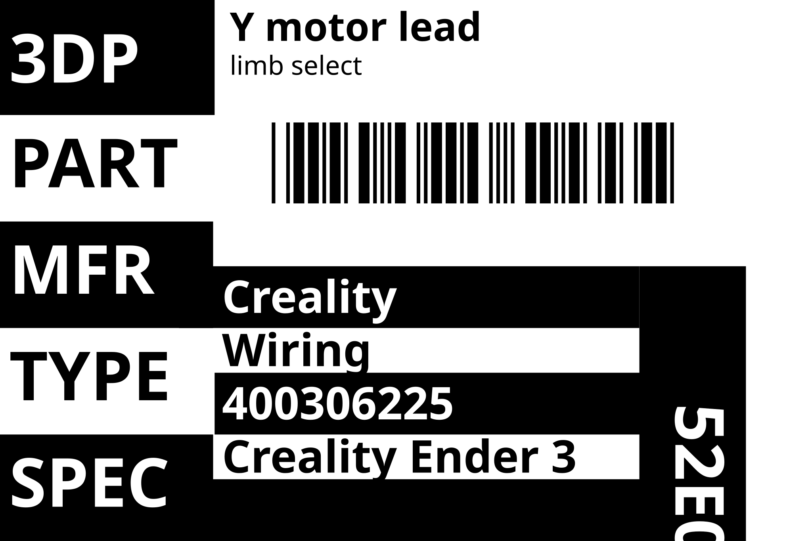

<!-- oomp-documentation:start -->
# Ender-3 Y motor lead

[Open catalogue record](http://localhost:5703/parts/three_d_printer_part_creality_ender_3_electronic_wiring_y_motor_lead_creality_400306225) · [Creality Ender-3 machine bill of materials](https://github.com/Creality3DPrinting/Ender-3/blob/88c7758cea9d0d00a54fdb238bedb3b33425f409/Ender-3%20Mechanical/Ender-3%20BOM.XLS)

## Summary

Ender-3 Y motor lead

## Details

OOMP ID `three_d_printer_part_creality_ender_3_electronic_wiring_y_motor_lead_creality_400306225`

| Specification | Value |
| --- | --- |
| Identifier basis | Creality machine BOM part code. Retail ordering code unverified. |
| Machine bom quantity pcs | 1 |
| Machine bom row | 99 |
| Manufacturer part number | 400306225 |
| Reference name | Y motor lead |
| Source name | Y Motor Line |
| Source specification | L420mm |

Sources checked 2026-11-18.


| Taxonomy slot | Value |
| --- | --- |
| 1 | `three_d_printer` |
| 2 | `part` |
| 3 | `creality_ender_3` |
| 4 | `electronic` |
| 5 | `wiring` |
| 6 | `y_motor_lead` |
| 14 | `creality` |
| 15 | `400306225` |

Assembly taxonomy: [electronic / wiring](../../navigation/part/creality_ender_3/electronic/wiring/README.md)

## Labels



| Layout | Stock (mm) | Files |
| --- | --- | --- |
| OOMP inventory | 76.2 × 50.8 | [SVG](label_oomp.svg) · [Print PDF](label_oomp.pdf) |
| Stock | 76.2 × 50.8 | [SVG](label_stock_3x2.svg) · [Print PDF](label_stock_3x2.pdf) |
| Stock | 38.1 × 25.4 | [SVG](label_stock_1_5x1.svg) · [Print PDF](label_stock_1_5x1.pdf) |
| Drawer | 38.1 × 25.4 | [SVG](label_drawer.svg) · [Print PDF](label_drawer.pdf) |
| Compact barcode | 30 × 15 | [SVG](label_30x15.svg) · [Print PDF](label_30x15.pdf) |

## Parts

[Browse this category](../../navigation/part/creality_ender_3/electronic/wiring/README.md) · [Canonical metadata](working.yaml) · [Catalogue](../../README.md)

Confirmed printer models in this catalogue

- [Creality Ender-3](../three_d_printer_printer_creality_ender_3/)

## Assembly

Use the model-specific manufacturer documentation linked above for setup or service.

<details>
<summary>Full OOMP metadata</summary>

```yaml
assembly_path:
- electronic
- wiring
compatible_printers:
- three_d_printer_printer_creality_ender_3
exact_variant: y_motor_lead
link_main: https://github.com/oomlout/oomp_three_d_printer_version_5/tree/main/parts/three_d_printer_part_creality_ender_3_electronic_wiring_y_motor_lead_creality_400306225
link_source: https://github.com/Creality3DPrinting/Ender-3/blob/88c7758cea9d0d00a54fdb238bedb3b33425f409/Ender-3%20Mechanical/Ender-3%20BOM.XLS
link_web: http://localhost:5703/parts/three_d_printer_part_creality_ender_3_electronic_wiring_y_motor_lead_creality_400306225
name_proper: Ender-3 Y motor lead
oomp_id: three_d_printer_part_creality_ender_3_electronic_wiring_y_motor_lead_creality_400306225
previous_id: three_d_printer_part_creality_ender_3_wiring_harness_y_motor_lead_creality_400306225
previous_label: 8KKF7
source_checked: '2026-11-18'
sources:
  Creality Ender-3 machine bill of materials: https://github.com/Creality3DPrinting/Ender-3/blob/88c7758cea9d0d00a54fdb238bedb3b33425f409/Ender-3%20Mechanical/Ender-3%20BOM.XLS
spare_type: wiring_harness
specifications:
  identifier_basis: Creality machine BOM part code. Retail ordering code unverified.
  machine_bom_quantity_pcs: 1
  machine_bom_row: 99
  manufacturer_part_number: '400306225'
  reference_name: Y motor lead
  source_name: Y Motor Line
  source_specification: L420mm
taxonomy_1: three_d_printer
taxonomy_10: ''
taxonomy_11: ''
taxonomy_12: ''
taxonomy_13: ''
taxonomy_14: creality
taxonomy_15: '400306225'
taxonomy_2: part
taxonomy_3: creality_ender_3
taxonomy_4: electronic
taxonomy_5: wiring
taxonomy_6: y_motor_lead
taxonomy_7: ''
taxonomy_8: ''
taxonomy_9: ''
taxonomy_1_upper: THREE_D_PRINTER
taxonomy_1_upper_length_1: T
taxonomy_1_upper_length_2: TH
taxonomy_1_upper_length_3: THR
taxonomy_1_upper_length_4: THRE
taxonomy_1_upper_length_5: THREE
taxonomy_1_length_1: t
taxonomy_1_length_2: th
taxonomy_1_length_3: thr
taxonomy_1_length_4: thre
taxonomy_1_length_5: three
taxonomy_1_capital: Three D Printer
taxonomy_1_first_letter: t
taxonomy_1_first_letter_upper: T
taxonomy_2_upper: PART
taxonomy_2_upper_length_1: P
taxonomy_2_upper_length_2: PA
taxonomy_2_upper_length_3: PAR
taxonomy_2_upper_length_4: PART
taxonomy_2_upper_length_5: PART
taxonomy_2_length_1: p
taxonomy_2_length_2: pa
taxonomy_2_length_3: par
taxonomy_2_length_4: part
taxonomy_2_length_5: part
taxonomy_2_capital: Part
taxonomy_2_first_letter: p
taxonomy_2_first_letter_upper: P
taxonomy_3_upper: CREALITY_ENDER_3
taxonomy_3_upper_length_1: C
taxonomy_3_upper_length_2: CR
taxonomy_3_upper_length_3: CRE
taxonomy_3_upper_length_4: CREA
taxonomy_3_upper_length_5: CREAL
taxonomy_3_length_1: c
taxonomy_3_length_2: cr
taxonomy_3_length_3: cre
taxonomy_3_length_4: crea
taxonomy_3_length_5: creal
taxonomy_3_capital: Creality Ender 3
taxonomy_3_first_letter: c
taxonomy_3_first_letter_upper: C
taxonomy_4_upper: ELECTRONIC
taxonomy_4_upper_length_1: E
taxonomy_4_upper_length_2: EL
taxonomy_4_upper_length_3: ELE
taxonomy_4_upper_length_4: ELEC
taxonomy_4_upper_length_5: ELECT
taxonomy_4_length_1: e
taxonomy_4_length_2: el
taxonomy_4_length_3: ele
taxonomy_4_length_4: elec
taxonomy_4_length_5: elect
taxonomy_4_capital: Electronic
taxonomy_4_first_letter: e
taxonomy_4_first_letter_upper: E
taxonomy_5_upper: WIRING
taxonomy_5_upper_length_1: W
taxonomy_5_upper_length_2: WI
taxonomy_5_upper_length_3: WIR
taxonomy_5_upper_length_4: WIRI
taxonomy_5_upper_length_5: WIRIN
taxonomy_5_length_1: w
taxonomy_5_length_2: wi
taxonomy_5_length_3: wir
taxonomy_5_length_4: wiri
taxonomy_5_length_5: wirin
taxonomy_5_capital: Wiring
taxonomy_5_first_letter: w
taxonomy_5_first_letter_upper: W
taxonomy_6_upper: Y_MOTOR_LEAD
taxonomy_6_upper_length_1: Y
taxonomy_6_upper_length_2: Y_
taxonomy_6_upper_length_3: Y_M
taxonomy_6_upper_length_4: Y_MO
taxonomy_6_upper_length_5: Y_MOT
taxonomy_6_length_1: y
taxonomy_6_length_2: y_
taxonomy_6_length_3: y_m
taxonomy_6_length_4: y_mo
taxonomy_6_length_5: y_mot
taxonomy_6_capital: Y Motor Lead
taxonomy_6_first_letter: y
taxonomy_6_first_letter_upper: Y
taxonomy_14_upper: CREALITY
taxonomy_14_upper_length_1: C
taxonomy_14_upper_length_2: CR
taxonomy_14_upper_length_3: CRE
taxonomy_14_upper_length_4: CREA
taxonomy_14_upper_length_5: CREAL
taxonomy_14_length_1: c
taxonomy_14_length_2: cr
taxonomy_14_length_3: cre
taxonomy_14_length_4: crea
taxonomy_14_length_5: creal
taxonomy_14_capital: Creality
taxonomy_14_first_letter: c
taxonomy_14_first_letter_upper: C
taxonomy_15_upper: '400306225'
taxonomy_15_upper_length_1: '4'
taxonomy_15_upper_length_2: '40'
taxonomy_15_upper_length_3: '400'
taxonomy_15_upper_length_4: '4003'
taxonomy_15_upper_length_5: '40030'
taxonomy_15_length_1: '4'
taxonomy_15_length_2: '40'
taxonomy_15_length_3: '400'
taxonomy_15_length_4: '4003'
taxonomy_15_length_5: '40030'
taxonomy_15_capital: '400306225'
taxonomy_15_first_letter: '4'
taxonomy_15_first_letter_upper: '4'
id: three_d_printer_part_creality_ender_3_electronic_wiring_y_motor_lead_creality_400306225
id_no_class: three_d_printer_part_creality_ender_3_electronic_wiring_y_motor_lead_creality_400306225
id_no_type: three_d_printer_part_creality_ender_3_electronic_wiring_y_motor_lead_creality_400306225
id_no_size: three_d_printer_part_creality_ender_3_electronic_wiring_y_motor_lead_creality_400306225
oomp_key: oomp_three_d_printer_part_creality_ender_3_electronic_wiring_y_motor_lead_creality_400306225
link_github: https://github.com/oomlout/oomp_three_d_printer_version_5/tree/main/parts/three_d_printer_part_creality_ender_3_electronic_wiring_y_motor_lead_creality_400306225
link_redirect: https://github.com/oomlout/oomp_three_d_printer_version_5/tree/main/parts/three_d_printer_part_creality_ender_3_electronic_wiring_y_motor_lead_creality_400306225
directory: parts/three_d_printer_part_creality_ender_3_electronic_wiring_y_motor_lead_creality_400306225
name: Three D Printer Part Creality Ender 3 Electronic Wiring Y Motor Lead Creality
  400306225
name_no_class: Three D Printer Part Creality Ender 3 Electronic Wiring Y Motor Lead
  Creality 400306225
name_no_type: Three D Printer Part Creality Ender 3 Electronic Wiring Y Motor Lead
  Creality 400306225
name_no_size: Three D Printer Part Creality Ender 3 Electronic Wiring Y Motor Lead
  Creality 400306225
md5: 81d86b6e8f2efcd15069196a03c4645d
md5_5: 81d86
md5_5_upper: 81D86
md5_6: 81d86b
md5_6_upper: 81D86B
md5_6_alpha: 52e0b
md5_6_alpha_upper: 52E0B
md5_10: 81d86b6e8f
md5_10_upper: 81D86B6E8F
bip_39_full_array:
- limb
- select
- sweet
- bundle
- used
- hamster
- double
- case
- head
- bullet
- boil
- robust
bip_39_full_space: limb select sweet bundle used hamster double case head bullet boil
  robust
bip_39_full_no_space: limbselectsweetbundleusedhamsterdoublecaseheadbulletboilrobust
bip_39_full_underscore: limb_select_sweet_bundle_used_hamster_double_case_head_bullet_boil_robust
bip_39_2_word_array:
- limb
- select
bip_39_2_word_space: limb select
bip_39_2_word_no_space: limbselect
bip_39_2_word_underscore: limb_select
bip_39_3_word_array:
- limb
- select
- sweet
bip_39_3_word_space: limb select sweet
bip_39_3_word_no_space: limbselectsweet
bip_39_3_word_underscore: limb_select_sweet
label_title: Y motor lead
label_barcode: M0,0h34v760h-34z M136,0h34v760h-34z M204,0h102v760h-102z M340,0h102v760h-102z
  M476,0h34v760h-34z M544,0h102v760h-102z M680,0h34v760h-34z M816,0h102v760h-102z
  M952,0h34v760h-34z M1020,0h34v760h-34z M1088,0h34v760h-34z M1156,0h102v760h-102z
  M1360,0h34v760h-34z M1428,0h34v760h-34z M1496,0h102v760h-102z M1632,0h102v760h-102z
  M1768,0h34v760h-34z M1836,0h102v760h-102z M2040,0h34v760h-34z M2108,0h34v760h-34z
  M2176,0h34v760h-34z M2244,0h34v760h-34z M2380,0h102v760h-102z M2516,0h102v760h-102z
  M2652,0h34v760h-34z M2720,0h34v760h-34z M2788,0h102v760h-102z M2924,0h34v760h-34z
  M3060,0h34v760h-34z M3128,0h102v760h-102z M3264,0h34v760h-34z M3400,0h34v760h-34z
  M3468,0h102v760h-102z M3604,0h102v760h-102z M3740,0h34v760h-34z
label_barcode_width: 3774
label_maker: Creality
label_family: Wiring
label_detail: '400306225'
label_variant: Creality Ender 3
label_context: Creality Ender-3
inventory_title_size: 14
stock_title_size: 5.3
drawer_title_size: 3.3
compact_title_size: 2.8
oomlout_ai_roboclick_1:
  actions:
  - command: text_jinja_template
    file_template: source_file/template_jinja/template_jinja_label_oomlout_76_2_mm_50_8_mm/working.svg.j2
    file_output: label_oomp.svg
    convert_to_pdf: true
    convert_to_png: false
  - command: text_jinja_template
    file_template: source_file/template_jinja/label_stock/3x2.svg.j2
    file_output: label_stock_3x2.svg
    convert_to_pdf: true
    convert_to_png: false
  - command: text_jinja_template
    file_template: source_file/template_jinja/label_stock/1_5x1.svg.j2
    file_output: label_stock_1_5x1.svg
    convert_to_pdf: true
    convert_to_png: false
  - command: text_jinja_template
    file_template: source_file/template_jinja/label_drawer/working.svg.j2
    file_output: label_drawer.svg
    convert_to_pdf: true
    convert_to_png: false
  - command: text_jinja_template
    file_template: source_file/template_jinja/label_printer_30x15/working.svg.j2
    file_output: label_30x15.svg
    convert_to_pdf: true
    convert_to_png: false
  file_test: ''
  retries_until_complete: 0
  action_name: step_0_jinja_template_label_oomp.svg
```

</details>
<!-- oomp-documentation:end -->
