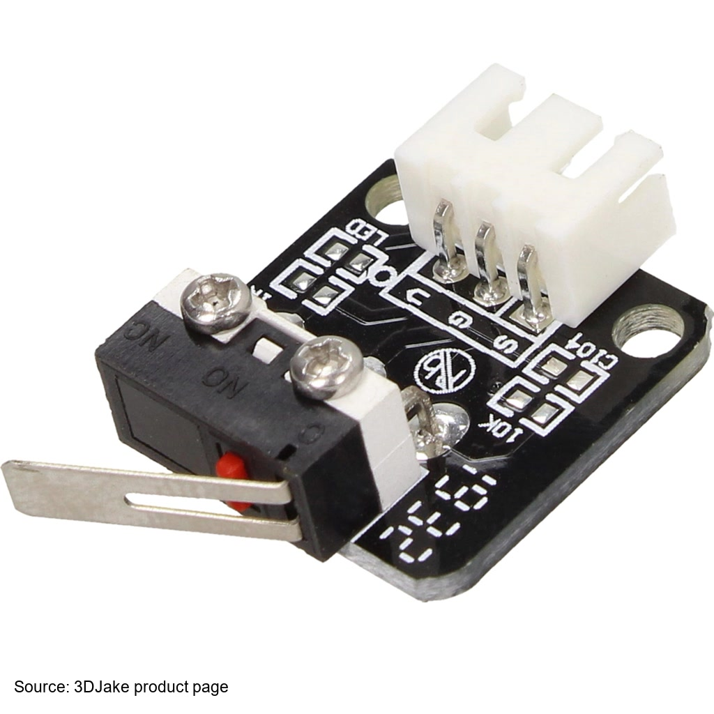

<!-- oomp-documentation:start -->
# Ender-3 Z endstop switch

## Summary

Ender-3 Z endstop switch



Creality replacement limit switch assembly; the installed position and mounting hardware are not shown. [Creality replacement endstop, 3DJake product image](https://www.3djake.uk/creality-3d-printers-spare-parts/limit-switch?sai=7792) by Creator not identified; product image supplied by 3DJake. [Retail product image; reuse permission not established](https://www.3djake.uk/creality-3d-printers-spare-parts/limit-switch?sai=7792). Resized within a square white canvas and credited on the image.

## Details

OOMP ID `three_d_printer_part_creality_ender_3_endstop_z_endstop_switch`

| Specification | Value |
| --- | --- |
| Cad file | ASM Z-Axis Limit Switch.SLDASM |
| Reference kind | Installed position |
| Reference name | Z endstop switch |

Sources checked 2026-11-18.

- [Creality machine bill of materials](https://github.com/Creality3DPrinting/Ender-3/blob/88c7758cea9d0d00a54fdb238bedb3b33425f409/Ender-3%20Mechanical/Ender-3%20BOM.XLS)
- [Creality original mechanical design](https://github.com/Creality3DPrinting/Ender-3/blob/88c7758cea9d0d00a54fdb238bedb3b33425f409/Ender-3%20Mechanical/Ender-3%20Parts/ASM%20Z-Axis%20Limit%20Switch.SLDASM)

| Taxonomy slot | Value |
| --- | --- |
| 1 | `three_d_printer` |
| 2 | `part` |
| 3 | `creality_ender_3` |
| 4 | `endstop` |
| 5 | `z_endstop_switch` |

## Labels

| Layout | Stock (mm) | Files |
| --- | --- | --- |
| OOMP inventory | 76.2 × 50.8 | [SVG](label_oomp.svg) · [Print PDF](label_oomp.pdf) |
| Stock | 76.2 × 50.8 | [SVG](label_stock_3x2.svg) · [Print PDF](label_stock_3x2.pdf) |
| Stock | 38.1 × 25.4 | [SVG](label_stock_1_5x1.svg) · [Print PDF](label_stock_1_5x1.pdf) |
| Drawer | 38.1 × 25.4 | [SVG](label_drawer.svg) · [Print PDF](label_drawer.pdf) |
| Compact barcode | 30 × 15 | [SVG](label_30x15.svg) · [Print PDF](label_30x15.pdf) |

## Parts

[Browse this category](../../navigation/part/creality_ender_3/endstop/README.md) · [Canonical metadata](working.yaml) · [Catalogue](../../README.md)

[Component used here: Ender-3 Three-pin endstop switch](../three_d_printer_part_creality_ender_3_endstop_three_pin_endstop_switch_creality_400304001/)

Confirmed printer models in this catalogue

- [Creality Ender-3](../three_d_printer_printer_creality_ender_3/)

## Assembly

Use the model-specific manufacturer documentation linked above for setup or service.

<details>
<summary>Full OOMP metadata</summary>

```yaml
compatible_printers:
- three_d_printer_printer_creality_ender_3
component_id: three_d_printer_part_creality_ender_3_endstop_three_pin_endstop_switch_creality_400304001
name_proper: Ender-3 Z endstop switch
oomp_id: three_d_printer_part_creality_ender_3_endstop_z_endstop_switch
photo:
  caption: Creality replacement limit switch assembly; the installed position and
    mounting hardware are not shown.
  changes: Resized within a square white canvas and credited on the image.
  creator: Creator not identified; product image supplied by 3DJake
  credit_line: 'Source: 3DJake product page'
  file: source_file/images/creality_replacement_endstop_square.jpg
  license: Retail product image; reuse permission not established
  license_url: https://www.3djake.uk/creality-3d-printers-spare-parts/limit-switch?sai=7792
  original_file: source_file/images/original/creality_replacement_endstop.jpg
  original_image_url: https://3d.nice-cdn.com/upload/image/product/large/default/10829_54723815.jpg
  source: https://www.3djake.uk/creality-3d-printers-spare-parts/limit-switch?sai=7792
  source_checked: '2026-11-19'
  title: Creality replacement endstop, 3DJake product image
source_checked: '2026-11-18'
sources:
  Creality machine bill of materials: https://github.com/Creality3DPrinting/Ender-3/blob/88c7758cea9d0d00a54fdb238bedb3b33425f409/Ender-3%20Mechanical/Ender-3%20BOM.XLS
  Creality original mechanical design: https://github.com/Creality3DPrinting/Ender-3/blob/88c7758cea9d0d00a54fdb238bedb3b33425f409/Ender-3%20Mechanical/Ender-3%20Parts/ASM%20Z-Axis%20Limit%20Switch.SLDASM
specifications:
  cad_file: ASM Z-Axis Limit Switch.SLDASM
  reference_kind: Installed position
  reference_name: Z endstop switch
taxonomy_1: three_d_printer
taxonomy_10: ''
taxonomy_11: ''
taxonomy_12: ''
taxonomy_13: ''
taxonomy_14: ''
taxonomy_15: ''
taxonomy_2: part
taxonomy_3: creality_ender_3
taxonomy_4: endstop
taxonomy_5: z_endstop_switch
taxonomy_6: ''
taxonomy_7: ''
taxonomy_8: ''
taxonomy_9: ''
taxonomy_1_upper: THREE_D_PRINTER
taxonomy_1_upper_length_1: T
taxonomy_1_upper_length_2: TH
taxonomy_1_upper_length_3: THR
taxonomy_1_upper_length_4: THRE
taxonomy_1_upper_length_5: THREE
taxonomy_1_length_1: t
taxonomy_1_length_2: th
taxonomy_1_length_3: thr
taxonomy_1_length_4: thre
taxonomy_1_length_5: three
taxonomy_1_capital: Three D Printer
taxonomy_1_first_letter: t
taxonomy_1_first_letter_upper: T
taxonomy_2_upper: PART
taxonomy_2_upper_length_1: P
taxonomy_2_upper_length_2: PA
taxonomy_2_upper_length_3: PAR
taxonomy_2_upper_length_4: PART
taxonomy_2_upper_length_5: PART
taxonomy_2_length_1: p
taxonomy_2_length_2: pa
taxonomy_2_length_3: par
taxonomy_2_length_4: part
taxonomy_2_length_5: part
taxonomy_2_capital: Part
taxonomy_2_first_letter: p
taxonomy_2_first_letter_upper: P
taxonomy_3_upper: CREALITY_ENDER_3
taxonomy_3_upper_length_1: C
taxonomy_3_upper_length_2: CR
taxonomy_3_upper_length_3: CRE
taxonomy_3_upper_length_4: CREA
taxonomy_3_upper_length_5: CREAL
taxonomy_3_length_1: c
taxonomy_3_length_2: cr
taxonomy_3_length_3: cre
taxonomy_3_length_4: crea
taxonomy_3_length_5: creal
taxonomy_3_capital: Creality Ender 3
taxonomy_3_first_letter: c
taxonomy_3_first_letter_upper: C
taxonomy_4_upper: ENDSTOP
taxonomy_4_upper_length_1: E
taxonomy_4_upper_length_2: EN
taxonomy_4_upper_length_3: END
taxonomy_4_upper_length_4: ENDS
taxonomy_4_upper_length_5: ENDST
taxonomy_4_length_1: e
taxonomy_4_length_2: en
taxonomy_4_length_3: end
taxonomy_4_length_4: ends
taxonomy_4_length_5: endst
taxonomy_4_capital: Endstop
taxonomy_4_first_letter: e
taxonomy_4_first_letter_upper: E
taxonomy_5_upper: Z_ENDSTOP_SWITCH
taxonomy_5_upper_length_1: Z
taxonomy_5_upper_length_2: Z_
taxonomy_5_upper_length_3: Z_E
taxonomy_5_upper_length_4: Z_EN
taxonomy_5_upper_length_5: Z_END
taxonomy_5_length_1: z
taxonomy_5_length_2: z_
taxonomy_5_length_3: z_e
taxonomy_5_length_4: z_en
taxonomy_5_length_5: z_end
taxonomy_5_capital: Z Endstop Switch
taxonomy_5_first_letter: z
taxonomy_5_first_letter_upper: Z
id: three_d_printer_part_creality_ender_3_endstop_z_endstop_switch
id_no_class: three_d_printer_part_creality_ender_3_endstop_z_endstop_switch
id_no_type: three_d_printer_part_creality_ender_3_endstop_z_endstop_switch
id_no_size: three_d_printer_part_creality_ender_3_endstop_z_endstop_switch
oomp_key: oomp_three_d_printer_part_creality_ender_3_endstop_z_endstop_switch
link_github: https://github.com/oomlout/oomp_three_d_printer_version_5/tree/main/parts/three_d_printer_part_creality_ender_3_endstop_z_endstop_switch
link_main: https://github.com/oomlout/oomp_three_d_printer_version_5/tree/main/parts/three_d_printer_part_creality_ender_3_endstop_z_endstop_switch
link_redirect: https://github.com/oomlout/oomp_three_d_printer_version_5/tree/main/parts/three_d_printer_part_creality_ender_3_endstop_z_endstop_switch
directory: parts/three_d_printer_part_creality_ender_3_endstop_z_endstop_switch
name: Three D Printer Part Creality Ender 3 Endstop Z Endstop Switch
name_no_class: Three D Printer Part Creality Ender 3 Endstop Z Endstop Switch
name_no_type: Three D Printer Part Creality Ender 3 Endstop Z Endstop Switch
name_no_size: Three D Printer Part Creality Ender 3 Endstop Z Endstop Switch
md5: 7b7215f09993140eb03891ef653758e0
md5_5: 7b721
md5_5_upper: 7B721
md5_6: 7b7215
md5_6_upper: 7B7215
md5_6_alpha: 4tedx
md5_6_alpha_upper: 4TEDX
md5_10: 7b7215f099
md5_10_upper: 7B7215F099
bip_39_full_array:
- kiwi
- mouse
- label
- creek
- course
- also
- science
- banana
- urge
- claim
- stomach
- screen
bip_39_full_space: kiwi mouse label creek course also science banana urge claim stomach
  screen
bip_39_full_no_space: kiwimouselabelcreekcoursealsosciencebananaurgeclaimstomachscreen
bip_39_full_underscore: kiwi_mouse_label_creek_course_also_science_banana_urge_claim_stomach_screen
bip_39_2_word_array:
- kiwi
- mouse
bip_39_2_word_space: kiwi mouse
bip_39_2_word_no_space: kiwimouse
bip_39_2_word_underscore: kiwi_mouse
bip_39_3_word_array:
- kiwi
- mouse
- label
bip_39_3_word_space: kiwi mouse label
bip_39_3_word_no_space: kiwimouselabel
bip_39_3_word_underscore: kiwi_mouse_label
label_title: Z endstop switch
label_barcode: M0,0h34v760h-34z M136,0h34v760h-34z M204,0h102v760h-102z M340,0h102v760h-102z
  M476,0h34v760h-34z M544,0h34v760h-34z M612,0h34v760h-34z M748,0h102v760h-102z M884,0h34v760h-34z
  M952,0h102v760h-102z M1088,0h34v760h-34z M1156,0h34v760h-34z M1224,0h102v760h-102z
  M1360,0h102v760h-102z M1564,0h34v760h-34z M1632,0h102v760h-102z M1768,0h34v760h-34z
  M1836,0h102v760h-102z M2040,0h34v760h-34z M2108,0h34v760h-34z M2176,0h34v760h-34z
  M2244,0h34v760h-34z M2312,0h102v760h-102z M2516,0h34v760h-34z M2584,0h102v760h-102z
  M2720,0h34v760h-34z M2856,0h34v760h-34z M2924,0h102v760h-102z M3060,0h34v760h-34z
  M3128,0h102v760h-102z M3264,0h34v760h-34z M3400,0h34v760h-34z M3468,0h102v760h-102z
  M3604,0h102v760h-102z M3740,0h34v760h-34z
label_barcode_width: 3774
label_maker: Unspecified
label_family: Endstop
label_detail: Installed position
label_variant: Creality Ender 3
label_context: Creality Ender-3
inventory_title_size: 13.712047012732613
stock_title_size: 4.162585700293829
drawer_title_size: 2.6934378060724775
compact_title_size: 2.8
oomlout_ai_roboclick_1:
  actions:
  - command: text_jinja_template
    file_template: source_file/template_jinja/template_jinja_label_oomlout_76_2_mm_50_8_mm/working.svg.j2
    file_output: label_oomp.svg
    convert_to_pdf: true
    convert_to_png: false
  - command: text_jinja_template
    file_template: source_file/template_jinja/label_stock/3x2.svg.j2
    file_output: label_stock_3x2.svg
    convert_to_pdf: true
    convert_to_png: false
  - command: text_jinja_template
    file_template: source_file/template_jinja/label_stock/1_5x1.svg.j2
    file_output: label_stock_1_5x1.svg
    convert_to_pdf: true
    convert_to_png: false
  - command: text_jinja_template
    file_template: source_file/template_jinja/label_drawer/working.svg.j2
    file_output: label_drawer.svg
    convert_to_pdf: true
    convert_to_png: false
  - command: text_jinja_template
    file_template: source_file/template_jinja/label_printer_30x15/working.svg.j2
    file_output: label_30x15.svg
    convert_to_pdf: true
    convert_to_png: false
  file_test: ''
  retries_until_complete: 0
  action_name: step_0_jinja_template_label_oomp.svg
```

</details>
<!-- oomp-documentation:end -->
