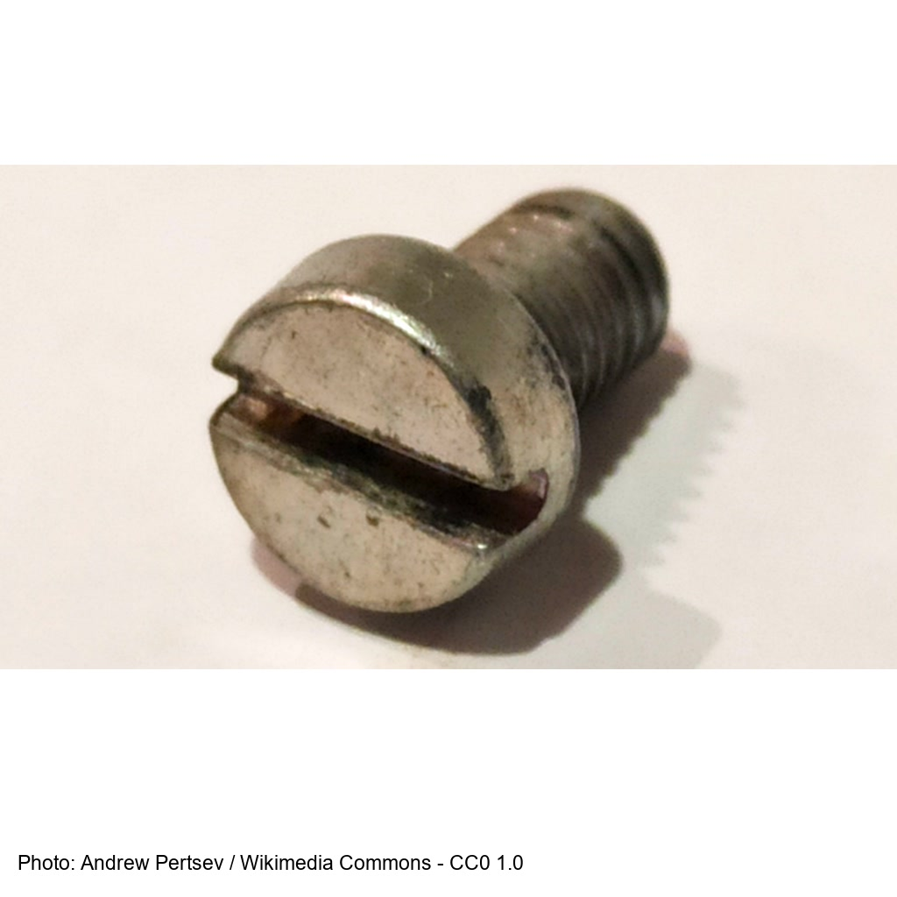

<!-- oomp-documentation:start -->
# Spare record moved

[Open the current part page](../three_d_printer_part_creality_ender_3_hardware_fastener_m4_x_14_pan_head_screw_creality_400205068/README.md). Previous label code: `47DCQ`.

[Open catalogue record](http://localhost:5703/parts/three_d_printer_part_creality_ender_3_hardware_fastener_m4_x_14_pan_head_screw_creality_400205068) · [Creality Ender-3 machine bill of materials](https://github.com/Creality3DPrinting/Ender-3/blob/88c7758cea9d0d00a54fdb238bedb3b33425f409/Ender-3%20Mechanical/Ender-3%20BOM.XLS)

Representative slotted pan-head screw; the drive and dimensions may differ from the Ender-3 part. [Pan head slotted screw.jpg](https://commons.wikimedia.org/wiki/File:Pan_head_slotted_screw.jpg) by Andrew Pertsev. [CC0 1.0](https://creativecommons.org/publicdomain/zero/1.0/). Resized within a square white canvas and credited on the image.

## Current labels

- OOMP inventory 76.2 × 50.8 mm · [SVG](../three_d_printer_part_creality_ender_3_hardware_fastener_m4_x_14_pan_head_screw_creality_400205068/label_oomp.svg) · [Print PDF](../three_d_printer_part_creality_ender_3_hardware_fastener_m4_x_14_pan_head_screw_creality_400205068/label_oomp.pdf)
- Stock 76.2 × 50.8 mm · [SVG](../three_d_printer_part_creality_ender_3_hardware_fastener_m4_x_14_pan_head_screw_creality_400205068/label_stock_3x2.svg) · [Print PDF](../three_d_printer_part_creality_ender_3_hardware_fastener_m4_x_14_pan_head_screw_creality_400205068/label_stock_3x2.pdf)
- Stock 38.1 × 25.4 mm · [SVG](../three_d_printer_part_creality_ender_3_hardware_fastener_m4_x_14_pan_head_screw_creality_400205068/label_stock_1_5x1.svg) · [Print PDF](../three_d_printer_part_creality_ender_3_hardware_fastener_m4_x_14_pan_head_screw_creality_400205068/label_stock_1_5x1.pdf)
- Drawer 38.1 × 25.4 mm · [SVG](../three_d_printer_part_creality_ender_3_hardware_fastener_m4_x_14_pan_head_screw_creality_400205068/label_drawer.svg) · [Print PDF](../three_d_printer_part_creality_ender_3_hardware_fastener_m4_x_14_pan_head_screw_creality_400205068/label_drawer.pdf)
- Compact barcode 30 × 15 mm · [SVG](../three_d_printer_part_creality_ender_3_hardware_fastener_m4_x_14_pan_head_screw_creality_400205068/label_30x15.svg) · [Print PDF](../three_d_printer_part_creality_ender_3_hardware_fastener_m4_x_14_pan_head_screw_creality_400205068/label_30x15.pdf)
<!-- oomp-documentation:end -->
