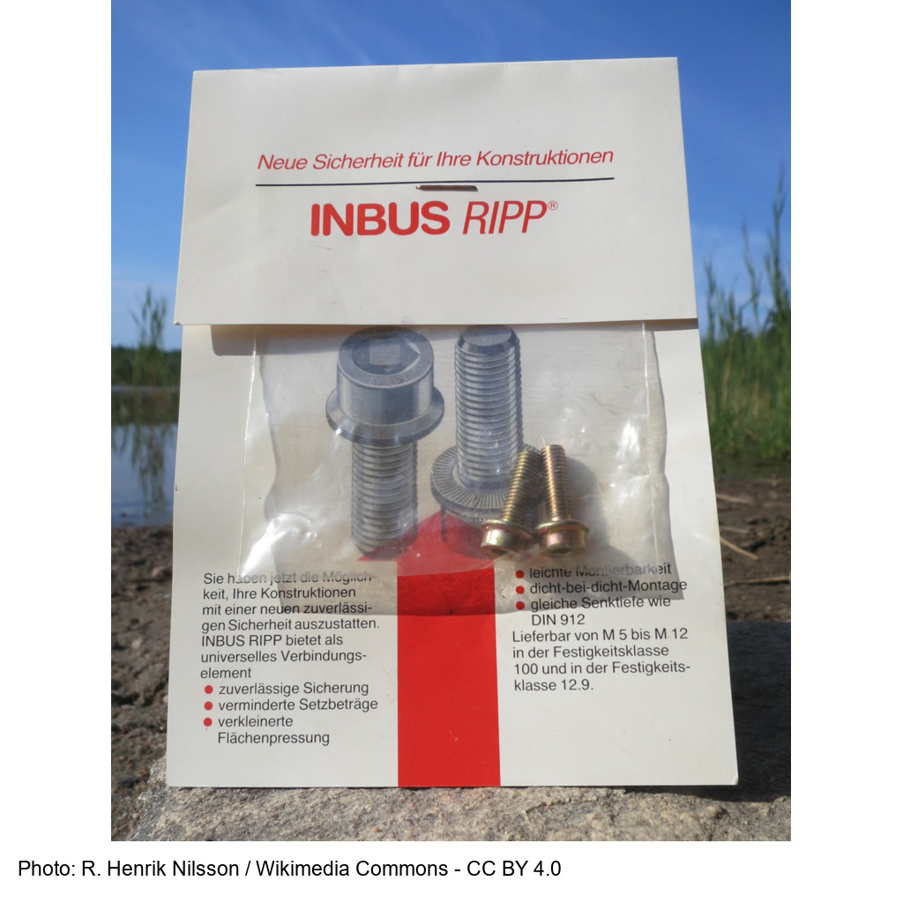

<!-- oomp-documentation:start -->
# Ender-3 M4 x 20 Socket Head Screw

## Summary

Ender-3 M4 x 20 Socket Head Screw



Representative flanged socket-head screws; the Ender-3 screw may differ in its flange and dimensions. [INBUS RIPP Serrated hex soc head cap screws with flange by Bauer and Schaurte Karcher GmbH Neuss Germany.jpg](https://commons.wikimedia.org/wiki/File:INBUS_RIPP_Serrated_hex_soc_head_cap_screws_with_flange_by_Bauer_and_Schaurte_Karcher_GmbH_Neuss_Germany.jpg) by R. Henrik Nilsson. [CC BY 4.0](https://creativecommons.org/licenses/by/4.0/). Resized within a square white canvas and credited on the image.

## Details

OOMP ID `three_d_printer_part_creality_ender_3_fastener_m4_x_20_socket_head_screw_creality_400205122`

| Specification | Value |
| --- | --- |
| Identifier basis | Creality machine BOM part code. Retail ordering code unverified. |
| Machine bom quantity pcs | 3 |
| Machine bom row | 67 |
| Manufacturer part number | 400205122 |
| Reference name | M4 x 20 Socket Head Screw |
| Source name | M4*20  Socket Head Screw |
| Source specification | M4*20 |

Sources checked 2026-11-18.

- [Creality Ender-3 machine bill of materials](https://github.com/Creality3DPrinting/Ender-3/blob/88c7758cea9d0d00a54fdb238bedb3b33425f409/Ender-3%20Mechanical/Ender-3%20BOM.XLS)

| Taxonomy slot | Value |
| --- | --- |
| 1 | `three_d_printer` |
| 2 | `part` |
| 3 | `creality_ender_3` |
| 4 | `fastener` |
| 5 | `m4_x_20_socket_head_screw` |
| 14 | `creality` |
| 15 | `400205122` |

## Labels

| Layout | Stock (mm) | Files |
| --- | --- | --- |
| OOMP inventory | 76.2 × 50.8 | [SVG](label_oomp.svg) · [Print PDF](label_oomp.pdf) |
| Stock | 76.2 × 50.8 | [SVG](label_stock_3x2.svg) · [Print PDF](label_stock_3x2.pdf) |
| Stock | 38.1 × 25.4 | [SVG](label_stock_1_5x1.svg) · [Print PDF](label_stock_1_5x1.pdf) |
| Drawer | 38.1 × 25.4 | [SVG](label_drawer.svg) · [Print PDF](label_drawer.pdf) |
| Compact barcode | 30 × 15 | [SVG](label_30x15.svg) · [Print PDF](label_30x15.pdf) |

## Parts

[Browse this category](../../navigation/part/creality_ender_3/fastener/README.md) · [Canonical metadata](working.yaml) · [Catalogue](../../README.md)

Confirmed printer models in this catalogue

- [Creality Ender-3](../three_d_printer_printer_creality_ender_3/)

## Assembly

Use the model-specific manufacturer documentation linked above for setup or service.

<details>
<summary>Full OOMP metadata</summary>

```yaml
compatible_printers:
- three_d_printer_printer_creality_ender_3
name_proper: Ender-3 M4 x 20 Socket Head Screw
oomp_id: three_d_printer_part_creality_ender_3_fastener_m4_x_20_socket_head_screw_creality_400205122
photo:
  caption: Representative flanged socket-head screws; the Ender-3 screw may differ
    in its flange and dimensions.
  changes: Resized within a square white canvas and credited on the image.
  creator: R. Henrik Nilsson
  credit_line: 'Photo: R. Henrik Nilsson / Wikimedia Commons - CC BY 4.0'
  file: source_file/images/representative_socket_square.jpg
  license: CC BY 4.0
  license_url: https://creativecommons.org/licenses/by/4.0/
  original_file: source_file/images/original/representative_socket.jpg
  original_image_url: https://upload.wikimedia.org/wikipedia/commons/2/2c/INBUS_RIPP_Serrated_hex_soc_head_cap_screws_with_flange_by_Bauer_and_Schaurte_Karcher_GmbH_Neuss_Germany.jpg?utm_source=commons.wikimedia.org&utm_campaign=imageinfo&utm_content=original
  source: https://commons.wikimedia.org/wiki/File:INBUS_RIPP_Serrated_hex_soc_head_cap_screws_with_flange_by_Bauer_and_Schaurte_Karcher_GmbH_Neuss_Germany.jpg
  source_checked: '2026-11-19'
  title: INBUS RIPP Serrated hex soc head cap screws with flange by Bauer and Schaurte
    Karcher GmbH Neuss Germany.jpg
source_checked: '2026-11-18'
sources:
  Creality Ender-3 machine bill of materials: https://github.com/Creality3DPrinting/Ender-3/blob/88c7758cea9d0d00a54fdb238bedb3b33425f409/Ender-3%20Mechanical/Ender-3%20BOM.XLS
specifications:
  identifier_basis: Creality machine BOM part code. Retail ordering code unverified.
  machine_bom_quantity_pcs: 3
  machine_bom_row: 67
  manufacturer_part_number: '400205122'
  reference_name: M4 x 20 Socket Head Screw
  source_name: M4*20  Socket Head Screw
  source_specification: M4*20
taxonomy_1: three_d_printer
taxonomy_10: ''
taxonomy_11: ''
taxonomy_12: ''
taxonomy_13: ''
taxonomy_14: creality
taxonomy_15: '400205122'
taxonomy_2: part
taxonomy_3: creality_ender_3
taxonomy_4: fastener
taxonomy_5: m4_x_20_socket_head_screw
taxonomy_6: ''
taxonomy_7: ''
taxonomy_8: ''
taxonomy_9: ''
taxonomy_1_upper: THREE_D_PRINTER
taxonomy_1_upper_length_1: T
taxonomy_1_upper_length_2: TH
taxonomy_1_upper_length_3: THR
taxonomy_1_upper_length_4: THRE
taxonomy_1_upper_length_5: THREE
taxonomy_1_length_1: t
taxonomy_1_length_2: th
taxonomy_1_length_3: thr
taxonomy_1_length_4: thre
taxonomy_1_length_5: three
taxonomy_1_capital: Three D Printer
taxonomy_1_first_letter: t
taxonomy_1_first_letter_upper: T
taxonomy_2_upper: PART
taxonomy_2_upper_length_1: P
taxonomy_2_upper_length_2: PA
taxonomy_2_upper_length_3: PAR
taxonomy_2_upper_length_4: PART
taxonomy_2_upper_length_5: PART
taxonomy_2_length_1: p
taxonomy_2_length_2: pa
taxonomy_2_length_3: par
taxonomy_2_length_4: part
taxonomy_2_length_5: part
taxonomy_2_capital: Part
taxonomy_2_first_letter: p
taxonomy_2_first_letter_upper: P
taxonomy_3_upper: CREALITY_ENDER_3
taxonomy_3_upper_length_1: C
taxonomy_3_upper_length_2: CR
taxonomy_3_upper_length_3: CRE
taxonomy_3_upper_length_4: CREA
taxonomy_3_upper_length_5: CREAL
taxonomy_3_length_1: c
taxonomy_3_length_2: cr
taxonomy_3_length_3: cre
taxonomy_3_length_4: crea
taxonomy_3_length_5: creal
taxonomy_3_capital: Creality Ender 3
taxonomy_3_first_letter: c
taxonomy_3_first_letter_upper: C
taxonomy_4_upper: FASTENER
taxonomy_4_upper_length_1: F
taxonomy_4_upper_length_2: FA
taxonomy_4_upper_length_3: FAS
taxonomy_4_upper_length_4: FAST
taxonomy_4_upper_length_5: FASTE
taxonomy_4_length_1: f
taxonomy_4_length_2: fa
taxonomy_4_length_3: fas
taxonomy_4_length_4: fast
taxonomy_4_length_5: faste
taxonomy_4_capital: Fastener
taxonomy_4_first_letter: f
taxonomy_4_first_letter_upper: F
taxonomy_5_upper: M4_X_20_SOCKET_HEAD_SCREW
taxonomy_5_upper_length_1: M
taxonomy_5_upper_length_2: M4
taxonomy_5_upper_length_3: M4_
taxonomy_5_upper_length_4: M4_X
taxonomy_5_upper_length_5: M4_X_
taxonomy_5_length_1: m
taxonomy_5_length_2: m4
taxonomy_5_length_3: m4_
taxonomy_5_length_4: m4_x
taxonomy_5_length_5: m4_x_
taxonomy_5_capital: M4 x 20 Socket Head Screw
taxonomy_5_first_letter: m
taxonomy_5_first_letter_upper: M
taxonomy_14_upper: CREALITY
taxonomy_14_upper_length_1: C
taxonomy_14_upper_length_2: CR
taxonomy_14_upper_length_3: CRE
taxonomy_14_upper_length_4: CREA
taxonomy_14_upper_length_5: CREAL
taxonomy_14_length_1: c
taxonomy_14_length_2: cr
taxonomy_14_length_3: cre
taxonomy_14_length_4: crea
taxonomy_14_length_5: creal
taxonomy_14_capital: Creality
taxonomy_14_first_letter: c
taxonomy_14_first_letter_upper: C
taxonomy_15_upper: '400205122'
taxonomy_15_upper_length_1: '4'
taxonomy_15_upper_length_2: '40'
taxonomy_15_upper_length_3: '400'
taxonomy_15_upper_length_4: '4002'
taxonomy_15_upper_length_5: '40020'
taxonomy_15_length_1: '4'
taxonomy_15_length_2: '40'
taxonomy_15_length_3: '400'
taxonomy_15_length_4: '4002'
taxonomy_15_length_5: '40020'
taxonomy_15_capital: '400205122'
taxonomy_15_first_letter: '4'
taxonomy_15_first_letter_upper: '4'
id: three_d_printer_part_creality_ender_3_fastener_m4_x_20_socket_head_screw_creality_400205122
id_no_class: three_d_printer_part_creality_ender_3_fastener_m4_x_20_socket_head_screw_creality_400205122
id_no_type: three_d_printer_part_creality_ender_3_fastener_m4_x_20_socket_head_screw_creality_400205122
id_no_size: three_d_printer_part_creality_ender_3_fastener_m4_x_20_socket_head_screw_creality_400205122
oomp_key: oomp_three_d_printer_part_creality_ender_3_fastener_m4_x_20_socket_head_screw_creality_400205122
link_github: https://github.com/oomlout/oomp_three_d_printer_version_5/tree/main/parts/three_d_printer_part_creality_ender_3_fastener_m4_x_20_socket_head_screw_creality_400205122
link_main: https://github.com/oomlout/oomp_three_d_printer_version_5/tree/main/parts/three_d_printer_part_creality_ender_3_fastener_m4_x_20_socket_head_screw_creality_400205122
link_redirect: https://github.com/oomlout/oomp_three_d_printer_version_5/tree/main/parts/three_d_printer_part_creality_ender_3_fastener_m4_x_20_socket_head_screw_creality_400205122
directory: parts/three_d_printer_part_creality_ender_3_fastener_m4_x_20_socket_head_screw_creality_400205122
name: Three D Printer Part Creality Ender 3 Fastener M4 X 20 Socket Head Screw Creality
  400205122
name_no_class: Three D Printer Part Creality Ender 3 Fastener M4 X 20 Socket Head
  Screw Creality 400205122
name_no_type: Three D Printer Part Creality Ender 3 Fastener M4 X 20 Socket Head Screw
  Creality 400205122
name_no_size: Three D Printer Part Creality Ender 3 Fastener M4 X 20 Socket Head Screw
  Creality 400205122
md5: b1b0db399c9924fb8ca5262f7890ca44
md5_5: b1b0d
md5_5_upper: B1B0D
md5_6: b1b0db
md5_6_upper: B1B0DB
md5_6_alpha: 6xlgb
md5_6_alpha_upper: 6XLGB
md5_10: b1b0db399c
md5_10_upper: B1B0DB399C
bip_39_full_array:
- random
- man
- solar
- decrease
- myself
- lava
- crater
- pill
- control
- setup
- crater
- mask
bip_39_full_space: random man solar decrease myself lava crater pill control setup
  crater mask
bip_39_full_no_space: randommansolardecreasemyselflavacraterpillcontrolsetupcratermask
bip_39_full_underscore: random_man_solar_decrease_myself_lava_crater_pill_control_setup_crater_mask
bip_39_2_word_array:
- random
- man
bip_39_2_word_space: random man
bip_39_2_word_no_space: randomman
bip_39_2_word_underscore: random_man
bip_39_3_word_array:
- random
- man
- solar
bip_39_3_word_space: random man solar
bip_39_3_word_no_space: randommansolar
bip_39_3_word_underscore: random_man_solar
label_title: M4 x 20 Socket Head Screw
label_barcode: M0,0h34v760h-34z M136,0h34v760h-34z M204,0h102v760h-102z M340,0h102v760h-102z
  M476,0h34v760h-34z M544,0h34v760h-34z M612,0h102v760h-102z M816,0h102v760h-102z
  M952,0h34v760h-34z M1020,0h34v760h-34z M1088,0h34v760h-34z M1224,0h34v760h-34z M1292,0h102v760h-102z
  M1428,0h34v760h-34z M1496,0h102v760h-102z M1632,0h34v760h-34z M1700,0h102v760h-102z
  M1836,0h34v760h-34z M1904,0h34v760h-34z M2040,0h102v760h-102z M2176,0h34v760h-34z
  M2244,0h34v760h-34z M2312,0h34v760h-34z M2448,0h102v760h-102z M2584,0h102v760h-102z
  M2720,0h34v760h-34z M2788,0h102v760h-102z M2924,0h34v760h-34z M3060,0h34v760h-34z
  M3128,0h102v760h-102z M3264,0h34v760h-34z M3400,0h34v760h-34z M3468,0h102v760h-102z
  M3604,0h102v760h-102z M3740,0h34v760h-34z
label_barcode_width: 3774
label_maker: Creality
label_family: Fastener
label_detail: '400205122'
label_variant: Creality Ender 3
label_context: Creality Ender-3
inventory_title_size: 8.538537775405961
stock_title_size: 2.5920561103910953
drawer_title_size: 1.6772127773118852
compact_title_size: 2.0583974994282226
oomlout_ai_roboclick_1:
  actions:
  - command: text_jinja_template
    file_template: source_file/template_jinja/template_jinja_label_oomlout_76_2_mm_50_8_mm/working.svg.j2
    file_output: label_oomp.svg
    convert_to_pdf: true
    convert_to_png: false
  - command: text_jinja_template
    file_template: source_file/template_jinja/label_stock/3x2.svg.j2
    file_output: label_stock_3x2.svg
    convert_to_pdf: true
    convert_to_png: false
  - command: text_jinja_template
    file_template: source_file/template_jinja/label_stock/1_5x1.svg.j2
    file_output: label_stock_1_5x1.svg
    convert_to_pdf: true
    convert_to_png: false
  - command: text_jinja_template
    file_template: source_file/template_jinja/label_drawer/working.svg.j2
    file_output: label_drawer.svg
    convert_to_pdf: true
    convert_to_png: false
  - command: text_jinja_template
    file_template: source_file/template_jinja/label_printer_30x15/working.svg.j2
    file_output: label_30x15.svg
    convert_to_pdf: true
    convert_to_png: false
  file_test: ''
  retries_until_complete: 0
  action_name: step_0_jinja_template_label_oomp.svg
```

</details>
<!-- oomp-documentation:end -->
