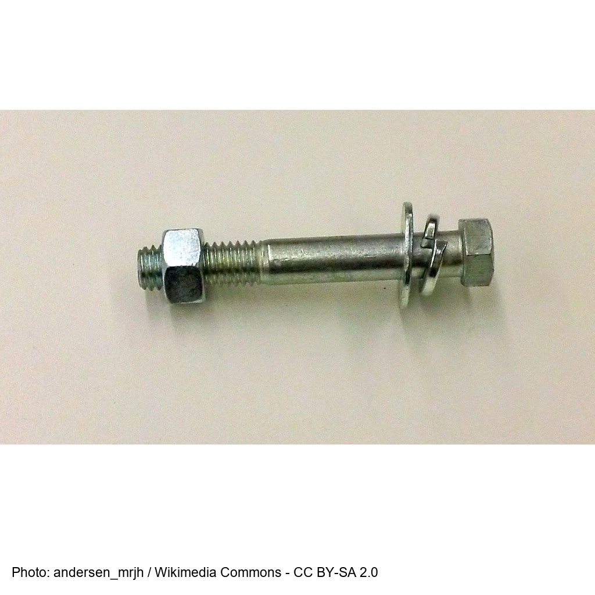

<!-- oomp-documentation:start -->
# Spare record moved

[Open the current part page](../three_d_printer_part_creality_ender_3_hardware_fastener_m5_washer_creality_400205109/README.md). Previous label code: `QLFA`.

[Open catalogue record](http://localhost:5703/parts/three_d_printer_part_creality_ender_3_hardware_fastener_m5_washer_creality_400205109) · [Creality Ender-3 machine bill of materials](https://github.com/Creality3DPrinting/Ender-3/blob/88c7758cea9d0d00a54fdb238bedb3b33425f409/Ender-3%20Mechanical/Ender-3%20BOM.XLS)

Representative bolt with plain and split washers; the dimensions shown may differ from the Ender-3 part. [Bolt, Plain washer and Spring lock washer.jpg](https://commons.wikimedia.org/wiki/File:Bolt,_Plain_washer_and_Spring_lock_washer.jpg) by andersen_mrjh. [CC BY-SA 2.0](https://creativecommons.org/licenses/by-sa/2.0/). Resized within a square white canvas and credited on the image.

## Current labels

- OOMP inventory 76.2 × 50.8 mm · [SVG](../three_d_printer_part_creality_ender_3_hardware_fastener_m5_washer_creality_400205109/label_oomp.svg) · [Print PDF](../three_d_printer_part_creality_ender_3_hardware_fastener_m5_washer_creality_400205109/label_oomp.pdf)
- Stock 76.2 × 50.8 mm · [SVG](../three_d_printer_part_creality_ender_3_hardware_fastener_m5_washer_creality_400205109/label_stock_3x2.svg) · [Print PDF](../three_d_printer_part_creality_ender_3_hardware_fastener_m5_washer_creality_400205109/label_stock_3x2.pdf)
- Stock 38.1 × 25.4 mm · [SVG](../three_d_printer_part_creality_ender_3_hardware_fastener_m5_washer_creality_400205109/label_stock_1_5x1.svg) · [Print PDF](../three_d_printer_part_creality_ender_3_hardware_fastener_m5_washer_creality_400205109/label_stock_1_5x1.pdf)
- Drawer 38.1 × 25.4 mm · [SVG](../three_d_printer_part_creality_ender_3_hardware_fastener_m5_washer_creality_400205109/label_drawer.svg) · [Print PDF](../three_d_printer_part_creality_ender_3_hardware_fastener_m5_washer_creality_400205109/label_drawer.pdf)
- Compact barcode 30 × 15 mm · [SVG](../three_d_printer_part_creality_ender_3_hardware_fastener_m5_washer_creality_400205109/label_30x15.svg) · [Print PDF](../three_d_printer_part_creality_ender_3_hardware_fastener_m5_washer_creality_400205109/label_30x15.pdf)
<!-- oomp-documentation:end -->
