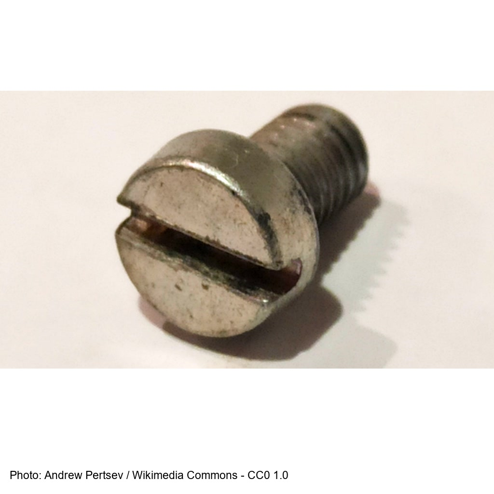

<!-- oomp-documentation:start -->
# Ender-3 M3 x 4 Pan Head Screw

[Open catalogue record](http://localhost:5703/parts/three_d_printer_part_creality_ender_3_hardware_fastener_m3_x_4_pan_head_screw_creality_400205021) · [Creality Ender-3 machine bill of materials](https://github.com/Creality3DPrinting/Ender-3/blob/88c7758cea9d0d00a54fdb238bedb3b33425f409/Ender-3%20Mechanical/Ender-3%20BOM.XLS)

## Summary

Ender-3 M3 x 4 Pan Head Screw



Representative slotted pan-head screw; the drive and dimensions may differ from the Ender-3 part. [Pan head slotted screw.jpg](https://commons.wikimedia.org/wiki/File:Pan_head_slotted_screw.jpg) by Andrew Pertsev. [CC0 1.0](https://creativecommons.org/publicdomain/zero/1.0/). Resized within a square white canvas and credited on the image.

## Details

OOMP ID `three_d_printer_part_creality_ender_3_hardware_fastener_m3_x_4_pan_head_screw_creality_400205021`

| Specification | Value |
| --- | --- |
| Identifier basis | Creality machine BOM part code. Retail ordering code unverified. |
| Machine bom quantity pcs | 1 |
| Machine bom row | 47 |
| Manufacturer part number | 400205021 |
| Reference name | M3 x 4 Pan Head Screw |
| Source name | M3*4  Pan Head Screw |
| Source specification | M3*4 |

Sources checked 2026-11-18.


| Taxonomy slot | Value |
| --- | --- |
| 1 | `three_d_printer` |
| 2 | `part` |
| 3 | `creality_ender_3` |
| 4 | `hardware` |
| 5 | `fastener` |
| 6 | `m3_x_4_pan_head_screw` |
| 14 | `creality` |
| 15 | `400205021` |

Assembly taxonomy: [hardware / fastener](../../navigation/part/creality_ender_3/hardware/fastener/README.md)

## Labels

| Layout | Stock (mm) | Files |
| --- | --- | --- |
| OOMP inventory | 76.2 × 50.8 | [SVG](label_oomp.svg) · [Print PDF](label_oomp.pdf) |
| Stock | 76.2 × 50.8 | [SVG](label_stock_3x2.svg) · [Print PDF](label_stock_3x2.pdf) |
| Stock | 38.1 × 25.4 | [SVG](label_stock_1_5x1.svg) · [Print PDF](label_stock_1_5x1.pdf) |
| Drawer | 38.1 × 25.4 | [SVG](label_drawer.svg) · [Print PDF](label_drawer.pdf) |
| Compact barcode | 30 × 15 | [SVG](label_30x15.svg) · [Print PDF](label_30x15.pdf) |

## Parts

[Browse this category](../../navigation/part/creality_ender_3/hardware/fastener/README.md) · [Canonical metadata](working.yaml) · [Catalogue](../../README.md)

Confirmed printer models in this catalogue

- [Creality Ender-3](../three_d_printer_printer_creality_ender_3/)

## Assembly

Use the model-specific manufacturer documentation linked above for setup or service.

<details>
<summary>Full OOMP metadata</summary>

```yaml
assembly_path:
- hardware
- fastener
compatible_printers:
- three_d_printer_printer_creality_ender_3
exact_variant: m3_x_4_pan_head_screw
link_main: https://github.com/oomlout/oomp_three_d_printer_version_5/tree/main/parts/three_d_printer_part_creality_ender_3_hardware_fastener_m3_x_4_pan_head_screw_creality_400205021
link_source: https://github.com/Creality3DPrinting/Ender-3/blob/88c7758cea9d0d00a54fdb238bedb3b33425f409/Ender-3%20Mechanical/Ender-3%20BOM.XLS
link_web: http://localhost:5703/parts/three_d_printer_part_creality_ender_3_hardware_fastener_m3_x_4_pan_head_screw_creality_400205021
name_proper: Ender-3 M3 x 4 Pan Head Screw
oomp_id: three_d_printer_part_creality_ender_3_hardware_fastener_m3_x_4_pan_head_screw_creality_400205021
photo:
  caption: Representative slotted pan-head screw; the drive and dimensions may differ
    from the Ender-3 part.
  changes: Resized within a square white canvas and credited on the image.
  creator: Andrew Pertsev
  credit_line: 'Photo: Andrew Pertsev / Wikimedia Commons - CC0 1.0'
  file: source_file/images/representative_pan_square.jpg
  license: CC0 1.0
  license_url: https://creativecommons.org/publicdomain/zero/1.0/
  original_file: source_file/images/original/representative_pan.jpg
  original_image_url: https://upload.wikimedia.org/wikipedia/commons/2/2e/Pan_head_slotted_screw.jpg?utm_source=commons.wikimedia.org&utm_campaign=imageinfo&utm_content=original
  source: https://commons.wikimedia.org/wiki/File:Pan_head_slotted_screw.jpg
  source_checked: '2026-11-19'
  title: Pan head slotted screw.jpg
previous_id: three_d_printer_part_creality_ender_3_fastener_m3_x_4_pan_head_screw_creality_400205021
previous_label: 7SALI
source_checked: '2026-11-18'
sources:
  Creality Ender-3 machine bill of materials: https://github.com/Creality3DPrinting/Ender-3/blob/88c7758cea9d0d00a54fdb238bedb3b33425f409/Ender-3%20Mechanical/Ender-3%20BOM.XLS
spare_type: fastener
specifications:
  identifier_basis: Creality machine BOM part code. Retail ordering code unverified.
  machine_bom_quantity_pcs: 1
  machine_bom_row: 47
  manufacturer_part_number: '400205021'
  reference_name: M3 x 4 Pan Head Screw
  source_name: M3*4  Pan Head Screw
  source_specification: M3*4
taxonomy_1: three_d_printer
taxonomy_10: ''
taxonomy_11: ''
taxonomy_12: ''
taxonomy_13: ''
taxonomy_14: creality
taxonomy_15: '400205021'
taxonomy_2: part
taxonomy_3: creality_ender_3
taxonomy_4: hardware
taxonomy_5: fastener
taxonomy_6: m3_x_4_pan_head_screw
taxonomy_7: ''
taxonomy_8: ''
taxonomy_9: ''
taxonomy_1_upper: THREE_D_PRINTER
taxonomy_1_upper_length_1: T
taxonomy_1_upper_length_2: TH
taxonomy_1_upper_length_3: THR
taxonomy_1_upper_length_4: THRE
taxonomy_1_upper_length_5: THREE
taxonomy_1_length_1: t
taxonomy_1_length_2: th
taxonomy_1_length_3: thr
taxonomy_1_length_4: thre
taxonomy_1_length_5: three
taxonomy_1_capital: Three D Printer
taxonomy_1_first_letter: t
taxonomy_1_first_letter_upper: T
taxonomy_2_upper: PART
taxonomy_2_upper_length_1: P
taxonomy_2_upper_length_2: PA
taxonomy_2_upper_length_3: PAR
taxonomy_2_upper_length_4: PART
taxonomy_2_upper_length_5: PART
taxonomy_2_length_1: p
taxonomy_2_length_2: pa
taxonomy_2_length_3: par
taxonomy_2_length_4: part
taxonomy_2_length_5: part
taxonomy_2_capital: Part
taxonomy_2_first_letter: p
taxonomy_2_first_letter_upper: P
taxonomy_3_upper: CREALITY_ENDER_3
taxonomy_3_upper_length_1: C
taxonomy_3_upper_length_2: CR
taxonomy_3_upper_length_3: CRE
taxonomy_3_upper_length_4: CREA
taxonomy_3_upper_length_5: CREAL
taxonomy_3_length_1: c
taxonomy_3_length_2: cr
taxonomy_3_length_3: cre
taxonomy_3_length_4: crea
taxonomy_3_length_5: creal
taxonomy_3_capital: Creality Ender 3
taxonomy_3_first_letter: c
taxonomy_3_first_letter_upper: C
taxonomy_4_upper: HARDWARE
taxonomy_4_upper_length_1: H
taxonomy_4_upper_length_2: HA
taxonomy_4_upper_length_3: HAR
taxonomy_4_upper_length_4: HARD
taxonomy_4_upper_length_5: HARDW
taxonomy_4_length_1: h
taxonomy_4_length_2: ha
taxonomy_4_length_3: har
taxonomy_4_length_4: hard
taxonomy_4_length_5: hardw
taxonomy_4_capital: Hardware
taxonomy_4_first_letter: h
taxonomy_4_first_letter_upper: H
taxonomy_5_upper: FASTENER
taxonomy_5_upper_length_1: F
taxonomy_5_upper_length_2: FA
taxonomy_5_upper_length_3: FAS
taxonomy_5_upper_length_4: FAST
taxonomy_5_upper_length_5: FASTE
taxonomy_5_length_1: f
taxonomy_5_length_2: fa
taxonomy_5_length_3: fas
taxonomy_5_length_4: fast
taxonomy_5_length_5: faste
taxonomy_5_capital: Fastener
taxonomy_5_first_letter: f
taxonomy_5_first_letter_upper: F
taxonomy_6_upper: M3_X_4_PAN_HEAD_SCREW
taxonomy_6_upper_length_1: M
taxonomy_6_upper_length_2: M3
taxonomy_6_upper_length_3: M3_
taxonomy_6_upper_length_4: M3_X
taxonomy_6_upper_length_5: M3_X_
taxonomy_6_length_1: m
taxonomy_6_length_2: m3
taxonomy_6_length_3: m3_
taxonomy_6_length_4: m3_x
taxonomy_6_length_5: m3_x_
taxonomy_6_capital: M3 x 4 Pan Head Screw
taxonomy_6_first_letter: m
taxonomy_6_first_letter_upper: M
taxonomy_14_upper: CREALITY
taxonomy_14_upper_length_1: C
taxonomy_14_upper_length_2: CR
taxonomy_14_upper_length_3: CRE
taxonomy_14_upper_length_4: CREA
taxonomy_14_upper_length_5: CREAL
taxonomy_14_length_1: c
taxonomy_14_length_2: cr
taxonomy_14_length_3: cre
taxonomy_14_length_4: crea
taxonomy_14_length_5: creal
taxonomy_14_capital: Creality
taxonomy_14_first_letter: c
taxonomy_14_first_letter_upper: C
taxonomy_15_upper: '400205021'
taxonomy_15_upper_length_1: '4'
taxonomy_15_upper_length_2: '40'
taxonomy_15_upper_length_3: '400'
taxonomy_15_upper_length_4: '4002'
taxonomy_15_upper_length_5: '40020'
taxonomy_15_length_1: '4'
taxonomy_15_length_2: '40'
taxonomy_15_length_3: '400'
taxonomy_15_length_4: '4002'
taxonomy_15_length_5: '40020'
taxonomy_15_capital: '400205021'
taxonomy_15_first_letter: '4'
taxonomy_15_first_letter_upper: '4'
id: three_d_printer_part_creality_ender_3_hardware_fastener_m3_x_4_pan_head_screw_creality_400205021
id_no_class: three_d_printer_part_creality_ender_3_hardware_fastener_m3_x_4_pan_head_screw_creality_400205021
id_no_type: three_d_printer_part_creality_ender_3_hardware_fastener_m3_x_4_pan_head_screw_creality_400205021
id_no_size: three_d_printer_part_creality_ender_3_hardware_fastener_m3_x_4_pan_head_screw_creality_400205021
oomp_key: oomp_three_d_printer_part_creality_ender_3_hardware_fastener_m3_x_4_pan_head_screw_creality_400205021
link_github: https://github.com/oomlout/oomp_three_d_printer_version_5/tree/main/parts/three_d_printer_part_creality_ender_3_hardware_fastener_m3_x_4_pan_head_screw_creality_400205021
link_redirect: https://github.com/oomlout/oomp_three_d_printer_version_5/tree/main/parts/three_d_printer_part_creality_ender_3_hardware_fastener_m3_x_4_pan_head_screw_creality_400205021
directory: parts/three_d_printer_part_creality_ender_3_hardware_fastener_m3_x_4_pan_head_screw_creality_400205021
name: Three D Printer Part Creality Ender 3 Hardware Fastener M3 X 4 Pan Head Screw
  Creality 400205021
name_no_class: Three D Printer Part Creality Ender 3 Hardware Fastener M3 X 4 Pan
  Head Screw Creality 400205021
name_no_type: Three D Printer Part Creality Ender 3 Hardware Fastener M3 X 4 Pan Head
  Screw Creality 400205021
name_no_size: Three D Printer Part Creality Ender 3 Hardware Fastener M3 X 4 Pan Head
  Screw Creality 400205021
md5: e6eacb76e888ab903cae30fd0263e744
md5_5: e6eac
md5_5_upper: E6EAC
md5_6: e6eacb
md5_6_upper: E6EACB
md5_6_alpha: 90czv
md5_6_alpha_upper: 90CZV
md5_10: e6eacb76e8
md5_10_upper: E6EACB76E8
bip_39_full_array:
- tragic
- film
- tank
- speed
- melt
- siege
- verify
- ship
- wonder
- basic
- what
- matter
bip_39_full_space: tragic film tank speed melt siege verify ship wonder basic what
  matter
bip_39_full_no_space: tragicfilmtankspeedmeltsiegeverifyshipwonderbasicwhatmatter
bip_39_full_underscore: tragic_film_tank_speed_melt_siege_verify_ship_wonder_basic_what_matter
bip_39_2_word_array:
- tragic
- film
bip_39_2_word_space: tragic film
bip_39_2_word_no_space: tragicfilm
bip_39_2_word_underscore: tragic_film
bip_39_3_word_array:
- tragic
- film
- tank
bip_39_3_word_space: tragic film tank
bip_39_3_word_no_space: tragicfilmtank
bip_39_3_word_underscore: tragic_film_tank
label_title: M3 x 4 Pan Head Screw
label_barcode: M0,0h34v760h-34z M136,0h34v760h-34z M204,0h102v760h-102z M340,0h102v760h-102z
  M476,0h34v760h-34z M544,0h34v760h-34z M612,0h102v760h-102z M816,0h34v760h-34z M884,0h102v760h-102z
  M1020,0h34v760h-34z M1088,0h34v760h-34z M1156,0h34v760h-34z M1292,0h102v760h-102z
  M1428,0h102v760h-102z M1564,0h34v760h-34z M1632,0h102v760h-102z M1768,0h102v760h-102z
  M1904,0h34v760h-34z M2040,0h34v760h-34z M2108,0h34v760h-34z M2176,0h34v760h-34z
  M2312,0h102v760h-102z M2448,0h102v760h-102z M2584,0h34v760h-34z M2652,0h34v760h-34z
  M2720,0h34v760h-34z M2856,0h102v760h-102z M2992,0h34v760h-34z M3060,0h34v760h-34z
  M3128,0h102v760h-102z M3264,0h34v760h-34z M3400,0h34v760h-34z M3468,0h102v760h-102z
  M3604,0h102v760h-102z M3740,0h34v760h-34z
label_barcode_width: 3774
label_maker: Creality
label_family: Fastener
label_detail: '400205021'
label_variant: Creality Ender 3
label_context: Creality Ender-3
inventory_title_size: 10.075566750629724
stock_title_size: 3.0586541921554518
drawer_title_size: 1.97912918315941
compact_title_size: 2.428931270241094
oomlout_ai_roboclick_1:
  actions:
  - command: text_jinja_template
    file_template: source_file/template_jinja/template_jinja_label_oomlout_76_2_mm_50_8_mm/working.svg.j2
    file_output: label_oomp.svg
    convert_to_pdf: true
    convert_to_png: false
  - command: text_jinja_template
    file_template: source_file/template_jinja/label_stock/3x2.svg.j2
    file_output: label_stock_3x2.svg
    convert_to_pdf: true
    convert_to_png: false
  - command: text_jinja_template
    file_template: source_file/template_jinja/label_stock/1_5x1.svg.j2
    file_output: label_stock_1_5x1.svg
    convert_to_pdf: true
    convert_to_png: false
  - command: text_jinja_template
    file_template: source_file/template_jinja/label_drawer/working.svg.j2
    file_output: label_drawer.svg
    convert_to_pdf: true
    convert_to_png: false
  - command: text_jinja_template
    file_template: source_file/template_jinja/label_printer_30x15/working.svg.j2
    file_output: label_30x15.svg
    convert_to_pdf: true
    convert_to_png: false
  file_test: ''
  retries_until_complete: 0
  action_name: step_0_jinja_template_label_oomp.svg
```

</details>
<!-- oomp-documentation:end -->
