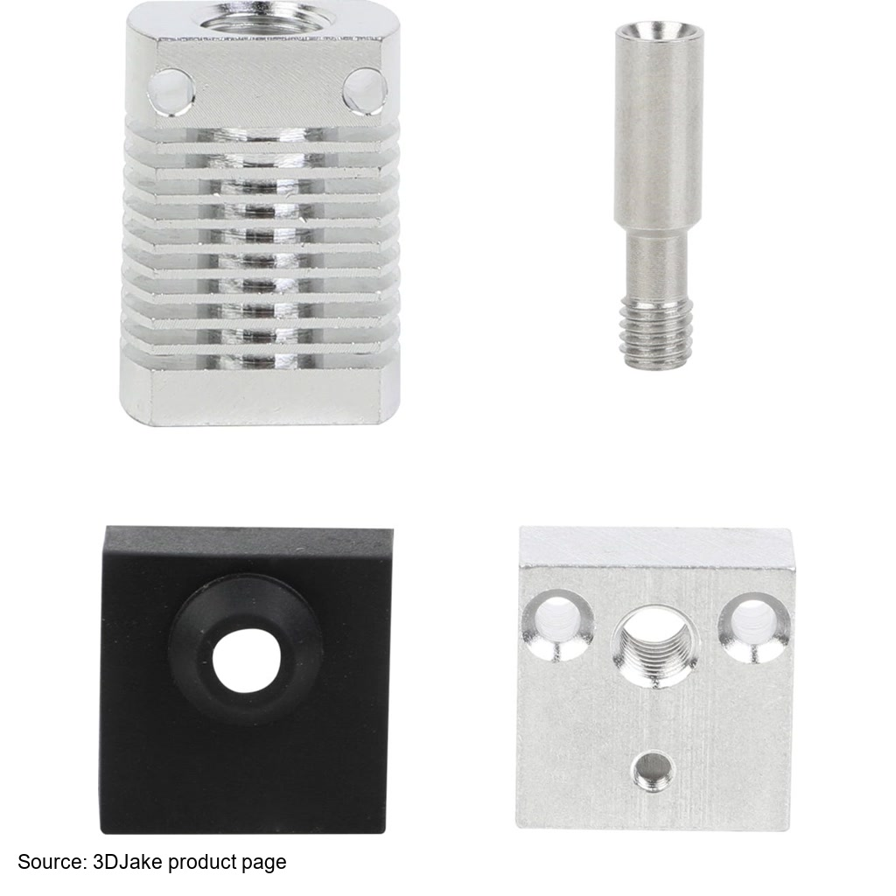

<!-- oomp-documentation:start -->
# Spare record moved

[Open the current part page](../three_d_printer_part_creality_ender_3_motion_z_assembly_x_gantry_carriage_toolhead_hotend_heatsink_hotend_heatsink_creality_400105008/README.md). Previous label code: `16NB5`.

[Open catalogue record](http://localhost:5703/parts/three_d_printer_part_creality_ender_3_motion_z_assembly_x_gantry_carriage_toolhead_hotend_heatsink_hotend_heatsink_creality_400105008) · [Creality Ender-3 machine bill of materials](https://github.com/Creality3DPrinting/Ender-3/blob/88c7758cea9d0d00a54fdb238bedb3b33425f409/Ender-3%20Mechanical/Ender-3%20BOM.XLS)

Creality Ender-3 hotend accessory kit showing the heatsink, throat tube, heater block and silicone cover; the factory assembly may differ. [Creality replacement hotend, 3DJake product image](https://www.3djake.uk/creality-3d-printers-spare-parts/hotend-accessory-kit?sai=12771) by Creator not identified; product image supplied by 3DJake. [Retail product image; reuse permission not established](https://www.3djake.uk/creality-3d-printers-spare-parts/hotend-accessory-kit?sai=12771). Resized within a square white canvas and credited on the image.

## Current labels

- OOMP inventory 76.2 × 50.8 mm · [SVG](../three_d_printer_part_creality_ender_3_motion_z_assembly_x_gantry_carriage_toolhead_hotend_heatsink_hotend_heatsink_creality_400105008/label_oomp.svg) · [Print PDF](../three_d_printer_part_creality_ender_3_motion_z_assembly_x_gantry_carriage_toolhead_hotend_heatsink_hotend_heatsink_creality_400105008/label_oomp.pdf)
- Stock 76.2 × 50.8 mm · [SVG](../three_d_printer_part_creality_ender_3_motion_z_assembly_x_gantry_carriage_toolhead_hotend_heatsink_hotend_heatsink_creality_400105008/label_stock_3x2.svg) · [Print PDF](../three_d_printer_part_creality_ender_3_motion_z_assembly_x_gantry_carriage_toolhead_hotend_heatsink_hotend_heatsink_creality_400105008/label_stock_3x2.pdf)
- Stock 38.1 × 25.4 mm · [SVG](../three_d_printer_part_creality_ender_3_motion_z_assembly_x_gantry_carriage_toolhead_hotend_heatsink_hotend_heatsink_creality_400105008/label_stock_1_5x1.svg) · [Print PDF](../three_d_printer_part_creality_ender_3_motion_z_assembly_x_gantry_carriage_toolhead_hotend_heatsink_hotend_heatsink_creality_400105008/label_stock_1_5x1.pdf)
- Drawer 38.1 × 25.4 mm · [SVG](../three_d_printer_part_creality_ender_3_motion_z_assembly_x_gantry_carriage_toolhead_hotend_heatsink_hotend_heatsink_creality_400105008/label_drawer.svg) · [Print PDF](../three_d_printer_part_creality_ender_3_motion_z_assembly_x_gantry_carriage_toolhead_hotend_heatsink_hotend_heatsink_creality_400105008/label_drawer.pdf)
- Compact barcode 30 × 15 mm · [SVG](../three_d_printer_part_creality_ender_3_motion_z_assembly_x_gantry_carriage_toolhead_hotend_heatsink_hotend_heatsink_creality_400105008/label_30x15.svg) · [Print PDF](../three_d_printer_part_creality_ender_3_motion_z_assembly_x_gantry_carriage_toolhead_hotend_heatsink_hotend_heatsink_creality_400105008/label_30x15.pdf)
<!-- oomp-documentation:end -->
