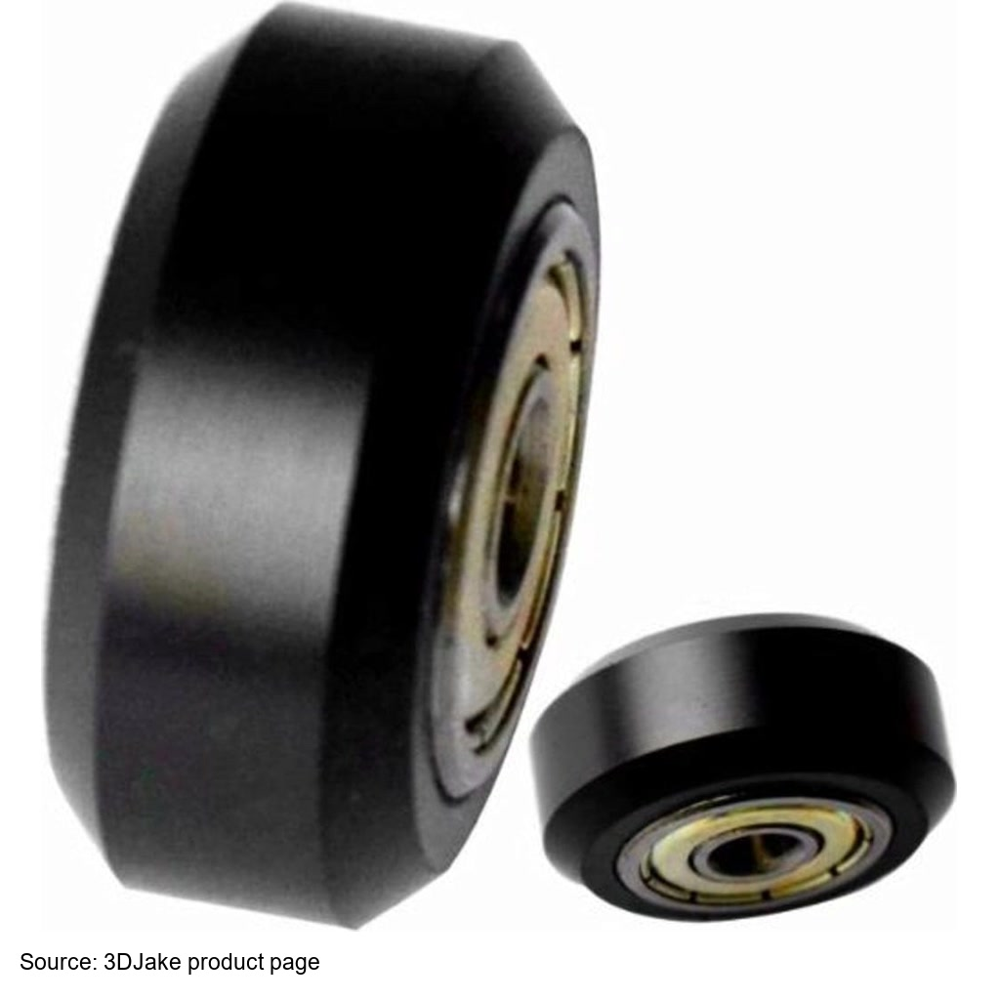

<!-- oomp-documentation:start -->
# Ender-3 V-wheel assembly

[Open catalogue record](http://localhost:5703/parts/three_d_printer_part_creality_ender_3_motion_shared_roller_wheel_v_wheel_assembly) · [Creality original mechanical design](https://github.com/Creality3DPrinting/Ender-3/blob/88c7758cea9d0d00a54fdb238bedb3b33425f409/Ender-3%20Mechanical/Ender-3%20Parts/V%20Wheel%20Component.SLDASM)

## Summary

Ender-3 V-wheel assembly



Creality replacement roller with bearing; the complete installed assembly may include additional hardware. [Creality replacement wheel, 3DJake product image](https://www.3djake.uk/creality-3d-printers-spare-parts/roller-with-bearing?sai=4833) by Creator not identified; product image supplied by 3DJake. [Retail product image; reuse permission not established](https://www.3djake.uk/creality-3d-printers-spare-parts/roller-with-bearing?sai=4833). Resized within a square white canvas and credited on the image.

## Details

OOMP ID `three_d_printer_part_creality_ender_3_motion_shared_roller_wheel_v_wheel_assembly`

| Specification | Value |
| --- | --- |
| Cad file | V Wheel Component.SLDASM |
| Reference kind | Mechanical design reference |
| Reference name | V-wheel assembly |

Sources checked 2026-11-18.


| Taxonomy slot | Value |
| --- | --- |
| 1 | `three_d_printer` |
| 2 | `part` |
| 3 | `creality_ender_3` |
| 4 | `motion` |
| 5 | `shared` |
| 6 | `roller_wheel` |
| 7 | `v_wheel_assembly` |

Assembly taxonomy: [motion / shared / roller_wheel](../../navigation/part/creality_ender_3/motion/shared/roller_wheel/README.md)

## Labels

| Layout | Stock (mm) | Files |
| --- | --- | --- |
| OOMP inventory | 76.2 × 50.8 | [SVG](label_oomp.svg) · [Print PDF](label_oomp.pdf) |
| Stock | 76.2 × 50.8 | [SVG](label_stock_3x2.svg) · [Print PDF](label_stock_3x2.pdf) |
| Stock | 38.1 × 25.4 | [SVG](label_stock_1_5x1.svg) · [Print PDF](label_stock_1_5x1.pdf) |
| Drawer | 38.1 × 25.4 | [SVG](label_drawer.svg) · [Print PDF](label_drawer.pdf) |
| Compact barcode | 30 × 15 | [SVG](label_30x15.svg) · [Print PDF](label_30x15.pdf) |

## Parts

[Browse this category](../../navigation/part/creality_ender_3/motion/shared/roller_wheel/README.md) · [Canonical metadata](working.yaml) · [Catalogue](../../README.md)

Confirmed printer models in this catalogue

- [Creality Ender-3](../three_d_printer_printer_creality_ender_3/)

## Assembly

Use the model-specific manufacturer documentation linked above for setup or service.

<details>
<summary>Full OOMP metadata</summary>

```yaml
assembly_path:
- motion
- shared
- roller_wheel
compatible_printers:
- three_d_printer_printer_creality_ender_3
exact_variant: v_wheel_assembly
link_main: https://github.com/oomlout/oomp_three_d_printer_version_5/tree/main/parts/three_d_printer_part_creality_ender_3_motion_shared_roller_wheel_v_wheel_assembly
link_source: https://github.com/Creality3DPrinting/Ender-3/blob/88c7758cea9d0d00a54fdb238bedb3b33425f409/Ender-3%20Mechanical/Ender-3%20Parts/V%20Wheel%20Component.SLDASM
link_web: http://localhost:5703/parts/three_d_printer_part_creality_ender_3_motion_shared_roller_wheel_v_wheel_assembly
name_proper: Ender-3 V-wheel assembly
oomp_id: three_d_printer_part_creality_ender_3_motion_shared_roller_wheel_v_wheel_assembly
photo:
  caption: Creality replacement roller with bearing; the complete installed assembly
    may include additional hardware.
  changes: Resized within a square white canvas and credited on the image.
  creator: Creator not identified; product image supplied by 3DJake
  credit_line: 'Source: 3DJake product page'
  file: source_file/images/creality_replacement_wheel_square.jpg
  license: Retail product image; reuse permission not established
  license_url: https://www.3djake.uk/creality-3d-printers-spare-parts/roller-with-bearing?sai=4833
  original_file: source_file/images/original/creality_replacement_wheel.jpg
  original_image_url: https://3d.nice-cdn.com/upload/image/product/large/default/6447_3742383e.jpg
  source: https://www.3djake.uk/creality-3d-printers-spare-parts/roller-with-bearing?sai=4833
  source_checked: '2026-11-19'
  title: Creality replacement wheel, 3DJake product image
previous_id: three_d_printer_part_creality_ender_3_roller_wheel_v_wheel_assembly
previous_label: 8TAZS
source_checked: '2026-11-18'
sources:
  Creality original mechanical design: https://github.com/Creality3DPrinting/Ender-3/blob/88c7758cea9d0d00a54fdb238bedb3b33425f409/Ender-3%20Mechanical/Ender-3%20Parts/V%20Wheel%20Component.SLDASM
spare_type: roller_wheel
specifications:
  cad_file: V Wheel Component.SLDASM
  reference_kind: Mechanical design reference
  reference_name: V-wheel assembly
taxonomy_1: three_d_printer
taxonomy_10: ''
taxonomy_11: ''
taxonomy_12: ''
taxonomy_13: ''
taxonomy_14: ''
taxonomy_15: ''
taxonomy_2: part
taxonomy_3: creality_ender_3
taxonomy_4: motion
taxonomy_5: shared
taxonomy_6: roller_wheel
taxonomy_7: v_wheel_assembly
taxonomy_8: ''
taxonomy_9: ''
taxonomy_1_upper: THREE_D_PRINTER
taxonomy_1_upper_length_1: T
taxonomy_1_upper_length_2: TH
taxonomy_1_upper_length_3: THR
taxonomy_1_upper_length_4: THRE
taxonomy_1_upper_length_5: THREE
taxonomy_1_length_1: t
taxonomy_1_length_2: th
taxonomy_1_length_3: thr
taxonomy_1_length_4: thre
taxonomy_1_length_5: three
taxonomy_1_capital: Three D Printer
taxonomy_1_first_letter: t
taxonomy_1_first_letter_upper: T
taxonomy_2_upper: PART
taxonomy_2_upper_length_1: P
taxonomy_2_upper_length_2: PA
taxonomy_2_upper_length_3: PAR
taxonomy_2_upper_length_4: PART
taxonomy_2_upper_length_5: PART
taxonomy_2_length_1: p
taxonomy_2_length_2: pa
taxonomy_2_length_3: par
taxonomy_2_length_4: part
taxonomy_2_length_5: part
taxonomy_2_capital: Part
taxonomy_2_first_letter: p
taxonomy_2_first_letter_upper: P
taxonomy_3_upper: CREALITY_ENDER_3
taxonomy_3_upper_length_1: C
taxonomy_3_upper_length_2: CR
taxonomy_3_upper_length_3: CRE
taxonomy_3_upper_length_4: CREA
taxonomy_3_upper_length_5: CREAL
taxonomy_3_length_1: c
taxonomy_3_length_2: cr
taxonomy_3_length_3: cre
taxonomy_3_length_4: crea
taxonomy_3_length_5: creal
taxonomy_3_capital: Creality Ender 3
taxonomy_3_first_letter: c
taxonomy_3_first_letter_upper: C
taxonomy_4_upper: MOTION
taxonomy_4_upper_length_1: M
taxonomy_4_upper_length_2: MO
taxonomy_4_upper_length_3: MOT
taxonomy_4_upper_length_4: MOTI
taxonomy_4_upper_length_5: MOTIO
taxonomy_4_length_1: m
taxonomy_4_length_2: mo
taxonomy_4_length_3: mot
taxonomy_4_length_4: moti
taxonomy_4_length_5: motio
taxonomy_4_capital: Motion
taxonomy_4_first_letter: m
taxonomy_4_first_letter_upper: M
taxonomy_5_upper: SHARED
taxonomy_5_upper_length_1: S
taxonomy_5_upper_length_2: SH
taxonomy_5_upper_length_3: SHA
taxonomy_5_upper_length_4: SHAR
taxonomy_5_upper_length_5: SHARE
taxonomy_5_length_1: s
taxonomy_5_length_2: sh
taxonomy_5_length_3: sha
taxonomy_5_length_4: shar
taxonomy_5_length_5: share
taxonomy_5_capital: Shared
taxonomy_5_first_letter: s
taxonomy_5_first_letter_upper: S
taxonomy_6_upper: ROLLER_WHEEL
taxonomy_6_upper_length_1: R
taxonomy_6_upper_length_2: RO
taxonomy_6_upper_length_3: ROL
taxonomy_6_upper_length_4: ROLL
taxonomy_6_upper_length_5: ROLLE
taxonomy_6_length_1: r
taxonomy_6_length_2: ro
taxonomy_6_length_3: rol
taxonomy_6_length_4: roll
taxonomy_6_length_5: rolle
taxonomy_6_capital: Roller Wheel
taxonomy_6_first_letter: r
taxonomy_6_first_letter_upper: R
taxonomy_7_upper: V_WHEEL_ASSEMBLY
taxonomy_7_upper_length_1: V
taxonomy_7_upper_length_2: V_
taxonomy_7_upper_length_3: V_W
taxonomy_7_upper_length_4: V_WH
taxonomy_7_upper_length_5: V_WHE
taxonomy_7_length_1: v
taxonomy_7_length_2: v_
taxonomy_7_length_3: v_w
taxonomy_7_length_4: v_wh
taxonomy_7_length_5: v_whe
taxonomy_7_capital: V Wheel Assembly
taxonomy_7_first_letter: v
taxonomy_7_first_letter_upper: V
id: three_d_printer_part_creality_ender_3_motion_shared_roller_wheel_v_wheel_assembly
id_no_class: three_d_printer_part_creality_ender_3_motion_shared_roller_wheel_v_wheel_assembly
id_no_type: three_d_printer_part_creality_ender_3_motion_shared_roller_wheel_v_wheel_assembly
id_no_size: three_d_printer_part_creality_ender_3_motion_shared_roller_wheel_v_wheel_assembly
oomp_key: oomp_three_d_printer_part_creality_ender_3_motion_shared_roller_wheel_v_wheel_assembly
link_github: https://github.com/oomlout/oomp_three_d_printer_version_5/tree/main/parts/three_d_printer_part_creality_ender_3_motion_shared_roller_wheel_v_wheel_assembly
link_redirect: https://github.com/oomlout/oomp_three_d_printer_version_5/tree/main/parts/three_d_printer_part_creality_ender_3_motion_shared_roller_wheel_v_wheel_assembly
directory: parts/three_d_printer_part_creality_ender_3_motion_shared_roller_wheel_v_wheel_assembly
name: Three D Printer Part Creality Ender 3 Motion Shared Roller Wheel V Wheel Assembly
name_no_class: Three D Printer Part Creality Ender 3 Motion Shared Roller Wheel V
  Wheel Assembly
name_no_type: Three D Printer Part Creality Ender 3 Motion Shared Roller Wheel V Wheel
  Assembly
name_no_size: Three D Printer Part Creality Ender 3 Motion Shared Roller Wheel V Wheel
  Assembly
md5: a5942e4aa7d45cfa940c1d7443a7c442
md5_5: a5942
md5_5_upper: A5942
md5_6: a5942e
md5_6_upper: A5942E
md5_6_alpha: 6gkz2
md5_6_alpha_upper: 6GKZ2
md5_10: a5942e4aa7
md5_10_upper: A5942E4AA7
bip_39_full_array:
- pitch
- pause
- naive
- exile
- easy
- later
- expand
- lonely
- inmate
- brush
- valve
- loud
bip_39_full_space: pitch pause naive exile easy later expand lonely inmate brush valve
  loud
bip_39_full_no_space: pitchpausenaiveexileeasylaterexpandlonelyinmatebrushvalveloud
bip_39_full_underscore: pitch_pause_naive_exile_easy_later_expand_lonely_inmate_brush_valve_loud
bip_39_2_word_array:
- pitch
- pause
bip_39_2_word_space: pitch pause
bip_39_2_word_no_space: pitchpause
bip_39_2_word_underscore: pitch_pause
bip_39_3_word_array:
- pitch
- pause
- naive
bip_39_3_word_space: pitch pause naive
bip_39_3_word_no_space: pitchpausenaive
bip_39_3_word_underscore: pitch_pause_naive
label_title: V-wheel assembly
label_barcode: M0,0h34v760h-34z M136,0h34v760h-34z M204,0h102v760h-102z M340,0h102v760h-102z
  M476,0h34v760h-34z M544,0h34v760h-34z M612,0h102v760h-102z M816,0h102v760h-102z
  M952,0h34v760h-34z M1020,0h34v760h-34z M1088,0h34v760h-34z M1156,0h34v760h-34z M1224,0h34v760h-34z
  M1360,0h102v760h-102z M1496,0h102v760h-102z M1632,0h102v760h-102z M1768,0h34v760h-34z
  M1836,0h34v760h-34z M1904,0h34v760h-34z M2040,0h102v760h-102z M2176,0h34v760h-34z
  M2312,0h102v760h-102z M2448,0h102v760h-102z M2584,0h34v760h-34z M2652,0h34v760h-34z
  M2720,0h34v760h-34z M2788,0h102v760h-102z M2992,0h34v760h-34z M3060,0h34v760h-34z
  M3128,0h102v760h-102z M3264,0h34v760h-34z M3400,0h34v760h-34z M3468,0h102v760h-102z
  M3604,0h102v760h-102z M3740,0h34v760h-34z
label_barcode_width: 3774
label_maker: Unspecified
label_family: Roller Wheel
label_detail: Mechanical design reference
label_variant: Creality Ender 3
label_context: Creality Ender-3
inventory_title_size: 13.000580383052814
stock_title_size: 3.946604759141033
drawer_title_size: 2.5536854323853744
compact_title_size: 2.8
oomlout_ai_roboclick_1:
  actions:
  - command: text_jinja_template
    file_template: source_file/template_jinja/template_jinja_label_oomlout_76_2_mm_50_8_mm/working.svg.j2
    file_output: label_oomp.svg
    convert_to_pdf: true
    convert_to_png: false
  - command: text_jinja_template
    file_template: source_file/template_jinja/label_stock/3x2.svg.j2
    file_output: label_stock_3x2.svg
    convert_to_pdf: true
    convert_to_png: false
  - command: text_jinja_template
    file_template: source_file/template_jinja/label_stock/1_5x1.svg.j2
    file_output: label_stock_1_5x1.svg
    convert_to_pdf: true
    convert_to_png: false
  - command: text_jinja_template
    file_template: source_file/template_jinja/label_drawer/working.svg.j2
    file_output: label_drawer.svg
    convert_to_pdf: true
    convert_to_png: false
  - command: text_jinja_template
    file_template: source_file/template_jinja/label_printer_30x15/working.svg.j2
    file_output: label_30x15.svg
    convert_to_pdf: true
    convert_to_png: false
  file_test: ''
  retries_until_complete: 0
  action_name: step_0_jinja_template_label_oomp.svg
```

</details>
<!-- oomp-documentation:end -->
