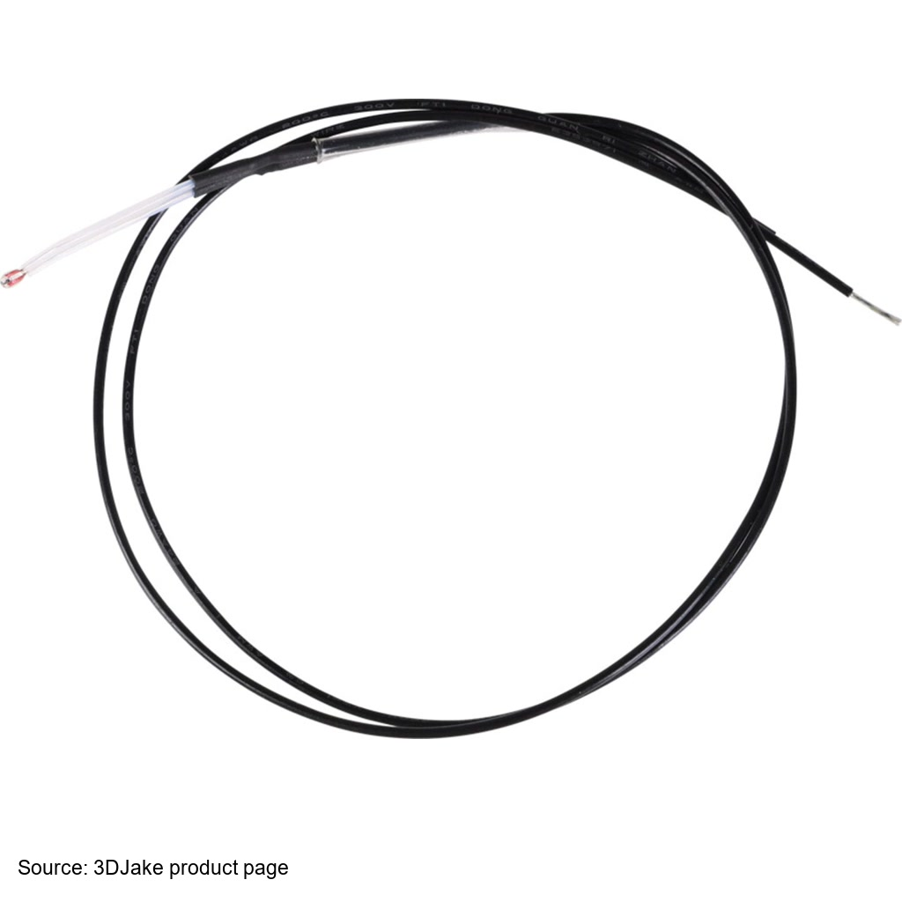

<!-- oomp-documentation:start -->
# Ender-3 Bed thermistor

[Open catalogue record](http://localhost:5703/parts/three_d_printer_part_creality_ender_3_motion_y_assembly_carriage_bed_thermistor_bed_thermistor_creality_400303022) · [Creality Ender-3 machine bill of materials](https://github.com/Creality3DPrinting/Ender-3/blob/88c7758cea9d0d00a54fdb238bedb3b33425f409/Ender-3%20Mechanical/Ender-3%20BOM.XLS)

## Summary

Ender-3 Bed thermistor



Creality glass bead thermistor replacement kit; the original installed wiring or connectors may differ. [Creality replacement thermistor, 3DJake product image](https://www.3djake.uk/creality-3d-printers-spare-parts/thermistor-kit?sai=11419) by Creator not identified; product image supplied by 3DJake. [Retail product image; reuse permission not established](https://www.3djake.uk/creality-3d-printers-spare-parts/thermistor-kit?sai=11419). Resized within a square white canvas and credited on the image.

## Details

OOMP ID `three_d_printer_part_creality_ender_3_motion_y_assembly_carriage_bed_thermistor_bed_thermistor_creality_400303022`

| Specification | Value |
| --- | --- |
| Identifier basis | Creality machine BOM part code. Retail ordering code unverified. |
| Machine bom quantity pcs | 1 |
| Machine bom row | 88 |
| Manufacturer part number | 400303022 |
| Reference name | Bed thermistor |
| Source name | Bed  thermistor |
| Source specification | D1.8-L700mm-100K |

Sources checked 2026-11-18.


| Taxonomy slot | Value |
| --- | --- |
| 1 | `three_d_printer` |
| 2 | `part` |
| 3 | `creality_ender_3` |
| 4 | `motion` |
| 5 | `y_assembly` |
| 6 | `carriage` |
| 7 | `bed` |
| 8 | `thermistor` |
| 9 | `bed_thermistor` |
| 14 | `creality` |
| 15 | `400303022` |

Assembly taxonomy: [motion / y_assembly / carriage / bed / thermistor](../../navigation/part/creality_ender_3/motion/y_assembly/carriage/bed/thermistor/README.md)

## Labels

| Layout | Stock (mm) | Files |
| --- | --- | --- |
| OOMP inventory | 76.2 × 50.8 | [SVG](label_oomp.svg) · [Print PDF](label_oomp.pdf) |
| Stock | 76.2 × 50.8 | [SVG](label_stock_3x2.svg) · [Print PDF](label_stock_3x2.pdf) |
| Stock | 38.1 × 25.4 | [SVG](label_stock_1_5x1.svg) · [Print PDF](label_stock_1_5x1.pdf) |
| Drawer | 38.1 × 25.4 | [SVG](label_drawer.svg) · [Print PDF](label_drawer.pdf) |
| Compact barcode | 30 × 15 | [SVG](label_30x15.svg) · [Print PDF](label_30x15.pdf) |

## Parts

[Browse this category](../../navigation/part/creality_ender_3/motion/y_assembly/carriage/bed/thermistor/README.md) · [Canonical metadata](working.yaml) · [Catalogue](../../README.md)

Confirmed printer models in this catalogue

- [Creality Ender-3](../three_d_printer_printer_creality_ender_3/)

## Assembly

Use the model-specific manufacturer documentation linked above for setup or service.

<details>
<summary>Full OOMP metadata</summary>

```yaml
assembly_path:
- motion
- y_assembly
- carriage
- bed
- thermistor
compatible_printers:
- three_d_printer_printer_creality_ender_3
exact_variant: bed_thermistor
link_main: https://github.com/oomlout/oomp_three_d_printer_version_5/tree/main/parts/three_d_printer_part_creality_ender_3_motion_y_assembly_carriage_bed_thermistor_bed_thermistor_creality_400303022
link_source: https://github.com/Creality3DPrinting/Ender-3/blob/88c7758cea9d0d00a54fdb238bedb3b33425f409/Ender-3%20Mechanical/Ender-3%20BOM.XLS
link_web: http://localhost:5703/parts/three_d_printer_part_creality_ender_3_motion_y_assembly_carriage_bed_thermistor_bed_thermistor_creality_400303022
name_proper: Ender-3 Bed thermistor
oomp_id: three_d_printer_part_creality_ender_3_motion_y_assembly_carriage_bed_thermistor_bed_thermistor_creality_400303022
photo:
  caption: Creality glass bead thermistor replacement kit; the original installed
    wiring or connectors may differ.
  changes: Resized within a square white canvas and credited on the image.
  creator: Creator not identified; product image supplied by 3DJake
  credit_line: 'Source: 3DJake product page'
  file: source_file/images/creality_replacement_thermistor_square.jpg
  license: Retail product image; reuse permission not established
  license_url: https://www.3djake.uk/creality-3d-printers-spare-parts/thermistor-kit?sai=11419
  original_file: source_file/images/original/creality_replacement_thermistor.jpg
  original_image_url: https://3d.nice-cdn.com/upload/image/product/large/default/19189_de652046.jpg
  source: https://www.3djake.uk/creality-3d-printers-spare-parts/thermistor-kit?sai=11419
  source_checked: '2026-11-19'
  title: Creality replacement thermistor, 3DJake product image
previous_id: three_d_printer_part_creality_ender_3_temperature_sensor_bed_thermistor_creality_400303022
previous_label: 6IV28
source_checked: '2026-11-18'
sources:
  Creality Ender-3 machine bill of materials: https://github.com/Creality3DPrinting/Ender-3/blob/88c7758cea9d0d00a54fdb238bedb3b33425f409/Ender-3%20Mechanical/Ender-3%20BOM.XLS
spare_type: temperature_sensor
specifications:
  identifier_basis: Creality machine BOM part code. Retail ordering code unverified.
  machine_bom_quantity_pcs: 1
  machine_bom_row: 88
  manufacturer_part_number: '400303022'
  reference_name: Bed thermistor
  source_name: Bed  thermistor
  source_specification: D1.8-L700mm-100K
taxonomy_1: three_d_printer
taxonomy_10: ''
taxonomy_11: ''
taxonomy_12: ''
taxonomy_13: ''
taxonomy_14: creality
taxonomy_15: '400303022'
taxonomy_2: part
taxonomy_3: creality_ender_3
taxonomy_4: motion
taxonomy_5: y_assembly
taxonomy_6: carriage
taxonomy_7: bed
taxonomy_8: thermistor
taxonomy_9: bed_thermistor
taxonomy_1_upper: THREE_D_PRINTER
taxonomy_1_upper_length_1: T
taxonomy_1_upper_length_2: TH
taxonomy_1_upper_length_3: THR
taxonomy_1_upper_length_4: THRE
taxonomy_1_upper_length_5: THREE
taxonomy_1_length_1: t
taxonomy_1_length_2: th
taxonomy_1_length_3: thr
taxonomy_1_length_4: thre
taxonomy_1_length_5: three
taxonomy_1_capital: Three D Printer
taxonomy_1_first_letter: t
taxonomy_1_first_letter_upper: T
taxonomy_2_upper: PART
taxonomy_2_upper_length_1: P
taxonomy_2_upper_length_2: PA
taxonomy_2_upper_length_3: PAR
taxonomy_2_upper_length_4: PART
taxonomy_2_upper_length_5: PART
taxonomy_2_length_1: p
taxonomy_2_length_2: pa
taxonomy_2_length_3: par
taxonomy_2_length_4: part
taxonomy_2_length_5: part
taxonomy_2_capital: Part
taxonomy_2_first_letter: p
taxonomy_2_first_letter_upper: P
taxonomy_3_upper: CREALITY_ENDER_3
taxonomy_3_upper_length_1: C
taxonomy_3_upper_length_2: CR
taxonomy_3_upper_length_3: CRE
taxonomy_3_upper_length_4: CREA
taxonomy_3_upper_length_5: CREAL
taxonomy_3_length_1: c
taxonomy_3_length_2: cr
taxonomy_3_length_3: cre
taxonomy_3_length_4: crea
taxonomy_3_length_5: creal
taxonomy_3_capital: Creality Ender 3
taxonomy_3_first_letter: c
taxonomy_3_first_letter_upper: C
taxonomy_4_upper: MOTION
taxonomy_4_upper_length_1: M
taxonomy_4_upper_length_2: MO
taxonomy_4_upper_length_3: MOT
taxonomy_4_upper_length_4: MOTI
taxonomy_4_upper_length_5: MOTIO
taxonomy_4_length_1: m
taxonomy_4_length_2: mo
taxonomy_4_length_3: mot
taxonomy_4_length_4: moti
taxonomy_4_length_5: motio
taxonomy_4_capital: Motion
taxonomy_4_first_letter: m
taxonomy_4_first_letter_upper: M
taxonomy_5_upper: Y_ASSEMBLY
taxonomy_5_upper_length_1: Y
taxonomy_5_upper_length_2: Y_
taxonomy_5_upper_length_3: Y_A
taxonomy_5_upper_length_4: Y_AS
taxonomy_5_upper_length_5: Y_ASS
taxonomy_5_length_1: y
taxonomy_5_length_2: y_
taxonomy_5_length_3: y_a
taxonomy_5_length_4: y_as
taxonomy_5_length_5: y_ass
taxonomy_5_capital: Y Assembly
taxonomy_5_first_letter: y
taxonomy_5_first_letter_upper: Y
taxonomy_6_upper: CARRIAGE
taxonomy_6_upper_length_1: C
taxonomy_6_upper_length_2: CA
taxonomy_6_upper_length_3: CAR
taxonomy_6_upper_length_4: CARR
taxonomy_6_upper_length_5: CARRI
taxonomy_6_length_1: c
taxonomy_6_length_2: ca
taxonomy_6_length_3: car
taxonomy_6_length_4: carr
taxonomy_6_length_5: carri
taxonomy_6_capital: Carriage
taxonomy_6_first_letter: c
taxonomy_6_first_letter_upper: C
taxonomy_7_upper: BED
taxonomy_7_upper_length_1: B
taxonomy_7_upper_length_2: BE
taxonomy_7_upper_length_3: BED
taxonomy_7_upper_length_4: BED
taxonomy_7_upper_length_5: BED
taxonomy_7_length_1: b
taxonomy_7_length_2: be
taxonomy_7_length_3: bed
taxonomy_7_length_4: bed
taxonomy_7_length_5: bed
taxonomy_7_capital: Bed
taxonomy_7_first_letter: b
taxonomy_7_first_letter_upper: B
taxonomy_8_upper: THERMISTOR
taxonomy_8_upper_length_1: T
taxonomy_8_upper_length_2: TH
taxonomy_8_upper_length_3: THE
taxonomy_8_upper_length_4: THER
taxonomy_8_upper_length_5: THERM
taxonomy_8_length_1: t
taxonomy_8_length_2: th
taxonomy_8_length_3: the
taxonomy_8_length_4: ther
taxonomy_8_length_5: therm
taxonomy_8_capital: Thermistor
taxonomy_8_first_letter: t
taxonomy_8_first_letter_upper: T
taxonomy_9_upper: BED_THERMISTOR
taxonomy_9_upper_length_1: B
taxonomy_9_upper_length_2: BE
taxonomy_9_upper_length_3: BED
taxonomy_9_upper_length_4: BED_
taxonomy_9_upper_length_5: BED_T
taxonomy_9_length_1: b
taxonomy_9_length_2: be
taxonomy_9_length_3: bed
taxonomy_9_length_4: bed_
taxonomy_9_length_5: bed_t
taxonomy_9_capital: Bed Thermistor
taxonomy_9_first_letter: b
taxonomy_9_first_letter_upper: B
taxonomy_14_upper: CREALITY
taxonomy_14_upper_length_1: C
taxonomy_14_upper_length_2: CR
taxonomy_14_upper_length_3: CRE
taxonomy_14_upper_length_4: CREA
taxonomy_14_upper_length_5: CREAL
taxonomy_14_length_1: c
taxonomy_14_length_2: cr
taxonomy_14_length_3: cre
taxonomy_14_length_4: crea
taxonomy_14_length_5: creal
taxonomy_14_capital: Creality
taxonomy_14_first_letter: c
taxonomy_14_first_letter_upper: C
taxonomy_15_upper: '400303022'
taxonomy_15_upper_length_1: '4'
taxonomy_15_upper_length_2: '40'
taxonomy_15_upper_length_3: '400'
taxonomy_15_upper_length_4: '4003'
taxonomy_15_upper_length_5: '40030'
taxonomy_15_length_1: '4'
taxonomy_15_length_2: '40'
taxonomy_15_length_3: '400'
taxonomy_15_length_4: '4003'
taxonomy_15_length_5: '40030'
taxonomy_15_capital: '400303022'
taxonomy_15_first_letter: '4'
taxonomy_15_first_letter_upper: '4'
id: three_d_printer_part_creality_ender_3_motion_y_assembly_carriage_bed_thermistor_bed_thermistor_creality_400303022
id_no_class: three_d_printer_part_creality_ender_3_motion_y_assembly_carriage_bed_thermistor_bed_thermistor_creality_400303022
id_no_type: three_d_printer_part_creality_ender_3_motion_y_assembly_carriage_bed_thermistor_bed_thermistor_creality_400303022
id_no_size: three_d_printer_part_creality_ender_3_motion_y_assembly_carriage_bed_thermistor_bed_thermistor_creality_400303022
oomp_key: oomp_three_d_printer_part_creality_ender_3_motion_y_assembly_carriage_bed_thermistor_bed_thermistor_creality_400303022
link_github: https://github.com/oomlout/oomp_three_d_printer_version_5/tree/main/parts/three_d_printer_part_creality_ender_3_motion_y_assembly_carriage_bed_thermistor_bed_thermistor_creality_400303022
link_redirect: https://github.com/oomlout/oomp_three_d_printer_version_5/tree/main/parts/three_d_printer_part_creality_ender_3_motion_y_assembly_carriage_bed_thermistor_bed_thermistor_creality_400303022
directory: parts/three_d_printer_part_creality_ender_3_motion_y_assembly_carriage_bed_thermistor_bed_thermistor_creality_400303022
name: Three D Printer Part Creality Ender 3 Motion Y Assembly Carriage Bed Thermistor
  Bed Thermistor Creality 400303022
name_no_class: Three D Printer Part Creality Ender 3 Motion Y Assembly Carriage Bed
  Thermistor Bed Thermistor Creality 400303022
name_no_type: Three D Printer Part Creality Ender 3 Motion Y Assembly Carriage Bed
  Thermistor Bed Thermistor Creality 400303022
name_no_size: Three D Printer Part Creality Ender 3 Motion Y Assembly Carriage Bed
  Thermistor Bed Thermistor Creality 400303022
md5: e7ef0fd6ffcb7e21fe320e1d70ee8f7b
md5_5: e7ef0
md5_5_upper: E7EF0
md5_6: e7ef0f
md5_6_upper: E7EF0F
md5_6_alpha: 91sen
md5_6_alpha_upper: 91SEN
md5_10: e7ef0fd6ff
md5_10_upper: E7EF0FD6FF
bip_39_full_array:
- tree
- journey
- volcano
- zebra
- retire
- axis
- web
- dove
- buddy
- manual
- phrase
- wasp
bip_39_full_space: tree journey volcano zebra retire axis web dove buddy manual phrase
  wasp
bip_39_full_no_space: treejourneyvolcanozebraretireaxiswebdovebuddymanualphrasewasp
bip_39_full_underscore: tree_journey_volcano_zebra_retire_axis_web_dove_buddy_manual_phrase_wasp
bip_39_2_word_array:
- tree
- journey
bip_39_2_word_space: tree journey
bip_39_2_word_no_space: treejourney
bip_39_2_word_underscore: tree_journey
bip_39_3_word_array:
- tree
- journey
- volcano
bip_39_3_word_space: tree journey volcano
bip_39_3_word_no_space: treejourneyvolcano
bip_39_3_word_underscore: tree_journey_volcano
label_title: Bed thermistor
label_barcode: M0,0h34v760h-34z M136,0h34v760h-34z M204,0h102v760h-102z M340,0h102v760h-102z
  M476,0h34v760h-34z M544,0h34v760h-34z M612,0h102v760h-102z M816,0h34v760h-34z M884,0h102v760h-102z
  M1020,0h34v760h-34z M1088,0h102v760h-102z M1224,0h34v760h-34z M1360,0h34v760h-34z
  M1428,0h34v760h-34z M1496,0h102v760h-102z M1632,0h34v760h-34z M1700,0h102v760h-102z
  M1836,0h34v760h-34z M1904,0h102v760h-102z M2108,0h34v760h-34z M2176,0h102v760h-102z
  M2312,0h34v760h-34z M2380,0h102v760h-102z M2584,0h34v760h-34z M2652,0h34v760h-34z
  M2720,0h34v760h-34z M2788,0h34v760h-34z M2856,0h102v760h-102z M2992,0h34v760h-34z
  M3128,0h102v760h-102z M3264,0h34v760h-34z M3400,0h34v760h-34z M3468,0h102v760h-102z
  M3604,0h102v760h-102z M3740,0h34v760h-34z
label_barcode_width: 3774
label_maker: Creality
label_family: Thermistor
label_detail: '400303022'
label_variant: Creality Ender 3
label_context: Creality Ender-3
inventory_title_size: 14
stock_title_size: 4.780652418447694
drawer_title_size: 3.093363329583802
compact_title_size: 2.8
oomlout_ai_roboclick_1:
  actions:
  - command: text_jinja_template
    file_template: source_file/template_jinja/template_jinja_label_oomlout_76_2_mm_50_8_mm/working.svg.j2
    file_output: label_oomp.svg
    convert_to_pdf: true
    convert_to_png: false
  - command: text_jinja_template
    file_template: source_file/template_jinja/label_stock/3x2.svg.j2
    file_output: label_stock_3x2.svg
    convert_to_pdf: true
    convert_to_png: false
  - command: text_jinja_template
    file_template: source_file/template_jinja/label_stock/1_5x1.svg.j2
    file_output: label_stock_1_5x1.svg
    convert_to_pdf: true
    convert_to_png: false
  - command: text_jinja_template
    file_template: source_file/template_jinja/label_drawer/working.svg.j2
    file_output: label_drawer.svg
    convert_to_pdf: true
    convert_to_png: false
  - command: text_jinja_template
    file_template: source_file/template_jinja/label_printer_30x15/working.svg.j2
    file_output: label_30x15.svg
    convert_to_pdf: true
    convert_to_png: false
  file_test: ''
  retries_until_complete: 0
  action_name: step_0_jinja_template_label_oomp.svg
```

</details>
<!-- oomp-documentation:end -->
