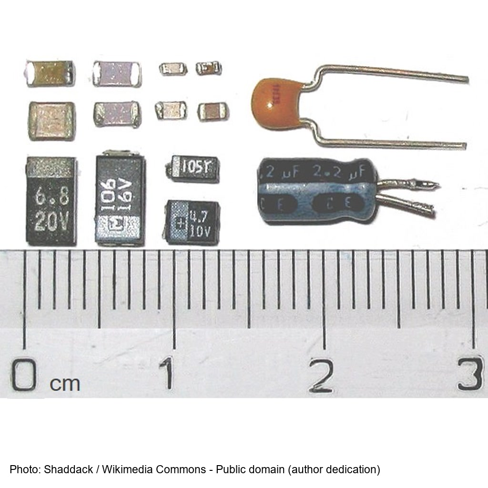
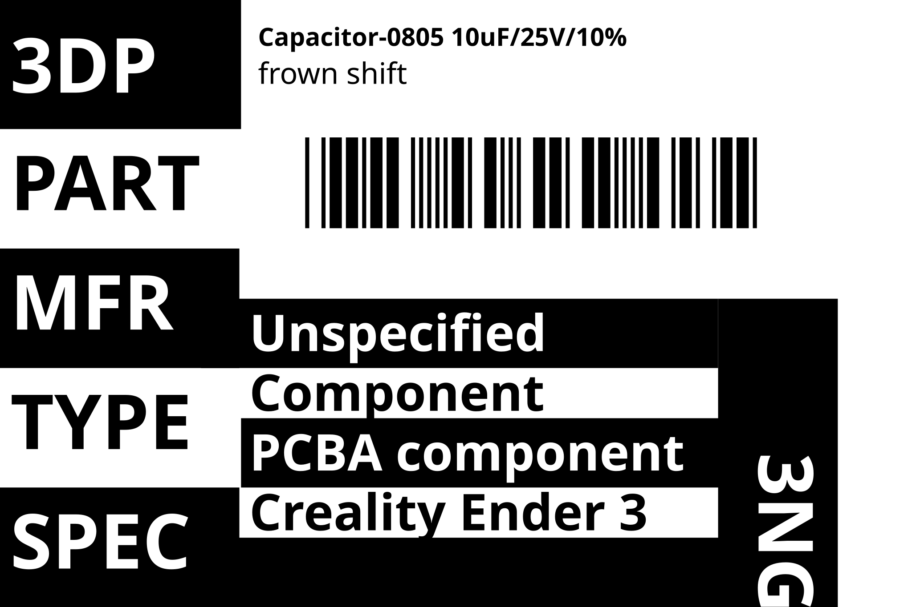

<!-- oomp-documentation:start -->
# Spare record moved

[Open the current part page](../three_d_printer_part_creality_ender_3_electronic_component_capacitor_0805_10uf_25v_10/README.md). Previous label code: `4TGVZ`.

[Open catalogue record](http://localhost:5703/parts/three_d_printer_part_creality_ender_3_electronic_component_capacitor_0805_10uf_25v_10) · [Creality Ender-3 PCBA bill of materials](https://github.com/Creality3DPrinting/Ender-3/blob/88c7758cea9d0d00a54fdb238bedb3b33425f409/Ender-3%20PCB/Ender-3%20PCBA%20BOM.xlsx)

Representative selection of surface-mount and leaded capacitors; the value and package may differ from this record. [Photo-SMDcapacitors.jpg](https://commons.wikimedia.org/wiki/File:Photo-SMDcapacitors.jpg) by Shaddack. [Public domain (author dedication)](https://commons.wikimedia.org/wiki/File:Photo-SMDcapacitors.jpg). Resized within a square white canvas and credited on the image.

## Current labels

- OOMP inventory 76.2 × 50.8 mm · [SVG](../three_d_printer_part_creality_ender_3_electronic_component_capacitor_0805_10uf_25v_10/label_oomp.svg) · [Print PDF](../three_d_printer_part_creality_ender_3_electronic_component_capacitor_0805_10uf_25v_10/label_oomp.pdf)
- Stock 76.2 × 50.8 mm · [SVG](../three_d_printer_part_creality_ender_3_electronic_component_capacitor_0805_10uf_25v_10/label_stock_3x2.svg) · [Print PDF](../three_d_printer_part_creality_ender_3_electronic_component_capacitor_0805_10uf_25v_10/label_stock_3x2.pdf)
- Stock 38.1 × 25.4 mm · [SVG](../three_d_printer_part_creality_ender_3_electronic_component_capacitor_0805_10uf_25v_10/label_stock_1_5x1.svg) · [Print PDF](../three_d_printer_part_creality_ender_3_electronic_component_capacitor_0805_10uf_25v_10/label_stock_1_5x1.pdf)
- Drawer 38.1 × 25.4 mm · [SVG](../three_d_printer_part_creality_ender_3_electronic_component_capacitor_0805_10uf_25v_10/label_drawer.svg) · [Print PDF](../three_d_printer_part_creality_ender_3_electronic_component_capacitor_0805_10uf_25v_10/label_drawer.pdf)
- Compact barcode 30 × 15 mm · [SVG](../three_d_printer_part_creality_ender_3_electronic_component_capacitor_0805_10uf_25v_10/label_30x15.svg) · [Print PDF](../three_d_printer_part_creality_ender_3_electronic_component_capacitor_0805_10uf_25v_10/label_30x15.pdf)
<!-- oomp-documentation:end -->
