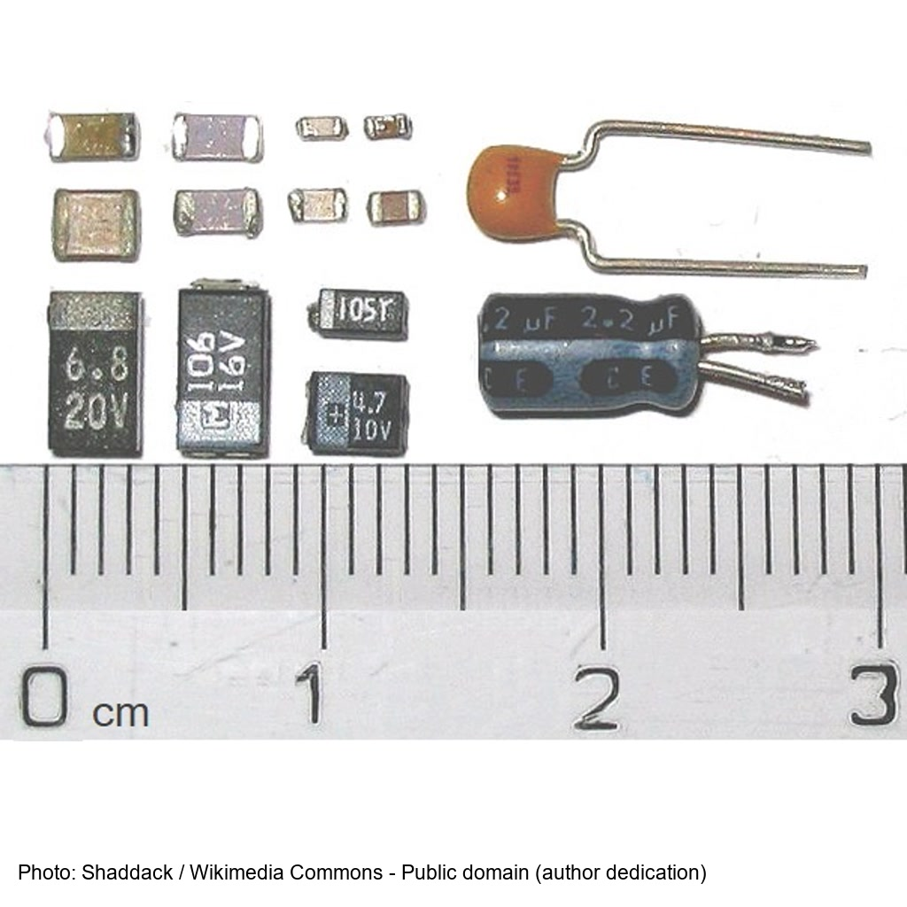

<!-- oomp-documentation:start -->
# Ender-3 Electrolytic Capacitor-DIP 100uF/16V 6*5mm

## Summary

Ender-3 Electrolytic Capacitor-DIP 100uF/16V 6*5mm



Representative selection of surface-mount and leaded capacitors; the value and package may differ from this record. [Photo-SMDcapacitors.jpg](https://commons.wikimedia.org/wiki/File:Photo-SMDcapacitors.jpg) by Shaddack. [Public domain (author dedication)](https://commons.wikimedia.org/wiki/File:Photo-SMDcapacitors.jpg). Resized within a square white canvas and credited on the image.

## Details

OOMP ID `three_d_printer_part_creality_ender_3_pcb_component_electrolytic_capacitor_dip_100uf_16v_6_5mm`

| Specification | Value |
| --- | --- |
| Pcba bom items | 35 |
| Pcba quantities pcs | 1 |
| Reference name | Electrolytic Capacitor-DIP 100uF/16V 6*5mm |
| Source name | Electrolytic Capacitor-DIP |
| Source specification | 100uF/16V 6*5mm |

Sources checked 2026-11-18.

- [Creality Ender-3 PCBA bill of materials](https://github.com/Creality3DPrinting/Ender-3/blob/88c7758cea9d0d00a54fdb238bedb3b33425f409/Ender-3%20PCB/Ender-3%20PCBA%20BOM.xlsx)

| Taxonomy slot | Value |
| --- | --- |
| 1 | `three_d_printer` |
| 2 | `part` |
| 3 | `creality_ender_3` |
| 4 | `pcb_component` |
| 5 | `electrolytic_capacitor_dip_100uf_16v_6_5mm` |

## Labels

| Layout | Stock (mm) | Files |
| --- | --- | --- |
| OOMP inventory | 76.2 × 50.8 | [SVG](label_oomp.svg) · [Print PDF](label_oomp.pdf) |
| Stock | 76.2 × 50.8 | [SVG](label_stock_3x2.svg) · [Print PDF](label_stock_3x2.pdf) |
| Stock | 38.1 × 25.4 | [SVG](label_stock_1_5x1.svg) · [Print PDF](label_stock_1_5x1.pdf) |
| Drawer | 38.1 × 25.4 | [SVG](label_drawer.svg) · [Print PDF](label_drawer.pdf) |
| Compact barcode | 30 × 15 | [SVG](label_30x15.svg) · [Print PDF](label_30x15.pdf) |

## Parts

[Browse this category](../../navigation/part/creality_ender_3/pcb_component/README.md) · [Canonical metadata](working.yaml) · [Catalogue](../../README.md)

Confirmed printer models in this catalogue

- [Creality Ender-3](../three_d_printer_printer_creality_ender_3/)

## Assembly

Use the model-specific manufacturer documentation linked above for setup or service.

<details>
<summary>Full OOMP metadata</summary>

```yaml
compatible_printers:
- three_d_printer_printer_creality_ender_3
name_proper: Ender-3 Electrolytic Capacitor-DIP 100uF/16V 6*5mm
oomp_id: three_d_printer_part_creality_ender_3_pcb_component_electrolytic_capacitor_dip_100uf_16v_6_5mm
photo:
  caption: Representative selection of surface-mount and leaded capacitors; the value
    and package may differ from this record.
  changes: Resized within a square white canvas and credited on the image.
  creator: Shaddack
  credit_line: 'Photo: Shaddack / Wikimedia Commons - Public domain (author dedication)'
  file: source_file/images/representative_capacitor_square.jpg
  license: Public domain (author dedication)
  license_url: https://commons.wikimedia.org/wiki/File:Photo-SMDcapacitors.jpg
  original_file: source_file/images/original/representative_capacitor.jpg
  original_image_url: https://upload.wikimedia.org/wikipedia/commons/8/86/Photo-SMDcapacitors.jpg?utm_source=commons.wikimedia.org&utm_campaign=imageinfo&utm_content=original
  source: https://commons.wikimedia.org/wiki/File:Photo-SMDcapacitors.jpg
  source_checked: '2026-11-19'
  title: Photo-SMDcapacitors.jpg
source_checked: '2026-11-18'
sources:
  Creality Ender-3 PCBA bill of materials: https://github.com/Creality3DPrinting/Ender-3/blob/88c7758cea9d0d00a54fdb238bedb3b33425f409/Ender-3%20PCB/Ender-3%20PCBA%20BOM.xlsx
specifications:
  pcba_bom_items:
  - 35
  pcba_quantities_pcs:
  - 1
  reference_name: Electrolytic Capacitor-DIP 100uF/16V 6*5mm
  source_name: Electrolytic Capacitor-DIP
  source_specification: 100uF/16V 6*5mm
taxonomy_1: three_d_printer
taxonomy_10: ''
taxonomy_11: ''
taxonomy_12: ''
taxonomy_13: ''
taxonomy_14: ''
taxonomy_15: ''
taxonomy_2: part
taxonomy_3: creality_ender_3
taxonomy_4: pcb_component
taxonomy_5: electrolytic_capacitor_dip_100uf_16v_6_5mm
taxonomy_6: ''
taxonomy_7: ''
taxonomy_8: ''
taxonomy_9: ''
taxonomy_1_upper: THREE_D_PRINTER
taxonomy_1_upper_length_1: T
taxonomy_1_upper_length_2: TH
taxonomy_1_upper_length_3: THR
taxonomy_1_upper_length_4: THRE
taxonomy_1_upper_length_5: THREE
taxonomy_1_length_1: t
taxonomy_1_length_2: th
taxonomy_1_length_3: thr
taxonomy_1_length_4: thre
taxonomy_1_length_5: three
taxonomy_1_capital: Three D Printer
taxonomy_1_first_letter: t
taxonomy_1_first_letter_upper: T
taxonomy_2_upper: PART
taxonomy_2_upper_length_1: P
taxonomy_2_upper_length_2: PA
taxonomy_2_upper_length_3: PAR
taxonomy_2_upper_length_4: PART
taxonomy_2_upper_length_5: PART
taxonomy_2_length_1: p
taxonomy_2_length_2: pa
taxonomy_2_length_3: par
taxonomy_2_length_4: part
taxonomy_2_length_5: part
taxonomy_2_capital: Part
taxonomy_2_first_letter: p
taxonomy_2_first_letter_upper: P
taxonomy_3_upper: CREALITY_ENDER_3
taxonomy_3_upper_length_1: C
taxonomy_3_upper_length_2: CR
taxonomy_3_upper_length_3: CRE
taxonomy_3_upper_length_4: CREA
taxonomy_3_upper_length_5: CREAL
taxonomy_3_length_1: c
taxonomy_3_length_2: cr
taxonomy_3_length_3: cre
taxonomy_3_length_4: crea
taxonomy_3_length_5: creal
taxonomy_3_capital: Creality Ender 3
taxonomy_3_first_letter: c
taxonomy_3_first_letter_upper: C
taxonomy_4_upper: PCB_COMPONENT
taxonomy_4_upper_length_1: P
taxonomy_4_upper_length_2: PC
taxonomy_4_upper_length_3: PCB
taxonomy_4_upper_length_4: PCB_
taxonomy_4_upper_length_5: PCB_C
taxonomy_4_length_1: p
taxonomy_4_length_2: pc
taxonomy_4_length_3: pcb
taxonomy_4_length_4: pcb_
taxonomy_4_length_5: pcb_c
taxonomy_4_capital: Pcb Component
taxonomy_4_first_letter: p
taxonomy_4_first_letter_upper: P
taxonomy_5_upper: ELECTROLYTIC_CAPACITOR_DIP_100UF_16V_6_5MM
taxonomy_5_upper_length_1: E
taxonomy_5_upper_length_2: EL
taxonomy_5_upper_length_3: ELE
taxonomy_5_upper_length_4: ELEC
taxonomy_5_upper_length_5: ELECT
taxonomy_5_length_1: e
taxonomy_5_length_2: el
taxonomy_5_length_3: ele
taxonomy_5_length_4: elec
taxonomy_5_length_5: elect
taxonomy_5_capital: Electrolytic Capacitor Dip 100Uf 16V 6.5mm
taxonomy_5_first_letter: e
taxonomy_5_first_letter_upper: E
id: three_d_printer_part_creality_ender_3_pcb_component_electrolytic_capacitor_dip_100uf_16v_6_5mm
id_no_class: three_d_printer_part_creality_ender_3_pcb_component_electrolytic_capacitor_dip_100uf_16v_6_5mm
id_no_type: three_d_printer_part_creality_ender_3_pcb_component_electrolytic_capacitor_dip_100uf_16v_6_5mm
id_no_size: three_d_printer_part_creality_ender_3_pcb_component_electrolytic_capacitor_dip_100uf_16v_6_5mm
oomp_key: oomp_three_d_printer_part_creality_ender_3_pcb_component_electrolytic_capacitor_dip_100uf_16v_6_5mm
link_github: https://github.com/oomlout/oomp_three_d_printer_version_5/tree/main/parts/three_d_printer_part_creality_ender_3_pcb_component_electrolytic_capacitor_dip_100uf_16v_6_5mm
link_main: https://github.com/oomlout/oomp_three_d_printer_version_5/tree/main/parts/three_d_printer_part_creality_ender_3_pcb_component_electrolytic_capacitor_dip_100uf_16v_6_5mm
link_redirect: https://github.com/oomlout/oomp_three_d_printer_version_5/tree/main/parts/three_d_printer_part_creality_ender_3_pcb_component_electrolytic_capacitor_dip_100uf_16v_6_5mm
directory: parts/three_d_printer_part_creality_ender_3_pcb_component_electrolytic_capacitor_dip_100uf_16v_6_5mm
name: Three D Printer Part Creality Ender 3 Pcb Component Electrolytic Capacitor Dip
  100Uf 16V 6 5Mm
name_no_class: Three D Printer Part Creality Ender 3 Pcb Component Electrolytic Capacitor
  Dip 100Uf 16V 6 5Mm
name_no_type: Three D Printer Part Creality Ender 3 Pcb Component Electrolytic Capacitor
  Dip 100Uf 16V 6 5Mm
name_no_size: Three D Printer Part Creality Ender 3 Pcb Component Electrolytic Capacitor
  Dip 100Uf 16V 6 5Mm
md5: aa042b040878ed57534cc2bd3db6d6b5
md5_5: aa042
md5_5_upper: AA042
md5_6: aa042b
md5_6_upper: AA042B
md5_6_alpha: 6mtd7
md5_6_alpha_upper: 6MTD7
md5_10: aa042b0408
md5_10_upper: AA042B0408
bip_39_full_array:
- present
- candy
- scissors
- axis
- mom
- produce
- essay
- obscure
- rule
- unit
- remember
- high
bip_39_full_space: present candy scissors axis mom produce essay obscure rule unit
  remember high
bip_39_full_no_space: presentcandyscissorsaxismomproduceessayobscureruleunitrememberhigh
bip_39_full_underscore: present_candy_scissors_axis_mom_produce_essay_obscure_rule_unit_remember_high
bip_39_2_word_array:
- present
- candy
bip_39_2_word_space: present candy
bip_39_2_word_no_space: presentcandy
bip_39_2_word_underscore: present_candy
bip_39_3_word_array:
- present
- candy
- scissors
bip_39_3_word_space: present candy scissors
bip_39_3_word_no_space: presentcandyscissors
bip_39_3_word_underscore: present_candy_scissors
label_title: Electrolytic Capacitor-DIP 100uF/16V 6*5mm
label_barcode: M0,0h34v760h-34z M136,0h34v760h-34z M204,0h102v760h-102z M340,0h102v760h-102z
  M476,0h34v760h-34z M544,0h34v760h-34z M612,0h102v760h-102z M816,0h102v760h-102z
  M952,0h34v760h-34z M1020,0h34v760h-34z M1088,0h102v760h-102z M1224,0h102v760h-102z
  M1360,0h34v760h-34z M1428,0h34v760h-34z M1564,0h34v760h-34z M1632,0h34v760h-34z
  M1700,0h34v760h-34z M1768,0h102v760h-102z M1904,0h102v760h-102z M2108,0h34v760h-34z
  M2176,0h34v760h-34z M2244,0h34v760h-34z M2312,0h102v760h-102z M2516,0h34v760h-34z
  M2584,0h102v760h-102z M2720,0h34v760h-34z M2788,0h34v760h-34z M2924,0h34v760h-34z
  M2992,0h102v760h-102z M3128,0h102v760h-102z M3264,0h34v760h-34z M3400,0h34v760h-34z
  M3468,0h102v760h-102z M3604,0h102v760h-102z M3740,0h34v760h-34z
label_barcode_width: 3774
label_maker: Unspecified
label_family: Pcb Component
label_detail: PCBA component
label_variant: Creality Ender 3
label_context: Creality Ender-3
inventory_title_size: 5.317381189764041
stock_title_size: 1.6142050040355127
drawer_title_size: 1.044485590846508
compact_title_size: 1.28186867967526
oomlout_ai_roboclick_1:
  actions:
  - command: text_jinja_template
    file_template: source_file/template_jinja/template_jinja_label_oomlout_76_2_mm_50_8_mm/working.svg.j2
    file_output: label_oomp.svg
    convert_to_pdf: true
    convert_to_png: false
  - command: text_jinja_template
    file_template: source_file/template_jinja/label_stock/3x2.svg.j2
    file_output: label_stock_3x2.svg
    convert_to_pdf: true
    convert_to_png: false
  - command: text_jinja_template
    file_template: source_file/template_jinja/label_stock/1_5x1.svg.j2
    file_output: label_stock_1_5x1.svg
    convert_to_pdf: true
    convert_to_png: false
  - command: text_jinja_template
    file_template: source_file/template_jinja/label_drawer/working.svg.j2
    file_output: label_drawer.svg
    convert_to_pdf: true
    convert_to_png: false
  - command: text_jinja_template
    file_template: source_file/template_jinja/label_printer_30x15/working.svg.j2
    file_output: label_30x15.svg
    convert_to_pdf: true
    convert_to_png: false
  file_test: ''
  retries_until_complete: 0
  action_name: step_0_jinja_template_label_oomp.svg
```

</details>
<!-- oomp-documentation:end -->
