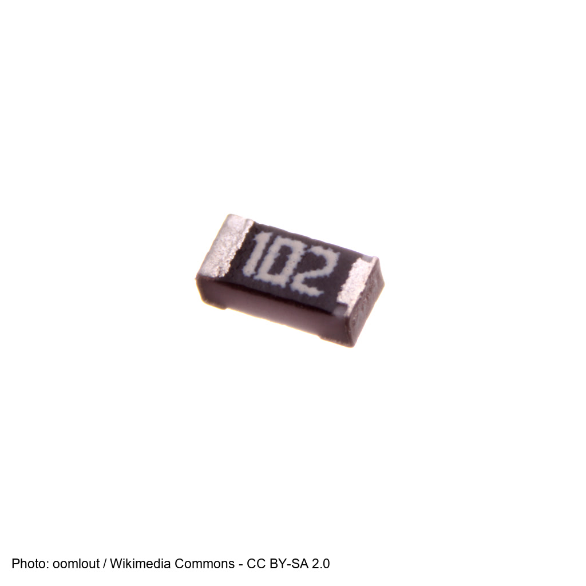

<!-- oomp-documentation:start -->
# Ender-3 Resistor-0603 1K

## Summary

Ender-3 Resistor-0603 1K



Representative 1 kiloohm 0603 surface-mount resistor; the value or package may differ from this record. [1 kiloohm SMD 0603 resistor.jpg](https://commons.wikimedia.org/wiki/File:1_kiloohm_SMD_0603_resistor.jpg) by oomlout. [CC BY-SA 2.0](https://creativecommons.org/licenses/by-sa/2.0/). Resized within a square white canvas and credited on the image.

## Details

OOMP ID `three_d_printer_part_creality_ender_3_pcb_component_resistor_0603_1k`

| Specification | Value |
| --- | --- |
| Pcba bom items | 8 |
| Pcba quantities pcs | 3 |
| Reference name | Resistor-0603 1K |
| Source name | Resistance-0603 |
| Source specification | 1K |

Sources checked 2026-11-18.

- [Creality Ender-3 PCBA bill of materials](https://github.com/Creality3DPrinting/Ender-3/blob/88c7758cea9d0d00a54fdb238bedb3b33425f409/Ender-3%20PCB/Ender-3%20PCBA%20BOM.xlsx)

| Taxonomy slot | Value |
| --- | --- |
| 1 | `three_d_printer` |
| 2 | `part` |
| 3 | `creality_ender_3` |
| 4 | `pcb_component` |
| 5 | `resistor_0603_1k` |

## Labels

| Layout | Stock (mm) | Files |
| --- | --- | --- |
| OOMP inventory | 76.2 × 50.8 | [SVG](label_oomp.svg) · [Print PDF](label_oomp.pdf) |
| Stock | 76.2 × 50.8 | [SVG](label_stock_3x2.svg) · [Print PDF](label_stock_3x2.pdf) |
| Stock | 38.1 × 25.4 | [SVG](label_stock_1_5x1.svg) · [Print PDF](label_stock_1_5x1.pdf) |
| Drawer | 38.1 × 25.4 | [SVG](label_drawer.svg) · [Print PDF](label_drawer.pdf) |
| Compact barcode | 30 × 15 | [SVG](label_30x15.svg) · [Print PDF](label_30x15.pdf) |

## Parts

[Browse this category](../../navigation/part/creality_ender_3/pcb_component/README.md) · [Canonical metadata](working.yaml) · [Catalogue](../../README.md)

Confirmed printer models in this catalogue

- [Creality Ender-3](../three_d_printer_printer_creality_ender_3/)

## Assembly

Use the model-specific manufacturer documentation linked above for setup or service.

<details>
<summary>Full OOMP metadata</summary>

```yaml
compatible_printers:
- three_d_printer_printer_creality_ender_3
name_proper: Ender-3 Resistor-0603 1K
oomp_id: three_d_printer_part_creality_ender_3_pcb_component_resistor_0603_1k
photo:
  caption: Representative 1 kiloohm 0603 surface-mount resistor; the value or package
    may differ from this record.
  changes: Resized within a square white canvas and credited on the image.
  creator: oomlout
  credit_line: 'Photo: oomlout / Wikimedia Commons - CC BY-SA 2.0'
  file: source_file/images/representative_resistor_square.jpg
  license: CC BY-SA 2.0
  license_url: https://creativecommons.org/licenses/by-sa/2.0/
  original_file: source_file/images/original/representative_resistor.jpg
  original_image_url: https://upload.wikimedia.org/wikipedia/commons/2/2c/1_kiloohm_SMD_0603_resistor.jpg?utm_source=commons.wikimedia.org&utm_campaign=imageinfo&utm_content=original
  source: https://commons.wikimedia.org/wiki/File:1_kiloohm_SMD_0603_resistor.jpg
  source_checked: '2026-11-19'
  title: 1 kiloohm SMD 0603 resistor.jpg
source_checked: '2026-11-18'
sources:
  Creality Ender-3 PCBA bill of materials: https://github.com/Creality3DPrinting/Ender-3/blob/88c7758cea9d0d00a54fdb238bedb3b33425f409/Ender-3%20PCB/Ender-3%20PCBA%20BOM.xlsx
specifications:
  pcba_bom_items:
  - 8
  pcba_quantities_pcs:
  - 3
  reference_name: Resistor-0603 1K
  source_name: Resistance-0603
  source_specification: 1K
taxonomy_1: three_d_printer
taxonomy_10: ''
taxonomy_11: ''
taxonomy_12: ''
taxonomy_13: ''
taxonomy_14: ''
taxonomy_15: ''
taxonomy_2: part
taxonomy_3: creality_ender_3
taxonomy_4: pcb_component
taxonomy_5: resistor_0603_1k
taxonomy_6: ''
taxonomy_7: ''
taxonomy_8: ''
taxonomy_9: ''
taxonomy_1_upper: THREE_D_PRINTER
taxonomy_1_upper_length_1: T
taxonomy_1_upper_length_2: TH
taxonomy_1_upper_length_3: THR
taxonomy_1_upper_length_4: THRE
taxonomy_1_upper_length_5: THREE
taxonomy_1_length_1: t
taxonomy_1_length_2: th
taxonomy_1_length_3: thr
taxonomy_1_length_4: thre
taxonomy_1_length_5: three
taxonomy_1_capital: Three D Printer
taxonomy_1_first_letter: t
taxonomy_1_first_letter_upper: T
taxonomy_2_upper: PART
taxonomy_2_upper_length_1: P
taxonomy_2_upper_length_2: PA
taxonomy_2_upper_length_3: PAR
taxonomy_2_upper_length_4: PART
taxonomy_2_upper_length_5: PART
taxonomy_2_length_1: p
taxonomy_2_length_2: pa
taxonomy_2_length_3: par
taxonomy_2_length_4: part
taxonomy_2_length_5: part
taxonomy_2_capital: Part
taxonomy_2_first_letter: p
taxonomy_2_first_letter_upper: P
taxonomy_3_upper: CREALITY_ENDER_3
taxonomy_3_upper_length_1: C
taxonomy_3_upper_length_2: CR
taxonomy_3_upper_length_3: CRE
taxonomy_3_upper_length_4: CREA
taxonomy_3_upper_length_5: CREAL
taxonomy_3_length_1: c
taxonomy_3_length_2: cr
taxonomy_3_length_3: cre
taxonomy_3_length_4: crea
taxonomy_3_length_5: creal
taxonomy_3_capital: Creality Ender 3
taxonomy_3_first_letter: c
taxonomy_3_first_letter_upper: C
taxonomy_4_upper: PCB_COMPONENT
taxonomy_4_upper_length_1: P
taxonomy_4_upper_length_2: PC
taxonomy_4_upper_length_3: PCB
taxonomy_4_upper_length_4: PCB_
taxonomy_4_upper_length_5: PCB_C
taxonomy_4_length_1: p
taxonomy_4_length_2: pc
taxonomy_4_length_3: pcb
taxonomy_4_length_4: pcb_
taxonomy_4_length_5: pcb_c
taxonomy_4_capital: Pcb Component
taxonomy_4_first_letter: p
taxonomy_4_first_letter_upper: P
taxonomy_5_upper: RESISTOR_0603_1K
taxonomy_5_upper_length_1: R
taxonomy_5_upper_length_2: RE
taxonomy_5_upper_length_3: RES
taxonomy_5_upper_length_4: RESI
taxonomy_5_upper_length_5: RESIS
taxonomy_5_length_1: r
taxonomy_5_length_2: re
taxonomy_5_length_3: res
taxonomy_5_length_4: resi
taxonomy_5_length_5: resis
taxonomy_5_capital: Resistor 0603.1K
taxonomy_5_first_letter: r
taxonomy_5_first_letter_upper: R
id: three_d_printer_part_creality_ender_3_pcb_component_resistor_0603_1k
id_no_class: three_d_printer_part_creality_ender_3_pcb_component_resistor_0603_1k
id_no_type: three_d_printer_part_creality_ender_3_pcb_component_resistor_0603_1k
id_no_size: three_d_printer_part_creality_ender_3_pcb_component_resistor_0603_1k
oomp_key: oomp_three_d_printer_part_creality_ender_3_pcb_component_resistor_0603_1k
link_github: https://github.com/oomlout/oomp_three_d_printer_version_5/tree/main/parts/three_d_printer_part_creality_ender_3_pcb_component_resistor_0603_1k
link_main: https://github.com/oomlout/oomp_three_d_printer_version_5/tree/main/parts/three_d_printer_part_creality_ender_3_pcb_component_resistor_0603_1k
link_redirect: https://github.com/oomlout/oomp_three_d_printer_version_5/tree/main/parts/three_d_printer_part_creality_ender_3_pcb_component_resistor_0603_1k
directory: parts/three_d_printer_part_creality_ender_3_pcb_component_resistor_0603_1k
name: Three D Printer Part Creality Ender 3 Pcb Component Resistor 0603 1K
name_no_class: Three D Printer Part Creality Ender 3 Pcb Component Resistor 0603 1K
name_no_type: Three D Printer Part Creality Ender 3 Pcb Component Resistor 0603 1K
name_no_size: Three D Printer Part Creality Ender 3 Pcb Component Resistor 0603 1K
md5: c51f50d5e5142f1d168b1912d89616b1
md5_5: c51f5
md5_5_upper: C51F5
md5_6: c51f50
md5_6_upper: C51F50
md5_6_alpha: 7ow28
md5_6_alpha_upper: 7OW28
md5_10: c51f50d5e5
md5_10_upper: C51F50D5E5
bip_39_full_array:
- shallow
- whisper
- cube
- sketch
- drill
- model
- focus
- glimpse
- barrel
- seven
- mad
- globe
bip_39_full_space: shallow whisper cube sketch drill model focus glimpse barrel seven
  mad globe
bip_39_full_no_space: shallowwhispercubesketchdrillmodelfocusglimpsebarrelsevenmadglobe
bip_39_full_underscore: shallow_whisper_cube_sketch_drill_model_focus_glimpse_barrel_seven_mad_globe
bip_39_2_word_array:
- shallow
- whisper
bip_39_2_word_space: shallow whisper
bip_39_2_word_no_space: shallowwhisper
bip_39_2_word_underscore: shallow_whisper
bip_39_3_word_array:
- shallow
- whisper
- cube
bip_39_3_word_space: shallow whisper cube
bip_39_3_word_no_space: shallowwhispercube
bip_39_3_word_underscore: shallow_whisper_cube
label_title: Resistor-0603 1K
label_barcode: M0,0h34v760h-34z M136,0h34v760h-34z M204,0h102v760h-102z M340,0h102v760h-102z
  M476,0h34v760h-34z M544,0h34v760h-34z M612,0h34v760h-34z M748,0h34v760h-34z M816,0h102v760h-102z
  M952,0h102v760h-102z M1088,0h102v760h-102z M1224,0h34v760h-34z M1292,0h102v760h-102z
  M1428,0h34v760h-34z M1564,0h34v760h-34z M1632,0h102v760h-102z M1836,0h102v760h-102z
  M1972,0h34v760h-34z M2040,0h34v760h-34z M2108,0h34v760h-34z M2176,0h34v760h-34z
  M2244,0h102v760h-102z M2448,0h34v760h-34z M2516,0h34v760h-34z M2584,0h102v760h-102z
  M2720,0h102v760h-102z M2856,0h34v760h-34z M2992,0h34v760h-34z M3060,0h102v760h-102z
  M3196,0h34v760h-34z M3264,0h34v760h-34z M3400,0h34v760h-34z M3468,0h102v760h-102z
  M3604,0h102v760h-102z M3740,0h34v760h-34z
label_barcode_width: 3774
label_maker: Unspecified
label_family: Pcb Component
label_detail: PCBA component
label_variant: Creality Ender 3
label_context: Creality Ender-3
inventory_title_size: 13.803302933201872
stock_title_size: 4.190288390436282
drawer_title_size: 2.711363076164653
compact_title_size: 2.8
oomlout_ai_roboclick_1:
  actions:
  - command: text_jinja_template
    file_template: source_file/template_jinja/template_jinja_label_oomlout_76_2_mm_50_8_mm/working.svg.j2
    file_output: label_oomp.svg
    convert_to_pdf: true
    convert_to_png: false
  - command: text_jinja_template
    file_template: source_file/template_jinja/label_stock/3x2.svg.j2
    file_output: label_stock_3x2.svg
    convert_to_pdf: true
    convert_to_png: false
  - command: text_jinja_template
    file_template: source_file/template_jinja/label_stock/1_5x1.svg.j2
    file_output: label_stock_1_5x1.svg
    convert_to_pdf: true
    convert_to_png: false
  - command: text_jinja_template
    file_template: source_file/template_jinja/label_drawer/working.svg.j2
    file_output: label_drawer.svg
    convert_to_pdf: true
    convert_to_png: false
  - command: text_jinja_template
    file_template: source_file/template_jinja/label_printer_30x15/working.svg.j2
    file_output: label_30x15.svg
    convert_to_pdf: true
    convert_to_png: false
  file_test: ''
  retries_until_complete: 0
  action_name: step_0_jinja_template_label_oomp.svg
```

</details>
<!-- oomp-documentation:end -->
