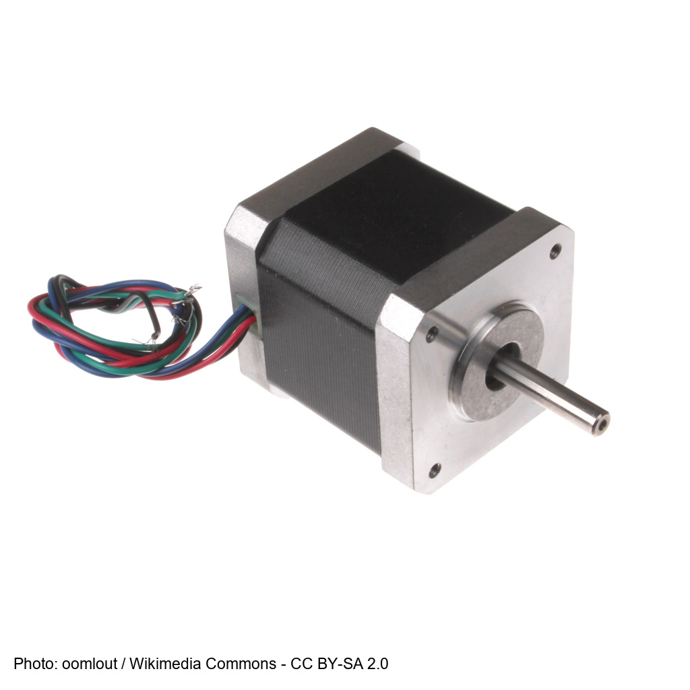

<!-- oomp-documentation:start -->
# Spare record moved

[Open the current part page](../three_d_printer_part_creality_ender_3_motion_shared_stepper_motor_42_40_stepper_motor_creality_400201004/README.md). Previous label code: `7CQQY`.

[Open catalogue record](http://localhost:5703/parts/three_d_printer_part_creality_ender_3_motion_shared_stepper_motor_42_40_stepper_motor_creality_400201004) · [Creality Ender-3 machine bill of materials](https://github.com/Creality3DPrinting/Ender-3/blob/88c7758cea9d0d00a54fdb238bedb3b33425f409/Ender-3%20Mechanical/Ender-3%20BOM.XLS)

Representative NEMA 17 stepper motor; the pictured motor is not the Ender-3 motor. [Nema 17 Stepper Motor.jpg](https://commons.wikimedia.org/wiki/File:Nema_17_Stepper_Motor.jpg) by oomlout. [CC BY-SA 2.0](https://creativecommons.org/licenses/by-sa/2.0/). Resized within a square white canvas and credited on the image.

## Current labels

- OOMP inventory 76.2 × 50.8 mm · [SVG](../three_d_printer_part_creality_ender_3_motion_shared_stepper_motor_42_40_stepper_motor_creality_400201004/label_oomp.svg) · [Print PDF](../three_d_printer_part_creality_ender_3_motion_shared_stepper_motor_42_40_stepper_motor_creality_400201004/label_oomp.pdf)
- Stock 76.2 × 50.8 mm · [SVG](../three_d_printer_part_creality_ender_3_motion_shared_stepper_motor_42_40_stepper_motor_creality_400201004/label_stock_3x2.svg) · [Print PDF](../three_d_printer_part_creality_ender_3_motion_shared_stepper_motor_42_40_stepper_motor_creality_400201004/label_stock_3x2.pdf)
- Stock 38.1 × 25.4 mm · [SVG](../three_d_printer_part_creality_ender_3_motion_shared_stepper_motor_42_40_stepper_motor_creality_400201004/label_stock_1_5x1.svg) · [Print PDF](../three_d_printer_part_creality_ender_3_motion_shared_stepper_motor_42_40_stepper_motor_creality_400201004/label_stock_1_5x1.pdf)
- Drawer 38.1 × 25.4 mm · [SVG](../three_d_printer_part_creality_ender_3_motion_shared_stepper_motor_42_40_stepper_motor_creality_400201004/label_drawer.svg) · [Print PDF](../three_d_printer_part_creality_ender_3_motion_shared_stepper_motor_42_40_stepper_motor_creality_400201004/label_drawer.pdf)
- Compact barcode 30 × 15 mm · [SVG](../three_d_printer_part_creality_ender_3_motion_shared_stepper_motor_42_40_stepper_motor_creality_400201004/label_30x15.svg) · [Print PDF](../three_d_printer_part_creality_ender_3_motion_shared_stepper_motor_42_40_stepper_motor_creality_400201004/label_30x15.pdf)
<!-- oomp-documentation:end -->
