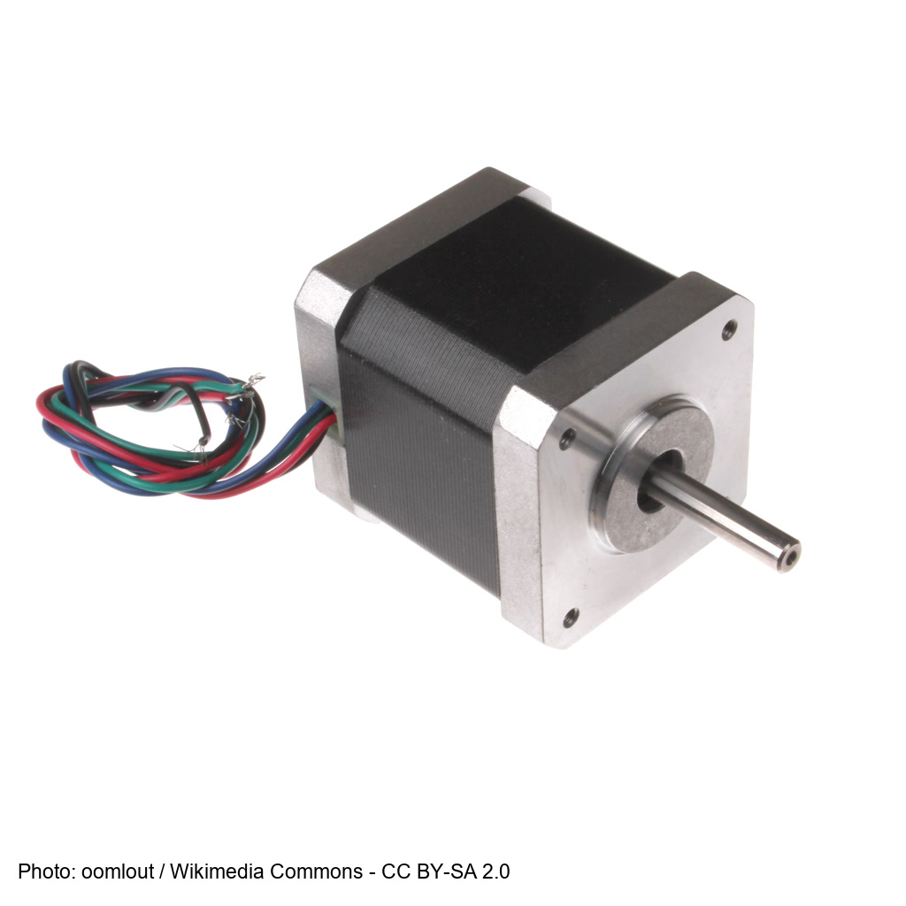

<!-- oomp-documentation:start -->
# Ender-3 X stepper motor

## Summary

Ender-3 X stepper motor



Representative NEMA 17 stepper motor; the pictured motor is not the Ender-3 motor. [Nema 17 Stepper Motor.jpg](https://commons.wikimedia.org/wiki/File:Nema_17_Stepper_Motor.jpg) by oomlout. [CC BY-SA 2.0](https://creativecommons.org/licenses/by-sa/2.0/). Resized within a square white canvas and credited on the image.

## Details

OOMP ID `three_d_printer_part_creality_ender_3_stepper_motor_x_stepper_motor`

| Specification | Value |
| --- | --- |
| Cad file | ASM X-Axis.SLDASM |
| Reference kind | Installed position |
| Reference name | X stepper motor |

Sources checked 2026-11-18.

- [Creality machine bill of materials](https://github.com/Creality3DPrinting/Ender-3/blob/88c7758cea9d0d00a54fdb238bedb3b33425f409/Ender-3%20Mechanical/Ender-3%20BOM.XLS)
- [Creality original mechanical design](https://github.com/Creality3DPrinting/Ender-3/blob/88c7758cea9d0d00a54fdb238bedb3b33425f409/Ender-3%20Mechanical/Ender-3%20Parts/ASM%20X-Axis.SLDASM)

| Taxonomy slot | Value |
| --- | --- |
| 1 | `three_d_printer` |
| 2 | `part` |
| 3 | `creality_ender_3` |
| 4 | `stepper_motor` |
| 5 | `x_stepper_motor` |

## Labels

| Layout | Stock (mm) | Files |
| --- | --- | --- |
| OOMP inventory | 76.2 × 50.8 | [SVG](label_oomp.svg) · [Print PDF](label_oomp.pdf) |
| Stock | 76.2 × 50.8 | [SVG](label_stock_3x2.svg) · [Print PDF](label_stock_3x2.pdf) |
| Stock | 38.1 × 25.4 | [SVG](label_stock_1_5x1.svg) · [Print PDF](label_stock_1_5x1.pdf) |
| Drawer | 38.1 × 25.4 | [SVG](label_drawer.svg) · [Print PDF](label_drawer.pdf) |
| Compact barcode | 30 × 15 | [SVG](label_30x15.svg) · [Print PDF](label_30x15.pdf) |

## Parts

[Browse this category](../../navigation/part/creality_ender_3/stepper_motor/README.md) · [Canonical metadata](working.yaml) · [Catalogue](../../README.md)

[Component used here: Ender-3 42-34 stepper motor](../three_d_printer_part_creality_ender_3_stepper_motor_42_34_stepper_motor_creality_400201001/)

Confirmed printer models in this catalogue

- [Creality Ender-3](../three_d_printer_printer_creality_ender_3/)

## Assembly

Use the model-specific manufacturer documentation linked above for setup or service.

<details>
<summary>Full OOMP metadata</summary>

```yaml
compatible_printers:
- three_d_printer_printer_creality_ender_3
component_id: three_d_printer_part_creality_ender_3_stepper_motor_42_34_stepper_motor_creality_400201001
name_proper: Ender-3 X stepper motor
oomp_id: three_d_printer_part_creality_ender_3_stepper_motor_x_stepper_motor
photo:
  caption: Representative NEMA 17 stepper motor; the pictured motor is not the Ender-3
    motor.
  changes: Resized within a square white canvas and credited on the image.
  creator: oomlout
  credit_line: 'Photo: oomlout / Wikimedia Commons - CC BY-SA 2.0'
  file: source_file/images/representative_motor_square.jpg
  license: CC BY-SA 2.0
  license_url: https://creativecommons.org/licenses/by-sa/2.0/
  original_file: source_file/images/original/representative_motor.jpg
  original_image_url: https://upload.wikimedia.org/wikipedia/commons/8/83/Nema_17_Stepper_Motor.jpg?utm_source=commons.wikimedia.org&utm_campaign=imageinfo&utm_content=original
  source: https://commons.wikimedia.org/wiki/File:Nema_17_Stepper_Motor.jpg
  source_checked: '2026-11-19'
  title: Nema 17 Stepper Motor.jpg
source_checked: '2026-11-18'
sources:
  Creality machine bill of materials: https://github.com/Creality3DPrinting/Ender-3/blob/88c7758cea9d0d00a54fdb238bedb3b33425f409/Ender-3%20Mechanical/Ender-3%20BOM.XLS
  Creality original mechanical design: https://github.com/Creality3DPrinting/Ender-3/blob/88c7758cea9d0d00a54fdb238bedb3b33425f409/Ender-3%20Mechanical/Ender-3%20Parts/ASM%20X-Axis.SLDASM
specifications:
  cad_file: ASM X-Axis.SLDASM
  reference_kind: Installed position
  reference_name: X stepper motor
taxonomy_1: three_d_printer
taxonomy_10: ''
taxonomy_11: ''
taxonomy_12: ''
taxonomy_13: ''
taxonomy_14: ''
taxonomy_15: ''
taxonomy_2: part
taxonomy_3: creality_ender_3
taxonomy_4: stepper_motor
taxonomy_5: x_stepper_motor
taxonomy_6: ''
taxonomy_7: ''
taxonomy_8: ''
taxonomy_9: ''
taxonomy_1_upper: THREE_D_PRINTER
taxonomy_1_upper_length_1: T
taxonomy_1_upper_length_2: TH
taxonomy_1_upper_length_3: THR
taxonomy_1_upper_length_4: THRE
taxonomy_1_upper_length_5: THREE
taxonomy_1_length_1: t
taxonomy_1_length_2: th
taxonomy_1_length_3: thr
taxonomy_1_length_4: thre
taxonomy_1_length_5: three
taxonomy_1_capital: Three D Printer
taxonomy_1_first_letter: t
taxonomy_1_first_letter_upper: T
taxonomy_2_upper: PART
taxonomy_2_upper_length_1: P
taxonomy_2_upper_length_2: PA
taxonomy_2_upper_length_3: PAR
taxonomy_2_upper_length_4: PART
taxonomy_2_upper_length_5: PART
taxonomy_2_length_1: p
taxonomy_2_length_2: pa
taxonomy_2_length_3: par
taxonomy_2_length_4: part
taxonomy_2_length_5: part
taxonomy_2_capital: Part
taxonomy_2_first_letter: p
taxonomy_2_first_letter_upper: P
taxonomy_3_upper: CREALITY_ENDER_3
taxonomy_3_upper_length_1: C
taxonomy_3_upper_length_2: CR
taxonomy_3_upper_length_3: CRE
taxonomy_3_upper_length_4: CREA
taxonomy_3_upper_length_5: CREAL
taxonomy_3_length_1: c
taxonomy_3_length_2: cr
taxonomy_3_length_3: cre
taxonomy_3_length_4: crea
taxonomy_3_length_5: creal
taxonomy_3_capital: Creality Ender 3
taxonomy_3_first_letter: c
taxonomy_3_first_letter_upper: C
taxonomy_4_upper: STEPPER_MOTOR
taxonomy_4_upper_length_1: S
taxonomy_4_upper_length_2: ST
taxonomy_4_upper_length_3: STE
taxonomy_4_upper_length_4: STEP
taxonomy_4_upper_length_5: STEPP
taxonomy_4_length_1: s
taxonomy_4_length_2: st
taxonomy_4_length_3: ste
taxonomy_4_length_4: step
taxonomy_4_length_5: stepp
taxonomy_4_capital: Stepper Motor
taxonomy_4_first_letter: s
taxonomy_4_first_letter_upper: S
taxonomy_5_upper: X_STEPPER_MOTOR
taxonomy_5_upper_length_1: X
taxonomy_5_upper_length_2: X_
taxonomy_5_upper_length_3: X_S
taxonomy_5_upper_length_4: X_ST
taxonomy_5_upper_length_5: X_STE
taxonomy_5_length_1: x
taxonomy_5_length_2: x_
taxonomy_5_length_3: x_s
taxonomy_5_length_4: x_st
taxonomy_5_length_5: x_ste
taxonomy_5_capital: X Stepper Motor
taxonomy_5_first_letter: x
taxonomy_5_first_letter_upper: X
id: three_d_printer_part_creality_ender_3_stepper_motor_x_stepper_motor
id_no_class: three_d_printer_part_creality_ender_3_stepper_motor_x_stepper_motor
id_no_type: three_d_printer_part_creality_ender_3_stepper_motor_x_stepper_motor
id_no_size: three_d_printer_part_creality_ender_3_stepper_motor_x_stepper_motor
oomp_key: oomp_three_d_printer_part_creality_ender_3_stepper_motor_x_stepper_motor
link_github: https://github.com/oomlout/oomp_three_d_printer_version_5/tree/main/parts/three_d_printer_part_creality_ender_3_stepper_motor_x_stepper_motor
link_main: https://github.com/oomlout/oomp_three_d_printer_version_5/tree/main/parts/three_d_printer_part_creality_ender_3_stepper_motor_x_stepper_motor
link_redirect: https://github.com/oomlout/oomp_three_d_printer_version_5/tree/main/parts/three_d_printer_part_creality_ender_3_stepper_motor_x_stepper_motor
directory: parts/three_d_printer_part_creality_ender_3_stepper_motor_x_stepper_motor
name: Three D Printer Part Creality Ender 3 Stepper Motor X Stepper Motor
name_no_class: Three D Printer Part Creality Ender 3 Stepper Motor X Stepper Motor
name_no_type: Three D Printer Part Creality Ender 3 Stepper Motor X Stepper Motor
name_no_size: Three D Printer Part Creality Ender 3 Stepper Motor X Stepper Motor
md5: 74546d9978d8a906c42f241459c7e046
md5_5: '74546'
md5_5_upper: '74546'
md5_6: 74546d
md5_6_upper: 74546D
md5_6_alpha: 4jejx
md5_6_alpha_upper: 4JEJX
md5_10: 74546d9978
md5_10_upper: 74546D9978
bip_39_full_array:
- inmate
- pet
- green
- vast
- melody
- lock
- awful
- tonight
- begin
- soda
- way
- mistake
bip_39_full_space: inmate pet green vast melody lock awful tonight begin soda way
  mistake
bip_39_full_no_space: inmatepetgreenvastmelodylockawfultonightbeginsodawaymistake
bip_39_full_underscore: inmate_pet_green_vast_melody_lock_awful_tonight_begin_soda_way_mistake
bip_39_2_word_array:
- inmate
- pet
bip_39_2_word_space: inmate pet
bip_39_2_word_no_space: inmatepet
bip_39_2_word_underscore: inmate_pet
bip_39_3_word_array:
- inmate
- pet
- green
bip_39_3_word_space: inmate pet green
bip_39_3_word_no_space: inmatepetgreen
bip_39_3_word_underscore: inmate_pet_green
label_title: X stepper motor
label_barcode: M0,0h34v760h-34z M136,0h34v760h-34z M204,0h102v760h-102z M340,0h102v760h-102z
  M476,0h34v760h-34z M544,0h34v760h-34z M612,0h34v760h-34z M748,0h102v760h-102z M884,0h34v760h-34z
  M952,0h102v760h-102z M1088,0h34v760h-34z M1156,0h34v760h-34z M1224,0h102v760h-102z
  M1428,0h102v760h-102z M1564,0h34v760h-34z M1632,0h102v760h-102z M1768,0h34v760h-34z
  M1836,0h102v760h-102z M2040,0h34v760h-34z M2108,0h34v760h-34z M2176,0h34v760h-34z
  M2244,0h34v760h-34z M2312,0h102v760h-102z M2516,0h102v760h-102z M2652,0h34v760h-34z
  M2720,0h34v760h-34z M2856,0h34v760h-34z M2924,0h102v760h-102z M3060,0h34v760h-34z
  M3128,0h102v760h-102z M3264,0h34v760h-34z M3400,0h34v760h-34z M3468,0h102v760h-102z
  M3604,0h102v760h-102z M3740,0h34v760h-34z
label_barcode_width: 3774
label_maker: Unspecified
label_family: Stepper Motor
label_detail: Installed position
label_variant: Creality Ender 3
label_context: Creality Ender-3
inventory_title_size: 14
stock_title_size: 4.434011476264997
drawer_title_size: 2.8690662493479393
compact_title_size: 2.8
oomlout_ai_roboclick_1:
  actions:
  - command: text_jinja_template
    file_template: source_file/template_jinja/template_jinja_label_oomlout_76_2_mm_50_8_mm/working.svg.j2
    file_output: label_oomp.svg
    convert_to_pdf: true
    convert_to_png: false
  - command: text_jinja_template
    file_template: source_file/template_jinja/label_stock/3x2.svg.j2
    file_output: label_stock_3x2.svg
    convert_to_pdf: true
    convert_to_png: false
  - command: text_jinja_template
    file_template: source_file/template_jinja/label_stock/1_5x1.svg.j2
    file_output: label_stock_1_5x1.svg
    convert_to_pdf: true
    convert_to_png: false
  - command: text_jinja_template
    file_template: source_file/template_jinja/label_drawer/working.svg.j2
    file_output: label_drawer.svg
    convert_to_pdf: true
    convert_to_png: false
  - command: text_jinja_template
    file_template: source_file/template_jinja/label_printer_30x15/working.svg.j2
    file_output: label_30x15.svg
    convert_to_pdf: true
    convert_to_png: false
  file_test: ''
  retries_until_complete: 0
  action_name: step_0_jinja_template_label_oomp.svg
```

</details>
<!-- oomp-documentation:end -->
