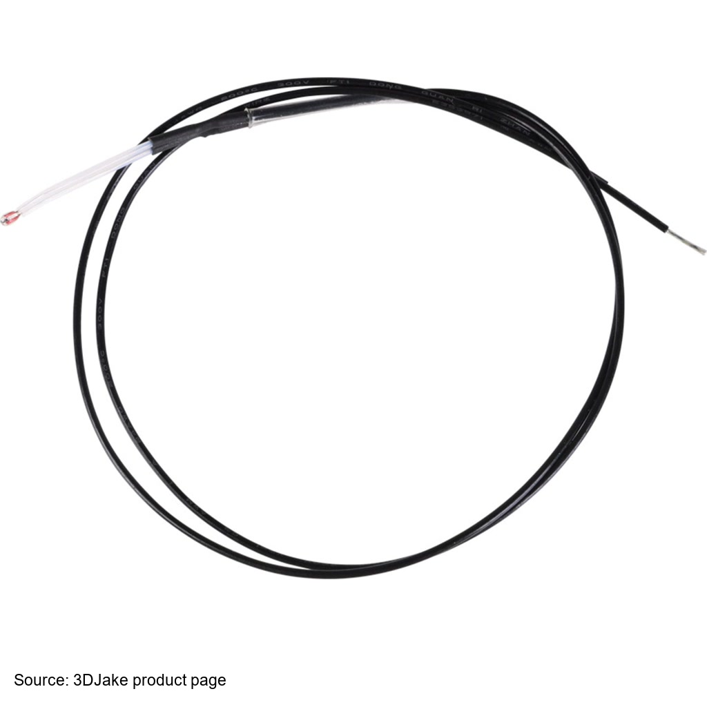

<!-- oomp-documentation:start -->
# Ender-3 Hotend thermistor

## Summary

Ender-3 Hotend thermistor



Creality glass bead thermistor replacement kit; the original installed wiring or connectors may differ. [Creality replacement thermistor, 3DJake product image](https://www.3djake.uk/creality-3d-printers-spare-parts/thermistor-kit?sai=11419) by Creator not identified; product image supplied by 3DJake. [Retail product image; reuse permission not established](https://www.3djake.uk/creality-3d-printers-spare-parts/thermistor-kit?sai=11419). Resized within a square white canvas and credited on the image.

## Details

OOMP ID `three_d_printer_part_creality_ender_3_temperature_sensor_hotend_thermistor_creality_400303006`

| Specification | Value |
| --- | --- |
| Identifier basis | Creality machine BOM part code. Retail ordering code unverified. |
| Machine bom quantity pcs | 1 |
| Machine bom row | 87 |
| Manufacturer part number | 400303006 |
| Reference name | Hotend thermistor |
| Source name | Nozzle thermistor |
| Source specification | D1.8-L1000mm-100K |

Sources checked 2026-11-18.

- [Creality Ender-3 machine bill of materials](https://github.com/Creality3DPrinting/Ender-3/blob/88c7758cea9d0d00a54fdb238bedb3b33425f409/Ender-3%20Mechanical/Ender-3%20BOM.XLS)

| Taxonomy slot | Value |
| --- | --- |
| 1 | `three_d_printer` |
| 2 | `part` |
| 3 | `creality_ender_3` |
| 4 | `temperature_sensor` |
| 5 | `hotend_thermistor` |
| 14 | `creality` |
| 15 | `400303006` |

## Labels

| Layout | Stock (mm) | Files |
| --- | --- | --- |
| OOMP inventory | 76.2 × 50.8 | [SVG](label_oomp.svg) · [Print PDF](label_oomp.pdf) |
| Stock | 76.2 × 50.8 | [SVG](label_stock_3x2.svg) · [Print PDF](label_stock_3x2.pdf) |
| Stock | 38.1 × 25.4 | [SVG](label_stock_1_5x1.svg) · [Print PDF](label_stock_1_5x1.pdf) |
| Drawer | 38.1 × 25.4 | [SVG](label_drawer.svg) · [Print PDF](label_drawer.pdf) |
| Compact barcode | 30 × 15 | [SVG](label_30x15.svg) · [Print PDF](label_30x15.pdf) |

## Parts

[Browse this category](../../navigation/part/creality_ender_3/temperature_sensor/README.md) · [Canonical metadata](working.yaml) · [Catalogue](../../README.md)

Confirmed printer models in this catalogue

- [Creality Ender-3](../three_d_printer_printer_creality_ender_3/)

## Assembly

Use the model-specific manufacturer documentation linked above for setup or service.

<details>
<summary>Full OOMP metadata</summary>

```yaml
compatible_printers:
- three_d_printer_printer_creality_ender_3
name_proper: Ender-3 Hotend thermistor
oomp_id: three_d_printer_part_creality_ender_3_temperature_sensor_hotend_thermistor_creality_400303006
photo:
  caption: Creality glass bead thermistor replacement kit; the original installed
    wiring or connectors may differ.
  changes: Resized within a square white canvas and credited on the image.
  creator: Creator not identified; product image supplied by 3DJake
  credit_line: 'Source: 3DJake product page'
  file: source_file/images/creality_replacement_thermistor_square.jpg
  license: Retail product image; reuse permission not established
  license_url: https://www.3djake.uk/creality-3d-printers-spare-parts/thermistor-kit?sai=11419
  original_file: source_file/images/original/creality_replacement_thermistor.jpg
  original_image_url: https://3d.nice-cdn.com/upload/image/product/large/default/19189_de652046.jpg
  source: https://www.3djake.uk/creality-3d-printers-spare-parts/thermistor-kit?sai=11419
  source_checked: '2026-11-19'
  title: Creality replacement thermistor, 3DJake product image
source_checked: '2026-11-18'
sources:
  Creality Ender-3 machine bill of materials: https://github.com/Creality3DPrinting/Ender-3/blob/88c7758cea9d0d00a54fdb238bedb3b33425f409/Ender-3%20Mechanical/Ender-3%20BOM.XLS
specifications:
  identifier_basis: Creality machine BOM part code. Retail ordering code unverified.
  machine_bom_quantity_pcs: 1
  machine_bom_row: 87
  manufacturer_part_number: '400303006'
  reference_name: Hotend thermistor
  source_name: Nozzle thermistor
  source_specification: D1.8-L1000mm-100K
taxonomy_1: three_d_printer
taxonomy_10: ''
taxonomy_11: ''
taxonomy_12: ''
taxonomy_13: ''
taxonomy_14: creality
taxonomy_15: '400303006'
taxonomy_2: part
taxonomy_3: creality_ender_3
taxonomy_4: temperature_sensor
taxonomy_5: hotend_thermistor
taxonomy_6: ''
taxonomy_7: ''
taxonomy_8: ''
taxonomy_9: ''
taxonomy_1_upper: THREE_D_PRINTER
taxonomy_1_upper_length_1: T
taxonomy_1_upper_length_2: TH
taxonomy_1_upper_length_3: THR
taxonomy_1_upper_length_4: THRE
taxonomy_1_upper_length_5: THREE
taxonomy_1_length_1: t
taxonomy_1_length_2: th
taxonomy_1_length_3: thr
taxonomy_1_length_4: thre
taxonomy_1_length_5: three
taxonomy_1_capital: Three D Printer
taxonomy_1_first_letter: t
taxonomy_1_first_letter_upper: T
taxonomy_2_upper: PART
taxonomy_2_upper_length_1: P
taxonomy_2_upper_length_2: PA
taxonomy_2_upper_length_3: PAR
taxonomy_2_upper_length_4: PART
taxonomy_2_upper_length_5: PART
taxonomy_2_length_1: p
taxonomy_2_length_2: pa
taxonomy_2_length_3: par
taxonomy_2_length_4: part
taxonomy_2_length_5: part
taxonomy_2_capital: Part
taxonomy_2_first_letter: p
taxonomy_2_first_letter_upper: P
taxonomy_3_upper: CREALITY_ENDER_3
taxonomy_3_upper_length_1: C
taxonomy_3_upper_length_2: CR
taxonomy_3_upper_length_3: CRE
taxonomy_3_upper_length_4: CREA
taxonomy_3_upper_length_5: CREAL
taxonomy_3_length_1: c
taxonomy_3_length_2: cr
taxonomy_3_length_3: cre
taxonomy_3_length_4: crea
taxonomy_3_length_5: creal
taxonomy_3_capital: Creality Ender 3
taxonomy_3_first_letter: c
taxonomy_3_first_letter_upper: C
taxonomy_4_upper: TEMPERATURE_SENSOR
taxonomy_4_upper_length_1: T
taxonomy_4_upper_length_2: TE
taxonomy_4_upper_length_3: TEM
taxonomy_4_upper_length_4: TEMP
taxonomy_4_upper_length_5: TEMPE
taxonomy_4_length_1: t
taxonomy_4_length_2: te
taxonomy_4_length_3: tem
taxonomy_4_length_4: temp
taxonomy_4_length_5: tempe
taxonomy_4_capital: Temperature Sensor
taxonomy_4_first_letter: t
taxonomy_4_first_letter_upper: T
taxonomy_5_upper: HOTEND_THERMISTOR
taxonomy_5_upper_length_1: H
taxonomy_5_upper_length_2: HO
taxonomy_5_upper_length_3: HOT
taxonomy_5_upper_length_4: HOTE
taxonomy_5_upper_length_5: HOTEN
taxonomy_5_length_1: h
taxonomy_5_length_2: ho
taxonomy_5_length_3: hot
taxonomy_5_length_4: hote
taxonomy_5_length_5: hoten
taxonomy_5_capital: Hotend Thermistor
taxonomy_5_first_letter: h
taxonomy_5_first_letter_upper: H
taxonomy_14_upper: CREALITY
taxonomy_14_upper_length_1: C
taxonomy_14_upper_length_2: CR
taxonomy_14_upper_length_3: CRE
taxonomy_14_upper_length_4: CREA
taxonomy_14_upper_length_5: CREAL
taxonomy_14_length_1: c
taxonomy_14_length_2: cr
taxonomy_14_length_3: cre
taxonomy_14_length_4: crea
taxonomy_14_length_5: creal
taxonomy_14_capital: Creality
taxonomy_14_first_letter: c
taxonomy_14_first_letter_upper: C
taxonomy_15_upper: '400303006'
taxonomy_15_upper_length_1: '4'
taxonomy_15_upper_length_2: '40'
taxonomy_15_upper_length_3: '400'
taxonomy_15_upper_length_4: '4003'
taxonomy_15_upper_length_5: '40030'
taxonomy_15_length_1: '4'
taxonomy_15_length_2: '40'
taxonomy_15_length_3: '400'
taxonomy_15_length_4: '4003'
taxonomy_15_length_5: '40030'
taxonomy_15_capital: '400303006'
taxonomy_15_first_letter: '4'
taxonomy_15_first_letter_upper: '4'
id: three_d_printer_part_creality_ender_3_temperature_sensor_hotend_thermistor_creality_400303006
id_no_class: three_d_printer_part_creality_ender_3_temperature_sensor_hotend_thermistor_creality_400303006
id_no_type: three_d_printer_part_creality_ender_3_temperature_sensor_hotend_thermistor_creality_400303006
id_no_size: three_d_printer_part_creality_ender_3_temperature_sensor_hotend_thermistor_creality_400303006
oomp_key: oomp_three_d_printer_part_creality_ender_3_temperature_sensor_hotend_thermistor_creality_400303006
link_github: https://github.com/oomlout/oomp_three_d_printer_version_5/tree/main/parts/three_d_printer_part_creality_ender_3_temperature_sensor_hotend_thermistor_creality_400303006
link_main: https://github.com/oomlout/oomp_three_d_printer_version_5/tree/main/parts/three_d_printer_part_creality_ender_3_temperature_sensor_hotend_thermistor_creality_400303006
link_redirect: https://github.com/oomlout/oomp_three_d_printer_version_5/tree/main/parts/three_d_printer_part_creality_ender_3_temperature_sensor_hotend_thermistor_creality_400303006
directory: parts/three_d_printer_part_creality_ender_3_temperature_sensor_hotend_thermistor_creality_400303006
name: Three D Printer Part Creality Ender 3 Temperature Sensor Hotend Thermistor Creality
  400303006
name_no_class: Three D Printer Part Creality Ender 3 Temperature Sensor Hotend Thermistor
  Creality 400303006
name_no_type: Three D Printer Part Creality Ender 3 Temperature Sensor Hotend Thermistor
  Creality 400303006
name_no_size: Three D Printer Part Creality Ender 3 Temperature Sensor Hotend Thermistor
  Creality 400303006
md5: 709995c4f849f8e7bc7fb7833ccb7b11
md5_5: '70999'
md5_5_upper: '70999'
md5_6: '709995'
md5_6_upper: '709995'
md5_6_alpha: 4e5xx
md5_6_alpha_upper: 4E5XX
md5_10: 709995c4f8
md5_10_upper: 709995C4F8
bip_39_full_array:
- identify
- smile
- illness
- vacuum
- panel
- inherit
- vehicle
- want
- lobster
- town
- tell
- casino
bip_39_full_space: identify smile illness vacuum panel inherit vehicle want lobster
  town tell casino
bip_39_full_no_space: identifysmileillnessvacuumpanelinheritvehiclewantlobstertowntellcasino
bip_39_full_underscore: identify_smile_illness_vacuum_panel_inherit_vehicle_want_lobster_town_tell_casino
bip_39_2_word_array:
- identify
- smile
bip_39_2_word_space: identify smile
bip_39_2_word_no_space: identifysmile
bip_39_2_word_underscore: identify_smile
bip_39_3_word_array:
- identify
- smile
- illness
bip_39_3_word_space: identify smile illness
bip_39_3_word_no_space: identifysmileillness
bip_39_3_word_underscore: identify_smile_illness
label_title: Hotend thermistor
label_barcode: M0,0h34v760h-34z M136,0h34v760h-34z M204,0h102v760h-102z M340,0h102v760h-102z
  M476,0h34v760h-34z M544,0h34v760h-34z M612,0h34v760h-34z M748,0h102v760h-102z M884,0h34v760h-34z
  M952,0h102v760h-102z M1088,0h102v760h-102z M1224,0h34v760h-34z M1292,0h102v760h-102z
  M1496,0h34v760h-34z M1564,0h34v760h-34z M1632,0h102v760h-102z M1768,0h34v760h-34z
  M1904,0h102v760h-102z M2040,0h34v760h-34z M2108,0h34v760h-34z M2176,0h34v760h-34z
  M2312,0h34v760h-34z M2380,0h102v760h-102z M2516,0h34v760h-34z M2584,0h102v760h-102z
  M2720,0h34v760h-34z M2856,0h34v760h-34z M2924,0h102v760h-102z M3060,0h34v760h-34z
  M3128,0h102v760h-102z M3264,0h34v760h-34z M3400,0h34v760h-34z M3468,0h102v760h-102z
  M3604,0h102v760h-102z M3740,0h34v760h-34z
label_barcode_width: 3774
label_maker: Creality
label_family: Temperature Sensor
label_detail: '400303006'
label_variant: Creality Ender 3
label_context: Creality Ender-3
inventory_title_size: 12.922579900773048
stock_title_size: 3.922926041306104
drawer_title_size: 2.53836390908042
compact_title_size: 2.8
oomlout_ai_roboclick_1:
  actions:
  - command: text_jinja_template
    file_template: source_file/template_jinja/template_jinja_label_oomlout_76_2_mm_50_8_mm/working.svg.j2
    file_output: label_oomp.svg
    convert_to_pdf: true
    convert_to_png: false
  - command: text_jinja_template
    file_template: source_file/template_jinja/label_stock/3x2.svg.j2
    file_output: label_stock_3x2.svg
    convert_to_pdf: true
    convert_to_png: false
  - command: text_jinja_template
    file_template: source_file/template_jinja/label_stock/1_5x1.svg.j2
    file_output: label_stock_1_5x1.svg
    convert_to_pdf: true
    convert_to_png: false
  - command: text_jinja_template
    file_template: source_file/template_jinja/label_drawer/working.svg.j2
    file_output: label_drawer.svg
    convert_to_pdf: true
    convert_to_png: false
  - command: text_jinja_template
    file_template: source_file/template_jinja/label_printer_30x15/working.svg.j2
    file_output: label_30x15.svg
    convert_to_pdf: true
    convert_to_png: false
  file_test: ''
  retries_until_complete: 0
  action_name: step_0_jinja_template_label_oomp.svg
```

</details>
<!-- oomp-documentation:end -->
