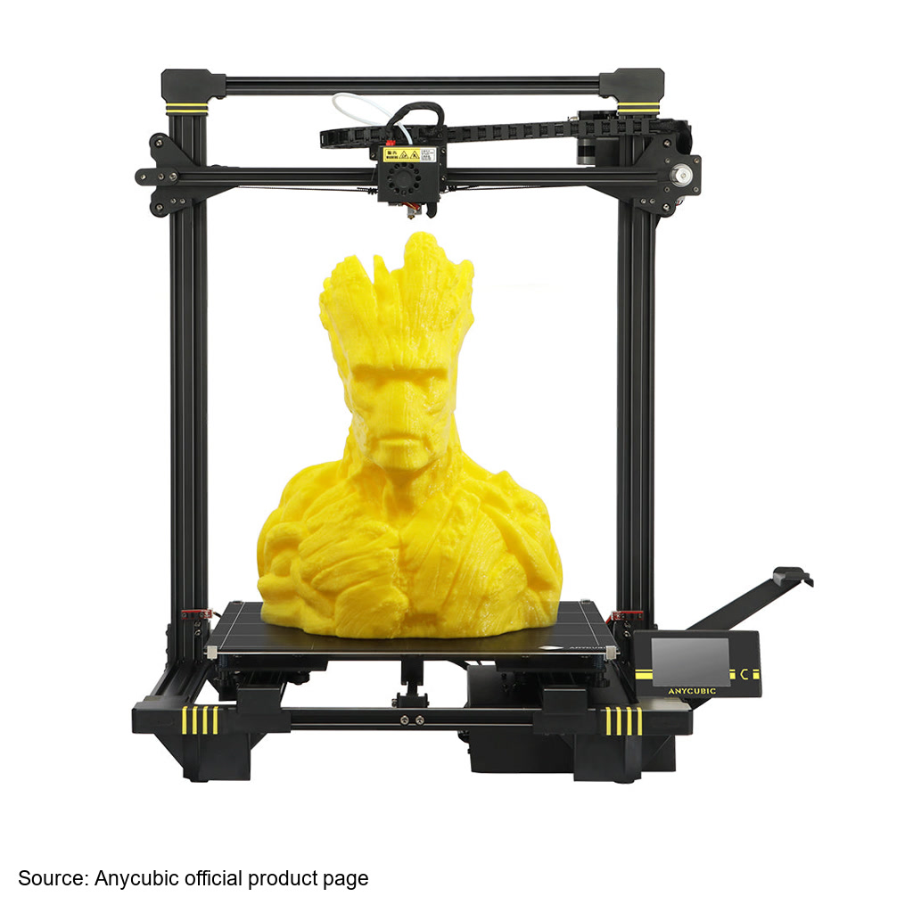

<!-- oomp-documentation:start -->
# Anycubic Chiron

[Open catalogue record](http://localhost:5703/parts/three_d_printer_printer_anycubic_chiron) · [Anycubic Chiron specifications](https://www.anycubic.es/pages/especificaciones-de-chiron)

## Summary

Anycubic Chiron filament printer.



Anycubic Chiron shown with a printed model. [Anycubic product image](https://store.anycubic.com/products/anycubic-c-3d-printer) by Anycubic. [Manufacturer product image; reuse permission not established](https://store.anycubic.com/products/anycubic-c-3d-printer). Resized within a square white canvas and credited on the image.

## Details

OOMP ID `three_d_printer_printer_anycubic_chiron`

| Specification | Value |
| --- | --- |
| Build volume (X × Y × Z, mm) | 400 × 400 × 450 |
| Max bed (°C) | 100 |
| Max hotend (°C) | 260 |
| Stock nozzle (mm) | 0.4 |

Sources checked 2026-11-18.


| Taxonomy slot | Value |
| --- | --- |
| 1 | `three_d_printer` |
| 2 | `printer` |
| 14 | `anycubic` |
| 15 | `chiron` |

## Labels

| Layout | Stock (mm) | Files |
| --- | --- | --- |
| OOMP inventory | 76.2 × 50.8 | [SVG](label_oomp.svg) · [Print PDF](label_oomp.pdf) |
| Stock | 76.2 × 50.8 | [SVG](label_stock_3x2.svg) · [Print PDF](label_stock_3x2.pdf) |
| Stock | 38.1 × 25.4 | [SVG](label_stock_1_5x1.svg) · [Print PDF](label_stock_1_5x1.pdf) |
| Drawer | 38.1 × 25.4 | [SVG](label_drawer.svg) · [Print PDF](label_drawer.pdf) |
| Compact barcode | 30 × 15 | [SVG](label_30x15.svg) · [Print PDF](label_30x15.pdf) |

## Parts

[Browse this category](../../navigation/printer/anycubic/README.md) · [Canonical metadata](working.yaml) · [Catalogue](../../README.md)


## Assembly

Use the model-specific manufacturer documentation linked above for setup or service.

<details>
<summary>Full OOMP metadata</summary>

```yaml
link_main: https://github.com/oomlout/oomp_three_d_printer_version_5/tree/main/parts/three_d_printer_printer_anycubic_chiron
link_source: https://www.anycubic.es/pages/especificaciones-de-chiron
link_web: http://localhost:5703/parts/three_d_printer_printer_anycubic_chiron
name_proper: Anycubic Chiron
oomp_id: three_d_printer_printer_anycubic_chiron
photo:
  caption: Anycubic Chiron shown with a printed model.
  changes: Resized within a square white canvas and credited on the image.
  creator: Anycubic
  credit_line: 'Source: Anycubic official product page'
  file: source_file/images/anycubic_chiron_square.jpg
  license: Manufacturer product image; reuse permission not established
  license_url: https://store.anycubic.com/products/anycubic-c-3d-printer
  original_file: source_file/images/original/anycubic_chiron.jpg
  original_image_url: http://store.anycubic.com/cdn/shop/products/Chiron_2.jpg?v=1770001967
  source: https://store.anycubic.com/products/anycubic-c-3d-printer
  source_checked: '2026-11-19'
  title: Anycubic product image
source_checked: '2026-11-18'
sources:
  Anycubic Chiron specifications: https://www.anycubic.es/pages/especificaciones-de-chiron
specifications:
  build_volume_mm:
  - 400
  - 400
  - 450
  max_bed_c: 100
  max_hotend_c: 260
  stock_nozzle_mm: 0.4
taxonomy_1: three_d_printer
taxonomy_10: ''
taxonomy_11: ''
taxonomy_12: ''
taxonomy_13: ''
taxonomy_14: anycubic
taxonomy_15: chiron
taxonomy_2: printer
taxonomy_3: ''
taxonomy_4: ''
taxonomy_5: ''
taxonomy_6: ''
taxonomy_7: ''
taxonomy_8: ''
taxonomy_9: ''
taxonomy_1_upper: THREE_D_PRINTER
taxonomy_1_upper_length_1: T
taxonomy_1_upper_length_2: TH
taxonomy_1_upper_length_3: THR
taxonomy_1_upper_length_4: THRE
taxonomy_1_upper_length_5: THREE
taxonomy_1_length_1: t
taxonomy_1_length_2: th
taxonomy_1_length_3: thr
taxonomy_1_length_4: thre
taxonomy_1_length_5: three
taxonomy_1_capital: Three D Printer
taxonomy_1_first_letter: t
taxonomy_1_first_letter_upper: T
taxonomy_2_upper: PRINTER
taxonomy_2_upper_length_1: P
taxonomy_2_upper_length_2: PR
taxonomy_2_upper_length_3: PRI
taxonomy_2_upper_length_4: PRIN
taxonomy_2_upper_length_5: PRINT
taxonomy_2_length_1: p
taxonomy_2_length_2: pr
taxonomy_2_length_3: pri
taxonomy_2_length_4: prin
taxonomy_2_length_5: print
taxonomy_2_capital: Printer
taxonomy_2_first_letter: p
taxonomy_2_first_letter_upper: P
taxonomy_14_upper: ANYCUBIC
taxonomy_14_upper_length_1: A
taxonomy_14_upper_length_2: AN
taxonomy_14_upper_length_3: ANY
taxonomy_14_upper_length_4: ANYC
taxonomy_14_upper_length_5: ANYCU
taxonomy_14_length_1: a
taxonomy_14_length_2: an
taxonomy_14_length_3: any
taxonomy_14_length_4: anyc
taxonomy_14_length_5: anycu
taxonomy_14_capital: Anycubic
taxonomy_14_first_letter: a
taxonomy_14_first_letter_upper: A
taxonomy_15_upper: CHIRON
taxonomy_15_upper_length_1: C
taxonomy_15_upper_length_2: CH
taxonomy_15_upper_length_3: CHI
taxonomy_15_upper_length_4: CHIR
taxonomy_15_upper_length_5: CHIRO
taxonomy_15_length_1: c
taxonomy_15_length_2: ch
taxonomy_15_length_3: chi
taxonomy_15_length_4: chir
taxonomy_15_length_5: chiro
taxonomy_15_capital: Chiron
taxonomy_15_first_letter: c
taxonomy_15_first_letter_upper: C
id: three_d_printer_printer_anycubic_chiron
id_no_class: three_d_printer_printer_anycubic_chiron
id_no_type: three_d_printer_printer_anycubic_chiron
id_no_size: three_d_printer_printer_anycubic_chiron
oomp_key: oomp_three_d_printer_printer_anycubic_chiron
link_github: https://github.com/oomlout/oomp_three_d_printer_version_5/tree/main/parts/three_d_printer_printer_anycubic_chiron
link_redirect: https://github.com/oomlout/oomp_three_d_printer_version_5/tree/main/parts/three_d_printer_printer_anycubic_chiron
directory: parts/three_d_printer_printer_anycubic_chiron
name: Three D Printer Printer Anycubic Chiron
name_no_class: Three D Printer Printer Anycubic Chiron
name_no_type: Three D Printer Printer Anycubic Chiron
name_no_size: Three D Printer Printer Anycubic Chiron
md5: 0cff43d2015ac51a1b2463928a04ffd5
md5_5: 0cff4
md5_5_upper: 0CFF4
md5_6: 0cff43
md5_6_upper: 0CFF43
md5_6_alpha: i98j
md5_6_alpha_upper: I98J
md5_10: 0cff43d201
md5_10_upper: 0CFF43D201
bip_39_full_array:
- artefact
- wheel
- virus
- actor
- proof
- minimum
- hold
- midnight
- myth
- expand
- divide
- produce
bip_39_full_space: artefact wheel virus actor proof minimum hold midnight myth expand
  divide produce
bip_39_full_no_space: artefactwheelvirusactorproofminimumholdmidnightmythexpanddivideproduce
bip_39_full_underscore: artefact_wheel_virus_actor_proof_minimum_hold_midnight_myth_expand_divide_produce
bip_39_2_word_array:
- artefact
- wheel
bip_39_2_word_space: artefact wheel
bip_39_2_word_no_space: artefactwheel
bip_39_2_word_underscore: artefact_wheel
bip_39_3_word_array:
- artefact
- wheel
- virus
bip_39_3_word_space: artefact wheel virus
bip_39_3_word_no_space: artefactwheelvirus
bip_39_3_word_underscore: artefact_wheel_virus
label_title: CHIRON
label_barcode: M0,0h34v760h-34z M136,0h34v760h-34z M204,0h102v760h-102z M340,0h102v760h-102z
  M476,0h34v760h-34z M544,0h34v760h-34z M612,0h102v760h-102z M748,0h34v760h-34z M884,0h102v760h-102z
  M1020,0h34v760h-34z M1088,0h34v760h-34z M1156,0h102v760h-102z M1360,0h34v760h-34z
  M1428,0h102v760h-102z M1564,0h34v760h-34z M1632,0h102v760h-102z M1768,0h34v760h-34z
  M1904,0h34v760h-34z M1972,0h102v760h-102z M2108,0h34v760h-34z M2176,0h34v760h-34z
  M2244,0h34v760h-34z M2312,0h102v760h-102z M2516,0h102v760h-102z M2652,0h34v760h-34z
  M2720,0h34v760h-34z M2856,0h34v760h-34z M2924,0h102v760h-102z M3060,0h102v760h-102z
  M3196,0h34v760h-34z
label_barcode_width: 3230
label_maker: Anycubic
label_family: Printer
label_detail: 400 x 400 x 450
label_variant: Build volume (mm)
label_context: Anycubic
inventory_title_size: 14
stock_title_size: 5.3
drawer_title_size: 3.3
compact_title_size: 2.8
oomlout_ai_roboclick_1:
  actions:
  - command: text_jinja_template
    file_template: source_file/template_jinja/template_jinja_label_oomlout_76_2_mm_50_8_mm/working.svg.j2
    file_output: label_oomp.svg
    convert_to_pdf: true
    convert_to_png: false
  - command: text_jinja_template
    file_template: source_file/template_jinja/label_stock/3x2.svg.j2
    file_output: label_stock_3x2.svg
    convert_to_pdf: true
    convert_to_png: false
  - command: text_jinja_template
    file_template: source_file/template_jinja/label_stock/1_5x1.svg.j2
    file_output: label_stock_1_5x1.svg
    convert_to_pdf: true
    convert_to_png: false
  - command: text_jinja_template
    file_template: source_file/template_jinja/label_drawer/working.svg.j2
    file_output: label_drawer.svg
    convert_to_pdf: true
    convert_to_png: false
  - command: text_jinja_template
    file_template: source_file/template_jinja/label_printer_30x15/working.svg.j2
    file_output: label_30x15.svg
    convert_to_pdf: true
    convert_to_png: false
  file_test: ''
  retries_until_complete: 0
  action_name: step_0_jinja_template_label_oomp.svg
```

</details>
<!-- oomp-documentation:end -->
