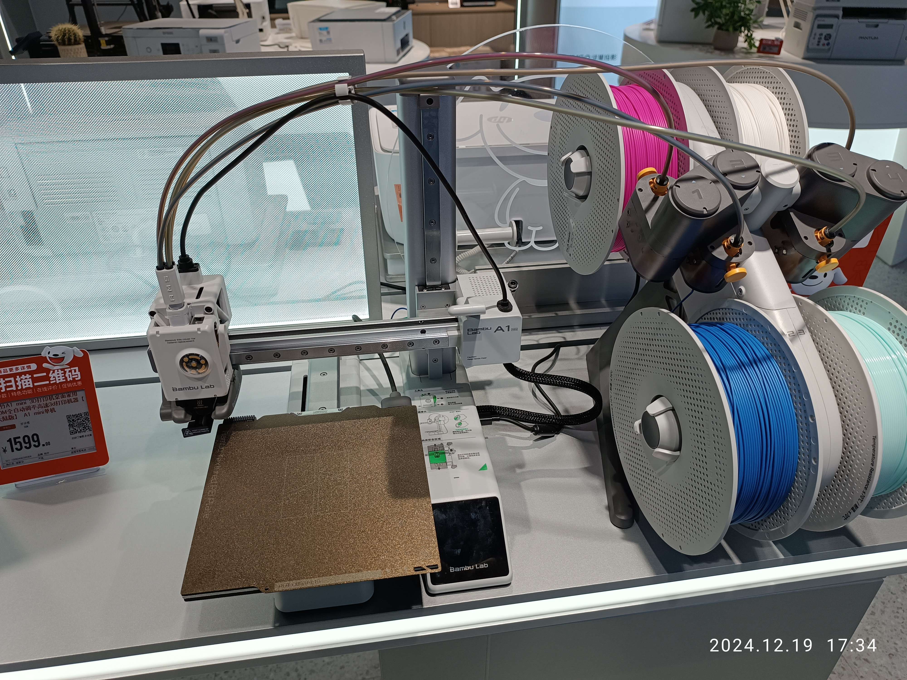

<!-- oomp-documentation:start -->
# Bambu Lab A1 mini

## Summary

Bambu Lab A1 mini filament printer.



Bambu Lab A1 mini on the left and AMS lite with four spools on the right. [JD Mall Electronics Showroom, 3D printers, December 2024 (R12S 06)](https://commons.wikimedia.org/wiki/File:DG_%E6%9D%B1%E8%8E%9E_DongGuan_%E5%8D%97%E5%9F%8E%E5%8D%80_Nancheng_%E9%B4%BB%E7%A6%8F%E8%B7%AF_HongFu_Road_%E6%9D%B1%E8%8E%9E%E4%BA%AC%E6%9D%B1%E5%95%86%E5%A0%B4_JD_Mall_Electronics_Showroom_3D_printers_December_2024_R12S_06.jpg) by NAS 238 WMMNO. [CC0 1.0](https://creativecommons.org/publicdomain/zero/1.0/). Original photograph, unchanged.

## Details

OOMP ID `three_d_printer_printer_bambu_lab_a1_mini`

| Specification | Value |
| --- | --- |
| Announcement date | 2023-09-20 |
| Build volume (X × Y × Z, mm) | 180 × 180 × 180 |
| Filament diameter (mm) | 1.75 |
| Product dimensions (manufacturer order, mm) | 347 × 315 × 365 |
| Max bed (°C) | 80 |
| Max hotend (°C) | 300 |
| Net mass (kg) | 5.5 |
| Reference price | USD 199–299, Bambu Lab Global starting and comparison prices for the printer. |
| Stock nozzle (mm) | 0.4 |

Sources checked 2026-11-18.

- [A1 mini specifications and setup](https://cdn1.bambulab.com/documentation/quick-start-b82993168480b/A1mini/Y.BC.SM.A00207-04_N1-%E5%A5%97%E8%A3%85-%E5%BF%AB%E9%80%9F%E5%85%A5%E9%97%A8%28%E8%8B%B1%E6%96%87%29.pdf)
- [Global store price listing](https://bambu-lab-global.myshopify.com/collections/3d-printer)
- [Manufacturer launch announcement](https://forum.bambulab.com/t/introducing-bambu-lab-a1-mini-a-colorful-gateway-to-3d-printing/28328)

| Taxonomy slot | Value |
| --- | --- |
| 1 | `three_d_printer` |
| 2 | `printer` |
| 14 | `bambu_lab` |
| 15 | `a1_mini` |

## Labels

| Layout | Stock (mm) | Files |
| --- | --- | --- |
| OOMP inventory | 76.2 × 50.8 | [SVG](label_oomp.svg) · [Print PDF](label_oomp.pdf) |
| Stock | 76.2 × 50.8 | [SVG](label_stock_3x2.svg) · [Print PDF](label_stock_3x2.pdf) |
| Stock | 38.1 × 25.4 | [SVG](label_stock_1_5x1.svg) · [Print PDF](label_stock_1_5x1.pdf) |
| Drawer | 38.1 × 25.4 | [SVG](label_drawer.svg) · [Print PDF](label_drawer.pdf) |
| Compact barcode | 30 × 15 | [SVG](label_30x15.svg) · [Print PDF](label_30x15.pdf) |

## Parts

[Browse this category](../../navigation/printer/bambu_lab/README.md) · [Canonical metadata](working.yaml) · [Catalogue](../../README.md)


Compatible spares and feeders in this catalogue

- [Bambu Lab AMS lite](../three_d_printer_ams_bambu_lab_ams_lite/)
- [Bambu Lab A1 series hotend with nozzle, 0.4 mm](../three_d_printer_part_bambu_lab_a1_mini_hotend_hotend_with_nozzle_0_4_mm_stainless_steel_bambu_lab_fah007/)

## Assembly

Use the model-specific manufacturer documentation linked above for setup or service.

<details>
<summary>Full OOMP metadata</summary>

```yaml
name_proper: Bambu Lab A1 mini
oomp_id: three_d_printer_printer_bambu_lab_a1_mini
photo:
  caption: Bambu Lab A1 mini on the left and AMS lite with four spools on the right.
  changes: Original photograph, unchanged.
  creator: NAS 238 WMMNO
  file: source_file/a1_mini_showroom.jpg
  license: CC0 1.0
  license_url: https://creativecommons.org/publicdomain/zero/1.0/
  source: https://commons.wikimedia.org/wiki/File:DG_%E6%9D%B1%E8%8E%9E_DongGuan_%E5%8D%97%E5%9F%8E%E5%8D%80_Nancheng_%E9%B4%BB%E7%A6%8F%E8%B7%AF_HongFu_Road_%E6%9D%B1%E8%8E%9E%E4%BA%AC%E6%9D%B1%E5%95%86%E5%A0%B4_JD_Mall_Electronics_Showroom_3D_printers_December_2024_R12S_06.jpg
  title: JD Mall Electronics Showroom, 3D printers, December 2024 (R12S 06)
source_checked: '2026-11-18'
sources:
  A1 mini specifications and setup: https://cdn1.bambulab.com/documentation/quick-start-b82993168480b/A1mini/Y.BC.SM.A00207-04_N1-%E5%A5%97%E8%A3%85-%E5%BF%AB%E9%80%9F%E5%85%A5%E9%97%A8%28%E8%8B%B1%E6%96%87%29.pdf
  Global store price listing: https://bambu-lab-global.myshopify.com/collections/3d-printer
  Manufacturer launch announcement: https://forum.bambulab.com/t/introducing-bambu-lab-a1-mini-a-colorful-gateway-to-3d-printing/28328
specifications:
  announcement_date: '2023-09-20'
  build_volume_mm:
  - 180
  - 180
  - 180
  filament_diameter_mm: 1.75
  machine_dimensions_mm:
  - 347
  - 315
  - 365
  max_bed_c: 80
  max_hotend_c: 300
  net_mass_kg: 5.5
  reference_price: USD 199–299, Bambu Lab Global starting and comparison prices for
    the printer.
  stock_nozzle_mm: 0.4
taxonomy_1: three_d_printer
taxonomy_10: ''
taxonomy_11: ''
taxonomy_12: ''
taxonomy_13: ''
taxonomy_14: bambu_lab
taxonomy_15: a1_mini
taxonomy_2: printer
taxonomy_3: ''
taxonomy_4: ''
taxonomy_5: ''
taxonomy_6: ''
taxonomy_7: ''
taxonomy_8: ''
taxonomy_9: ''
worked_example: true
taxonomy_1_upper: THREE_D_PRINTER
taxonomy_1_upper_length_1: T
taxonomy_1_upper_length_2: TH
taxonomy_1_upper_length_3: THR
taxonomy_1_upper_length_4: THRE
taxonomy_1_upper_length_5: THREE
taxonomy_1_length_1: t
taxonomy_1_length_2: th
taxonomy_1_length_3: thr
taxonomy_1_length_4: thre
taxonomy_1_length_5: three
taxonomy_1_capital: Three D Printer
taxonomy_1_first_letter: t
taxonomy_1_first_letter_upper: T
taxonomy_2_upper: PRINTER
taxonomy_2_upper_length_1: P
taxonomy_2_upper_length_2: PR
taxonomy_2_upper_length_3: PRI
taxonomy_2_upper_length_4: PRIN
taxonomy_2_upper_length_5: PRINT
taxonomy_2_length_1: p
taxonomy_2_length_2: pr
taxonomy_2_length_3: pri
taxonomy_2_length_4: prin
taxonomy_2_length_5: print
taxonomy_2_capital: Printer
taxonomy_2_first_letter: p
taxonomy_2_first_letter_upper: P
taxonomy_14_upper: BAMBU_LAB
taxonomy_14_upper_length_1: B
taxonomy_14_upper_length_2: BA
taxonomy_14_upper_length_3: BAM
taxonomy_14_upper_length_4: BAMB
taxonomy_14_upper_length_5: BAMBU
taxonomy_14_length_1: b
taxonomy_14_length_2: ba
taxonomy_14_length_3: bam
taxonomy_14_length_4: bamb
taxonomy_14_length_5: bambu
taxonomy_14_capital: Bambu Lab
taxonomy_14_first_letter: b
taxonomy_14_first_letter_upper: B
taxonomy_15_upper: A1_MINI
taxonomy_15_upper_length_1: A
taxonomy_15_upper_length_2: A1
taxonomy_15_upper_length_3: A1_
taxonomy_15_upper_length_4: A1_M
taxonomy_15_upper_length_5: A1_MI
taxonomy_15_length_1: a
taxonomy_15_length_2: a1
taxonomy_15_length_3: a1_
taxonomy_15_length_4: a1_m
taxonomy_15_length_5: a1_mi
taxonomy_15_capital: A1 Mini
taxonomy_15_first_letter: a
taxonomy_15_first_letter_upper: A
id: three_d_printer_printer_bambu_lab_a1_mini
id_no_class: three_d_printer_printer_bambu_lab_a1_mini
id_no_type: three_d_printer_printer_bambu_lab_a1_mini
id_no_size: three_d_printer_printer_bambu_lab_a1_mini
oomp_key: oomp_three_d_printer_printer_bambu_lab_a1_mini
link_github: https://github.com/oomlout/oomp_three_d_printer_version_5/tree/main/parts/three_d_printer_printer_bambu_lab_a1_mini
link_main: https://github.com/oomlout/oomp_three_d_printer_version_5/tree/main/parts/three_d_printer_printer_bambu_lab_a1_mini
link_redirect: https://github.com/oomlout/oomp_three_d_printer_version_5/tree/main/parts/three_d_printer_printer_bambu_lab_a1_mini
directory: parts/three_d_printer_printer_bambu_lab_a1_mini
name: Three D Printer Printer Bambu Lab A1 Mini
name_no_class: Three D Printer Printer Bambu Lab A1 Mini
name_no_type: Three D Printer Printer Bambu Lab A1 Mini
name_no_size: Three D Printer Printer Bambu Lab A1 Mini
md5: f76d4bf23c08e760649deca8c0606475
md5_5: f76d4
md5_5_upper: F76D4
md5_6: f76d4b
md5_6_upper: F76D4B
md5_6_alpha: 9njuz
md5_6_alpha_upper: 9NJUZ
md5_10: f76d4bf23c
md5_10_upper: F76D4BF23C
bip_39_full_array:
- wash
- heart
- wish
- job
- mobile
- rabbit
- mystery
- rural
- potato
- adapt
- boil
- typical
bip_39_full_space: wash heart wish job mobile rabbit mystery rural potato adapt boil
  typical
bip_39_full_no_space: washheartwishjobmobilerabbitmysteryruralpotatoadaptboiltypical
bip_39_full_underscore: wash_heart_wish_job_mobile_rabbit_mystery_rural_potato_adapt_boil_typical
bip_39_2_word_array:
- wash
- heart
bip_39_2_word_space: wash heart
bip_39_2_word_no_space: washheart
bip_39_2_word_underscore: wash_heart
bip_39_3_word_array:
- wash
- heart
- wish
bip_39_3_word_space: wash heart wish
bip_39_3_word_no_space: washheartwish
bip_39_3_word_underscore: wash_heart_wish
label_title: A1 MINI
label_barcode: M0,0h34v760h-34z M136,0h34v760h-34z M204,0h102v760h-102z M340,0h102v760h-102z
  M476,0h34v760h-34z M544,0h34v760h-34z M612,0h102v760h-102z M816,0h34v760h-34z M884,0h102v760h-102z
  M1020,0h34v760h-34z M1088,0h34v760h-34z M1156,0h34v760h-34z M1224,0h102v760h-102z
  M1360,0h34v760h-34z M1496,0h102v760h-102z M1632,0h34v760h-34z M1700,0h34v760h-34z
  M1768,0h102v760h-102z M1972,0h102v760h-102z M2108,0h34v760h-34z M2176,0h102v760h-102z
  M2380,0h34v760h-34z M2448,0h34v760h-34z M2516,0h34v760h-34z M2584,0h102v760h-102z
  M2720,0h34v760h-34z M2856,0h102v760h-102z M2992,0h102v760h-102z M3128,0h34v760h-34z
  M3196,0h34v760h-34z M3264,0h34v760h-34z M3400,0h34v760h-34z M3468,0h102v760h-102z
  M3604,0h102v760h-102z M3740,0h34v760h-34z
label_barcode_width: 3774
label_maker: Bambu Lab
label_family: Printer
label_detail: 180 x 180 x 180
label_variant: Build volume (mm)
label_context: Bambu Lab
inventory_title_size: 14
stock_title_size: 5.3
drawer_title_size: 3.3
compact_title_size: 2.8
oomlout_ai_roboclick_1:
  actions:
  - command: text_jinja_template
    file_template: source_file/template_jinja/template_jinja_label_oomlout_76_2_mm_50_8_mm/working.svg.j2
    file_output: label_oomp.svg
    convert_to_pdf: true
    convert_to_png: false
  - command: text_jinja_template
    file_template: source_file/template_jinja/label_stock/3x2.svg.j2
    file_output: label_stock_3x2.svg
    convert_to_pdf: true
    convert_to_png: false
  - command: text_jinja_template
    file_template: source_file/template_jinja/label_stock/1_5x1.svg.j2
    file_output: label_stock_1_5x1.svg
    convert_to_pdf: true
    convert_to_png: false
  - command: text_jinja_template
    file_template: source_file/template_jinja/label_drawer/working.svg.j2
    file_output: label_drawer.svg
    convert_to_pdf: true
    convert_to_png: false
  - command: text_jinja_template
    file_template: source_file/template_jinja/label_printer_30x15/working.svg.j2
    file_output: label_30x15.svg
    convert_to_pdf: true
    convert_to_png: false
  file_test: ''
  retries_until_complete: 0
  action_name: step_0_jinja_template_label_oomp.svg
```

</details>
<!-- oomp-documentation:end -->
