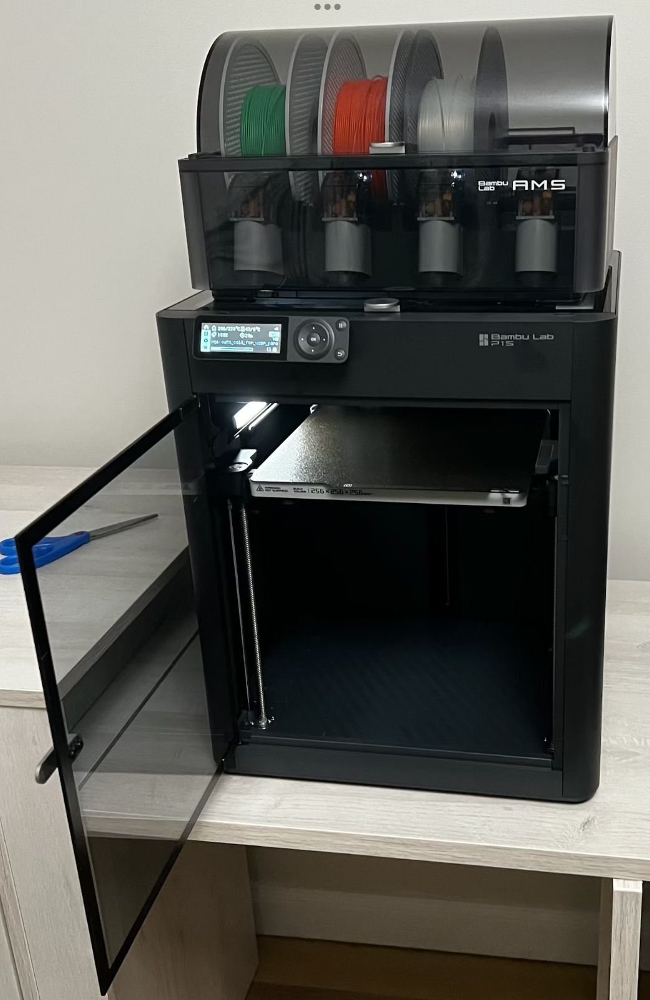

<!-- oomp-documentation:start -->
# Bambu Lab P1S

## Summary

Bambu Lab P1S filament printer.



Bambu Lab P1S with the original AMS on top. [P1s with ams.jpg](https://commons.wikimedia.org/wiki/File:P1s_with_ams.jpg) by Pineapplefish77. [CC BY-SA 4.0](https://creativecommons.org/licenses/by-sa/4.0/). Original photograph, unchanged.

## Details

OOMP ID `three_d_printer_printer_bambu_lab_p1s`

| Specification | Value |
| --- | --- |
| Announcement date | 2023-07-13 |
| Build volume (X × Y × Z, mm) | 256 × 256 × 256 |
| Filament diameter (mm) | 1.75 |
| Product dimensions (manufacturer order, mm) | 389 × 389 × 458 |
| Max bed (°C) | 100 |
| Max hotend (°C) | 300 |
| Net mass (kg) | 12.95 |
| Reference price | USD 599–699, Bambu Lab Global starting and comparison prices for the printer. |
| Stock nozzle (mm) | 0.4 |

Sources checked 2026-11-18.

- [Global store price listing](https://bambu-lab-global.myshopify.com/collections/3d-printer)
- [Manufacturer launch announcement](https://forum.bambulab.com/t/the-bambu-lab-p1s-is-launched/19959)
- [P1S technical specifications](https://store.bblcdn.com/s5/default/78c105c0c92642a99e64b4b0b0f3ca6a.pdf)

| Taxonomy slot | Value |
| --- | --- |
| 1 | `three_d_printer` |
| 2 | `printer` |
| 14 | `bambu_lab` |
| 15 | `p1s` |

## Labels

| Layout | Stock (mm) | Files |
| --- | --- | --- |
| OOMP inventory | 76.2 × 50.8 | [SVG](label_oomp.svg) · [Print PDF](label_oomp.pdf) |
| Stock | 76.2 × 50.8 | [SVG](label_stock_3x2.svg) · [Print PDF](label_stock_3x2.pdf) |
| Stock | 38.1 × 25.4 | [SVG](label_stock_1_5x1.svg) · [Print PDF](label_stock_1_5x1.pdf) |
| Drawer | 38.1 × 25.4 | [SVG](label_drawer.svg) · [Print PDF](label_drawer.pdf) |
| Compact barcode | 30 × 15 | [SVG](label_30x15.svg) · [Print PDF](label_30x15.pdf) |

## Parts

[Browse this category](../../navigation/printer/bambu_lab/README.md) · [Canonical metadata](working.yaml) · [Catalogue](../../README.md)


Compatible spares and feeders in this catalogue

- [Bambu Lab AMS](../three_d_printer_ams_bambu_lab_ams/)
- [Bambu Lab P1 series complete hotend, 0.4 mm](../three_d_printer_part_bambu_lab_p1s_hotend_complete_0_4_mm_hardened_steel_bambu_lab_fah001_p/)

## Assembly

Use the model-specific manufacturer documentation linked above for setup or service.

<details>
<summary>Full OOMP metadata</summary>

```yaml
name_proper: Bambu Lab P1S
oomp_id: three_d_printer_printer_bambu_lab_p1s
photo:
  caption: Bambu Lab P1S with the original AMS on top.
  changes: Original photograph, unchanged.
  creator: Pineapplefish77
  file: source_file/p1s_with_ams.jpg
  license: CC BY-SA 4.0
  license_url: https://creativecommons.org/licenses/by-sa/4.0/
  source: https://commons.wikimedia.org/wiki/File:P1s_with_ams.jpg
  title: P1s with ams.jpg
source_checked: '2026-11-18'
sources:
  Global store price listing: https://bambu-lab-global.myshopify.com/collections/3d-printer
  Manufacturer launch announcement: https://forum.bambulab.com/t/the-bambu-lab-p1s-is-launched/19959
  P1S technical specifications: https://store.bblcdn.com/s5/default/78c105c0c92642a99e64b4b0b0f3ca6a.pdf
specifications:
  announcement_date: '2023-07-13'
  build_volume_mm:
  - 256
  - 256
  - 256
  filament_diameter_mm: 1.75
  machine_dimensions_mm:
  - 389
  - 389
  - 458
  max_bed_c: 100
  max_hotend_c: 300
  net_mass_kg: 12.95
  reference_price: USD 599–699, Bambu Lab Global starting and comparison prices for
    the printer.
  stock_nozzle_mm: 0.4
taxonomy_1: three_d_printer
taxonomy_10: ''
taxonomy_11: ''
taxonomy_12: ''
taxonomy_13: ''
taxonomy_14: bambu_lab
taxonomy_15: p1s
taxonomy_2: printer
taxonomy_3: ''
taxonomy_4: ''
taxonomy_5: ''
taxonomy_6: ''
taxonomy_7: ''
taxonomy_8: ''
taxonomy_9: ''
worked_example: true
taxonomy_1_upper: THREE_D_PRINTER
taxonomy_1_upper_length_1: T
taxonomy_1_upper_length_2: TH
taxonomy_1_upper_length_3: THR
taxonomy_1_upper_length_4: THRE
taxonomy_1_upper_length_5: THREE
taxonomy_1_length_1: t
taxonomy_1_length_2: th
taxonomy_1_length_3: thr
taxonomy_1_length_4: thre
taxonomy_1_length_5: three
taxonomy_1_capital: Three D Printer
taxonomy_1_first_letter: t
taxonomy_1_first_letter_upper: T
taxonomy_2_upper: PRINTER
taxonomy_2_upper_length_1: P
taxonomy_2_upper_length_2: PR
taxonomy_2_upper_length_3: PRI
taxonomy_2_upper_length_4: PRIN
taxonomy_2_upper_length_5: PRINT
taxonomy_2_length_1: p
taxonomy_2_length_2: pr
taxonomy_2_length_3: pri
taxonomy_2_length_4: prin
taxonomy_2_length_5: print
taxonomy_2_capital: Printer
taxonomy_2_first_letter: p
taxonomy_2_first_letter_upper: P
taxonomy_14_upper: BAMBU_LAB
taxonomy_14_upper_length_1: B
taxonomy_14_upper_length_2: BA
taxonomy_14_upper_length_3: BAM
taxonomy_14_upper_length_4: BAMB
taxonomy_14_upper_length_5: BAMBU
taxonomy_14_length_1: b
taxonomy_14_length_2: ba
taxonomy_14_length_3: bam
taxonomy_14_length_4: bamb
taxonomy_14_length_5: bambu
taxonomy_14_capital: Bambu Lab
taxonomy_14_first_letter: b
taxonomy_14_first_letter_upper: B
taxonomy_15_upper: P1S
taxonomy_15_upper_length_1: P
taxonomy_15_upper_length_2: P1
taxonomy_15_upper_length_3: P1S
taxonomy_15_upper_length_4: P1S
taxonomy_15_upper_length_5: P1S
taxonomy_15_length_1: p
taxonomy_15_length_2: p1
taxonomy_15_length_3: p1s
taxonomy_15_length_4: p1s
taxonomy_15_length_5: p1s
taxonomy_15_capital: P1S
taxonomy_15_first_letter: p
taxonomy_15_first_letter_upper: P
id: three_d_printer_printer_bambu_lab_p1s
id_no_class: three_d_printer_printer_bambu_lab_p1s
id_no_type: three_d_printer_printer_bambu_lab_p1s
id_no_size: three_d_printer_printer_bambu_lab_p1s
oomp_key: oomp_three_d_printer_printer_bambu_lab_p1s
link_github: https://github.com/oomlout/oomp_three_d_printer_version_5/tree/main/parts/three_d_printer_printer_bambu_lab_p1s
link_main: https://github.com/oomlout/oomp_three_d_printer_version_5/tree/main/parts/three_d_printer_printer_bambu_lab_p1s
link_redirect: https://github.com/oomlout/oomp_three_d_printer_version_5/tree/main/parts/three_d_printer_printer_bambu_lab_p1s
directory: parts/three_d_printer_printer_bambu_lab_p1s
name: Three D Printer Printer Bambu Lab P1S
name_no_class: Three D Printer Printer Bambu Lab P1S
name_no_type: Three D Printer Printer Bambu Lab P1S
name_no_size: Three D Printer Printer Bambu Lab P1S
md5: cb313c82b7d57847197f5b5bdbf36548
md5_5: cb313
md5_5_upper: CB313
md5_6: cb313c
md5_6_upper: CB313C
md5_6_alpha: 7xf0c
md5_6_alpha_upper: 7XF0C
md5_10: cb313c82b7
md5_10_upper: CB313C82B7
bip_39_full_array:
- sleep
- measure
- camera
- hurry
- fiscal
- castle
- grass
- twin
- forward
- test
- sun
- mouse
bip_39_full_space: sleep measure camera hurry fiscal castle grass twin forward test
  sun mouse
bip_39_full_no_space: sleepmeasurecamerahurryfiscalcastlegrasstwinforwardtestsunmouse
bip_39_full_underscore: sleep_measure_camera_hurry_fiscal_castle_grass_twin_forward_test_sun_mouse
bip_39_2_word_array:
- sleep
- measure
bip_39_2_word_space: sleep measure
bip_39_2_word_no_space: sleepmeasure
bip_39_2_word_underscore: sleep_measure
bip_39_3_word_array:
- sleep
- measure
- camera
bip_39_3_word_space: sleep measure camera
bip_39_3_word_no_space: sleepmeasurecamera
bip_39_3_word_underscore: sleep_measure_camera
label_title: P1S
label_barcode: M0,0h34v760h-34z M136,0h34v760h-34z M204,0h102v760h-102z M340,0h102v760h-102z
  M476,0h34v760h-34z M544,0h34v760h-34z M612,0h34v760h-34z M748,0h34v760h-34z M816,0h102v760h-102z
  M952,0h102v760h-102z M1088,0h34v760h-34z M1224,0h34v760h-34z M1292,0h102v760h-102z
  M1428,0h34v760h-34z M1496,0h102v760h-102z M1632,0h34v760h-34z M1700,0h102v760h-102z
  M1836,0h102v760h-102z M2040,0h34v760h-34z M2108,0h34v760h-34z M2176,0h34v760h-34z
  M2244,0h34v760h-34z M2380,0h102v760h-102z M2516,0h102v760h-102z M2652,0h34v760h-34z
  M2720,0h102v760h-102z M2856,0h102v760h-102z M2992,0h34v760h-34z M3128,0h34v760h-34z
  M3196,0h34v760h-34z M3264,0h34v760h-34z M3400,0h34v760h-34z M3468,0h102v760h-102z
  M3604,0h102v760h-102z M3740,0h34v760h-34z
label_barcode_width: 3774
label_maker: Bambu Lab
label_family: Printer
label_detail: 256 x 256 x 256
label_variant: Build volume (mm)
label_context: Bambu Lab
inventory_title_size: 14
stock_title_size: 5.3
drawer_title_size: 3.3
compact_title_size: 2.8
oomlout_ai_roboclick_1:
  actions:
  - command: text_jinja_template
    file_template: source_file/template_jinja/template_jinja_label_oomlout_76_2_mm_50_8_mm/working.svg.j2
    file_output: label_oomp.svg
    convert_to_pdf: true
    convert_to_png: false
  - command: text_jinja_template
    file_template: source_file/template_jinja/label_stock/3x2.svg.j2
    file_output: label_stock_3x2.svg
    convert_to_pdf: true
    convert_to_png: false
  - command: text_jinja_template
    file_template: source_file/template_jinja/label_stock/1_5x1.svg.j2
    file_output: label_stock_1_5x1.svg
    convert_to_pdf: true
    convert_to_png: false
  - command: text_jinja_template
    file_template: source_file/template_jinja/label_drawer/working.svg.j2
    file_output: label_drawer.svg
    convert_to_pdf: true
    convert_to_png: false
  - command: text_jinja_template
    file_template: source_file/template_jinja/label_printer_30x15/working.svg.j2
    file_output: label_30x15.svg
    convert_to_pdf: true
    convert_to_png: false
  file_test: ''
  retries_until_complete: 0
  action_name: step_0_jinja_template_label_oomp.svg
```

</details>
<!-- oomp-documentation:end -->
