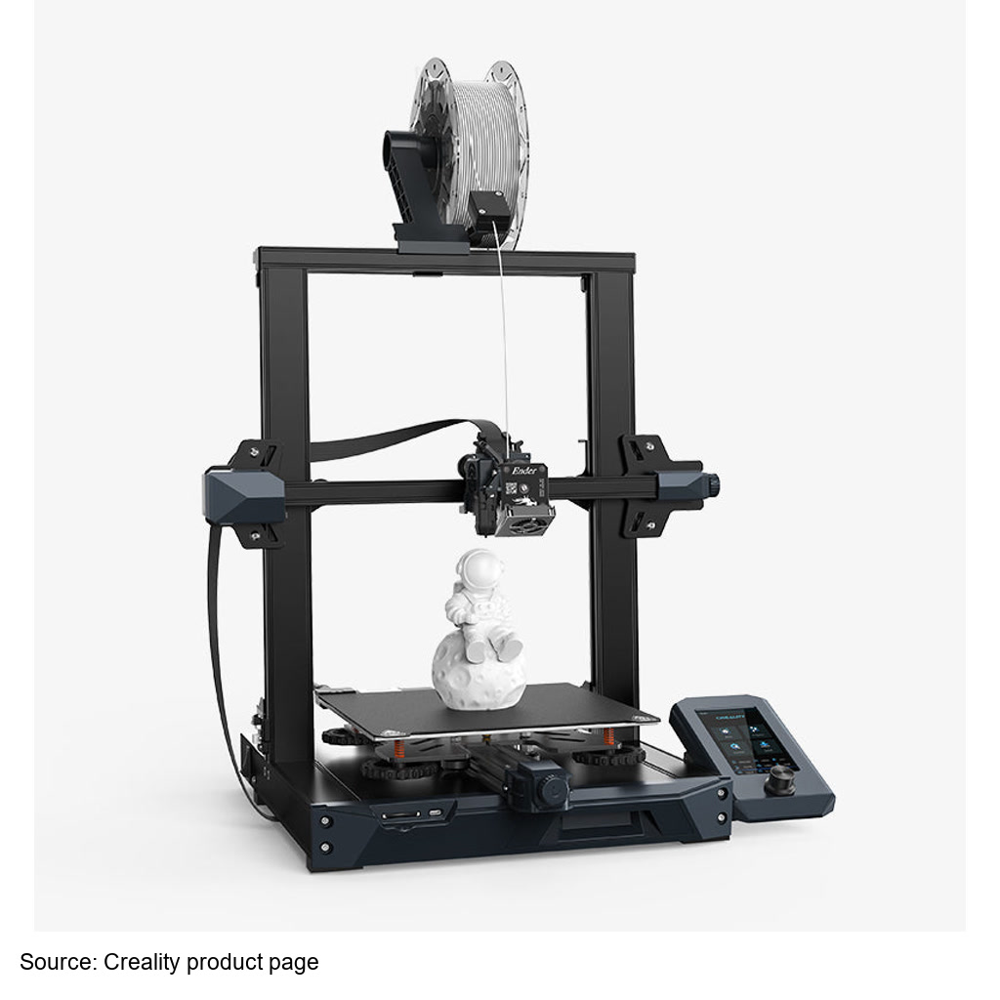

<!-- oomp-documentation:start -->
# Creality Ender-3 S1

[Open catalogue record](http://localhost:5703/parts/three_d_printer_printer_creality_ender_3_s1) · [Creality model reference](https://store.creality.com/ca/blogs/all/ender-series-3d-printers-parameter-comparison)

## Summary

Creality Ender-3 S1 filament printer.



Creality Ender-3 S1 shown on its product page. [Creality Ender-3 S1 product image](https://store.creality.com/ca/products/ender-3-s1-3d-printer) by Photographer uncredited on Creality product page. [Product image, reuse permission unverified](https://store.creality.com/ca/products/ender-3-s1-3d-printer). Resized within a square white canvas and credited on the image.

## Details

OOMP ID `three_d_printer_printer_creality_ender_3_s1`

| Specification | Value |
| --- | --- |
| Build volume (X × Y × Z, mm) | 220 × 220 × 270 |
| Product dimensions (manufacturer order, mm) | 487 × 453 × 622 |
| Max bed (°C) | 100 |
| Max hotend (°C) | 260 |
| Net mass (kg) | 9.1 |
| Release month | 2021-12 |

Sources checked 2026-11-18.


| Taxonomy slot | Value |
| --- | --- |
| 1 | `three_d_printer` |
| 2 | `printer` |
| 14 | `creality` |
| 15 | `ender_3_s1` |

## Labels

| Layout | Stock (mm) | Files |
| --- | --- | --- |
| OOMP inventory | 76.2 × 50.8 | [SVG](label_oomp.svg) · [Print PDF](label_oomp.pdf) |
| Stock | 76.2 × 50.8 | [SVG](label_stock_3x2.svg) · [Print PDF](label_stock_3x2.pdf) |
| Stock | 38.1 × 25.4 | [SVG](label_stock_1_5x1.svg) · [Print PDF](label_stock_1_5x1.pdf) |
| Drawer | 38.1 × 25.4 | [SVG](label_drawer.svg) · [Print PDF](label_drawer.pdf) |
| Compact barcode | 30 × 15 | [SVG](label_30x15.svg) · [Print PDF](label_30x15.pdf) |

## Parts

[Browse this category](../../navigation/printer/creality/README.md) · [Canonical metadata](working.yaml) · [Catalogue](../../README.md)


## Assembly

Use the model-specific manufacturer documentation linked above for setup or service.

<details>
<summary>Full OOMP metadata</summary>

```yaml
link_main: https://github.com/oomlout/oomp_three_d_printer_version_5/tree/main/parts/three_d_printer_printer_creality_ender_3_s1
link_source: https://store.creality.com/ca/blogs/all/ender-series-3d-printers-parameter-comparison
link_web: http://localhost:5703/parts/three_d_printer_printer_creality_ender_3_s1
name_proper: Creality Ender-3 S1
oomp_id: three_d_printer_printer_creality_ender_3_s1
photo:
  caption: Creality Ender-3 S1 shown on its product page.
  changes: Resized within a square white canvas and credited on the image.
  creator: Photographer uncredited on Creality product page
  credit_line: 'Source: Creality product page'
  file: source_file/images/printer_ender_3_s1_square.jpg
  license: Product image, reuse permission unverified
  license_url: https://store.creality.com/ca/products/ender-3-s1-3d-printer
  original_file: source_file/images/original/printer_ender_3_s1.jpg
  original_image_url: https://cdn.shopify.com/s/files/1/0911/3233/0284/files/0305366fdcdcbbfd653733311d882de3_4d1d511a-c7c8-40ec-b346-b08ed949f23d.jpg?v=1742443574
  source: https://store.creality.com/ca/products/ender-3-s1-3d-printer
  source_checked: '2026-11-19'
  title: Creality Ender-3 S1 product image
source_checked: '2026-11-18'
sources:
  Creality model reference: https://store.creality.com/ca/blogs/all/ender-series-3d-printers-parameter-comparison
specifications:
  build_volume_mm:
  - 220
  - 220
  - 270
  machine_dimensions_mm:
  - 487
  - 453
  - 622
  max_bed_c: 100
  max_hotend_c: 260
  net_mass_kg: 9.1
  release_month: 2021-12
taxonomy_1: three_d_printer
taxonomy_10: ''
taxonomy_11: ''
taxonomy_12: ''
taxonomy_13: ''
taxonomy_14: creality
taxonomy_15: ender_3_s1
taxonomy_2: printer
taxonomy_3: ''
taxonomy_4: ''
taxonomy_5: ''
taxonomy_6: ''
taxonomy_7: ''
taxonomy_8: ''
taxonomy_9: ''
taxonomy_1_upper: THREE_D_PRINTER
taxonomy_1_upper_length_1: T
taxonomy_1_upper_length_2: TH
taxonomy_1_upper_length_3: THR
taxonomy_1_upper_length_4: THRE
taxonomy_1_upper_length_5: THREE
taxonomy_1_length_1: t
taxonomy_1_length_2: th
taxonomy_1_length_3: thr
taxonomy_1_length_4: thre
taxonomy_1_length_5: three
taxonomy_1_capital: Three D Printer
taxonomy_1_first_letter: t
taxonomy_1_first_letter_upper: T
taxonomy_2_upper: PRINTER
taxonomy_2_upper_length_1: P
taxonomy_2_upper_length_2: PR
taxonomy_2_upper_length_3: PRI
taxonomy_2_upper_length_4: PRIN
taxonomy_2_upper_length_5: PRINT
taxonomy_2_length_1: p
taxonomy_2_length_2: pr
taxonomy_2_length_3: pri
taxonomy_2_length_4: prin
taxonomy_2_length_5: print
taxonomy_2_capital: Printer
taxonomy_2_first_letter: p
taxonomy_2_first_letter_upper: P
taxonomy_14_upper: CREALITY
taxonomy_14_upper_length_1: C
taxonomy_14_upper_length_2: CR
taxonomy_14_upper_length_3: CRE
taxonomy_14_upper_length_4: CREA
taxonomy_14_upper_length_5: CREAL
taxonomy_14_length_1: c
taxonomy_14_length_2: cr
taxonomy_14_length_3: cre
taxonomy_14_length_4: crea
taxonomy_14_length_5: creal
taxonomy_14_capital: Creality
taxonomy_14_first_letter: c
taxonomy_14_first_letter_upper: C
taxonomy_15_upper: ENDER_3_S1
taxonomy_15_upper_length_1: E
taxonomy_15_upper_length_2: EN
taxonomy_15_upper_length_3: END
taxonomy_15_upper_length_4: ENDE
taxonomy_15_upper_length_5: ENDER
taxonomy_15_length_1: e
taxonomy_15_length_2: en
taxonomy_15_length_3: end
taxonomy_15_length_4: ende
taxonomy_15_length_5: ender
taxonomy_15_capital: Ender 3 S1
taxonomy_15_first_letter: e
taxonomy_15_first_letter_upper: E
id: three_d_printer_printer_creality_ender_3_s1
id_no_class: three_d_printer_printer_creality_ender_3_s1
id_no_type: three_d_printer_printer_creality_ender_3_s1
id_no_size: three_d_printer_printer_creality_ender_3_s1
oomp_key: oomp_three_d_printer_printer_creality_ender_3_s1
link_github: https://github.com/oomlout/oomp_three_d_printer_version_5/tree/main/parts/three_d_printer_printer_creality_ender_3_s1
link_redirect: https://github.com/oomlout/oomp_three_d_printer_version_5/tree/main/parts/three_d_printer_printer_creality_ender_3_s1
directory: parts/three_d_printer_printer_creality_ender_3_s1
name: Three D Printer Printer Creality Ender 3 S1
name_no_class: Three D Printer Printer Creality Ender 3 S1
name_no_type: Three D Printer Printer Creality Ender 3 S1
name_no_size: Three D Printer Printer Creality Ender 3 S1
md5: 849ffe474ee74ed29968e5242890b588
md5_5: 849ff
md5_5_upper: 849FF
md5_6: 849ffe
md5_6_upper: 849FFE
md5_6_alpha: 56ake
md5_6_alpha_upper: 56AKE
md5_10: 849ffe474e
md5_10_upper: 849FFE474E
bip_39_full_array:
- loyal
- zoo
- mushroom
- oven
- insane
- harsh
- grant
- bronze
- category
- duty
- coin
- balance
bip_39_full_space: loyal zoo mushroom oven insane harsh grant bronze category duty
  coin balance
bip_39_full_no_space: loyalzoomushroomoveninsaneharshgrantbronzecategorydutycoinbalance
bip_39_full_underscore: loyal_zoo_mushroom_oven_insane_harsh_grant_bronze_category_duty_coin_balance
bip_39_2_word_array:
- loyal
- zoo
bip_39_2_word_space: loyal zoo
bip_39_2_word_no_space: loyalzoo
bip_39_2_word_underscore: loyal_zoo
bip_39_3_word_array:
- loyal
- zoo
- mushroom
bip_39_3_word_space: loyal zoo mushroom
bip_39_3_word_no_space: loyalzoomushroom
bip_39_3_word_underscore: loyal_zoo_mushroom
label_title: ENDER 3 S1
label_barcode: M0,0h34v760h-34z M136,0h34v760h-34z M204,0h102v760h-102z M340,0h102v760h-102z
  M476,0h34v760h-34z M544,0h102v760h-102z M680,0h34v760h-34z M816,0h102v760h-102z
  M952,0h34v760h-34z M1020,0h34v760h-34z M1088,0h34v760h-34z M1156,0h102v760h-102z
  M1360,0h102v760h-102z M1496,0h34v760h-34z M1564,0h34v760h-34z M1632,0h102v760h-102z
  M1768,0h34v760h-34z M1836,0h34v760h-34z M1972,0h34v760h-34z M2040,0h102v760h-102z
  M2176,0h102v760h-102z M2312,0h34v760h-34z M2380,0h34v760h-34z M2448,0h34v760h-34z
  M2584,0h102v760h-102z M2720,0h102v760h-102z M2856,0h34v760h-34z M2924,0h102v760h-102z
  M3128,0h34v760h-34z M3196,0h34v760h-34z M3264,0h34v760h-34z M3400,0h34v760h-34z
  M3468,0h102v760h-102z M3604,0h102v760h-102z M3740,0h34v760h-34z
label_barcode_width: 3774
label_maker: Creality
label_family: Printer
label_detail: 220 x 220 x 270
label_variant: Build volume (mm)
label_context: Creality
inventory_title_size: 14
stock_title_size: 5.3
drawer_title_size: 3.3
compact_title_size: 2.8
oomlout_ai_roboclick_1:
  actions:
  - command: text_jinja_template
    file_template: source_file/template_jinja/template_jinja_label_oomlout_76_2_mm_50_8_mm/working.svg.j2
    file_output: label_oomp.svg
    convert_to_pdf: true
    convert_to_png: false
  - command: text_jinja_template
    file_template: source_file/template_jinja/label_stock/3x2.svg.j2
    file_output: label_stock_3x2.svg
    convert_to_pdf: true
    convert_to_png: false
  - command: text_jinja_template
    file_template: source_file/template_jinja/label_stock/1_5x1.svg.j2
    file_output: label_stock_1_5x1.svg
    convert_to_pdf: true
    convert_to_png: false
  - command: text_jinja_template
    file_template: source_file/template_jinja/label_drawer/working.svg.j2
    file_output: label_drawer.svg
    convert_to_pdf: true
    convert_to_png: false
  - command: text_jinja_template
    file_template: source_file/template_jinja/label_printer_30x15/working.svg.j2
    file_output: label_30x15.svg
    convert_to_pdf: true
    convert_to_png: false
  file_test: ''
  retries_until_complete: 0
  action_name: step_0_jinja_template_label_oomp.svg
```

</details>
<!-- oomp-documentation:end -->
