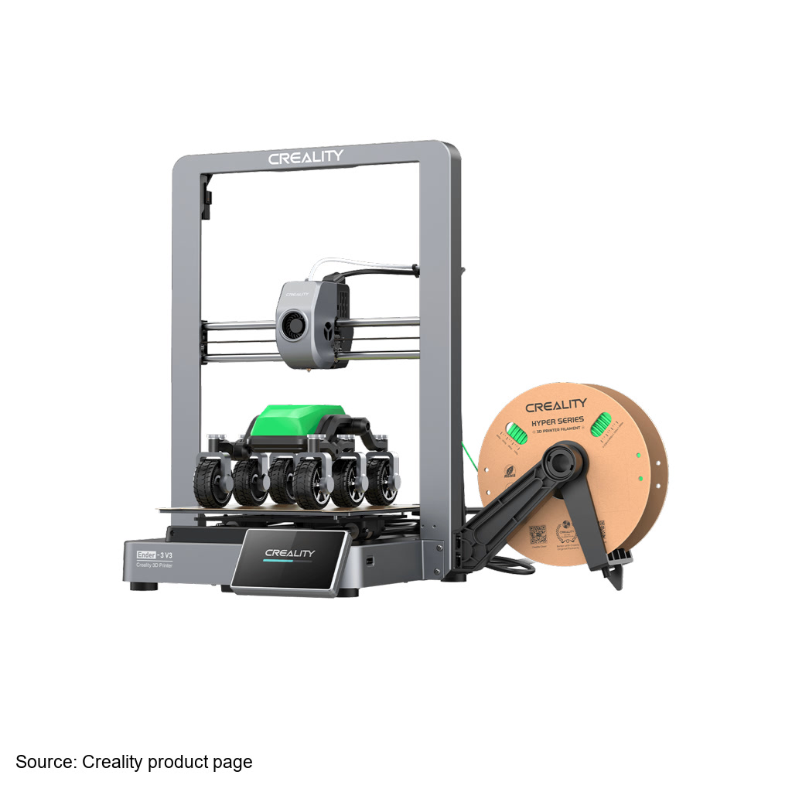

<!-- oomp-documentation:start -->
# Creality Ender-3 V3

[Open catalogue record](http://localhost:5703/parts/three_d_printer_printer_creality_ender_3_v3) · [Creality V3 series comparison](https://store.creality.com/uk/blogs/tutorial/ender-3-v3-vs-v3-se-vs-v3-ke)

## Summary

Creality Ender-3 V3 filament printer.



Creality Ender-3 V3 shown on its product page. [Creality Ender-3 V3 product image](https://store.creality.com/products/ender-3-v3-corexz-3d-printer) by Photographer uncredited on Creality product page. [Product image, reuse permission unverified](https://store.creality.com/products/ender-3-v3-corexz-3d-printer). Resized within a square white canvas and credited on the image.

## Details

OOMP ID `three_d_printer_printer_creality_ender_3_v3`

| Specification | Value |
| --- | --- |
| Build volume (X × Y × Z, mm) | 220 × 220 × 250 |
| Filament diameter (mm) | 1.75 |
| Product dimensions (manufacturer order, mm) | 358 × 374 × 498 |
| Max hotend (°C) | 300 |
| Motion system | CoreXZ |
| Net mass (kg) | 7.83 |
| Release month | 2024-02 |
| Stock nozzle (mm) | 0.4 |

Sources checked 2026-11-18.

- [Creality model reference](https://www.creality.com/compare/compare-ender-3-v3-series)

| Taxonomy slot | Value |
| --- | --- |
| 1 | `three_d_printer` |
| 2 | `printer` |
| 14 | `creality` |
| 15 | `ender_3_v3` |

## Labels

| Layout | Stock (mm) | Files |
| --- | --- | --- |
| OOMP inventory | 76.2 × 50.8 | [SVG](label_oomp.svg) · [Print PDF](label_oomp.pdf) |
| Stock | 76.2 × 50.8 | [SVG](label_stock_3x2.svg) · [Print PDF](label_stock_3x2.pdf) |
| Stock | 38.1 × 25.4 | [SVG](label_stock_1_5x1.svg) · [Print PDF](label_stock_1_5x1.pdf) |
| Drawer | 38.1 × 25.4 | [SVG](label_drawer.svg) · [Print PDF](label_drawer.pdf) |
| Compact barcode | 30 × 15 | [SVG](label_30x15.svg) · [Print PDF](label_30x15.pdf) |

## Parts

[Browse this category](../../navigation/printer/creality/README.md) · [Canonical metadata](working.yaml) · [Catalogue](../../README.md)


## Assembly

Use the model-specific manufacturer documentation linked above for setup or service.

<details>
<summary>Full OOMP metadata</summary>

```yaml
link_main: https://github.com/oomlout/oomp_three_d_printer_version_5/tree/main/parts/three_d_printer_printer_creality_ender_3_v3
link_source: https://store.creality.com/uk/blogs/tutorial/ender-3-v3-vs-v3-se-vs-v3-ke
link_web: http://localhost:5703/parts/three_d_printer_printer_creality_ender_3_v3
name_proper: Creality Ender-3 V3
oomp_id: three_d_printer_printer_creality_ender_3_v3
photo:
  caption: Creality Ender-3 V3 shown on its product page.
  changes: Resized within a square white canvas and credited on the image.
  creator: Photographer uncredited on Creality product page
  credit_line: 'Source: Creality product page'
  file: source_file/images/printer_ender_3_v3_square.jpg
  license: Product image, reuse permission unverified
  license_url: https://store.creality.com/products/ender-3-v3-corexz-3d-printer
  original_file: source_file/images/original/printer_ender_3_v3.png
  original_image_url: https://cdn.shopify.com/s/files/1/0893/0603/8637/files/Ender-3_V3.png?v=1762200441
  source: https://store.creality.com/products/ender-3-v3-corexz-3d-printer
  source_checked: '2026-11-19'
  title: Creality Ender-3 V3 product image
source_checked: '2026-11-18'
sources:
  Creality V3 series comparison: https://store.creality.com/uk/blogs/tutorial/ender-3-v3-vs-v3-se-vs-v3-ke
  Creality model reference: https://www.creality.com/compare/compare-ender-3-v3-series
specifications:
  build_volume_mm:
  - 220
  - 220
  - 250
  filament_diameter_mm: 1.75
  machine_dimensions_mm:
  - 358
  - 374
  - 498
  max_hotend_c: 300
  motion_system: CoreXZ
  net_mass_kg: 7.83
  release_month: 2024-02
  stock_nozzle_mm: 0.4
taxonomy_1: three_d_printer
taxonomy_10: ''
taxonomy_11: ''
taxonomy_12: ''
taxonomy_13: ''
taxonomy_14: creality
taxonomy_15: ender_3_v3
taxonomy_2: printer
taxonomy_3: ''
taxonomy_4: ''
taxonomy_5: ''
taxonomy_6: ''
taxonomy_7: ''
taxonomy_8: ''
taxonomy_9: ''
taxonomy_1_upper: THREE_D_PRINTER
taxonomy_1_upper_length_1: T
taxonomy_1_upper_length_2: TH
taxonomy_1_upper_length_3: THR
taxonomy_1_upper_length_4: THRE
taxonomy_1_upper_length_5: THREE
taxonomy_1_length_1: t
taxonomy_1_length_2: th
taxonomy_1_length_3: thr
taxonomy_1_length_4: thre
taxonomy_1_length_5: three
taxonomy_1_capital: Three D Printer
taxonomy_1_first_letter: t
taxonomy_1_first_letter_upper: T
taxonomy_2_upper: PRINTER
taxonomy_2_upper_length_1: P
taxonomy_2_upper_length_2: PR
taxonomy_2_upper_length_3: PRI
taxonomy_2_upper_length_4: PRIN
taxonomy_2_upper_length_5: PRINT
taxonomy_2_length_1: p
taxonomy_2_length_2: pr
taxonomy_2_length_3: pri
taxonomy_2_length_4: prin
taxonomy_2_length_5: print
taxonomy_2_capital: Printer
taxonomy_2_first_letter: p
taxonomy_2_first_letter_upper: P
taxonomy_14_upper: CREALITY
taxonomy_14_upper_length_1: C
taxonomy_14_upper_length_2: CR
taxonomy_14_upper_length_3: CRE
taxonomy_14_upper_length_4: CREA
taxonomy_14_upper_length_5: CREAL
taxonomy_14_length_1: c
taxonomy_14_length_2: cr
taxonomy_14_length_3: cre
taxonomy_14_length_4: crea
taxonomy_14_length_5: creal
taxonomy_14_capital: Creality
taxonomy_14_first_letter: c
taxonomy_14_first_letter_upper: C
taxonomy_15_upper: ENDER_3_V3
taxonomy_15_upper_length_1: E
taxonomy_15_upper_length_2: EN
taxonomy_15_upper_length_3: END
taxonomy_15_upper_length_4: ENDE
taxonomy_15_upper_length_5: ENDER
taxonomy_15_length_1: e
taxonomy_15_length_2: en
taxonomy_15_length_3: end
taxonomy_15_length_4: ende
taxonomy_15_length_5: ender
taxonomy_15_capital: Ender 3 V3
taxonomy_15_first_letter: e
taxonomy_15_first_letter_upper: E
id: three_d_printer_printer_creality_ender_3_v3
id_no_class: three_d_printer_printer_creality_ender_3_v3
id_no_type: three_d_printer_printer_creality_ender_3_v3
id_no_size: three_d_printer_printer_creality_ender_3_v3
oomp_key: oomp_three_d_printer_printer_creality_ender_3_v3
link_github: https://github.com/oomlout/oomp_three_d_printer_version_5/tree/main/parts/three_d_printer_printer_creality_ender_3_v3
link_redirect: https://github.com/oomlout/oomp_three_d_printer_version_5/tree/main/parts/three_d_printer_printer_creality_ender_3_v3
directory: parts/three_d_printer_printer_creality_ender_3_v3
name: Three D Printer Printer Creality Ender 3 V3
name_no_class: Three D Printer Printer Creality Ender 3 V3
name_no_type: Three D Printer Printer Creality Ender 3 V3
name_no_size: Three D Printer Printer Creality Ender 3 V3
md5: cc4d38ff0005950fb7ce0f2d26ade05e
md5_5: cc4d3
md5_5_upper: CC4D3
md5_6: cc4d38
md5_6_upper: CC4D38
md5_6_alpha: 7yz3s
md5_6_alpha_upper: 7YZ3S
md5_10: cc4d38ff00
md5_10_upper: CC4D38FF00
bip_39_full_array:
- slush
- hawk
- divert
- abandon
- flock
- march
- tennis
- sea
- coffee
- cube
- job
- rose
bip_39_full_space: slush hawk divert abandon flock march tennis sea coffee cube job
  rose
bip_39_full_no_space: slushhawkdivertabandonflockmarchtennisseacoffeecubejobrose
bip_39_full_underscore: slush_hawk_divert_abandon_flock_march_tennis_sea_coffee_cube_job_rose
bip_39_2_word_array:
- slush
- hawk
bip_39_2_word_space: slush hawk
bip_39_2_word_no_space: slushhawk
bip_39_2_word_underscore: slush_hawk
bip_39_3_word_array:
- slush
- hawk
- divert
bip_39_3_word_space: slush hawk divert
bip_39_3_word_no_space: slushhawkdivert
bip_39_3_word_underscore: slush_hawk_divert
label_title: ENDER 3 V3
label_barcode: M0,0h34v760h-34z M136,0h34v760h-34z M204,0h102v760h-102z M340,0h102v760h-102z
  M476,0h34v760h-34z M544,0h34v760h-34z M612,0h34v760h-34z M748,0h34v760h-34z M816,0h102v760h-102z
  M952,0h102v760h-102z M1088,0h102v760h-102z M1292,0h34v760h-34z M1360,0h102v760h-102z
  M1496,0h34v760h-34z M1564,0h34v760h-34z M1632,0h34v760h-34z M1768,0h102v760h-102z
  M1904,0h102v760h-102z M2040,0h34v760h-34z M2108,0h34v760h-34z M2176,0h102v760h-102z
  M2312,0h102v760h-102z M2516,0h34v760h-34z M2584,0h34v760h-34z M2652,0h34v760h-34z
  M2720,0h34v760h-34z M2788,0h102v760h-102z M2924,0h34v760h-34z M2992,0h102v760h-102z
  M3196,0h34v760h-34z M3264,0h34v760h-34z M3400,0h34v760h-34z M3468,0h102v760h-102z
  M3604,0h102v760h-102z M3740,0h34v760h-34z
label_barcode_width: 3774
label_maker: Creality
label_family: Printer
label_detail: 220 x 220 x 250
label_variant: Build volume (mm)
label_context: Creality
inventory_title_size: 14
stock_title_size: 5.3
drawer_title_size: 3.3
compact_title_size: 2.8
oomlout_ai_roboclick_1:
  actions:
  - command: text_jinja_template
    file_template: source_file/template_jinja/template_jinja_label_oomlout_76_2_mm_50_8_mm/working.svg.j2
    file_output: label_oomp.svg
    convert_to_pdf: true
    convert_to_png: false
  - command: text_jinja_template
    file_template: source_file/template_jinja/label_stock/3x2.svg.j2
    file_output: label_stock_3x2.svg
    convert_to_pdf: true
    convert_to_png: false
  - command: text_jinja_template
    file_template: source_file/template_jinja/label_stock/1_5x1.svg.j2
    file_output: label_stock_1_5x1.svg
    convert_to_pdf: true
    convert_to_png: false
  - command: text_jinja_template
    file_template: source_file/template_jinja/label_drawer/working.svg.j2
    file_output: label_drawer.svg
    convert_to_pdf: true
    convert_to_png: false
  - command: text_jinja_template
    file_template: source_file/template_jinja/label_printer_30x15/working.svg.j2
    file_output: label_30x15.svg
    convert_to_pdf: true
    convert_to_png: false
  file_test: ''
  retries_until_complete: 0
  action_name: step_0_jinja_template_label_oomp.svg
```

</details>
<!-- oomp-documentation:end -->
